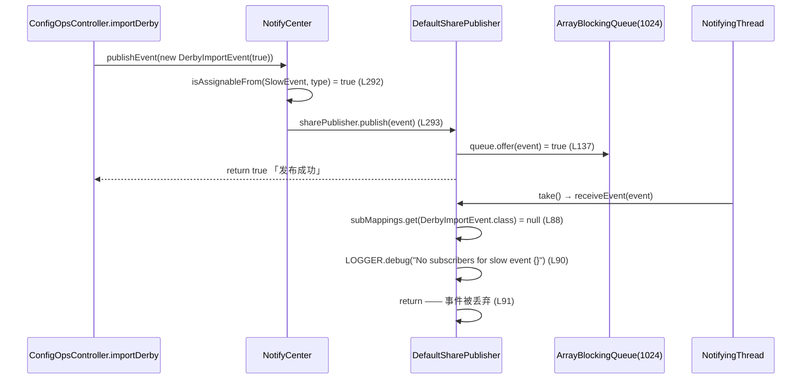

我来查证 `DerbyImportEvent` 的全部引用点与订阅方。

已确认引用面：6 处 `registerToSharePublisher` + 2 处 `publishEvent`，**零处 `registerSubscriber`**。继续核实事件定义与 `dataImport` 的真实收尾路径。

定位 `NotifyCenter` 与两个 `dataImport` 实现，确认导入完成后真正的收尾逻辑。

`registerToSharePublisher` L315-317 只是 `return INSTANCE.sharePublisher;`——这很关键。再核实发布端与空订阅者行为。

核对 `DefaultSharePublisher.publish` 在无订阅者时的具体行为。

核心结论已成形。再补齐"实际生效的收尾机制"这块证据。

已取证完毕。结论明确：**没有任何处理器，事件发布后会被静默丢弃。**

---

## 一、结论

`DerbyImportEvent` 在当前 master 上是一个**只发不收**的"孤儿事件"：

- 全仓 19 处引用中，`publishEvent` 有 2 处，**`registerSubscriber` / `Subscriber<DerbyImportEvent>` / `SmartSubscriber.subscribeTypes()` 有 0 处**。
- 那 6 处 `NotifyCenter.registerToSharePublisher(DerbyImportEvent.class)` **不是订阅**，而且它连"注册"这个动作本身都没做（见下）。
- 事件实例进入 `sharePublisher` 的队列后被消费线程取出，因 `subMappings` 查不到该类型而直接 `return`，**且日志级别是 debug**——默认配置下你连一行痕迹都看不到。

## 二、`DerbyImportEvent` 的全部引用面（穷尽）

| 位置 | 类型 | 说明 |
|---|---|---|
| `persistence/.../model/event/DerbyImportEvent.java` L26/L32 | 类定义 | `extends SlowEvent`，只有一个 `boolean finished` |
| `config/.../controller/ConfigOpsController.java` L154 | **publish**(`finished=false`) | 上传落盘后、导入任务提交前 |
| `config/.../controller/ConfigOpsController.java` L156 | **publish**(`finished=true`) | `whenComplete` 的第一行，成功/失败都会发 |
| `EmbeddedConfigInfoPersistServiceImpl` L157 | `registerToSharePublisher` | 忽略返回值 |
| `EmbeddedConfigInfoBetaPersistServiceImpl` L84 | `registerToSharePublisher` | 同上 |
| `EmbeddedConfigInfoGrayPersistServiceImpl` L104 | `registerToSharePublisher` | 同上 |
| `EmbeddedConfigInfoTagPersistServiceImpl` L84 | `registerToSharePublisher` | 同上 |
| `EmbeddedHistoryConfigInfoPersistServiceImpl` L83 | `registerToSharePublisher` | 同上 |
| `core/.../namespace/repository/EmbeddedNamespacePersistServiceImpl` L71 | `registerToSharePublisher` | 同上 |
| `persistence/src/test/.../EventTest.java` L29-30 | 单元测试 | 只 `new` + 断言 `isFinished()`，不验证任何行为 |
| （其余 6 处为 `import` 语句） | — | — |

**消费方：0。**

## 三、为什么 `registerToSharePublisher` 那 6 行不构成"处理器"

这是最容易误判的一点。看它的实现：

```java
// common/.../notify/NotifyCenter.java  L315-L317
public static EventPublisher registerToSharePublisher(final Class<? extends SlowEvent> eventType) {
    return INSTANCE.sharePublisher;   // ← 全文就这一行，eventType 参数完全没被使用
}
```

三重无效：

1. **参数被忽略**——`eventType` 没有进入任何 Map/Set，不建立 `<DerbyImportEvent, ...>` 的映射。
2. **返回值被丢弃**——6 个调用点全部写成裸语句 `NotifyCenter.registerToSharePublisher(DerbyImportEvent.class);`。这个方法的设计意图是**返回 publisher 实例给你自己用**（老写法是拿到引用后再手工 `addSubscriber`），光调用它没有任何意义。
3. **sharePublisher 不需要业务方注册**——它在类加载的 static 块里就已建好：

```java
// NotifyCenter L68-L102
shareBufferSize = Integer.getInteger("nacos.core.notify.share-buffer-size", 1024);
...
INSTANCE.sharePublisher = new DefaultSharePublisher();
INSTANCE.sharePublisher.init(SlowEvent.class, shareBufferSize);
```

所以这 6 处调用是**纯粹的遗留死代码**，删掉不改变任何行为。唯一能让 `subMappings` 出现 key 的入口只有 `registerSubscriber` → `sharePublisher.addSubscriber(consumer, subscribeType)`（L177-L190），而这条路径上没有任何人订阅 `DerbyImportEvent`。

## 四、事件的实际生命周期：入队成功 → 出队 → 丢弃



三个关键细节：

```java
// DefaultPublisher.publish L135-L144 —— 不检查有无订阅者，入队即返回 true
public boolean publish(Event event) {
    checkIsStart();
    boolean success = this.queue.offer(event);
    if (!success) {                       // 队列满也不丢，转为同步调用
        LOGGER.warn("Unable to plug in due to interruption, synchronize sending time, event : {}", event);
        receiveEvent(event);              // ← 仍然走到下面的丢弃分支
        return true;
    }
    return true;
}
```

```java
// DefaultSharePublisher.receiveEvent L81-L92 —— 精确 class 查找，无父类兜底
final Class<? extends SlowEvent> slowEventType = (Class<? extends SlowEvent>) event.getClass();
Set<Subscriber> subscribers = subMappings.get(slowEventType);
if (null == subscribers) {
    LOGGER.debug("[NotifyCenter] No subscribers for slow event {}", slowEventType.getName());
    return;                                // ★ 唯一的"处理"
}
```

- **连一条 warn 都不会有**：普通事件在无 publisher 时会打 `LOGGER.warn("There are no [{}] publishers for this event, please register")`（L305），但 SlowEvent 分支在 L292-293 就提前 return 了，绕过该检查。
- **不存在"订阅父类 `SlowEvent`/`Event` 来兜底"的可能**：`subMappings` 用 `event.getClass()` 精确匹配 key，不做 `isAssignableFrom` 遍历。
- **队列满时也照样丢弃**：降级成同步 `receiveEvent`，走的还是同一个 null 分支。

## 五、那 `importDerby` 的收尾靠什么？

没人处理这个事件，接口依然工作正常——因为**三件事全部另有路径**：

| 关注点 | 真实实现 | 与 DerbyImportEvent 的关系 |
|---|---|---|
| HTTP 响应 | `DeferredResult` + `future.whenComplete` 里 `response.setResult(...)`（L157-L161） | 完全无关，直接回调 |
| 数据落到各节点 Derby | Distributed：`protocol.writeAsync(WriteRequest + DATA_IMPORT_KEY)`（L399-L402）→ 每节点 `onApply` L529-L530 → `doDataImport` → `batchUpdate`（`BaseDatabaseOperate` L268-L273） | 走 raft 复制，不靠事件 |
| 本地读缓存（`CacheItem`）刷新 | `EmbeddedApplyHook` → `ConfigDumpEvent` → `DumpConfigHandler` | **也不走**：见下方坑 2 |

即：`DerbyImportEvent` 的 `finished` 布尔位、`false`/`true` 两次发布、6 处 sharePublisher 注册，**在当前版本没有任何代码消费**。从命名（`finished` 的两个阶段）推测，原意大概是"导入开始 → 暂停某些后台任务/读降级；导入结束 → 触发全量 dump 并恢复"，但这套逻辑在本仓没有对应实现，只留下了发布端。

## 六、关键点

1. **`SlowEvent` 的子类天然"有 publisher、没 subscriber"**——`sharePublisher` 是全局共享、类加载即启动的，所以发布一定"成功"，不会像普通事件那样给出 `please register` 的 warn。这是这类孤儿事件能长期潜伏而不被发现的根本原因。
2. **判断"有没有人处理某事件"的正确方法**：不是看 `registerToSharePublisher`/`registerToPublisher`（那是发布端准备），而是**只搜 `registerSubscriber` + `SmartSubscriber.subscribeTypes()` 里是否出现该类型**。Nacos 里大量 `registerToPublisher(X.class, size)` 只是给事件建队列，消费方可能在别处；反之 `registerToSharePublisher` 在本版本连队列都不建。
3. **`registerToSharePublisher(eventType)` 语义是"取回共享慢事件 publisher 的引用"**，参数只是签名装饰（且方法签名限定 `Class<? extends SlowEvent>`，纯粹为类型安全）。忽略返回值 = 空操作。
4. **同一作者遗留的对称模式**：`EmbeddedConfigDumpApplyHook` 构造函数里 `registerToPublisher(ConfigDumpEvent.class, ...)` + `registerSubscriber(new DumpConfigHandler())` 是**正确配对**的写法（L43-L44），可作为对照样本——凡是只有前者没有后者的，都值得怀疑。
5. **导入路径不经过 `EmbeddedApplyHook` 的 dump 分支**（`onApply` 的 `if/else`，L529-L542），这一点比"事件无人处理"更影响实际使用体验。

## 七、坑

1. **误以为导入后配置已生效**：`importDerby` 返回 200 只代表 SQL 批量执行成功（`doDataImport` 的 `affect.length == requests.size()`），**不代表服务端读缓存已更新**。
2. **导入不会触发即时 dump**：`onApply` 里 `DATA_IMPORT_KEY` 分支直接 `doDataImport` 并 return，`PersistenceExecutor.executeEmbeddedDump(...)` + hooks 的调用写在 **else 分支**（L537-L541）；且 `dataImport` 构造的 `WriteRequest` 只 `putExtendInfo(DATA_IMPORT_KEY)`（L402），没有 `EXTEND_INFO_CONFIG_DUMP_EVENT`。两条 dump 驱动路径都被绕开 → 缓存要等下一次 `DumpAllProcessorRunner`（`DUMP_ALL_INTERVAL_IN_MINUTE = 360`）或重启（走上一轮分析的 `EmbeddedDumpService#init` 事件链）才刷新。**这也是实践上普遍建议"导入后重启节点"的真实原因**，而不是因为那个事件。
3. **想加处理器时容易踩的静默失败**：若你写一个 `Subscriber` 但 `subscribeType()` 返回父类 `SlowEvent.class`，仍然收不到（`subMappings` 精确匹配）。必须返回 `DerbyImportEvent.class`。
4. **`finished=false` 事件的发布点在 `WebUtils.onFileUpload` 回调内**（L153-L154），而 `finished=true` 在 `whenComplete`；若上传阶段本身失败，第二个事件不会发出，`DeferredResult` 由 `onFileUpload` 内部处理。目前因为无人消费所以无副作用，但**一旦你补上"导入开始置标志 / 导入结束清标志"的订阅者，就必须考虑这条非对称路径**（建议用 `try/finally` 或把 `finished=true` 移到更靠后的统一出口）。

## 八、总结

**没有处理器。** `DerbyImportEvent` 在当前代码库是纯粹的遗留发布端：`ConfigOpsController#importDerby` 发了两个实例（`finished=false` / `finished=true`），全仓没有任何 `registerSubscriber` 或 `SmartSubscriber` 订阅它；实例进入 `sharePublisher` 的 1024 容量队列，被消费线程取出后在 `DefaultSharePublisher#receiveEvent` 因 `subMappings.get(...) == null` 直接 return，只留一行 debug 日志。

那 6 处看起来像"注册了处理逻辑"的 `NotifyCenter.registerToSharePublisher(DerbyImportEvent.class)` 是**空操作**——方法体只有 `return INSTANCE.sharePublisher;`，既不使用传入的类型参数，返回值也被调用方丢弃。它们与 5 个 `Embedded*PersistServiceImpl` 的构造期初始化混在一起，属于历史重构（早期版本用返回值再挂 subscriber）未清理干净的残留。

功能上不影响导入的正确性：响应靠 `DeferredResult`，数据一致性靠 raft 复制（`DATA_IMPORT_KEY` → `onApply` → `doDataImport`）。但要注意**真正有实际影响的缺口是导入路径绕开了 `EmbeddedApplyHook` 的 dump 分支**，导致导入后不会即时刷新服务端读缓存——需要等下一次 360 分钟的全量 dump 或重启才生效。如果你在排查"导入成功但查不到新配置"，方向应该是 dump 链（`DumpAllProcessor` / `EmbeddedDumpService#init`），而不是这个事件。