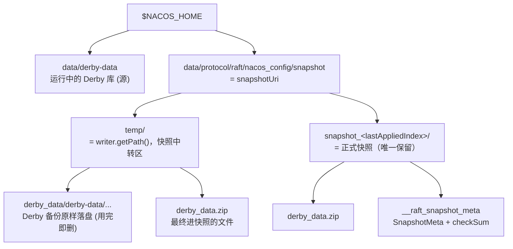

我先读取该文件及其依赖的工具类，确认备份路径与压缩细节。

继续确认 jraft 侧临时快照目录的命名与"提交后重命名"机制，以及 Nacos 的 raft 根路径与 writeLock 来源。

最后确认 jraft 创建快照存储时 temp 目录的来源，以及 Nacos 是否启用了共享快照存储/限流。

## 结论速览

`DerbySnapshotOperation.onSnapshotSave` 做的事只有一件：**把整个 Derby 库做一次在线物理热备，压成一个 `derby_data.zip` 放进 jraft 的快照临时目录，等 jraft 把这个临时目录原子改名成正式快照目录。**

- 触发者：jraft 的快照定时器 / 手动 `doSnapshot` 运维命令（不是 leader 专属，每个节点各自打）
- 执行线程：**不在 FSM 线程**，而是异步切到 `com.alibaba.nacos.persistence.embedded.snapshot` 单线程池
- 备份目录：`$NACOS_HOME/data/protocol/raft/nacos_config/snapshot/temp/derby_data/`（中转）→ 最终产物是 `.../snapshot/<derby_data.zip>` 和 `.../snapshot_N/derby_data.zip`
- 备份方式：`CALL SYSCS_UTIL.SYSCS_BACKUP_DATABASE(?)`（不是 SQL 导出，是 Derby 引擎级文件拷贝）

---

## 一、完整调用链与线程边界

```mermaid
sequenceDiagram
    participant T as "snapshotTimer (NodeImpl)"
    participant SE as "SnapshotExecutorImpl"
    participant F as "JRaft-FSMCaller-Disruptor (单线程)"我先读取该文件及其依赖的工具类，确认备份路径与压缩细节。

继续确认 jraft 侧临时快照目录的命名与"提交后重命名"机制，以及 Nacos 的 raft 根路径与 writeLock 来源。

最后确认 jraft 创建快照存储时 temp 目录的来源，以及 Nacos 是否启用了共享快照存储/限流。

## 结论速览

`DerbySnapshotOperation.onSnapshotSave` 做的事只有一件：**把整个 Derby 库做一次在线物理热备，压成一个 `derby_data.zip` 放进 jraft 的快照临时目录，等 jraft 把这个临时目录原子改名成正式快照目录。**

- 触发者：jraft 的快照定时器 / 手动 `doSnapshot` 运维命令（不是 leader 专属，每个节点各自打）
- 执行线程：**不在 FSM 线程**，而是异步切到 `com.alibaba.nacos.persistence.embedded.snapshot` 单线程池
- 备份目录：`$NACOS_HOME/data/protocol/raft/nacos_config/snapshot/temp/derby_data/`（中转）→ 最终产物是 `.../snapshot/<derby_data.zip>` 和 `.../snapshot_N/derby_data.zip`
- 备份方式：`CALL SYSCS_UTIL.SYSCS_BACKUP_DATABASE(?)`（不是 SQL 导出，是 Derby 引擎级文件拷贝）

---

## 一、完整调用链与线程边界

```mermaid
sequenceDiagram
    participant T as "snapshotTimer (NodeImpl)"
    participant SE as "SnapshotExecutorImpl"
    participant F as "JRaft-FSMCaller-Disruptor (单线程)"
    participant NS as "NacosStateMachine"
    participant SP as "embedded.snapshot (单线程池)"
    participant DB as "Derby"
    participant LS as "LocalSnapshotStorage"

    T->>SE: doSnapshot(done)
    SE->>SE: 六道闸门 (stopped/downloading/saving/index未推进/margin/create)
    SE->>SE: writer = snapshotStorage.create() 指向 snapshot/temp
    SE->>F: fsmCaller.onSnapshotSave(SaveSnapshotDone)
    F->>F: meta.lastIncludedIndex = lastAppliedIndex
    F->>NS: onSnapshotSave(writer, done)
    NS->>NS: new Writer(writer.getPath()) + callFinally 包装
    NS->>SP: DerbySnapshotOperation.onSnapshotSave 提交任务后立即返回
    SP->>SP: writeLock.lock()  (与 onApply/onRequest 的 readLock 互斥)
    SP->>DB: CALL SYSCS_UTIL.SYSCS_BACKUP_DATABASE(temp/derby_data)
    SP->>SP: DiskUtils.compress → temp/derby_data.zip + CRC64
    SP->>SP: deleteDirectory(temp/derby_data)
    SP->>NS: callFinally → writer.addFile("derby_data.zip", meta)
    SP->>SE: done.run(status)
    SE->>LS: SaveSnapshotDone.run → 再切线程 continueRun
    LS->>LS: sync __raft_snapshot_meta + atomicMoveFile(temp → snapshot_N)
    SE->>SE: logManager.setSnapshot(meta) 压缩旧日志
```

三次线程切换是这段代码最值得注意的结构特征：

| 阶段 | 线程 | 证据 |
|---|---|---|
| 生成 meta、进入业务回调 | `JRaft-FSMCaller-Disruptor` 单线程 | `FSMCallerImpl.runApplyTask` 的 `case SNAPSHOT_SAVE` → `doSnapshotSave` → `fsm.onSnapshotSave` |
| 实际备份 + 压缩 | `com.alibaba.nacos.persistence.embedded.snapshot`（**single**） | `DerbySnapshotOperation` L84 → `PersistenceExecutor.executeSnapshot` → `PersistenceExecutor` L42-44 |
| 收尾（改名、setSnapshot） | `com.alibaba.nacos.core.protocol.raft-common` | jraft `SnapshotExecutorImpl.SaveSnapshotDone.run` L143-145 `ThreadPoolsFactory.runInThread(...)` |

`NacosStateMachine.onSnapshotSave`（L155-166）本身只是一层 for 循环转发 + 异常重抛，`adapterToJRaftSnapshot`（L251-319）把 jraft 的 `SnapshotWriter` 包装成 Nacos 的 `Writer`，注释写得很直白："Do a layer of proxy operation to shield different Raft components from implementing snapshots"。

---

## 二、onSnapshotSave 逐步源码解读

```java
@Override
public void onSnapshotSave(Writer writer, BiConsumer<Boolean, Throwable> callFinally) {
    PersistenceExecutor.executeSnapshot(() -> {          // ① 异步：FSM 线程不等 IO
        TimerContext.start(DERBY_SNAPSHOT_SAVE);         // ② ThreadLocal 计时，end 时按 DEBUG 打印耗时
        final Lock lock = writeLock;                     // ③ 写锁：来自 DistributedDatabaseOperateImpl L174
        lock.lock();
        try {
            final String writePath = writer.getPath();   // ④ = <snapshotUri>/temp
            final String parentPath = Paths.get(writePath, snapshotDir).toString();  // temp/derby_data
            DiskUtils.deleteDirectory(parentPath);       // ⑤ 清残留（上次失败留下的）
            DiskUtils.forceMkdir(parentPath);
            doDerbyBackup(parentPath);                   // ⑥ 真正的备份：Derby 引擎在线热备
            final String outputFile = Paths.get(writePath, snapshotArchive).toString(); // temp/derby_data.zip
            final Checksum checksum = new CRC64();       // ⑦ 注意：CRC64 是 com.alipay.sofa.jraft.util 的类
            DiskUtils.compress(writePath, snapshotDir, outputFile, checksum);  // ⑧ zip + 边写边算校验和
            DiskUtils.deleteDirectory(parentPath);       // ⑨ 删掉未压缩副本，快照只留 zip
            final LocalFileMeta meta = new LocalFileMeta();
            meta.append(checkSumKey, Long.toHexString(checksum.getValue()));   // ⑩ 校验和进元数据
            callFinally.accept(writer.addFile(snapshotArchive, meta), null);   // ⑪ 登记文件（不拷贝）
        } catch (Throwable t) {
            LOGGER.error("Fail to compress snapshot, path={}, file list={}, {}.", ...);
            callFinally.accept(false, t);                // ⑫ 失败 → 上层拼 EIO
        } finally {
            lock.unlock();
            TimerContext.end(DERBY_SNAPSHOT_SAVE, LOGGER);
        }
    });
}
```

### ③ writeLock 的真实含义（关键）

`DistributedDatabaseOperateImpl` 的锁分工是：

- `onApply`（写日志重放）用 **readLock**（L523）
- `onRequest`（一致性读）用 **readLock**（L474）
- 快照 save/load 用 **writeLock**（L467 传入）

也就是说：ReentrantReadWriteLock 的写锁会**同时排斥读锁**，所以"备份期间"该节点的 derby SQL 执行（无论 apply 还是 query）**全部排队等待**。异步化只解放了 disruptor 线程本身，并没有解放业务写入——这一点在压测/大容量 derby 时非常关键。

### ⑥ `doDerbyBackup` —— 如何备份数据

```java
private final String backupSql = "CALL SYSCS_UTIL.SYSCS_BACKUP_DATABASE(?)";   // L63

private void doDerbyBackup(String backupDirectory) throws Exception {          // L159
    DataSourceService sourceService = DynamicDataSource.getInstance().getDataSource();
    DataSource dataSource = sourceService.getJdbcTemplate().getDataSource();   // Hikari 池
    try (Connection holder = Objects.requireNonNull(dataSource, "dataSource").getConnection()) {
        CallableStatement cs = holder.prepareCall(backupSql);
        cs.setString(1, backupDirectory);
        cs.execute();
    }
}
```

三个要点：

1. **引擎级物理备份**，不是 `SELECT` 导出、也不是复制 `data/derby-data` 目录。`SYSCS_BACKUP_DATABASE` 是 Derby 的 online backup 过程，**必须在库处于打开状态时调用**（当前节点正在跑 derby，所以刚好满足），它会把数据库的 `seg0/`、`log/`、`dbex.lck`、`service.properties` 等整体拷到目标目录，并保证备份点是事务一致的（备份期间的修改写入备份的 log 目录）。
2. **备份目录里会再嵌套一层"数据库名"目录**。Derby 在给定目录下创建与源库同名的子目录，源库路径是 `$NACOS_HOME/data/derby-data`（L69 + `PersistenceConstant.DERBY_BASE_DIR = "derby-data"`，L46），所以产物是 `temp/derby_data/derby-data/...`。这个嵌套在 `onSnapshotLoad` 的 L136 得到了反向印证：`loadPath = readerPath/derby_data/derby-data`。
3. 连接从 Hikari 池借，try-with-resources 归还；`CallableStatement` 没有显式关闭（随连接关闭释放）。

### ⑧ 压缩实现（`DiskUtils`，注释标注 copy from sofa-jraft）

```java
public static void compress(final String rootDir, final String sourceDir, final String outputFile,
        final Checksum checksum) throws IOException {                      // L387
    try (final FileOutputStream fos = new FileOutputStream(outputFile);
            final CheckedOutputStream cos = new CheckedOutputStream(fos, checksum);
            final ZipOutputStream zos = new ZipOutputStream(new BufferedOutputStream(cos))) {
        compressDirectoryToZipFile(rootDir, sourceDir, zos);
        zos.flush();
        fos.getFD().sync();                                               // ★ 强制落盘
    }
}
```

- zip 条目名带 `derby_data/` 前缀（L405 `Paths.get(sourceDir, file.getName())` 递归），所以解压回 `readerPath` 时结构自动对齐；
- `CheckedOutputStream` 让 CRC64 与写文件同步计算，零额外遍历；
- `fos.getFD().sync()` 保证 zip 内容真正落盘，避免断电后快照是"看起来存在但内容为空"。

### ⑪ `writer.addFile` 到底做了什么（最容易误解的地方）

Nacos 侧 `Writer.addFile`（L59-62）只是 `files.put(fileName, meta)`；`callFinally`（`NacosStateMachine` L270-285）再把名字转成 jraft 的 `LocalSnapshotWriter.addFile`，而后者（`LocalSnapshotMetaTable.addFile`）是：

```java
public boolean addFile(final String fileName, final LocalFileMeta meta) {
    return this.fileMap.putIfAbsent(fileName, meta) == null;   // ★ 只登记，不搬文件
}
```

**结论：jraft 不负责把业务文件拷进快照目录，业务必须自己写进 `writer.getPath()`。** `addFile` 的语义是"往 `__raft_snapshot_meta` 的清单里登记一个文件名 + 元数据"，这份清单同时决定了后续 InstallSnapshot 时**哪些文件会被传给 follower**（未登记的兄弟文件不会被复制）。

---

## 三、备份目录（精确路径）

前置：`$NACOS_HOME` = `-Dnacos.home` 指定值，否则 `${user.home}/nacos`（`EnvUtil` L290-301、L70、L92、L104）。



各路径的代码出处：

| 路径 | 生成位置 | 值 |
|---|---|---|
| raft 根目录 | `JRaftServer` L228 | `Paths.get(EnvUtil.getNacosHome(), "data/protocol/raft")` |
| `snapshotUri` | `JRaftUtils.initDirectory` L89/L104 | `<root>/<group>/snapshot`，group = `nacos_config`（`PersistenceConstant.CONFIG_MODEL_RAFT_GROUP`，L53） |
| `writer.getPath()` | jraft `LocalSnapshotStorage.create()` L302-321 + `TEMP_PATH="temp"` L60/L107 | `<snapshotUri>/temp`（**固定单一目录名，不是 per-index**） |
| 备份中转 | `DerbySnapshotOperation` L91 | `<snapshotUri>/temp/derby_data` |
| Derby 实际产出 | Derby `SYSCS_BACKUP_DATABASE` | `<snapshotUri>/temp/derby_data/derby-data/` |
| zip 产物 | L97 | `<snapshotUri>/temp/derby_data.zip` |
| 正式快照 | `LocalSnapshotStorage.close` L247-261 | `<snapshotUri>/snapshot_<lastAppliedIndex>/`，内含 `derby_data.zip` + `__raft_snapshot_meta` |

### 快照目录的保留/清理策略（jraft 侧）

- `LocalSnapshotStorage.init()`（L144-173）：启动时扫描 `snapshot_*`，**只保留 index 最大的一个**，其余全部 `destroySnapshot`；同时删除上次崩溃残留的 `temp`（L131-142）。
- `LocalSnapshotStorage.close()`（L220-284）：`writer.sync()` 写 `__raft_snapshot_meta` → 若 `oldIndex == newIndex` 直接 `EEXISTS` 丢弃 → 先删同名旧目录 → `Utils.atomicMoveFile(temp → snapshot_N)` → `ref(new)`、`unref(old)`（引用计数归零即删除上一份）。
- 备份成功后 `SnapshotExecutorImpl.onSnapshotSaveDone`（L448）调用 `logManager.setSnapshot(meta)` —— **这才是打快照的真正收益：压缩掉 snapshot 点之前的 raft log**。

### 谁读这些目录（onSnapshotLoad 侧）

- 启动加载：`SnapshotExecutorImpl.init()` L258-286 → `snapshotStorage.open()` 拿到的 reader 路径就是 `snapshot_<last>`；
- 无快照时 `open()` 返回 null（L335-338），**根本不会回调 `onSnapshotLoad`**；
- InstallSnapshot：copier 把 leader 的 `derby_data.zip` 下载到本地 temp 目录再走同一个 reader 路径。

---

## 四、关键点

| # | 关键点 | 说明 |
|---|---|---|
| 1 | 快照不是 leader 专属 | jraft `NodeImpl.handleSnapshotTimeout` 只判 `state.isActive()`，leader/follower 都按 `snapshot_interval_secs` 本地打 |
| 2 | 默认 30 分钟 | `RaftSysConstants.DEFAULT_RAFT_SNAPSHOT_INTERVAL_SECS = 30*60`（L37），key 为 `snapshot_interval_secs`（L143）；`JRaftServer` L253 若 group 没有 `SnapshotOperation` 则强制为 0（禁用定时器） |
| 3 | 快照点 = `lastAppliedIndex` | `FSMCallerImpl.doSnapshotSave` 用它构造 `SnapshotMeta`，所以快照语义上是"已 apply 状态"的镜像 |
| 4 | Nacos 把重 IO 挪出 FSM 线程 | 避免 derby 备份（可能几十秒）卡住 disruptor 上的 `COMMITTED`/`LEADER_START` 等任务 |
| 5 | 但用 writeLock 补回一致性 | 备份内容与 derby 数据文件不会撕裂；代价是 apply 与 read 一起排队 |
| 6 | 全库物理备份，非增量、非 SQL dump | 单次快照体积 ≈ 整个 derby-data；`init()` 保证磁盘上最多 1 个正式快照 |
| 7 | `addFile` 只登记不拷贝 | 业务必须直接写到 `writer.getPath()`；快照清单决定 InstallSnapshot 传输哪些文件 |
| 8 | temp → snapshot_N 是原子 move | 崩溃时最多留下 `temp`，下次启动 `LocalSnapshotStorage.init` 直接删除，不会出现"半个快照"被当成正式快照 |
| 9 | CRC64 随 zip 写入计算，存进 `__raft_snapshot_meta` 的 userMeta | `LocalFileMeta.append("checkSum", hex)` → JSON → protobuf `userMeta`（`JSnapshotOperation.buildMetadata` L65-68） |
| 10 | 只在"嵌入式存储 + CP"下存在 | `DistributedDatabaseOperateImpl` 带 `@Conditional(ConditionDistributedEmbedStorage.class)`（L146），MySQL 模式下这个 bean 不注册，`nacos_config` group 也不存在 |
| 11 | 耗时观测只有 DEBUG | `TimerContext.end(..., LOGGER)` 默认 DEBUG 级（`TimerContext` L47-48、L66），生产 INFO 日志里看不到快照耗时 |
| 12 | 快照成功后 raft log 被压缩 | `logManager.setSnapshot(meta)`；这正是 follower 落后太多时 leader 必须改用 InstallSnapshot 的原因 |

---

## 五、坑

1. **异步 save 破坏了"快照点 ↔ 备份内容"的对应关系（最本质的坑）**
   `meta.lastIncludedIndex` 是**入队 SNAPSHOT_SAVE 任务时**的 `lastAppliedIndex`；真正的备份发生在稍后异步线程抢到 writeLock 的时刻，此时可能已经又 apply 了几条日志。结果：快照内容 ⊇ meta 记录的状态。重启时 jraft 从 `snapshot_N` 之后再重放一遍 N+1..N+k 的日志 → **重复执行同一批 INSERT**（derby 上表现为主键/唯一索引冲突，即之前分析过的重放冲突问题）。jraft 文档对异步快照的要求是"自行做临时队列，把回调期间新增的写合并进快照"，Nacos 没有做，只靠 writeLock 兜住"不撕裂"，没兜住"不多做"。

2. **`savingSnapshot` 只在 `done.run` 链走完才复位**
   `SnapshotExecutorImpl.doSnapshot` L383 置 `savingSnapshot = true`，`onSnapshotSaveDone` L455 置回 false。若异步任务里 `callFinally` 因为异常路径没被执行到（例如线程池被拒绝、或 `writer.addFile` 抛 `ConsistencyException`），该 group 之后**所有快照永远 EBUSY**，且 `NodeImpl.shutdown` 里的 `snapshotExecutor.join()` 会挂住。

3. **`callFinally` 可能被调用两次**
   L105 在 `try` 内部，如果 `callFinally.accept(...)` 自己抛异常（jraft `addFile` 包了 `ConsistencyException`，见 `NacosStateMachine` L276-278），控制流会落到 L106 的 `catch`，再次 `callFinally.accept(false, t)` → `done.run` 两次 → `onSnapshotSaveDone` 两次 → `writer.close()` 两次。第二次 `addFile` 因 `putIfAbsent` 必然返回 false，`runningJobs` 也会重复 countDown。

4. **同名文件登记冲突**
   `LocalSnapshotMetaTable.addFile` 是 `putIfAbsent`，返回 false → 快照被判 EIO。因此同一个 group 内多个 `SnapshotOperation` **必须使用互不相同的文件名**（当前 5 个 group 各自只有一个 operation，且都是 `Collections.singletonList`，所以现状安全；自定义扩展时要小心）。

5. **CRC 校验是 fail-open**
   `onSnapshotLoad` L130-134 是 `if (fileMeta.getFileMeta().containsKey(checkSumKey)) { 比对 }` —— 元数据缺失（例如跨版本、或 `JacksonUtils.toObj` 未能把 `Properties` 还原）时**静默跳过校验**，坏快照照样被恢复。严格实现应当"缺 meta 即失败"。

6. **load 侧解压进了只读快照目录**
   `DiskUtils.decompress(sourceFile, readerPath, checksum)`（L126）把 `derby_data/` 解到 `snapshot_N/` 里，L147 只删了内层 `loadPath`（`derby_data/derby-data`），外层 `derby_data` 空目录残留，污染正式快照目录（不影响功能，因为复制只看 `__raft_snapshot_meta` 清单）。

7. **磁盘峰值 ≈ 3 倍库大小**
   `temp/derby_data/`（未压缩）+ `temp/derby_data.zip` + 旧 `snapshot_*/derby_data.zip`。derby 库大时容易打满磁盘，且失败是 `EIO` + `reportError` → 触发 `RaftDbErrorEvent` → `dataSourceService.setHealthStatus("DOWN")`（L202-212），把快照失败升级成节点降级。

8. **快照频率 = 一致性收敛时间上界**
   默认 1800s 意味着 follower 落后时可能要靠 30 分钟的日志重放才追上；反过来把 `snapshot_interval_secs` 调很小（如配置文件注释里示例的 `=30`，注意**它不是默认值**）会让 derby 全库备份变成常态开销，并与 writeLock 争用叠加。

9. **`derbyBaseDir` 在构造期固化**
   L69 在实例构造时就取 `EnvUtil.getNacosHome()`，而 `DerbySnapshotOperation` 是 `loadSnapshotOperate()`（L467）每次 new 出来的；若 `nacos.home` 在运行期被改变，快照路径不会跟着变。

---

## 六、总结

`DerbySnapshotOperation.onSnapshotSave` 是一个"**换空间 + 换锁**"的实现：用 Derby 引擎自带的 `SYSCS_BACKUP_DATABASE` 在线热备拿到事务一致的整库物理副本，用 `ZipOutputStream + CRC64` 把它压成单文件 `derby_data.zip`（顺带删掉未压缩副本），最后仅把这个文件名连同校验和登记进 `__raft_snapshot_meta`。jraft 侧的契约是"你自己把文件写进 `writer.getPath()`（即 `<snapshotUri>/temp`），我只负责 `addFile` 记账和 close 时把 temp 原子改名成 `snapshot_<lastAppliedIndex>`"，所以完整路径是 `$NACOS_HOME/data/protocol/raft/nacos_config/snapshot/{temp → snapshot_N}/derby_data.zip`，并且磁盘上只保留最新一份快照。

设计上它做对了两件事：把重 IO 移出 `JRaft-FSMCaller-Disruptor` 单线程（避免卡住 apply/leader 事件等其他状态机任务），以及用 `writeLock` 与 `onApply`/`onRequest` 的 `readLock` 互斥来保证备份瞬间库不被并发改写。代价同样明显：异步执行让"快照点 index"与"实际备份内容"脱钩（重启时会重放快照之后的日志，产生重复写），而 writeLock 又让"异步"没能真正放开业务——备份期间该节点的 derby apply 与一致性读都在排队。

运维视角要记住三条：① 快照是**每个节点自治**的定时行为，leader/follower 都会打，别只盯 leader；② `snapshot_interval_secs`（默认 1800s）同时是"启动重放量"和"follower 收敛时间"的上界，也是 derby 全库备份的频率，调它要同时评估 CPU/磁盘/写阻塞；③ 快照耗时只在 DEBUG 日志里可见（`DerbySnapshotOperation.SAVE cost time`），排查"写入偶发卡顿 30 分钟一次"时，先把 raft 日志级别调到 debug 或直接看 `snapshot/temp` 目录是否长期残留。
    participant NS as "NacosStateMachine"
    participant SP as "embedded.snapshot (单线程池)"
    participant DB as "Derby"
    participant LS as "LocalSnapshotStorage"

    T->>SE: doSnapshot(done)
    SE->>SE: 六道闸门 (stopped/downloading/saving/index未推进/margin/create)
    SE->>SE: writer = snapshotStorage.create() 指向 snapshot/temp
    SE->>F: fsmCaller.onSnapshotSave(SaveSnapshotDone)
    F->>F: meta.lastIncludedIndex = lastAppliedIndex
    F->>NS: onSnapshotSave(writer, done)
    NS->>NS: new Writer(writer.getPath()) + callFinally 包装
    NS->>SP: DerbySnapshotOperation.onSnapshotSave 提交任务后立即返回
    SP->>SP: writeLock.lock()  (与 onApply/onRequest 的 readLock 互斥)
    SP->>DB: CALL SYSCS_UTIL.SYSCS_BACKUP_DATABASE(temp/derby_data)
    SP->>SP: DiskUtils.compress → temp/derby_data.zip + CRC64
    SP->>SP: deleteDirectory(temp/derby_data)
    SP->>NS: callFinally → writer.addFile("derby_data.zip", meta)
    SP->>SE: done.run(status)
    SE->>LS: SaveSnapshotDone.run → 再切线程 continueRun
    LS->>LS: sync __raft_snapshot_meta + atomicMoveFile(temp → snapshot_N)
    SE->>SE: logManager.setSnapshot(meta) 压缩旧日志
```

三次线程切换是这段代码最值得注意的结构特征：

| 阶段 | 线程 | 证据 |
|---|---|---|
| 生成 meta、进入业务回调 | `JRaft-FSMCaller-Disruptor` 单线程 | `FSMCallerImpl.runApplyTask` 的 `case SNAPSHOT_SAVE` → `doSnapshotSave` → `fsm.onSnapshotSave` |
| 实际备份 + 压缩 | `com.alibaba.nacos.persistence.embedded.snapshot`（**single**） | `DerbySnapshotOperation` L84 → `PersistenceExecutor.executeSnapshot` → `PersistenceExecutor` L42-44 |
| 收尾（改名、setSnapshot） | `com.alibaba.nacos.core.protocol.raft-common` | jraft `SnapshotExecutorImpl.SaveSnapshotDone.run` L143-145 `ThreadPoolsFactory.runInThread(...)` |

`NacosStateMachine.onSnapshotSave`（L155-166）本身只是一层 for 循环转发 + 异常重抛，`adapterToJRaftSnapshot`（L251-319）把 jraft 的 `SnapshotWriter` 包装成 Nacos 的 `Writer`，注释写得很直白："Do a layer of proxy operation to shield different Raft components from implementing snapshots"。

---

## 二、onSnapshotSave 逐步源码解读

```java
@Override
public void onSnapshotSave(Writer writer, BiConsumer<Boolean, Throwable> callFinally) {
    PersistenceExecutor.executeSnapshot(() -> {          // ① 异步：FSM 线程不等 IO
        TimerContext.start(DERBY_SNAPSHOT_SAVE);         // ② ThreadLocal 计时，end 时按 DEBUG 打印耗时
        final Lock lock = writeLock;                     // ③ 写锁：来自 DistributedDatabaseOperateImpl L174
        lock.lock();
        try {
            final String writePath = writer.getPath();   // ④ = <snapshotUri>/temp
            final String parentPath = Paths.get(writePath, snapshotDir).toString();  // temp/derby_data
            DiskUtils.deleteDirectory(parentPath);       // ⑤ 清残留（上次失败留下的）
            DiskUtils.forceMkdir(parentPath);
            doDerbyBackup(parentPath);                   // ⑥ 真正的备份：Derby 引擎在线热备
            final String outputFile = Paths.get(writePath, snapshotArchive).toString(); // temp/derby_data.zip
            final Checksum checksum = new CRC64();       // ⑦ 注意：CRC64 是 com.alipay.sofa.jraft.util 的类
            DiskUtils.compress(writePath, snapshotDir, outputFile, checksum);  // ⑧ zip + 边写边算校验和
            DiskUtils.deleteDirectory(parentPath);       // ⑨ 删掉未压缩副本，快照只留 zip
            final LocalFileMeta meta = new LocalFileMeta();
            meta.append(checkSumKey, Long.toHexString(checksum.getValue()));   // ⑩ 校验和进元数据
            callFinally.accept(writer.addFile(snapshotArchive, meta), null);   // ⑪ 登记文件（不拷贝）
        } catch (Throwable t) {
            LOGGER.error("Fail to compress snapshot, path={}, file list={}, {}.", ...);
            callFinally.accept(false, t);                // ⑫ 失败 → 上层拼 EIO
        } finally {
            lock.unlock();
            TimerContext.end(DERBY_SNAPSHOT_SAVE, LOGGER);
        }
    });
}
```

### ③ writeLock 的真实含义（关键）

`DistributedDatabaseOperateImpl` 的锁分工是：

- `onApply`（写日志重放）用 **readLock**（L523）
- `onRequest`（一致性读）用 **readLock**（L474）
- 快照 save/load 用 **writeLock**（L467 传入）

也就是说：ReentrantReadWriteLock 的写锁会**同时排斥读锁**，所以"备份期间"该节点的 derby SQL 执行（无论 apply 还是 query）**全部排队等待**。异步化只解放了 disruptor 线程本身，并没有解放业务写入——这一点在压测/大容量 derby 时非常关键。

### ⑥ `doDerbyBackup` —— 如何备份数据

```java
private final String backupSql = "CALL SYSCS_UTIL.SYSCS_BACKUP_DATABASE(?)";   // L63

private void doDerbyBackup(String backupDirectory) throws Exception {          // L159
    DataSourceService sourceService = DynamicDataSource.getInstance().getDataSource();
    DataSource dataSource = sourceService.getJdbcTemplate().getDataSource();   // Hikari 池
    try (Connection holder = Objects.requireNonNull(dataSource, "dataSource").getConnection()) {
        CallableStatement cs = holder.prepareCall(backupSql);
        cs.setString(1, backupDirectory);
        cs.execute();
    }
}
```

三个要点：

1. **引擎级物理备份**，不是 `SELECT` 导出、也不是复制 `data/derby-data` 目录。`SYSCS_BACKUP_DATABASE` 是 Derby 的 online backup 过程，**必须在库处于打开状态时调用**（当前节点正在跑 derby，所以刚好满足），它会把数据库的 `seg0/`、`log/`、`dbex.lck`、`service.properties` 等整体拷到目标目录，并保证备份点是事务一致的（备份期间的修改写入备份的 log 目录）。
2. **备份目录里会再嵌套一层"数据库名"目录**。Derby 在给定目录下创建与源库同名的子目录，源库路径是 `$NACOS_HOME/data/derby-data`（L69 + `PersistenceConstant.DERBY_BASE_DIR = "derby-data"`，L46），所以产物是 `temp/derby_data/derby-data/...`。这个嵌套在 `onSnapshotLoad` 的 L136 得到了反向印证：`loadPath = readerPath/derby_data/derby-data`。
3. 连接从 Hikari 池借，try-with-resources 归还；`CallableStatement` 没有显式关闭（随连接关闭释放）。

### ⑧ 压缩实现（`DiskUtils`，注释标注 copy from sofa-jraft）

```java
public static void compress(final String rootDir, final String sourceDir, final String outputFile,
        final Checksum checksum) throws IOException {                      // L387
    try (final FileOutputStream fos = new FileOutputStream(outputFile);
            final CheckedOutputStream cos = new CheckedOutputStream(fos, checksum);
            final ZipOutputStream zos = new ZipOutputStream(new BufferedOutputStream(cos))) {
        compressDirectoryToZipFile(rootDir, sourceDir, zos);
        zos.flush();
        fos.getFD().sync();                                               // ★ 强制落盘
    }
}
```

- zip 条目名带 `derby_data/` 前缀（L405 `Paths.get(sourceDir, file.getName())` 递归），所以解压回 `readerPath` 时结构自动对齐；
- `CheckedOutputStream` 让 CRC64 与写文件同步计算，零额外遍历；
- `fos.getFD().sync()` 保证 zip 内容真正落盘，避免断电后快照是"看起来存在但内容为空"。

### ⑪ `writer.addFile` 到底做了什么（最容易误解的地方）

Nacos 侧 `Writer.addFile`（L59-62）只是 `files.put(fileName, meta)`；`callFinally`（`NacosStateMachine` L270-285）再把名字转成 jraft 的 `LocalSnapshotWriter.addFile`，而后者（`LocalSnapshotMetaTable.addFile`）是：

```java
public boolean addFile(final String fileName, final LocalFileMeta meta) {
    return this.fileMap.putIfAbsent(fileName, meta) == null;   // ★ 只登记，不搬文件
}
```

**结论：jraft 不负责把业务文件拷进快照目录，业务必须自己写进 `writer.getPath()`。** `addFile` 的语义是"往 `__raft_snapshot_meta` 的清单里登记一个文件名 + 元数据"，这份清单同时决定了后续 InstallSnapshot 时**哪些文件会被传给 follower**（未登记的兄弟文件不会被复制）。

---

## 三、备份目录（精确路径）

前置：`$NACOS_HOME` = `-Dnacos.home` 指定值，否则 `${user.home}/nacos`（`EnvUtil` L290-301、L70、L92、L104）。


各路径的代码出处：

| 路径 | 生成位置 | 值 |
|---|---|---|
| raft 根目录 | `JRaftServer` L228 | `Paths.get(EnvUtil.getNacosHome(), "data/protocol/raft")` |
| `snapshotUri` | `JRaftUtils.initDirectory` L89/L104 | `<root>/<group>/snapshot`，group = `nacos_config`（`PersistenceConstant.CONFIG_MODEL_RAFT_GROUP`，L53） |
| `writer.getPath()` | jraft `LocalSnapshotStorage.create()` L302-321 + `TEMP_PATH="temp"` L60/L107 | `<snapshotUri>/temp`（**固定单一目录名，不是 per-index**） |
| 备份中转 | `DerbySnapshotOperation` L91 | `<snapshotUri>/temp/derby_data` |
| Derby 实际产出 | Derby `SYSCS_BACKUP_DATABASE` | `<snapshotUri>/temp/derby_data/derby-data/` |
| zip 产物 | L97 | `<snapshotUri>/temp/derby_data.zip` |
| 正式快照 | `LocalSnapshotStorage.close` L247-261 | `<snapshotUri>/snapshot_<lastAppliedIndex>/`，内含 `derby_data.zip` + `__raft_snapshot_meta` |

### 快照目录的保留/清理策略（jraft 侧）

- `LocalSnapshotStorage.init()`（L144-173）：启动时扫描 `snapshot_*`，**只保留 index 最大的一个**，其余全部 `destroySnapshot`；同时删除上次崩溃残留的 `temp`（L131-142）。
- `LocalSnapshotStorage.close()`（L220-284）：`writer.sync()` 写 `__raft_snapshot_meta` → 若 `oldIndex == newIndex` 直接 `EEXISTS` 丢弃 → 先删同名旧目录 → `Utils.atomicMoveFile(temp → snapshot_N)` → `ref(new)`、`unref(old)`（引用计数归零即删除上一份）。
- 备份成功后 `SnapshotExecutorImpl.onSnapshotSaveDone`（L448）调用 `logManager.setSnapshot(meta)` —— **这才是打快照的真正收益：压缩掉 snapshot 点之前的 raft log**。

### 谁读这些目录（onSnapshotLoad 侧）

- 启动加载：`SnapshotExecutorImpl.init()` L258-286 → `snapshotStorage.open()` 拿到的 reader 路径就是 `snapshot_<last>`；
- 无快照时 `open()` 返回 null（L335-338），**根本不会回调 `onSnapshotLoad`**；
- InstallSnapshot：copier 把 leader 的 `derby_data.zip` 下载到本地 temp 目录再走同一个 reader 路径。

---

## 四、关键点

| # | 关键点 | 说明 |
|---|---|---|
| 1 | 快照不是 leader 专属 | jraft `NodeImpl.handleSnapshotTimeout` 只判 `state.isActive()`，leader/follower 都按 `snapshot_interval_secs` 本地打 |
| 2 | 默认 30 分钟 | `RaftSysConstants.DEFAULT_RAFT_SNAPSHOT_INTERVAL_SECS = 30*60`（L37），key 为 `snapshot_interval_secs`（L143）；`JRaftServer` L253 若 group 没有 `SnapshotOperation` 则强制为 0（禁用定时器） |
| 3 | 快照点 = `lastAppliedIndex` | `FSMCallerImpl.doSnapshotSave` 用它构造 `SnapshotMeta`，所以快照语义上是"已 apply 状态"的镜像 |
| 4 | Nacos 把重 IO 挪出 FSM 线程 | 避免 derby 备份（可能几十秒）卡住 disruptor 上的 `COMMITTED`/`LEADER_START` 等任务 |
| 5 | 但用 writeLock 补回一致性 | 备份内容与 derby 数据文件不会撕裂；代价是 apply 与 read 一起排队 |
| 6 | 全库物理备份，非增量、非 SQL dump | 单次快照体积 ≈ 整个 derby-data；`init()` 保证磁盘上最多 1 个正式快照 |
| 7 | `addFile` 只登记不拷贝 | 业务必须直接写到 `writer.getPath()`；快照清单决定 InstallSnapshot 传输哪些文件 |
| 8 | temp → snapshot_N 是原子 move | 崩溃时最多留下 `temp`，下次启动 `LocalSnapshotStorage.init` 直接删除，不会出现"半个快照"被当成正式快照 |
| 9 | CRC64 随 zip 写入计算，存进 `__raft_snapshot_meta` 的 userMeta | `LocalFileMeta.append("checkSum", hex)` → JSON → protobuf `userMeta`（`JSnapshotOperation.buildMetadata` L65-68） |
| 10 | 只在"嵌入式存储 + CP"下存在 | `DistributedDatabaseOperateImpl` 带 `@Conditional(ConditionDistributedEmbedStorage.class)`（L146），MySQL 模式下这个 bean 不注册，`nacos_config` group 也不存在 |
| 11 | 耗时观测只有 DEBUG | `TimerContext.end(..., LOGGER)` 默认 DEBUG 级（`TimerContext` L47-48、L66），生产 INFO 日志里看不到快照耗时 |
| 12 | 快照成功后 raft log 被压缩 | `logManager.setSnapshot(meta)`；这正是 follower 落后太多时 leader 必须改用 InstallSnapshot 的原因 |

---

## 五、坑

1. **异步 save 破坏了"快照点 ↔ 备份内容"的对应关系（最本质的坑）**
   `meta.lastIncludedIndex` 是**入队 SNAPSHOT_SAVE 任务时**的 `lastAppliedIndex`；真正的备份发生在稍后异步线程抢到 writeLock 的时刻，此时可能已经又 apply 了几条日志。结果：快照内容 ⊇ meta 记录的状态。重启时 jraft 从 `snapshot_N` 之后再重放一遍 N+1..N+k 的日志 → **重复执行同一批 INSERT**（derby 上表现为主键/唯一索引冲突，即之前分析过的重放冲突问题）。jraft 文档对异步快照的要求是"自行做临时队列，把回调期间新增的写合并进快照"，Nacos 没有做，只靠 writeLock 兜住"不撕裂"，没兜住"不多做"。

2. **`savingSnapshot` 只在 `done.run` 链走完才复位**
   `SnapshotExecutorImpl.doSnapshot` L383 置 `savingSnapshot = true`，`onSnapshotSaveDone` L455 置回 false。若异步任务里 `callFinally` 因为异常路径没被执行到（例如线程池被拒绝、或 `writer.addFile` 抛 `ConsistencyException`），该 group 之后**所有快照永远 EBUSY**，且 `NodeImpl.shutdown` 里的 `snapshotExecutor.join()` 会挂住。

3. **`callFinally` 可能被调用两次**
   L105 在 `try` 内部，如果 `callFinally.accept(...)` 自己抛异常（jraft `addFile` 包了 `ConsistencyException`，见 `NacosStateMachine` L276-278），控制流会落到 L106 的 `catch`，再次 `callFinally.accept(false, t)` → `done.run` 两次 → `onSnapshotSaveDone` 两次 → `writer.close()` 两次。第二次 `addFile` 因 `putIfAbsent` 必然返回 false，`runningJobs` 也会重复 countDown。

4. **同名文件登记冲突**
   `LocalSnapshotMetaTable.addFile` 是 `putIfAbsent`，返回 false → 快照被判 EIO。因此同一个 group 内多个 `SnapshotOperation` **必须使用互不相同的文件名**（当前 5 个 group 各自只有一个 operation，且都是 `Collections.singletonList`，所以现状安全；自定义扩展时要小心）。

5. **CRC 校验是 fail-open**
   `onSnapshotLoad` L130-134 是 `if (fileMeta.getFileMeta().containsKey(checkSumKey)) { 比对 }` —— 元数据缺失（例如跨版本、或 `JacksonUtils.toObj` 未能把 `Properties` 还原）时**静默跳过校验**，坏快照照样被恢复。严格实现应当"缺 meta 即失败"。

6. **load 侧解压进了只读快照目录**
   `DiskUtils.decompress(sourceFile, readerPath, checksum)`（L126）把 `derby_data/` 解到 `snapshot_N/` 里，L147 只删了内层 `loadPath`（`derby_data/derby-data`），外层 `derby_data` 空目录残留，污染正式快照目录（不影响功能，因为复制只看 `__raft_snapshot_meta` 清单）。

7. **磁盘峰值 ≈ 3 倍库大小**
   `temp/derby_data/`（未压缩）+ `temp/derby_data.zip` + 旧 `snapshot_*/derby_data.zip`。derby 库大时容易打满磁盘，且失败是 `EIO` + `reportError` → 触发 `RaftDbErrorEvent` → `dataSourceService.setHealthStatus("DOWN")`（L202-212），把快照失败升级成节点降级。

8. **快照频率 = 一致性收敛时间上界**
   默认 1800s 意味着 follower 落后时可能要靠 30 分钟的日志重放才追上；反过来把 `snapshot_interval_secs` 调很小（如配置文件注释里示例的 `=30`，注意**它不是默认值**）会让 derby 全库备份变成常态开销，并与 writeLock 争用叠加。

9. **`derbyBaseDir` 在构造期固化**
   L69 在实例构造时就取 `EnvUtil.getNacosHome()`，而 `DerbySnapshotOperation` 是 `loadSnapshotOperate()`（L467）每次 new 出来的；若 `nacos.home` 在运行期被改变，快照路径不会跟着变。

---

## 六、总结

`DerbySnapshotOperation.onSnapshotSave` 是一个"**换空间 + 换锁**"的实现：用 Derby 引擎自带的 `SYSCS_BACKUP_DATABASE` 在线热备拿到事务一致的整库物理副本，用 `ZipOutputStream + CRC64` 把它压成单文件 `derby_data.zip`（顺带删掉未压缩副本），最后仅把这个文件名连同校验和登记进 `__raft_snapshot_meta`。jraft 侧的契约是"你自己把文件写进 `writer.getPath()`（即 `<snapshotUri>/temp`），我只负责 `addFile` 记账和 close 时把 temp 原子改名成 `snapshot_<lastAppliedIndex>`"，所以完整路径是 `$NACOS_HOME/data/protocol/raft/nacos_config/snapshot/{temp → snapshot_N}/derby_data.zip`，并且磁盘上只保留最新一份快照。

设计上它做对了两件事：把重 IO 移出 `JRaft-FSMCaller-Disruptor` 单线程（避免卡住 apply/leader 事件等其他状态机任务），以及用 `writeLock` 与 `onApply`/`onRequest` 的 `readLock` 互斥来保证备份瞬间库不被并发改写。代价同样明显：异步执行让"快照点 index"与"实际备份内容"脱钩（重启时会重放快照之后的日志，产生重复写），而 writeLock 又让"异步"没能真正放开业务——备份期间该节点的 derby apply 与一致性读都在排队。

运维视角要记住三条：① 快照是**每个节点自治**的定时行为，leader/follower 都会打，别只盯 leader；② `snapshot_interval_secs`（默认 1800s）同时是"启动重放量"和"follower 收敛时间"的上界，也是 derby 全库备份的频率，调它要同时评估 CPU/磁盘/写阻塞；③ 快照耗时只在 DEBUG 日志里可见（`DerbySnapshotOperation.SAVE cost time`），排查"写入偶发卡顿 30 分钟一次"时，先把 raft 日志级别调到 debug 或直接看 `snapshot/temp` 目录是否长期残留。