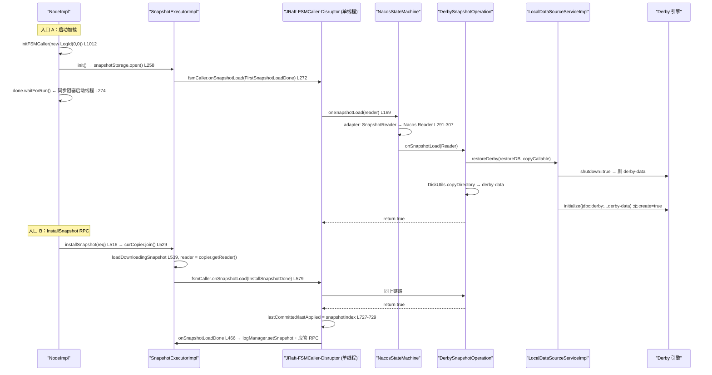

我先读取该文件与恢复链路涉及的依赖类。

继续读取解压、目录复制、Derby 恢复与事件订阅方实现。

并行确认适配层 Reader、锁使用范围、路径常量与 schema 重载行为。

核对 jraft 侧两条 load 路径的 reader 来源与加载后的索引推进。

核对 schema 重放行为、copier 的 reader 路径与事件订阅方。

补齐 jraft 侧 done 语义与 Nacos 直连查询是否绕过写锁。

最后确认安装快照路径下 reader 目录的来源。

核对 NodeImpl.init 中快照加载与 logManager/FSMCaller 的先后顺序。

最后确认启动后日志重放的驱动点。

## 结论速览

`DerbySnapshotOperation.onSnapshotLoad` 做的不是"把快照里的数据 INSERT 回数据库"，而是**一次文件级的整库替换**：把 `derby_data.zip` 解压 → 用 `SYSCS_BACKUP_DATABASE` 产出的备份目录**覆盖** `$NACOS_HOME/data/derby-data` → 重启 Derby 引擎挂上去。

| 维度 | 事实 |
|---|---|
| 执行线程 | **`JRaft-FSMCaller-Disruptor` 单线程**（与 save 走异步线程池不同，load 完全同步） |
| 触发入口 | ① 节点启动 `NodeImpl.initSnapshotStorage` ② leader 发来的 `InstallSnapshot` RPC |
| 输入文件 | `<snapshotUri>/snapshot_<N>/derby_data.zip` |
| 落地位置 | `$NACOS_HOME/data/derby-data`（Derby 库目录本身） |
| 数据形态 | Derby 物理文件（非 SQL dump、非 `SYSCS_IMPORT_TABLE`） |
| 恢复后动作 | jraft 把 `lastAppliedIndex` 推到快照点 → 截断旧日志 → 之后的日志走 `onApply` 增量重放 |
| 失败后果 | 返回 false → `ESTATEMACHINE`；启动路径下 `NodeImpl.init` 失败 → **jraft 返回 null node，而 Nacos 未判空** |

---

## 一、谁在什么时候调用它



两个决定行为的关键时序事实（都来自 jraft v1.3.14 源码）：

1. **启动时 `initFSMCaller(new LogId(0, 0))`（`NodeImpl` L1012）先于 `initSnapshotStorage()`（L1026）** —— 所以 `lastAppliedIndex` 初值是 0，`FSMCallerImpl.doSnapshotLoad` 的 `ESTALE` 守卫（L703）在启动路径上**不可能命中**；也解释了为什么启动时快照能顺利覆盖空库。
2. **InstallSnapshot 路径下 reader 的路径也是 `snapshot_<N>` 而不是 temp**：`LocalSnapshotCopier.internalCopy()` L118-120 在拷贝成功后执行 `this.reader = (LocalSnapshotReader) this.storage.open()`，而 `open()` 只返回 `getSnapshotPath(lastSnapshotIndex)`（`LocalSnapshotStorage` L324-348）——temp 目录已在 writer close 时被 `Utils.atomicMoveFile` 改名（L256）。所以 `reader.getPath()` 两个入口都是**正式快照目录**。

---

## 二、逐行源码解读

```java
@Override
public boolean onSnapshotLoad(Reader reader) {
    final String readerPath = reader.getPath();                                   // ① = <snapshotUri>/snapshot_N
    final String sourceFile = Paths.get(readerPath, snapshotArchive).toString();  //   .../snapshot_N/derby_data.zip
    TimerContext.start(DERBY_SNAPSHOT_LOAD);
    final Lock lock = writeLock;                                                  // ② DistributedDatabaseOperateImpl L174
    lock.lock();
    try {
        final Checksum checksum = new CRC64();
        DiskUtils.decompress(sourceFile, readerPath, checksum);                   // ③ 先解压，边解边算 CRC64

        LocalFileMeta fileMeta = reader.getFileMeta(snapshotArchive);             // ④ 取 save 时写进 userMeta 的 checkSum
        if (fileMeta.getFileMeta().containsKey(checkSumKey)) {                    //    ★ fail-open：没 key 就跳过校验
            if (!Objects.equals(Long.toHexString(checksum.getValue()), fileMeta.get(checkSumKey))) {
                throw new IllegalArgumentException("Snapshot checksum failed");
            }
        }

        final String loadPath = Paths.get(readerPath, snapshotDir, PersistenceConstant.DERBY_BASE_DIR)
                .toString();                                                      // ⑤ .../snapshot_N/derby_data/derby-data
        LOGGER.info("snapshot load from : {}, and copy to : {}", loadPath, derbyBaseDir);

        doDerbyRestoreFromBackup(() -> {                                          // ⑥ 关库 → 删库 → 拷贝 → 开库
            final File srcDir = new File(loadPath);
            final File destDir = new File(derbyBaseDir);
            DiskUtils.copyDirectory(srcDir, destDir);                             //    commons-io 递归拷贝
            LOGGER.info("Complete database recovery");
            return null;
        });
        DiskUtils.deleteDirectory(loadPath);                                      // ⑦ 清内层解压产物
        NotifyCenter.publishEvent(DerbyLoadEvent.INSTANCE);                       // ⑧ 无订阅者（见坑 5）
        return true;
    } catch (final Throwable t) {
        LOGGER.error("Fail to load snapshot, path={}, file list={}, {}.", readerPath, reader.listFiles(), t);
        return false;                                                             // ⑨ false → ESTATEMACHINE
    } finally {
        lock.unlock();
        TimerContext.end(DERBY_SNAPSHOT_LOAD, LOGGER);                            //    耗时只在 DEBUG 可见
    }
}
```

### ① 路径怎么来的：适配层不做翻译

`NacosStateMachine.adapterToJRaftSnapshot` 的 load 分支（L290-308）只做两件事：把 jraft `SnapshotReader.listFiles()`（来自 `__raft_snapshot_meta` 的 fileMap，`LocalSnapshotReader.listFiles()` → `metaTable.listFiles()`）逐个读出 protobuf `LocalFileMeta`，把其中的 `userMeta` JSON 反序列化成 Nacos 的 `LocalFileMeta`（L296-303），组成 `Map<String, LocalFileMeta>`，再 `new Reader(reader.getPath(), metaMap)`。

也就是说 **Nacos 的 `Reader` 是"目录 + 清单快照"的不可变视图**（`consistency/snapshot/Reader.java` 里 `Collections.unmodifiableMap`），它不提供任何流式读取能力——业务只能自己拿 `getPath()` 拼文件路径。这正是"save 必须自己写进 writer.getPath()、load 必须自己读 reader.getPath()"这层契约的来源。

### ③ 解压（`DiskUtils.decompress`，L456-482）

```java
try (FileInputStream fis = new FileInputStream(sourceFile);
     CheckedInputStream cis = new CheckedInputStream(fis, checksum);
     ZipInputStream zis = new ZipInputStream(new BufferedInputStream(cis))) {
    while ((entry = zis.getNextEntry()) != null) {
        final String fileName = entry.getName();
        if (isIllegalFileName(fileName)) { continue; }          // 含 ".." 或以 "/" 开头 → 静默跳过
        final File entryFile = new File(Paths.get(outputDir, fileName).toString());
        FileUtils.forceMkdir(entryFile.getParentFile());
        try (FileOutputStream fos = new FileOutputStream(entryFile);
             BufferedOutputStream bos = new BufferedOutputStream(fos)) {
            IOUtils.copy(zis, bos);
            bos.flush();
            fos.getFD().sync();                                 // 每个文件强制落盘
        }
    }
    IOUtils.copy(cis, NullOutputStream.NULL_OUTPUT_STREAM);      // ★ 读完尾部残留字节，否则 CRC64 值不对
}
```

- zip 条目名是 save 时按 `rootDir=writer.getPath()`、`sourceDir="derby_data"` 生成的（`compressDirectoryToZipFile` L405 `Paths.get(sourceDir, file.getName())`），所以形如 `derby_data/derby-data/seg0/...`；解压到 `readerPath` 后目录结构天然对齐 ⑤ 的 `loadPath`。
- 最后一行 `IOUtils.copy(cis, NullOutputStream)` 是关键细节：`CheckedInputStream` 的校验值覆盖**所有被读过的字节**，如果 `ZipInputStream` 提前停在最后一个 entry，zip 尾部的 central directory 没被计入 CRC，比对必然失败。注释也点了这个坑（引用 coderanch 帖）。
- 目标目录**就是正式快照目录本身**，即解压产物落在 `snapshot_N/` 里（见坑 6）。

### ④ 校验和的取数链路

save 侧：`meta.append("checkSum", Long.toHexString(crc64))` → `NacosStateMachine.callFinally` → `JSnapshotOperation.buildMetadata`（L65-68）：

```java
return LocalFileMetaOutter.LocalFileMeta.newBuilder()
        .setUserMeta(ZeroByteStringHelper.wrap(JacksonUtils.toJsonBytes(metadata))).build();
```

load 侧再在 `adapterToJRaftSnapshot` L296-302 用 `JacksonUtils.toObj(bytes, LocalFileMeta.class)` 还原。注意 **Nacos 把 CRC64 放在 jraft 的 `userMeta` 里，而不是 jraft 自己的 `checksum` 字段**（`LocalFileMeta` 只有 `Properties` + `name/source/checksum`，Nacos 只填了自定义 key）。后果：`LocalSnapshotCopier.filterBeforeCopy`（L269 `remoteMeta.hasChecksum()`）拿不到 jraft 级 checksum → 增量下载优化失效；而 `setFilterBeforeCopyRemote` 在 Nacos core 里也确实一次都没调用（grep 0 匹配），所以每次 InstallSnapshot 都是**整包重下 zip**。

### ⑤⑥ 核心：`doDerbyRestoreFromBackup` → `restoreDerby`

```java
// DerbySnapshotOperation
private final String derbyBaseDir = Paths.get(EnvUtil.getNacosHome(), "data", PersistenceConstant.DERBY_BASE_DIR).toString();  // L69
private final String restoreDB    = "jdbc:derby:" + derbyBaseDir;                                                                 // L72  ★ 没有 create=true

// LocalDataSourceServiceImpl L130-147
public void restoreDerby(String jdbcUrl, Callable<Void> callable) throws Exception {
    doDerbyClean();          // ⑴ DriverManager.getConnection("jdbc:derby:;shutdown=true") + 删 data/derby-data
    callable.call();         // ⑵ DiskUtils.copyDirectory(备份目录 → data/derby-data)
    initialize(jdbcUrl);     // ⑶ 重建 Hikari + JdbcTemplate + TransactionTemplate，并 reload() 跑 derby-schema.sql
}

private void doDerbyClean() throws Exception {
    try {
        DriverManager.getConnection("jdbc:derby:;shutdown=true");            // ★ JVM 级关闭整个 Derby 引擎
    } catch (Exception e) {
        // "Derby system shutdown." 是正常关闭也会抛的异常，必须吞掉
        if (!StringUtils.containsIgnoreCase(e.getMessage(), derbyShutdownErrMsg)) { throw e; }
    }
    DiskUtils.deleteDirectory(Paths.get(EnvUtil.getNacosHome(), derbyBaseDir).toString());
}
```

恢复语义拆成三层，缺一不可：

| 层 | 动作 | 为什么要 |
|---|---|---|
| 引擎 | `jdbc:derby:;shutdown=true` | Derby **Embedded** 模式下库被进程独占，不关掉就无法替换文件；`XJ015`（"Derby system shutdown"）是**成功关闭也抛的异常**，所以按 message 白名单吞掉 |
| 文件 | 删 `data/derby-data` → `copyDirectory` 备份目录进来 | `SYSCS_BACKUP_DATABASE` 的产物本身就是一个可直接挂载的数据库目录（含数据容器与自身事务日志），"恢复"= 放回原位 |
| 连接 | `initialize("jdbc:derby:...data/derby-data")` | URL **不带 `create=true`**，等价于"必须以已存在的库打开"，若 ⑵ 没成功会直接连不上 → 抛异常 → `return false` |

`initialize()` 里还有一个容易被忽略但**故意设计**的点（L158-169）：

```java
if (jdbcTemplateInit) {
    jt.setDataSource(ds);              // 复用同一个 JdbcTemplate 对象，只换 DataSource
    tjt.setTransactionManager(tm);
} else { ... 新建 ... }
reload();
```

因为 `GroupCapacityPersistService` L75、`TenantCapacityPersistService` L72、`ConfigOpsController` L120 等都是**在构造期把 `dataSourceService.getJdbcTemplate()` 缓存成了字段**，只有复用同一对象引用，整库替换后这些缓存才不会失效。

最后 `reload()`（L92-105 → `execute` L257-268）会重新执行一遍 `derby-schema.sql`：

```java
for (String sql : sqlList) {
    try { stmt.execute(sql); } catch (Exception e) { LOGGER.warn(e.getMessage()); }   // ★ 逐条吞异常
}
```

而 `META-INF/derby-schema.sql` 用的是裸 `CREATE TABLE` / `CREATE SCHEMA`（无 `IF NOT EXISTS`）。恢复一个已有表的库，这 16 条建表语句会全部报"already exists"，但**被 WARN 吞掉**，于是这段代码"歪打正着"地具备了两个效果：① 对快照恢复是幂等的；② 升级新版本时快照缺表会被自动补建（前提是 `loadSql` 优先取的 `$NACOS_HOME/conf/derby-schema.sql` 是新版本的文件，L218-226）。

### ⑨ 返回 true / false 之后 jraft 干什么

`FSMCallerImpl.doSnapshotLoad`（L684-731）：

```java
if (lastAppliedId.compareTo(snapshotId) > 0) { done.run(ESTALE, "Loading a stale snapshot ..."); return; }  // 不调 fsm
if (!this.fsm.onSnapshotLoad(reader)) {
    done.run(new Status(-1, "StateMachine onSnapshotLoad failed"));
    setError(new RaftException(ERROR_TYPE_STATE_MACHINE, ESTATEMACHINE, "StateMachine onSnapshotLoad failed"));  // ★ 节点进错误态
    return;
}
... this.fsm.onConfigurationCommitted(conf);                                            // 成员列表也从快照恢复
this.lastCommittedIndex.set(meta.getLastIncludedIndex());
this.lastAppliedIndex.set(meta.getLastIncludedIndex());                                  // ★ 索引推到快照点
this.lastAppliedTerm = meta.getLastIncludedTerm();
done.run(Status.OK());
```

`done.run` → `SnapshotExecutorImpl.onSnapshotLoadDone`（L466-513）：`lastSnapshotIndex = meta.lastIncludedIndex` → **`logManager.setSnapshot(meta)`（L478，锁外）截断快照点之前的日志** → `node.updateConfigurationAfterInstallingSnapshot()`（L491）→ 若是 InstallSnapshot 则回 RPC 成功（L508-509）。

之后增量数据由 `onApply` 补齐：单节点/选主时 `NodeImpl.becomeLeader` L1258 `ballotBox.resetPendingIndex(logManager.getLastLogIndex() + 1)` 把 committedIndex 顶到本地最后一条日志，触发 `fsmCaller.onCommitted` → 从 `lastAppliedIndex + 1`（= 快照点 + 1）逐条读日志调 `NacosStateMachine.onApply` → `DistributedDatabaseOperateImpl.onApply`（L519，readLock）执行 SQL。

**所以完整的数据收敛公式是：`derby-data(快照点状态) + raft log(快照点之后的已提交日志) = 当前状态`。**

---

## 三、涉及的路径与磁盘形态

| 角色 | 路径 | 出处 |
|---|---|---|
| 目标库（唯一真相） | `$NACOS_HOME/data/derby-data` | L69 + `PersistenceConstant.DERBY_BASE_DIR="derby-data"`（L46） |
| `reader.getPath()` | `$NACOS_HOME/data/protocol/raft/nacos_config/snapshot/snapshot_<N>` | `JRaftServer` L228 + `JRaftUtils.initDirectory` L89/L104 + `LocalSnapshotStorage.getSnapshotPath` L178-180 |
| 输入 zip | `.../snapshot_<N>/derby_data.zip` | L120 |
| 解压产物（临时） | `.../snapshot_<N>/derby_data/derby-data/` | L126 + L136 |
| 快照清单 | `.../snapshot_<N>/__raft_snapshot_meta` | `LocalSnapshotReader.init` L`JRAFT_SNAPSHOT_META_FILE` |
| group | `nacos_config` | `PersistenceConstant.CONFIG_MODEL_RAFT_GROUP` L53 |

注意 **Derby 备份目录会嵌套一层同名库目录**（`derby_data/derby-data/`）：这是 `SYSCS_BACKUP_DATABASE` 的行为（在指定目录下建与源库同名的子目录），⑤ 的 `loadPath` 就是这个内层目录。

恢复期间的磁盘占用：`snapshot_N/derby_data.zip` + 解压后的整份库 + 目标 `data/derby-data` 整份 ≈ **2 倍库大小（解压产物在拷贝期间与目标并存）**。

---

## 四、关键点

| # | 关键点 | 说明 |
|---|---|---|
| 1 | 文件级整库替换，非 SQL 回放 | `copyDirectory` 覆盖 `data/derby-data`；不涉及 `SYSCS_IMPORT_TABLE` |
| 2 | **同步跑在 FSM 线程** | `case SNAPSHOT_LOAD → doSnapshotLoad`（`FSMCallerImpl.runApplyTask` L420-425）；解压+拷贝+关开库期间该 group 的 apply、leader 事件全部停摆 |
| 3 | 启动路径是阻塞式同步 | `FirstSnapshotLoadDone.waitForRun()`（CountDownLatch），快照多大、启动就多久 |
| 4 | 校验在替换之前 | CRC 失败会 throw 在 `doDerbyRestoreFromBackup` 之前 → **原库不会被破坏**，这是顺序上的正确设计 |
| 5 | writeLock 的实际作用不同于 save | save 在异步线程，writeLock 挡的是 FSM 的 `onApply`；load 本身就在 FSM 线程，`onApply` 不可能并发，此时 writeLock 真正挡住的是**跨线程的 readIndex 线性读**（`JRaftProtocol.get` L291 → `onRequest` readLock L474） |
| 6 | `jdbc:derby:` 不带 `create=true` | 语义即"必须恢复出可用的库"，失败会暴露为异常而非静默建空库 |
| 7 | 复用同一个 JdbcTemplate 对象 | `jdbcTemplateInit` 分支只 `setDataSource`（L158-160），让所有缓存了 `jt` 引用的 bean 自动指向新库 |
| 8 | `derby-schema.sql` 逐条吞异常 | 让"恢复完再跑一遍建表脚本"变成幂等的补表动作（兼作版本升级时的 schema 补齐） |
| 9 | 恢复后 jraft 才推索引、截日志 | `lastAppliedIndex = snapshotIndex`（L727-729）+ `logManager.setSnapshot`（L478）→ 缺口由 `onApply` 重放补齐 |
| 10 | 快照点之前的 raft log 被删 | 所以"快照 + 尾部日志"必须成对可用，删 `snapshot_*` 而留 log 是破坏性操作 |
| 11 | 两个入口共用同一段代码 | 启动加载与 InstallSnapshot 装完包后的 load 完全一致（`storage.open()` 都返回 `snapshot_N`），无需分支处理 |
| 12 | 无快照时根本不会调用 | `snapshotStorage.open()` 返回 null（`LocalSnapshotStorage.open` L335-338）→ `SnapshotExecutorImpl.init` 直接 `return true` |
| 13 | 整库备份意味着"未经 raft 的本地写"也被带进快照 | capacity/tenant_capacity/users 等在嵌入式模式下由 `getJdbcTemplate()` 直写、不走日志，它们随快照复制但各节点本就分叉 |
| 14 | Nacos 不用 jraft 级 checksum | 只写 userMeta（`buildMetadata` L65-68），且 core 里没有 `setFilterBeforeCopyRemote` 调用 → InstallSnapshot 全量重下 zip |

---

## 五、坑

1. **失败静默、且 node 为 null 不判空（最严重）**
   启动时 `onSnapshotLoad` 返回 false → `SnapshotExecutorImpl.init` 返回 false → `NodeImpl.init` 返回 false → `RaftServiceFactory.createAndInitRaftNode` 返回 **null**（`RaftGroupService.start` 依然打印 "Start the RaftGroupService successfully."）。而 `JRaftServer.createMultiRaftGroup` L260-271 拿到 node 后**完全没有判空**：`machine.setNode(null)`、`multiRaftGroup.put(groupName, new RaftGroupTuple(null, ...))` 照常执行，Spring 启动也照常成功。故障表现推迟到第一次读写：`commit()` L332 `node.isLeader()` NPE。排查时看到是 NPE 而不是"快照加载失败"，很容易走偏。

2. **Derby 引擎被 JVM 级关闭，而 writeLock 护不住绕过它的调用方**
   `DriverManager.getConnection("jdbc:derby:;shutdown=true")` 关的是整个引擎（不是某个连接）。`GroupCapacityPersistService` L75 / `TenantCapacityPersistService` L72 / `ConfigOpsController` L120 直接持有 `getJdbcTemplate()`、**不经过 raft 锁**，运行期 InstallSnapshot（尤其是节点已对外服务的场景）会让这些路径瞬间报 "Derby system shutdown"/连接失效。也就是说锁的边界 = raft 读写路径的边界，而不是"derby 可用性"的边界。

3. **旧 Hikari 池不关闭**
   `initialize()` 里 `jt.setDataSource(ds)` 直接换新池（L159），旧 `HikariDataSource` 从未 `close()`：其 housekeeper 线程与（已失效的）连接对象继续存活；被删掉的 `derby-data` 文件若有句柄未释放，磁盘空间也不会立即回收。频繁装快照会累积泄漏。

4. **非原子 + 无回滚**
   `doDerbyClean()` 已经把 `data/derby-data` **删掉了**，此时若 `copyDirectory`（磁盘满 / IO 错）或 `initialize`+`reload` 失败，本地库就处于"没了/半份"状态，`onSnapshotLoad` 返回 false 后 jraft 只会把节点标记为 `ESTATEMACHINE`，不会恢复原目录。启动路径下等于**用一次坏快照换掉了一个可用库**。严格实现应该拷到临时目录再改名，或先 `mv` 备份再回滚。

5. **`DerbyLoadEvent` 没有订阅方（与你笔记一致）**
   全仓 grep `DerbyLoad` 只有 `DistributedDatabaseOperateImpl` L200 的 `registerToSharePublisher` 与 L148 的 publish，**没有任何 `subscribeType()` 返回它**。后果：整库被替换后，本节点的磁盘/RocksDB dump 缓存不会重建，出现"表已是快照点状态、缓存还是旧内容"的窗口，只能等下次全量 dump 收敛。这个事件显然是为该场景预留的，接线漏了。

6. **解压污染正式快照目录，清理不彻底**
   ③ 解到 `readerPath`（`snapshot_N/`），⑦ 只删内层 `loadPath = snapshot_N/derby_data/derby-data`，**外层 `snapshot_N/derby_data/` 空目录残留**。功能上无害（jraft 只按 `__raft_snapshot_meta` 清单取文件），但会误导排障（看起来像"快照里有两个库"），也会让 `filterBeforeCopy` 之类的目录扫描逻辑受影响。

7. **CRC 校验是 fail-open**
   L130 `if (fileMeta.getFileMeta().containsKey(checkSumKey))` —— 元数据缺失（跨版本、`JacksonUtils.toObj` 未能还原 `Properties`、或 `userMeta` 为空走 L299-300 的 `new LocalFileMeta()`）时**静默跳过校验**，坏 zip 照样恢复。另外 `decompress` 对非法 entry 名是 `continue` 跳过（不报错），若真出现 zip-slip 变体条目，会得到"文件少了但 CRC 仍一致"的结果——因为 CRC 算的是解压流而不是落盘文件。

8. **快照点 ↔ 备份内容脱钩在 load 侧显形**
   接上次的发现：save 是异步的，`meta.lastIncludedIndex` 取的是 SNAPSHOT_SAVE **入队时**的 `lastAppliedIndex`，而备份内容是稍后抢到 writeLock 时的 derby 状态（可能更新）。于是重启后 `derby-data` 已经含 N+1..N+k，而 jraft 仍会从 N+1 起重放这些日志 → **重复 INSERT**（`his_config_info`/`config_info` 主键或唯一索引冲突，即 `onApply` 里被当作 `DataIntegrityViolationException` 吞掉、返回 success=false 的那批）。这是"装完快照/重启后某些配置行看起来是旧的或报错"的根因。

9. **整库替换在启动路径上会串行放大**
   `DistributedDatabaseOperateImpl.init()` L192 已经先 `cleanAndReopenDerby()`（关引擎 + 删库 + 建空库 + 跑 schema），紧接着 raft 起 node 又要再走一遍 `doDerbyClean` + 拷贝 + 开库 + 跑 schema。也就是说**每次启动 Derby 都被开关两次**，快照体积大时启动时间明显变长，且中间态的"空库"对早期 Spring bean 是可见的（此时 dump/健康检查若已跑起来会读到空表）。

---

## 六、总结

`onSnapshotLoad` 是 `DerbySnapshotOperation` 里语义最"重"的一段：它不做增量、不做 SQL 导入，而是把 `snapshot_<N>/derby_data.zip` 解压出 `SYSCS_BACKUP_DATABASE` 的整库物理备份，**关掉整个 Derby 引擎、删掉 `$NACOS_HOME/data/derby-data`、把备份目录拷回原位，再用不带 `create=true` 的 URL 重新打开并跑一遍吞掉全部异常的 `derby-schema.sql`**。它由 jraft 的两处驱动且都在 `JRaft-FSMCaller-Disruptor` 单线程上同步执行——启动时（`initFSMCaller(LogId(0,0))` 先于 `initSnapshotStorage`，因此 ESTALE 守卫不生效，且 `waitForRun()` 直接把进程启动阻塞住）和运行期收到 leader 的 InstallSnapshot RPC 时（copier 下载完已 atomicMove 成 `snapshot_N`，所以两个入口共用同一份 reader 路径与同一段代码）。返回 true 后 jraft 才把 `lastCommittedIndex/lastAppliedIndex` 推到快照点并 `logManager.setSnapshot` 截断旧日志，快照点之后的部分由 `onApply` 重放补齐——"快照 + 尾部日志 = 当前状态"就是这条链的全部契约。

设计上做对的三点值得记下：校验放在替换之前（坏包不伤原库）、`jdbc:derby:` 刻意不带 `create=true`（失败必须显式暴露）、复用同一 `JdbcTemplate` 对象让所有缓存引用的 bean 自动跟随新 DataSource。代价与风险也集中在三处：**同步执行让快照恢复变成整段 FSM 停摆**（writeLock 此时护的是跨线程线性读而非 apply）；**先删库再拷贝、失败不回滚**；**Derby 是 JVM 独占引擎，`shutdown=true` 的影响面远大于 raft 锁的覆盖面**（capacity/users 等直连 `getJdbcTemplate()` 的路径完全在锁外）。

落到运维上三条建议：① 见到 raft 相关的 NPE 先回查 `start the RaftGroupService successfully` 之后有没有 `Fail to load snapshot from ...`，因为 `JRaftServer` L260 对 null node 不判空，真实原因只埋在 raft 日志里；② `data/protocol/raft/nacos_config/snapshot/` 下若残留 `derby_data/` 空目录属正常副作用，但若 `temp/` 长期存在说明 save 卡住，而此时 `data/derby-data` 缺失/异常则是 load 失败未被回滚的信号；③ 由于 `DerbyLoadEvent` 无人订阅、`TimerContext` 只在 DEBUG 打耗时，排查"装快照后缓存不一致/写入停顿"时先把 `com.alibaba.nacos.core.persistence.DerbySnapshotOperation` 与 raft 日志调到 debug，否则整条链路在 INFO 级别几乎是静默的。