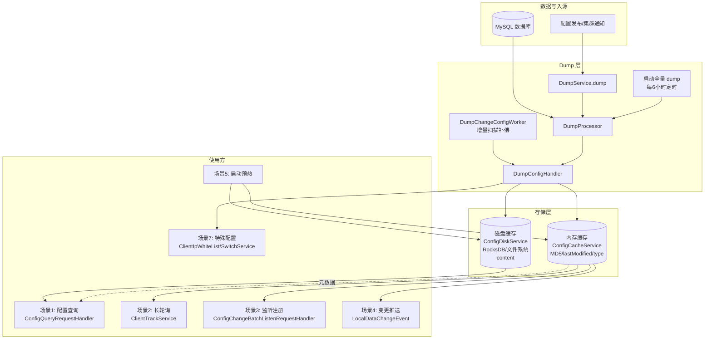

让我追踪 dump 后的数据流向，看看它们分别在哪里被使用。

## 服务端 Dump 配置的使用场景分析

### 一、Dump 产物的双层存储

`DumpService` 通过 `DumpConfigHandler.configDump()` 将数据落到两个地方：

| 层级 | 存储位置 | 存储内容 | 代码位置 |
|------|---------|---------|---------|
| **内存层** | `ConfigCacheService` → `CacheItem` | MD5、lastModifiedTs、type、encryptedDataKey、灰度规则 | `ConfigCacheService.dump()` |
| **磁盘层** | `ConfigDiskServiceFactory` (RocksDB / 文件系统) | 完整 content 内容 | `saveToDisk()` / `saveGrayToDisk()` |

这种分层是 Nacos 高性能读取的关键：**内存存元数据（快比较）、磁盘存内容（省内存）**。

---

### 二、七大使用场景

#### 场景 1：**客户端配置查询（读多写少的核心路径）**

**关键设计**：所有客户端查询请求 **不会穿透到 MySQL**，全部读本地 Dump 缓存。

**源码链路**：`ConfigQueryRequestHandler` → `ConfigQueryChainService` → `FormalHandler`

```java
// FormalHandler.java 第50-64行
CacheItem cacheItem = ConfigChainEntryHandler.getThreadLocalCacheItem();  // 内存：元数据
String md5 = cacheItem.getConfigCache().getMd5();
String content = ConfigDiskServiceFactory.getInstance()
        .getContent(dataId, group, tenant);   // 磁盘：内容
long lastModified = cacheItem.getConfigCache().getLastModifiedTs();
String encryptedDataKey = cacheItem.getConfigCache().getEncryptedDataKey();
```

灰度查询同理（`GrayRuleMatchHandler`）：
```java
// 从内存匹配灰度规则
for (ConfigCacheGray configCacheGray : cacheItem.getSortConfigGrays()) {
    if (configCacheGray.match(request.getAppLabels())) {
        matchedGray = configCacheGray;
        break;
    }
}
// 从磁盘读取灰度内容
String content = ConfigDiskServiceFactory.getInstance()
        .getGrayContent(dataId, group, tenant, matchedGray.getGrayName());
```

**优势**：数据库故障时读请求不受影响，QPS 也不受 DB 瓶颈限制。

---

#### 场景 2：**长轮询 MD5 对比（HTTP 客户端）**

**用途**：判断客户端持有的配置是否过期，决定是否需要返回变更。

```java
// ClientTrackService.java 第81行
boolean isUpdate = ConfigCacheService.isUptodate(groupKey, clientMd5);
```

长轮询每 29.5s 检查一次所有 clientMd5 vs 服务端内存 MD5，**不查磁盘也不查 DB**。这就是为什么内存层只存 MD5 就够了。

---

#### 场景 3：**gRPC 批量监听注册时的初始一致性检查**

**源码位置**：`ConfigChangeBatchListenRequestHandler.handle()` 第70行：

```java
configChangeListenContext.addListen(groupKey, md5, connectionId);
boolean isUptoDate = ConfigCacheService.isUptodate(groupKey, md5, 
        meta.getClientIp(), tag, meta.getAppLabels());
if (!isUptoDate) {
    // 立即告知客户端"你手上的配置已过期"
    configChangeBatchListenResponse.addChangeConfig(dataId, group, tenant);
}
```

客户端刚注册监听时，服务端**基于内存缓存**立即判断客户端携带的 MD5 是否最新。

---

#### 场景 4：**变更推送的触发源**

**源码位置**：`ConfigCacheService.dump()` 内部会 `publishEvent(new LocalDataChangeEvent(groupKey))`

```
DumpService → ConfigCacheService.dump() → 内存 MD5 变化
                                              ↓
                                    LocalDataChangeEvent
                                              ↓
                    ┌─────────────────────────┴─────────────────────────┐
                    ↓                                                   ↓
            LongPollingService                              RpcConfigChangeNotifier
            (HTTP 客户端推送)                                (gRPC 客户端推送)
```

**没有 Dump 就没有变更检测**：客户端收到的所有变更通知，都源自内存缓存 MD5 的变化。

---

#### 场景 5：**服务启动预热**

**源码位置**：`DumpService.dumpOperate()` 第208-271行：

```java
protected void dumpOperate() throws NacosException {
    // 全量 dump 所有配置到本地内存 + 磁盘
    dumpAllConfigInfoOnStartup(dumpAllProcessor);
    // 全量 dump 灰度配置
    ConfigDiskServiceFactory.getInstance().clearAllGray();
    dumpAllGrayProcessor.process(new DumpAllGrayTask());
    
    if (!EnvUtil.getStandaloneMode()) {
        // 集群模式：启动定时全量 dump（每 6 小时一次）
        ConfigExecutor.scheduleConfigTask(new DumpAllProcessorRunner(), 
            initialDelay, DUMP_ALL_INTERVAL_IN_MINUTE, TimeUnit.MINUTES);
        // 启动增量 dump worker
        ConfigExecutor.scheduleConfigChangeTask(new DumpChangeConfigWorker(...), ...);
    }
}
```

**意义**：服务启动时**必须先 Dump 完成再对外提供读服务**，否则每个请求都要穿透到 MySQL，会瞬间打垮 DB。

---

#### 场景 6：**集群通知丢失的兜底补偿**

**源码位置**：`DumpChangeConfigWorker.java` 第108-142行

```java
// 定时扫描 config_info 表最近变更（通过 gmt_modified 时间戳 + 分页游标）
List<ConfigInfoStateWrapper> changeConfigs = configInfoPersistService.findChangeConfig(
        startTime, changeCursorId, pageSize);

for (ConfigInfoStateWrapper cf : changeConfigs) {
    // 对比内存缓存的时间戳 & MD5
    boolean newLastModified = cf.getLastModified() > ConfigCacheService.getLastModifiedTs(groupKey);
    String localContentMd5 = ConfigCacheService.getContentMd5(groupKey);
    boolean md5Update = !localContentMd5.equals(cf.getMd5());
    if (newLastModified || md5Update) {
        // 补偿 dump
        ConfigCacheService.dump(...);
    }
}
```

**用途**：即使集群间 gRPC 通知 (`AsyncNotifyService`) 因网络抖动失败，本节点也能通过定时扫描 MySQL binlog-like 表补齐缓存。**这是最终一致性兜底**。

---

#### 场景 7：**特殊配置的业务联动**

**源码位置**：`DumpConfigHandler.configDump()` 第72-78行

```java
if (dataId.equals(ClientIpWhiteList.CLIENT_IP_WHITELIST_METADATA)) {
    ClientIpWhiteList.load(content);   // 加载 IP 白名单到内存
}

if (dataId.equals(SwitchService.SWITCH_META_DATA_ID)) {
    SwitchService.load(content);        // 加载服务端开关配置
}
```

**内置元配置**通过 Dump 通道注入到服务端自身的运行时状态（限流开关、IP 白名单等）。

---

### 三、完整数据流向图



---

### 四、为什么 Dump 是 Nacos 配置模块的性能命脉？

| 无 Dump 直接查 DB | 有 Dump 走缓存 |
|-----------------|---------------|
| 每次读请求都要 SELECT | 从内存/本地磁盘读取 |
| MySQL 是瓶颈（连接数、TPS） | MySQL 只在写入时被打扰 |
| 网络延迟 5-20ms | 内存读取 <1ms |
| DB 挂 = 全站瘫痪 | DB 挂 = 只影响写，读正常 |
| 长轮询 MD5 对比无法高频 | MD5 直接内存比对 |

---

### 五、总结

**服务端 dump 出来的配置在以下情况下会被读取**：

1. ✅ **每次配置查询请求**（读缓存，不读 DB）
2. ✅ **每次长轮询 MD5 检查**（内存对比）
3. ✅ **每次 gRPC 客户端注册监听**（判断是否需推送）
4. ✅ **每次配置变更事件源**（触发 LocalDataChangeEvent 推送）
5. ✅ **服务启动时**（预热）
6. ✅ **定时任务补偿**（DumpChangeConfigWorker 检测遗漏）
7. ✅ **内置元配置生效**（IP 白名单、开关配置）

**没有 Dump**，Nacos 配置模块就退化成"一个 MySQL 的 HTTP 代理"，失去高性能读、集群最终一致、故障降级等一系列能力。