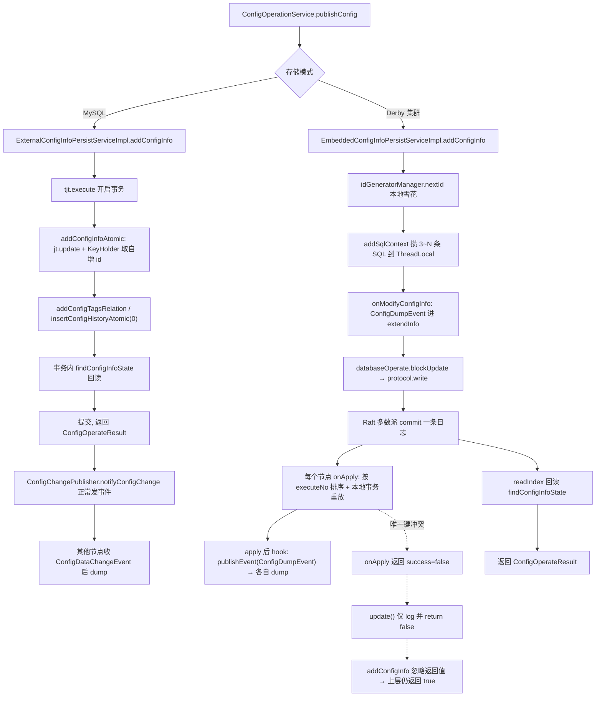

我直接对照两个实现的源码。

两条链路的差异核心在 `EmbeddedStorageContextUtils` 与 `databaseOperate`，我需要看清这两个。

内嵌 derby 的写路径落在 `DistributedDatabaseOperateImpl`（也是 `RequestProcessor4CP`）。继续追。

## 〇 一句话结论

两个 `addConfigInfo` 做的是**同一件事**（插 `config_info` + 插 `config_tags_relation` + 插 `his_config_info` + 回读 `ConfigOperateResult`），但**执行模型完全不同**：

- **External**：SQL 立刻打到共享 MySQL，靠 **Spring 编程式事务**（`tjt.execute`）保证原子性，集群一致性由"大家共用一个库"天然提供。
- **Embedded**：SQL 先**不执行**，而是攒进 `ThreadLocal`；最后把这一整包 SQL 序列化成**一条 JRaft 日志**提交，由每个节点的 `onApply` 在本地事务里重放，一致性由 **Raft 多数派**提供。

一句话：**External 是"一次本地事务"，Embedded 是"一条被复制到多数派的 SQL 批包"**。

---

## 一、它们如何被选中（条件装配）

| 层 | External 链 | Embedded 链 |
|---|---|---|
| Persist 实现 | `ExternalConfigInfoPersistServiceImpl` `@Conditional(ConditionOnExternalStorage)` L97-98 | `EmbeddedConfigInfoPersistServiceImpl`（同为 `ConditionOnEmbeddedStorage` 家族） |
| 执行引擎 | 无，直接 `jt` / `tjt`（来自 `dataSourceService`） | `DatabaseOperate`，构造注入 L145-L147 |
| ├ 单机 derby | — | `StandaloneDatabaseOperateImpl`（本地事务，无 Raft） |
| └ 集群 derby | — | `DistributedDatabaseOperateImpl` `@Conditional(ConditionDistributedEmbedStorage)` L146-L149 |
| 请求准入 | 任何节点都能写 | 额外注册 `CircuitFilter`（`NacosConfigConfiguration` L53-L68，仅 `ConditionDistributedEmbedStorage`） |

```java
// ConditionDistributedEmbedStorage L34
return DatasourceConfiguration.isEmbeddedStorage() && !EnvUtil.getStandaloneMode();
```

注意一个容易误解的点：`EmbeddedConfigInfoPersistServiceImpl` **单机和集群共用**，两者差别只在注入的 `DatabaseOperate` 实现；而 `EmbeddedStorageContextUtils.onModifyConfigInfo` 里那句 `if (!EnvUtil.getStandaloneMode())` 正是为此存在。

---

## 二、方法体逐行对照

### External（L144-L169）

```java
public ConfigOperateResult addConfigInfo(String srcIp, String srcUser, ConfigInfo configInfo, Map<String,Object> configAdvanceInfo) {
    return tjt.execute(status -> {                                        // ① Spring 事务包裹
        try {
            long configId = addConfigInfoAtomic(-1, srcIp, ...);           // ② 立即执行 INSERT，忽略入参 id
            addConfigTagsRelation(configId, configTags, ...);              // ③ 立即执行 N 条 INSERT
            Timestamp now = new Timestamp(System.currentTimeMillis());
            historyConfigInfoPersistService.insertConfigHistoryAtomic(0, configInfo, srcIp, srcUser, now, "I", ...);  // ④ id 传 0
            ConfigInfoStateWrapper configInfoCurrent = this.findConfigInfoState(...);   // ⑤ 事务内回读（读自己的写）
            if (configInfoCurrent == null) return new ConfigOperateResult(false);
            return new ConfigOperateResult(configInfoCurrent.getId(), configInfoCurrent.getLastModified());
        } catch (CannotGetJdbcConnectionException e) {                      // ⑥ 只特殊处理"连不上库"
            LogUtil.FATAL_LOG.error("[db-error] " + e, e); throw e;
        }
    });
}
```

`addConfigInfoAtomic`（L219-L239）的 INSERT 列**不含 `id`**，用 `KeyHolder` 回捞 MySQL 自增主键：

```java
KeyHolder keyHolder = ExternalStorageUtils.createKeyHolder();
jt.update(conn -> createPsForInsertConfigInfo(...), keyHolder);
Number nu = keyHolder.getKey();
if (nu == null) throw new IllegalArgumentException("insert config_info fail");
```

### Embedded（L200-L235）

```java
public ConfigOperateResult addConfigInfo(...) { return addConfigInfo(srcIp, srcUser, configInfo, configAdvanceInfo, null); }  // ★ 多一个 consumer 重载

private ConfigOperateResult addConfigInfo(..., BiConsumer<Boolean,Throwable> consumer) {
    try {
        configInfo.setTenant(isBlank ? EMPTY : tenant);                     // ① 显式归一化 tenant
        long configId = idGeneratorManager.nextId(RESOURCE_CONFIG_INFO_ID);  // ② 本地雪花，不走网络
        long hisId    = idGeneratorManager.nextId(RESOURCE_CONFIG_HISTORY_ID);
        addConfigInfoAtomic(configId, srcIp, ...);                          // ③ 只攒 SQL，不执行
        addConfigTagsRelation(configId, configTags, ...);                   // ④ 只攒 SQL
        Timestamp now = new Timestamp(System.currentTimeMillis());
        historyConfigInfoPersistService.insertConfigHistoryAtomic(hisId, ...);   // ⑤ 攒真实 hisId
        EmbeddedStorageContextUtils.onModifyConfigInfo(configInfo, srcIp, now);  // ⑥ ★ 把 ConfigDumpEvent 写入 extendInfo
        databaseOperate.blockUpdate(consumer);                              // ⑦ ★ 一次提交全部（Raft write）
        return getConfigInfoOperateResult(...);                             // ⑧ 回读（走 raft 读）
    } finally {
        EmbeddedStorageContextHolder.cleanAllContext();                      // ⑨ 清 ThreadLocal
    }
}
```

`addConfigInfoAtomic`（L260-L283）列里**含 `id`**，且末尾只是 `addSqlContext`：

```java
final String sql = configInfoMapper.insert(Arrays.asList("id", "data_id", ...));
final Object[] args = new Object[] {id, configInfo.getDataId(), ...};
EmbeddedStorageContextHolder.addSqlContext(sql, args);   // 入队，不执行
return id;
```

---

## 三、六个本质区别

### 1️⃣ 原子性手段：Spring 事务 vs 一条 Raft 日志

External 靠 `tjt.execute`；Embedded 靠"多条 SQL 打包成一个 `WriteRequest`，`onApply` 里再开本地事务"：

```java
// DistributedDatabaseOperateImpl L423-L440
final String key = System.currentTimeMillis() + "-" + group() + "-"
        + memberManager.getSelf().getAddress() + "-" + MD5Utils.md5Hex(sqlContext.toString(), DEFAULT_ENCODE);
WriteRequest request = WriteRequest.newBuilder().setGroup(group()).setKey(key)
        .setData(ByteString.copyFrom(serializer.serialize(sqlContext)))          // List<ModifyRequest>
        .putAllExtendInfo(EmbeddedStorageContextHolder.getCurrentExtendInfo())   // ConfigDumpEvent JSON
        .setType(sqlContext.getClass().getCanonicalName()).build();
Response response = this.protocol.write(request);   // 同步等多数派
```

```java
// DistributedDatabaseOperateImpl.onApply L526-L533
List<ModifyRequest> sqlContext = serializer.deserialize(byteString.toByteArray(), List.class);
sqlContext.sort(Comparator.comparingInt(ModifyRequest::getExecuteNo));   // ★ 顺序保障
isOk = update(transactionTemplate, jdbcTemplate, sqlContext);             // ★ 到这里才开事务
```

`executeNo` 由 `addSqlContext` 按入队顺序写入（`EmbeddedStorageContextHolder` L46），排序是因为序列化/传输后 List 顺序不可信——**保证 N 个节点重放顺序完全一致**。

### 2️⃣ 主键来源：DB 自增 vs 显式雪花

这不是风格差异，是**正确性要求**。Derby 的 `config_info.id` 是 `generated by default as identity`（derby-schema L20），允许显式赋值：

```sql
id bigint NOT NULL generated by default as identity,
constraint configinfo_id_key PRIMARY KEY (id),
constraint uk_configinfo_datagrouptenant UNIQUE (data_id,group_id,tenant_id));
```

Raft 复制的是 **SQL 文本**，若依赖各库自增，一旦某节点某次 apply 失败或序列状态漂移，`configId` 就会在各节点分叉，进而 `config_tags_relation.id`、`his_config_info.id` 全部错位。所以 Embedded 必须由 leader 侧的 `SnowFlowerIdGenerator`（`workerId` 由本机 IP 后两段推导，`nextId()` 仅 `synchronized`，**不走网络**）一次生成，把 id 写进 SQL 里复制出去。

### 3️⃣ 集群同步机制：不通知 vs 随日志携带

```java
// ConfigChangePublisher L36-L41 —— 分布式内嵌存储下，集群通知被"短路"
public static void notifyConfigChange(ConfigDataChangeEvent event) {
    if (DatasourceConfiguration.isEmbeddedStorage() && !EnvUtil.getStandaloneMode()) {
        return;                     // ★ 不发 ConfigDataChangeEvent
    }
    NotifyCenter.publishEvent(event);
}
```

Embedded 把"通知其他节点落 dump 缓存"这件事**塞进了 Raft 日志的 extendInfo**，由 apply 之后的 hook 完成：

```
EmbeddedStorageContextUtils.onModifyConfigInfo (L49-L59)
        → EXTEND_INFO_CONFIG_DUMP_EVENT = JSON(ConfigDumpEvent)
        → WriteRequest.putAllExtendInfo
        → 每个节点 onApply → PersistenceExecutor.executeEmbeddedDump (L537-L541)
        → EmbeddedConfigDumpApplyHook.afterApply → NotifyCenter.publishEvent(ConfigDumpEvent)
        → DumpConfigHandler → 本地 ConfigCacheService dump
```

所以 External 的 dump 是"网络通知驱动"，Embedded 是"**日志回放副产品**"——每个节点看到的 dump 事件序列和它的 SQL 重放顺序严格一致。

### 4️⃣ 失败语义（最大的坑，务必注意）

```java
// DistributedDatabaseOperateImpl.onApply L544-L554
// We do not believe that an error caused by a problem with an SQL error should trigger the stop operation of the raft state machine
} catch (BadSqlGrammarException | DataIntegrityViolationException e) {
    return Response.newBuilder().setSuccess(false).setErrMsg(e.toString()).build();   // ★ 不抛
} catch (DataAccessException e) {
    throw new ConsistencyException(e.toString());                                     // ★ 抛 → 状态机停 → 节点降级
}

// DistributedDatabaseOperateImpl.update L441-L447
Response response = this.protocol.write(request);
if (response.getSuccess()) return true;
LOGGER.error("execute sql modify operation failed : {}", response.getErrMsg());
return false;                                                                        // ★ 只是 false
```

而 `addConfigInfo` 写的是 `databaseOperate.blockUpdate(consumer);` —— **返回值被丢弃**（L229）。对比同文件 `updateConfigInfoCas` 是有检查的：

```java
// L590-L595
boolean success = databaseOperate.blockUpdate();
if (success) { return getConfigInfoOperateResult(...); } else { return new ConfigOperateResult(false); }
```

后果链条（External vs Embedded 完全不同）：

| 场景：并发重复新增同一 `dataId/group/tenant`，撞 `uk_configinfo_datagrouptenant` | External | Embedded |
|---|---|---|
| 异常发生位置 | 本线程 `jt.update` 立即抛 `DataIntegrityViolationException` | leader/follower 的 raft apply 线程 |
| 向上传播 | ✅ 穿透 `tjt.execute` | ❌ 被 `onApply` 吞成 `success=false` |
| 上层处理 | `ConfigOperationService` L140-L146 catch → `ConfigAlreadyExistsException` | 返回 false 被忽略；随后 `getConfigInfoOperateResult` 查不到 → `ConfigOperateResult(false)`，但非 CAS 分支**不检查 `isSuccess()`** → 接口返回 `true` |
| 用户可见 | 409 类"已存在" | **假成功**；批量导入的 `SameConfigPolicy.SKIP/ABORT` 逻辑（`ConfigController` L923-L945）在 derby 集群下失效 |

这和上次 JRaft 持久实例注册里发现的"错误语义不对称"是**同一个结构性问题**（`FailoverClosureImpl` 只看 `status.isOk()`，不看 `Response.success`）。

### 5️⃣ 回读一致性

| | External | Embedded |
|---|---|---|
| `findConfigInfoState` 走哪 | 同一事务的 `jt`，读自己的写，隔离级别内可见 | `databaseOperate.queryOne` → `ReadRequest` → `JRaftProtocol.getData` → `raftServer.get`（**readIndex**） |
| 代价 | 0 | 一次 ReadIndex 往返 |
| 风险 | — | 读必须等 apply 追上，否则刚提交的写读不到 |

Embedded 侧还有专门机制处理"必须等数据出现"的读：

```java
// EmbeddedDumpService L109
EmbeddedStorageContextHolder.putExtendInfo(EXTEND_NEED_READ_UNTIL_HAVE_DATA, ...);
// DistributedDatabaseOperateImpl L376-L381
if (blockRead) { return protocol.aGetData(request).join(); }
return protocol.getData(request);
```

### 6️⃣ `his_config_info.id` 的语义漂移（小坑）

| 传入值 | 新增（`"I"`） | 更新（`"U"`） |
|---|---|---|
| External | **恒为 0**（L154） | 真实 `configId` |
| Embedded | `config-history-id` 序列的雪花 `hisId`（L215） | 真实 `configId`（L539） |

`his_config_info.id` 在两套库里都不是主键（derby 主键是 `nid` identity，MySQL 主键是 `nid` AUTO_INCREMENT），查询也主要按 `gmt_modified`/`nid`，所以**当前不构成故障**，但这个列的含义在两种模式下、在同一条链路的"新增/更新"之间都不一致。

---

## 四、图示对比



---

## 五、关键点清单

| # | 关键点 | 源码位置 | 说明 |
|---|---|---|---|
| 1 | 同一接口两种执行模型 | `ConfigInfoPersistService` | 上层 `ConfigOperationService` 完全无感 |
| 2 | SQL 延迟执行 | `EmbeddedStorageContextHolder.addSqlContext` L43-L51 | `Embedded*Atomic` 方法**不执行 SQL**，命名有欺骗性 |
| 3 | ThreadLocal 上下文 + 必须清理 | `EmbeddedConfigInfoPersistServiceImpl` L233、`blockUpdate` L150 | 双重 `cleanAllContext`（幂等），漏清会串到下个请求 |
| 4 | 打包成一条 raft log | `DistributedDatabaseOperateImpl.update` L437-L440 | `data = Hessian(List<ModifyRequest>)`，`extendInfo` 带 dump 事件 |
| 5 | `executeNo` 排序 | `onApply` L532 | 保证多节点重放顺序 |
| 6 | 显式雪花主键 | `SnowFlowerIdGenerator` L124/L141 | workerId 取自 IP，`nextId` 纯本地，不走网络 |
| 7 | 事务下沉到 apply | `BaseDatabaseOperate.update` L213-L251 | 原子性发生在每个节点的 apply 阶段 |
| 8 | `rollBackOnUpdateFail` | `addSqlContext(true,...)` L633 + L228-L231 | CAS 更新 0 行 → 抛 `IllegalTransactionStateException` 回滚整包 |
| 9 | 集群通知短路 | `ConfigChangePublisher` L37-L39 | 避免"SQL 已复制 + 再广播一次"的双重通知 |
| 10 | dump 是 apply 的副产品 | `EmbeddedConfigDumpApplyHook` L48-L57 | 异步线程池处理，不阻塞状态机 |
| 11 | 错误分级 | `onApply` L548-L554 | SQL 错 → `false`；`DataAccessException` → `ConsistencyException` → `RaftDbErrorEvent` → `healthStatus=DOWN` |
| 12 | 降级熔断 | `CircuitFilter` L90-L94 / L139-L141 | `isDowngrading` → 503 "System triggered degradation" |
| 13 | 未选主不放行 | `CircuitFilter` L111-L124 | peers 不含自己或 leader 未出 → `isOpenService=false` → 503 "In the node initialization" |
| 14 | 读需 readIndex | `innerRead` L376-L381 | 写后回读是线性一致读 |
| 15 | md5 编码常量不统一 | Embedded L269 用 `PERSIST_ENCODE`；External L253 用 `ENCODE` | 默认都是 UTF-8；见坑 2 |
| 16 | history id 语义 | External `0` vs Embedded `hisId` | 见 3️⃣6️⃣ |
| 17 | `batchInsertOrUpdate` 用 consumer 转同步 | L313-L317 `callFinally` | 批量导入需要逐条知道成败 |

---

## 六、坑

**坑 1（高危）：derby 集群下重复新增会假成功。** 唯一键冲突被 `onApply` 吞掉，`blockUpdate` 返回值在 `addConfigInfo` 里被忽略，`ConfigOperationService` 非 CAS 分支不检查 `isSuccess()`。MySQL 下能正确报 `ConfigAlreadyExistsException`，derby 集群下静默"发布成功但数据没落"。**这解释了为什么 Embedded 的 `updateConfigInfoCas` 特意检查了返回值而 add 路径漏了**——属于同类问题未全覆盖。

**坑 2：`nacosPersistEncodingKey` 是"看起来能改，实际改了会坏"。** 编码常量在四个方法里分布不一致：

| 方法 | External | Embedded |
|---|---|---|
| add（写 `config_info.md5`） | `ENCODE`（UTF-8 硬编码） | `PERSIST_ENCODE` |
| update | `ENCODE` | `ENCODE` |
| updateCas | **`PERSIST_ENCODE`** | `ENCODE` |
| history | `ENCODE` | `ENCODE` |

而 `ConfigCacheService` L108 用 `PERSIST_ENCODE` 算比对 md5。默认 UTF-8 时四方一致；一旦设为 GBK，External 的 add 与 updateCas、Embedded 的 add 与 update 就会算出不同 md5，导致 long-polling 误判变更。

**坑 3：Embedded 的一条 raft log 可能包含 N+3 条 SQL。** 带多个 tag 时 `addConfigTagsRelation` 循环入队；`ModifyRequest` 列表越大，apply 阶段单事务持锁越久，且 Hessian 载荷受 raft 单条日志大小限制。

**坑 4：ThreadLocal 复用泄漏。** `EmbeddedStorageContextHolder` 是 `static ThreadLocal`，`sqlLimiter` 拒绝、`onModifyConfigInfo` 抛错等异常路径全靠 `finally cleanAllContext()`；若某处直接调 `addSqlContext` 而不进 `blockUpdate`（例如自研扩展），脏 SQL 会被下一个复用该线程的请求一起提交。

**坑 5：性能预期差。** Embedded 集群的一次发布 = 本地雪花 ×2 + Hessian 序列化 + 多数派 fsync（`protocol.write` 同步等 10s）+ 每节点一次事务 + apply 后 dump + 一次 readIndex 回读。压测时 derby 集群的 TPS 天花板由 raft 提交（串行 pipeline）决定，而不是 Derby 本身。

**坑 6：`CircuitFilter` 已不再"转发到 leader"。** 类注释仍写"all requests are routed to the Leader node"（L50-L54），但 `doFilter` 只有准入检查（`isOpenService`/`isDowngrading`）+ 异常包装（L75-L103）——真正的转发由 `JRaftServer.commit` 的 `invokeToLeader` 完成。按注释去找转发代码会白费时间。

**坑 7：单机 derby 与集群 derby 走同一个类但语义不同。** `EnvUtil.getStandaloneMode()=true` 时 `onModifyConfigInfo` 直接 return，`databaseOperate` 是 `StandaloneDatabaseOperateImpl`（本地事务），排查问题时不能把两者行为互推。

---

## 七、总结

**设计上，这两个类是同一个 SPI 的两种一致性策略落地。**

1. **上层保持一致**：`ConfigOperationService` 只认 `ConfigInfoPersistService` 接口和 `ConfigOperateResult`，`insertOrUpdate` 的"查一下决定 add 还是 update"逻辑在两边**逐行镜像**，说明这是刻意维持的可替换边界。

2. **核心分野在于"原子性与复制由谁提供"**：
    - External：`TransactionTemplate` 提供原子性，共享 MySQL 提供复制，`KeyHolder` 提供主键，通知靠 `ConfigChangePublisher` 广播。
    - Embedded：`ThreadLocal` 把 SQL 攒成批包，**Raft 同时提供原子性（一条日志）、复制（全节点重放）、顺序（`executeNo`）**，雪花提供主键，通知作为 `extendInfo` 随日志一起复制。

3. **Embedded 的取舍是明确的**：省掉外部数据库运维、把 dump 一致性收敛成日志重放的副产品；代价是每次发布要走多数派 fsync、读要走 readIndex、以及**错误语义在 apply 边界处断裂**（坑 1）——这个断裂在 naming 的 JRaft 持久实例里也存在，是 `FailoverClosureImpl` 只看 `status.isOk()` 不看 `Response.success` 的同一根因。

4. **迁移/选型上的实操建议**：批量导入（依赖 `ConfigAlreadyExistsException` 判定 SKIP/ABORT）、`updateForExist=false` 的新增接口、以及任何设置 `nacosPersistEncodingKey` 的部署，在 derby 集群下与 MySQL 下**行为不等价**，需要单独验证。

> 最后一句：External 的 `addConfigInfo` 回答的是"**我在共享库里原子地插了几行**"；Embedded 的 `addConfigInfo` 回答的是"**集群共同承认了一条包含这几行 SQL 的日志**"——前者的返回值来自数据库，后者的返回值来自一次 readIndex 之后的本地重放结果。