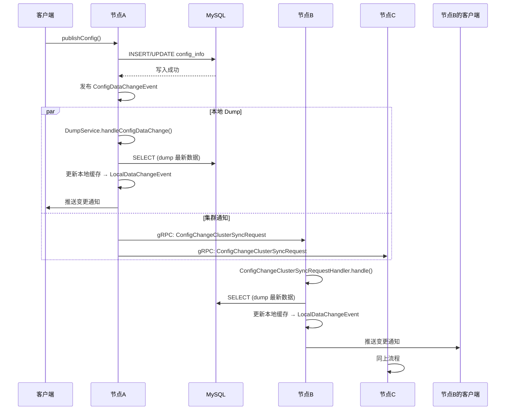

让我查看 MySQL 模式下配置发布后集群间如何同步。

## MySQL 存储集群为什么不用选主？配置发布如何处理？

### 一、为什么 MySQL 集群不需要选主？

核心原因：**MySQL 是所有节点共享的单一数据源**。

任何节点都可以直接读写 MySQL，不存在"只有 Leader 才能写"的限制。一致性由 MySQL 本身的事务保证。

对比 Derby + Raft 模式：每个节点持有**独立的嵌入式数据库副本**，必须通过 Raft Leader 写入才能保证各副本一致。

**关键代码证明** — `ConfigChangePublisher.java`:

```java
public static void notifyConfigChange(ConfigDataChangeEvent event) {
    // Embedded + 集群模式 → 直接 return，不发事件
    // 因为 Raft 协议本身已经完成了数据同步
    if (DatasourceConfiguration.isEmbeddedStorage() && !EnvUtil.getStandaloneMode()) {
        return;
    }
    // MySQL 模式 或 单机模式 → 正常发布事件
    NotifyCenter.publishEvent(event);
}
```

这段代码体现了两种模式的根本区别：
| 存储模式 | 写入方式 | 是否需要事件通知 | 原因 |
|---------|---------|----------------|------|
| **MySQL 集群** | 任意节点直接写 DB | ✅ 需要 | 其他节点的本地缓存需要刷新 |
| **Derby+Raft 集群** | 只能通过 Leader 写 | ❌ 不需要 | Raft 日志复制自动同步到其他节点 |

---

### 二、MySQL 集群配置发布的完整流程

假设集群有 **节点A、节点B、节点C** 三个 Nacos 节点，客户端将配置发布到 **节点A**。



---

### 三、关键源码分析

#### 3.1 写入 — 任意节点直接写 MySQL

**ConfigOperationService.publishConfig()** 第122-151行：

```java
// 不需要判断是否为 Leader，任何节点都能写
configOperateResult = configInfoPersistService.insertOrUpdate(srcIp, srcUser, configInfo, configAdvanceInfo);

// 写完后立即发布变更事件
ConfigChangePublisher.notifyConfigChange(
    new ConfigDataChangeEvent(dataId, group, tenant, configOperateResult.getLastModified()));
```

#### 3.2 事件分发 — 两个 Subscriber

`ConfigDataChangeEvent` 发布后，有**两个订阅者**同时响应：

**① AsyncNotifyService（集群通知）** — 第106-128行：

```java
void handleConfigDataChangeEvent(Event event) {
    ConfigDataChangeEvent evt = (ConfigDataChangeEvent) event;
    // 获取集群其他成员（排除自己）
    Collection<Member> ipList = memberManager.allMembersWithoutSelf();
    
    Queue<NotifySingleRpcTask> rpcQueue = new LinkedList<>();
    for (Member member : ipList) {
        // 为每个其他节点生成通知任务
        NotifySingleRpcTask task = generateTask(evt, member);
        rpcQueue.add(task);
    }
    if (!rpcQueue.isEmpty()) {
        ConfigExecutor.executeAsyncNotify(new AsyncRpcTask(rpcQueue));
    }
}
```

**② DumpService（本地刷新）** — 第126-148行：

```java
// DumpService 构造时注册
NotifyCenter.registerSubscriber(new Subscriber() {
    @Override
    public void onEvent(Event event) {
        handleConfigDataChange(event);  // 本地也 dump
    }
    @Override
    public Class<? extends Event> subscribeType() {
        return ConfigDataChangeEvent.class;
    }
});

void handleConfigDataChange(Event event) {
    ConfigDataChangeEvent evt = (ConfigDataChangeEvent) event;
    DumpRequest dumpRequest = DumpRequest.create(evt.dataId, evt.group, evt.tenant, evt.lastModifiedTs, localIP);
    DumpService.this.dump(dumpRequest);  // 从 MySQL 读取最新 → 更新本地缓存
}
```

#### 3.3 远端节点接收通知

**ConfigChangeClusterSyncRequestHandler.handle()** 第60-75行：

```java
@Override
public ConfigChangeClusterSyncResponse handle(ConfigChangeClusterSyncRequest request, RequestMeta meta) {
    // 收到通知后，触发本地 dump（从 MySQL 读最新数据）
    DumpRequest dumpRequest = DumpRequest.create(
        request.getDataId(), request.getGroup(), request.getTenant(),
        request.getLastModified(), meta.getClientIp());
    dumpRequest.setGrayName(request.getGrayName());
    dumpService.dump(dumpRequest);  // → DumpProcessor → MySQL SELECT → 更新缓存
    return new ConfigChangeClusterSyncResponse();
}
```

#### 3.4 DumpProcessor — 真正从 MySQL 拉数据

**DumpProcessor.process()** 第53-91行：

```java
public boolean process(NacosTask task) {
    // 从 MySQL 查询最新配置
    ConfigInfoWrapper cf = configInfoPersistService.findConfigInfo(dataId, group, tenant);
    
    // 构建 dump 事件
    ConfigDumpEvent event = ConfigDumpEvent.builder()
        .namespaceId(tenant).dataId(dataId).group(group)
        .content(cf.getContent()).md5(cf.getMd5())
        .lastModifiedTs(cf.getLastModified()).build();
    
    // 写入本地内存缓存 + 磁盘 → 最终发布 LocalDataChangeEvent
    return DumpConfigHandler.configDump(event);
}
```

#### 3.5 重试机制

通知失败时采用**平方递增退避**：

```java
private static int getDelayTime(NotifySingleRpcTask task) {
    int failCount = task.getFailCount();
    // 500ms + failCount² * 1000ms
    int delay = MIN_RETRY_INTERVAL + failCount * failCount * INCREASE_STEPS;
    if (failCount <= MAX_COUNT) {  // 最多6次
        task.setFailCount(failCount + 1);
    }
    return delay;
}
```

重试延迟序列：`500ms → 1500ms → 4500ms → 9500ms → 16500ms → 25500ms → 36500ms`

---

### 四、总结回答

| 问题 | 答案 |
|------|------|
| **为什么不用选主？** | MySQL 是所有节点共享的数据源，任何节点都能读写，一致性由 DB 事务保证 |
| **配置发布到哪都一样吗？** | 是的。客户端请求发到哪个节点，该节点直接写 MySQL，无需转发给 Leader |
| **其他节点如何知道？** | 通过 `AsyncNotifyService` → gRPC `ConfigChangeClusterSyncRequest` **异步通知** |
| **通知后其他节点做什么？** | 收到通知 → 从 MySQL 读最新数据 → 更新本地缓存 → 推送给自己连接的客户端 |
| **通知失败了怎么办？** | 指数退避重试（最多6次），同时有 `DumpChangeConfigWorker` 定时扫描 DB 增量做兜底 |
| **Raft 模式为什么要选主？** | 因为每个节点有独立数据库副本，写必须走 Leader → Raft 日志复制 → 各副本自动同步 |

**一句话总结**：MySQL 模式下，数据一致性靠数据库（共享存储），缓存一致性靠 gRPC 异步通知 + 定时兜底，不需要选主。