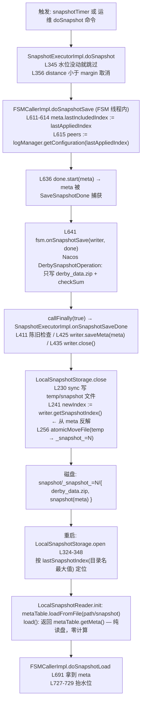
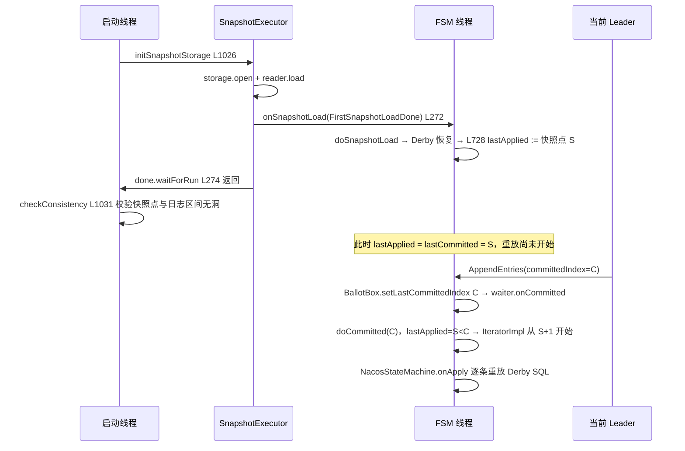

我先核对快照 meta 的写入侧与读取侧证据，以及日志缺失的处理路径。

关键证据已到手（`doSnapshotSave` L611-614 就是 meta 的源头）。继续取证 leader 侧快照传输与日志缺失的处理。

最后确认启动期一致性校验失败的处理方式。

取证完成。下面分两问回答。

---

# 问题一：`meta.lastIncludedIndex` 从哪里来

## 一句话结论

它**不是算出来的，也不是网络传来的**，而是「**执行 `doSnapshotSave` 那一刻 `FSMCaller.lastAppliedIndex` 的值**」被序列化进快照目录里 `snapshot` 文件的**持久化副本**。加载时只是把这个数读回来，原样写回水位。

## 完整生命周期（写入 → 落盘 → 读回）



### 第 2 步是唯一造出这个数的地方

`FSMCallerImpl.doSnapshotSave` L609-642，注意它取的是 **apply 位点**，不是 commit 位点、也不是 lastLogIndex：

```java
private void doSnapshotSave(final SaveSnapshotClosure done) {
    final long lastAppliedIndex = this.lastAppliedIndex.get();          // L611 ★
    final RaftOutter.SnapshotMeta.Builder metaBuilder = RaftOutter.SnapshotMeta.newBuilder()
        .setLastIncludedIndex(lastAppliedIndex)                          // L613 ★ 唯一的赋值点
        .setLastIncludedTerm(this.lastAppliedTerm);                      // L614
    final ConfigurationEntry confEntry = this.logManager.getConfiguration(lastAppliedIndex);  // L615
    if (confEntry == null || confEntry.isEmpty()) { ... EINVAL ... }     // L616-621
    ... peers / learners / oldPeers 全部按这个 index 的配置快照 ...        // L622-635
    final SnapshotWriter writer = done.start(metaBuilder.build());       // L636
    this.fsm.onSnapshotSave(writer, done);                              // L641 → 才轮到 Nacos
}
```

### Nacos 在这条链里只干一件事

`DerbySnapshotOperation.onSnapshotSave` L83-115 的全部产出就是 `derby_data.zip` + 一个自定义的 `LocalFileMeta`（只含 `checkSum`，L102-103）。**`lastIncludedIndex`/`lastIncludedTerm`/`peers` 这三个字段，Nacos 一个字都不碰**，全由 jraft 负责。这也解释了为什么 `NacosStateMachine.adapterToJRaftSnapshot`（L291-306）要费力还原 `LocalFileMeta` —— 那是 Nacos 唯一的私有元数据通道。

### 落盘顺序是崩溃安全的关键

`SnapshotExecutorImpl.onSnapshotSaveDone` L403-464：

```java
if (st.isOk()) {
    if (meta.getLastIncludedIndex() <= this.lastSnapshotIndex) {   // L411
        ret = RaftError.ESTALE.getNumber();                        // L412 陈旧快照丢弃
        writer.setError(RaftError.ESTALE, "Installing snapshot is older than local snapshot");
    }
}
if (ret == 0) {
    if (!writer.saveMeta(meta)) { ... }   // L425 ★数据文件写完后才提交 meta
}
writer.close();                            // L435 → LocalSnapshotStorage.close
...
if (ret == 0) {
    this.lastSnapshotIndex = meta.getLastIncludedIndex();   // L444
    this.logManager.setSnapshot(meta);                      // L448 ★存快照成功后同样触发日志回收
}
```

`LocalSnapshotStorage.close` L220-284 里还有一个细节值得记：**快照先写在 `snapshot/temp`，最后 `atomicMoveFile(temp → _snapshot_=N)`（L256）**。目录名里的 `N` 是从 `writer.getSnapshotIndex()` 拿的，而它（`LocalSnapshotWriter.getSnapshotIndex` L93-95）就是 `metaTable.getMeta().getLastIncludedIndex()`。**所以"目录名"和"meta 文件内容"同源同生**，不存在两者不一致的合法状态。

### 所以 `doSnapshotLoad` 抬的那个水位，链路是

```
lastAppliedIndex(存快照那一刻) → metaBuilder → SaveSnapshotDone.meta
   → writer.saveMeta → temp/snapshot 文件 → rename 成 _snapshot_=N
   → 重启 → reader.load() → L691 meta → L728 lastAppliedIndex := meta.getLastIncludedIndex()
```

首尾是**同一个数的往返**。

## 两条入口的 meta 是同一个来源

| | 入口 A：本地重启恢复 | 入口 B：installSnapshot |
|---|---|---|
| 谁读 meta | `SnapshotExecutorImpl.init` L258 `snapshotStorage.open()` | `Replicator.installSnapshot` L639 `getSnapshotStorage().open()` |
| meta 值来自 | **本节点**磁盘 `snapshot/` | **leader**磁盘 `snapshot/` |
| 传输方式 | 无，本地读 | `rb.setMeta(meta)`（`Replicator` L677）**原样搬运** |
| 抬水位 | `doSnapshotLoad` L727-729 | 同一段代码 L727-729 |

`Replicator.installSnapshot` L622-706 的关键三行：

```java
this.reader = this.options.getSnapshotStorage().open();   // L639 打开 leader 自己的最新快照
final String uri = this.reader.generateURIForCopy();      // L649 raft://addr/readerId，供 follower 拉文件
final RaftOutter.SnapshotMeta meta = this.reader.load();  // L660 ★直接读盘，不做任何计算
rb.setMeta(meta);                                          // L677 ★原样塞进请求
```

**结论**：follower 装完快照后抬到的水位，等于 leader 当初存快照那一刻的 `lastAppliedIndex`；而它恢复出来的 Derby 数据，也正是 leader 那一刻的数据库镜像。**数值与内容天然对齐，不需要任何额外的"对齐"动作。**

## 为什么必须用 `lastAppliedIndex`，而不是 `committedIndex`

这是这个设计最容易被误解的地方。假设改用 `committedIndex`：

- 日志已 commit 到 N，但 Derby 只 apply 到 M（M < N）
- 快照内容 = 状态@M，但 meta 说 lastIncluded = N
- 恢复后水位 = N，重放从 N+1 开始 → **M+1..N 这段日志被永久跳过**
- 更糟的是 `logManager.setSnapshot(meta)`（`LogManagerImpl` L636-647）会把 ≤ N 的日志回收掉 → **这段日志既没生效，也再也拿不回来**

用 `lastAppliedIndex` 就把这个窗口关死了：快照点必然是"已全部生效"的点，多出来的只会是"重复恢复"（幂等安全），绝不会是"跳过"（不可逆）。

## 一个必须纠正的说法（关于 `writeLock`）

上一轮我把 `DerbySnapshotOperation` L88/L123 的 `writeLock` 描述为"挡的是客户端读"。结合本轮的时序，更准确的表述是：**它同时冻结了 raft 的 apply**。

- `DistributedDatabaseOperateImpl.onApply` L523-524 持 **readLock**
- `onRequest`（读请求）L474 同样持 readLock
- `onSnapshotSave` L88、`onSnapshotLoad` L123 持 **writeLock**

`doSnapshotSave` L641 只是把备份任务丢进 `PersistenceExecutor.executeSnapshot`（`DerbySnapshotOperation` L84）就返回了，FSM 线程随后会去处理 COMMITTED 任务。此时备份线程正握着 writeLock，**FSM 线程会阻塞在 readLock 上**。所以真正的效果是：从 L611 读出水位，到 Derby 备份+zip 压缩全部完成，这段时间内**这个 group 的日志不会被 apply 一条**。

不过正确性的第一道保证不来自这把锁，而来自 **FSM 线程串行**：`meta.lastIncludedIndex` 的读取（L611）和 `fsm.onSnapshotSave` 的调用（L641）在同一次 `runApplyTask`（L398-468）里完成，中间物理上不可能插入 apply。writeLock 保证的是后半段——"水位固定之后到备份结束，数据库不再变化"。两者叠加才有那个不变式：

> **快照内容 ≡ 日志 1..lastIncludedIndex 全部 apply 完成后的 Derby 状态**

---

# 问题二：`lastAppliedIndex` 与 `committedIndex` 之间的日志本地没有怎么办

## 第一步：先证明"正常情况下不可能缺"

| 场景 | 是否可能缺 | 依据 |
|---|---|---|
| 快照点之后的日志已被 GC | **不可能** | `LogManagerImpl.setSnapshot` L636-647 的 `truncatePrefix` 只回收到**上一次**快照点 `savedLastSnapshotIndex+1`，源码注释明确写了原因（L639-641：`We don't truncate log before the last snapshot immediately since some log around last_snapshot_index is probably needed by some followers`）。保留区间 `[上次快照点+1, ∞)` ⊇ 水位之后的区间 |
| leader 重放时缺自己的 committed 日志 | **不可能** | `BallotBox.commitAt(firstLogIndex, lastLogIndex, peer)` 的 index 来自 `Replicator` L1531，是 leader **自己下发出去的日志位置**，必然 ≤ leader 的 `lastLogIndex` |
| follower 的 committed 超过自己落盘的日志 | **不可能** | `FollowerStableClosure` L1843-1847：`committedIndex = Math.min(request.getCommittedIndex(), prevLogIndex + entriesCount)` —— follower 只承认已落盘部分 |
| 重启后从水位+1 顺序取日志 | **不会取空** | 水位 == 快照点（`doSnapshotLoad` L728），而 `setSnapshot` 同时把 `appliedId` 抬高（`LogManagerImpl` L619-621），二者原子推进 |
| 人为删文件 / 磁盘损坏 | **可能** | 见下面三道防线 |

前三行合起来说明一件事：**"committed 但本地没有"在协议正常运行下是一个不可能状态**。所以 jraft 不需要设计"重放时发现缺日志就去远程补齐"的路径——它把这类问题归类为"数据损坏"，走的是拒绝服务而不是自愈。

## 防线 1（启动期，最靠前）：`checkConsistency` 直接拒启

```java
public Status checkConsistency() {                    // LogManagerImpl L1153
    Requires.requireTrue(this.firstLogIndex > 0);
    Requires.requireTrue(this.lastLogIndex >= 0);
    if (this.lastSnapshotId.equals(new LogId(0, 0))) {         // 没有快照
        if (this.firstLogIndex == 1) return Status.OK();
        return new Status(RaftError.EIO, "Missing logs in (0, %d)", this.firstLogIndex);   // L1162
    } else {
        if (this.lastSnapshotId.getIndex() >= this.firstLogIndex - 1
            && this.lastSnapshotId.getIndex() <= this.lastLogIndex) {                       // L1164-1165
            return Status.OK();
        }
        return new Status(RaftError.EIO, "There's a gap between snapshot={%d, %d} and log=[%d, %d]");  // L1168
    }
}
```

调用点 `NodeImpl.init` L1031-1035：

```java
final Status st = this.logManager.checkConsistency();
if (!st.isOk()) {
    LOG.error("Node {} is initialized with inconsistent log, status={}.", getNodeId(), st);
    return false;                                    // ★整个 raft 节点 init 失败
}
```

注意它在 `initSnapshotStorage()`（L1026，即本地快照恢复）**之后**，所以校验的是"恢复完快照以后"的状态。两个条件精确对应两种洞：

- `lastSnapshotId.getIndex() > lastLogIndex` → 日志比快照还旧（删了快照之后的 log）
- `lastSnapshotId.getIndex() < firstLogIndex - 1` → 快照点和日志起点之间有洞（删了快照之后的部分 log）

**这里我要修正上一轮的一个说法。** 我之前写的是"手工只删 `snapshot/` 保留 `log/` → `IteratorImpl` 取不到 entry 直接打死节点"。更准确的链条是：

删掉 `snapshot/` 后 `LocalSnapshotStorage.init` L160-173 扫不到 `_snapshot_=` 目录 → `lastSnapshotIndex=0` → `open()` L335-337 返回 null → `SnapshotExecutorImpl.init` L259-261 **直接 `return true`（水位保持 0，不报错）** → 但 `log/` 的 `firstLogIndex` 早已因历史 GC > 1 → 走到 `checkConsistency` L1158-1162 → **EIO "Missing logs in (0, N)"，`init` 返回 false，进程起不来**。

也就是说：**删快照和删日志两个方向都在启动阶段就被拦下，只是错误消息不同**。这比运行期才发现要好得多——节点根本不会带着洞对外提供服务。

## 防线 2（运行期，最后兜底）：报错打死，绝不跳过

如果洞是在运行期才暴露（日志文件被外部删、磁盘坏块），路径是：

```java
// IteratorImpl.next()
this.currEntry = this.logManager.getEntry(this.currentIndex);
if (this.currEntry == null) {
    getOrCreateError().setType(ERROR_TYPE_LOG)
        .getStatus().setError(-1, "Fail to get entry at index=%d while committed_index=%d", ...);
}
```

```java
// FSMCallerImpl.doCommitted L564-567
if (iterImpl.hasError()) {
    setError(iterImpl.getError());              // → L753-765：fsm.onError(e) + node.onError(e)
    iterImpl.runTheRestClosureWithError();      // 所有等待中的 closure 全部回错
}
```

`NodeImpl.onError` L2515-2538 会把状态推进到 `STATE_ERROR`，并在还是 leader 时 `stepDown`。

配合 `LogManagerImpl.getEntry` L754-765 的两层检测——取不到报 `Corrupted entry at index=%d, not found`，取到了但 checksum 不符则 `reportError` 后**直接抛 `LogEntryCorruptedException`**。

这套设计的取舍很明确：**宁可整个节点不可用（可由其余多数派继续服务、运维事后修复），也绝不跳过一条日志继续 apply**。跳过一次的后果是本节点状态机与集群永久分叉，而 Nacos 的 Derby 层**没有任何对账或修复手段**——`DistributedDatabaseOperateImpl` 只有写入路径的 raft 复制，没有数据比对。分叉不会被发现，只会以"某台机器查出来的配置和别人不一样"的形式表现出来。

## 防线 3（真正的解法）：落后太多就换用快照传输

如果缺日志的是 follower，leader 会主动降级为传快照。触发点只有一个，在 `fillCommonFields`：

```java
private boolean fillCommonFields(final AppendEntriesRequest.Builder rb, long prevLogIndex, final boolean isHeartbeat) {
    final long prevLogTerm = this.options.getLogManager().getTerm(prevLogIndex);
    if (prevLogTerm == 0 && prevLogIndex != 0) {
        if (!isHeartbeat) {
            Requires.requireTrue(prevLogIndex < this.options.getLogManager().getFirstLogIndex());  // L1555 ★
            LOG.debug("logIndex={} was compacted", prevLogIndex);
            return false;                                        // → sendEntries L1628-1631 → installSnapshot()
        } else {
            // The log at prev_log_index has been compacted, which indicates
            // we is or is going to install snapshot to the follower. So we let
            // both prev_log_index and prev_log_term be 0 in the heartbeat
            // request so that follower would do nothing besides updating its
            // leader timestamp.
            prevLogIndex = 0;                                     // L1564
        }
    }
    ...
    rb.setCommittedIndex(this.options.getBallotBox().getLastCommittedIndex());   // L1573 ★
    return true;
}
```

两个细节值得单独看：

1. **L1555 的断言**：leader 认为 `getTerm(index)==0` 只可能是"该日志已被 compact"（即 `index < firstLogIndex`）。如果 `index >= firstLogIndex` 却取不到 term，那属于程序性错误，**直接抛异常而不是猜**。这是一种很硬的设计风格：不给"日志缺失"留任何降级空间。
2. **L1564 心跳特殊处理**：心跳发现前缀被压缩时不去报错，而是把 `prevLogIndex` 置 0 让心跳照常通过——因为此时装快照正在路上，没必要让心跳失败。

另外 `sendEntries` L1646-1648 有第二个 installSnapshot 入口：`nextSendingIndex < logManager.getFirstLogIndex()`，即 leader 自己想发的日志起点已经比本地最早日志还老。

而 leader 视角下"follower 日志少/不一致"的定位，靠 `onAppendEntriesReturned` L1492-1506：`nextIndex = response.getLastLogIndex() + 1`（少日志）或 `nextIndex--`（有旧 term 的脏日志需要覆盖）。

## 那集群的 `committedIndex` 到底靠什么一致

不是靠"同步 committedIndex 这个变量"，而是靠下面这四条叠出来的结果。

**① 单源：只有一个写入路径**

follower 侧的 committed 完全来自 leader 每条 AppendEntries 携带的字段，而这个字段的值就是 `fillCommonFields` L1573 的 `ballotBox.getLastCommittedIndex()`。**没有第二个地方能给 follower 设置 committedIndex。**

**② 推进门槛：多数派**

`BallotBox.commitAt` L98-140 需要 `bl.grant(peer, hint)` 后 `bl.isGranted()`（quorum 达成）才把 `lastCommittedIndex` 前移，然后 L140 `this.waiter.onCommitted(lastCommittedIndex)` 通知 FSMCaller。也就是说 **leader 自己也不能单方面宣布提交**——必须先攒够多数派回执。而 `Replicator` L1529-1531 还有一条：只有 `replicatorType.isFollower()` 的响应才计入 `commitAt`，learner 不投票。

**③ 本地自钳：对 leader 有限信任**

`FollowerStableClosure` L1843-1847 的 `Math.min(committedIndex, prevLogIndex + entriesCount)`。leader 说"提交到 100"，但这次只发到 80，follower 就只承认 80。这挡住了 leader 落后/切换期间的错误声明。

`BallotBox.setLastCommittedIndex` L227-249 还有两道闸：

```java
if (this.pendingIndex != 0 || !pendingMetaQueue.isEmpty()) {
    requireTrue(lastCommittedIndex < pendingIndex); return false;    // 有未决投票时不回退
}
if (!this.waiter.hasAvailableCapacity(1)) { LOG.warn("fsm is busy"); return false; }  // L237 背压
if (lastCommittedIndex > this.lastCommittedIndex) {                 // L243 单调递增
    this.lastCommittedIndex = lastCommittedIndex;
    this.stampedLock.unlockWrite(stamp);                             // L247 先解锁再回调
    this.waiter.onCommitted(lastCommittedIndex);                     // L249
}
```

**④ apply 位点不可回退，冲突只动未生效的尾巴**

`LogManagerImpl.setAppliedId` L1135-1137 收到更小的 appliedId 直接 return；`unsafeTruncateSuffix` L984-989：

```java
if (lastIndexKept < this.appliedId.getIndex()) {
    LOG.error("FATAL ERROR: Can't truncate logs before appliedId={}, lastIndexKept={}", ...);
    return;                                      // ★拒绝截断已 apply 的日志
}
```

而 follower 与 leader 的日志匹配修复走 `checkAndResolveConflict` L1005-1065：逐条比 term 找第一个冲突点（L1042-1048）→ `unsafeTruncateSuffix(冲突点-1)`（L1053，注释 L1051-1052 写着 *"truncate the conflicting entries to make local logs consensus with the leader"*）→ 清掉重复前缀（L1058-1061）；发现空洞则拒绝（L1019-1023 EINVAL *"There's a gap between first_index and last_log_index"*）；整批日志都已 apply 过则幂等返回 OK（L1025-1034）。

**这四条合起来给出一个结论：committedIndex 甚至不需要持久化。** `FSMCallerImpl.init` 里 `lastCommittedIndex`/`lastAppliedIndex` 都从 `bootstrapId`（`NodeImpl.init` L1012 传的是 `new LogId(0, 0)`）初始化，重启后从 0 重新推导。只要"快照 + 快照之后的日志"这个集合是完整的（`checkConsistency` 保证），从 0 重算出来的水位在每个节点上必然相同。

这正是这套架构的心智模型：

> **日志是真相，水位是派生量。** 派生量可以从真相重新算出来，所以不持久化反而是对的；一旦持久化了，反而可能出现"记录的水位和实际数据对不上"这种无法修复的状态。

## 重放完整时序



**注意倒数第二步**：重放不是快照加载"触发"的，是 leader 的下一条 AppendEntries（哪怕是纯心跳，`NodeImpl` L1987）"推"的。所以在集群里没有任何写流量、也没有 leader 心跳（比如单节点启动且未当选）时，装完快照的节点水位就停在 S，一条日志也不会重放。这也印证了"重放没有独立代码路径"——**它只是同一个 `doCommitted` 在 `lastAppliedIndex` 与 `committedIndex` 距离较大时的表现**。

---

# 关键点

1. **`meta.lastIncludedIndex` 全局唯一赋值点是 `FSMCallerImpl.doSnapshotSave` L613，值 = 那一刻的 `lastAppliedIndex`。** 找这个数的来源，只需要看这一行；其余全是搬运。
2. **Nacos 完全不参与 meta 的生成。** `DerbySnapshotOperation` 只负责 `derby_data.zip` 和 `checkSum` 这个自定义 `LocalFileMeta`。这既是解耦（业务不需要理解 raft 位点），也是它 `TODO depend on jraft strongly`（L51）注释的由来——依赖在于时序和锁，不在于数值。
3. **用 `lastAppliedIndex` 而非 `committedIndex` 打快照点，是"绝不丢数据"的必要条件。** 宁可重启时多重放（幂等），也绝不错过（不可逆）。
4. **快照点与数据库状态的严格对应，由「FSM 线程串行 + Nacos writeLock 冻结 apply」双重保证。** 前者覆盖"读水位到调用 onSnapshotSave"，后者覆盖"备份执行期间"。理解这点才知道那把 writeLock 真正的价值不止是挡住查询接口。
5. **目录名 `_snapshot_=N` 与 meta 里的 `lastIncludedIndex` 同源，且靠 `atomicMoveFile` 一次性生效**（`LocalSnapshotStorage` L241/L256）。合法状态下两者不可能不一致。
6. **`lastAppliedIndex` 到 `committedIndex` 之间的日志，正常运行下不可能缺**——三条独立论证（GC 保守回收、leader commitAt 不超自身 lastLogIndex、follower min 钳制）。真缺了就是数据损坏，不是协议问题。
7. **数据损坏的第一道闸在启动阶段（`checkConsistency` L1153-1175 + `NodeImpl` L1031-1035），不是运行期。** 表现为 `init` 返回 false、进程起不来，错误消息直接告诉你是 `Missing logs` 还是 `gap`。
8. **运行期发现缺日志一律打死节点**（`ERROR_TYPE_LOG` → `setError` → `onError` → `stepDown`/`STATE_ERROR`），因为 Nacos 的 Derby 层没有对账能力，静默跳过等于制造不可发现的数据分叉。
9. **follower 真落后到日志被压缩时，走 installSnapshot 而不是报错。** 唯一触发条件是 `fillCommonFields` L1552-1557 的 `getTerm(prevLogIndex)==0`，且 meta 是 leader 磁盘快照的原样搬运。
10. **committedIndex 不需要"对齐"机制，因为它不需要持久化。** 四条规则（单源 / quorum 推进 / min 自钳 / applied 不可回退）保证从 0 重算必然收敛到同一个值。
11. **config 组的快照完全依赖定时器。** `JRaftServer` L249-255 读 `snapshot_interval_secs`（`RaftSysConstants` L37 默认 `30 * 60` = 1800 秒），且 `loadSnapshotOperate()` 为空时强制设 0（L253）；`NodeImpl` L1095-1098 只在 `> 0` 时启动 `snapshotTimer`。运维可用 CoreOps 的 `doSnapshot` 命令（`JRaftConstants` L39）手动触发。**这意味着重启后最多可能重放 30 分钟的写日志。**
12. **存快照成功后也会调 `logManager.setSnapshot(meta)`**（`onSnapshotSaveDone` L448），与装快照后同一函数。所以"日志回收只到上一次快照点"这个保守策略，是由 save 和 load 两条路径共同维持的。

---

# 坑

**1. 快照"数据写完才提交 meta"，但中间失败会留下垃圾目录。** `LocalSnapshotStorage.close` L242-245 遇到 `oldIndex == newIndex` 返回 EEXISTS，L273-278 会 `destroySnapshot(writer.getPath())`——但只删 temp 路径，且 `keepDataOnError=true` 时不删。反复失败的快照会让 `snapshot/temp` 长期占盘。

**2. `doSnapshotSave` L615-621 依赖 `getConfiguration(lastAppliedIndex)` 能取到 conf entry。** `truncatePrefix` 是同步删 `configManager` 的（`LogManagerImpl` L960），如果 conf 恰好被回收，快照会以 `EINVAL "Empty conf entry for lastAppliedIndex=..."` 静默失败（走 `ThreadPoolsFactory.runClosureInThread` 异步报错，不在 FSM 线程抛），日志级别是 error 但**不影响节点存活**——很容易被忽略，导致某台机器长期没有新快照，重启重放量持续膨胀。运维上应监控这条日志。

**3. `SnapshotExecutorImpl.init` 在 `open()` 返回 null 时直接 `return true`（L259-261），不报错。** 所以"快照目录存在但 meta 文件损坏"这种情况，节点会带着 `lastApplied=0` 假装没事地通过这一步，全靠后面的 `checkConsistency` 拦。**如果日志恰好完整（`firstLogIndex==1`），它会全量重放全部日志启动**——数据是对的，但耗时可能是灾难性的。反过来，如果人为伪造一个高 index 的空快照目录，`LocalSnapshotStorage.init` L152 的 `Long.parseLong(目录名)` 会把它当成 `lastSnapshotIndex`，而 `reader.init` 失败又只表现为 open 返回 null。

**4. writeLock 冻结 apply 带来的周期性停顿。** 默认 1800 秒一次快照，`SYSCS_BACKUP_DATABASE`（L63）+ zip 压缩（L99）期间整个 group 无法 apply。更隐蔽的是 `TimerContext.end` 只在 DEBUG 级别输出（L112），生产默认日志级别下**完全看不到耗时**。而 Derby 备份是热备份整个 `derby-data`，数据量越大停顿越久——这条链路没有任何超时或熔断保护。

**5. `onSnapshotLoad` 失败不回滚。** L150-152 的 catch 只 `return false`，但此前 L143 的 `copyDirectory` 可能已经覆盖了正在使用的 Derby 目录，`doDerbyClean` 也已经删过库（`LocalDataSourceServiceImpl.restoreDerby` L130-134）。返回 false → `doSnapshotLoad` L710-714 → `ERROR_TYPE_STATE_MACHINE` → 节点进 ERROR。表现是"进程活着但 raft 不可用，且 Derby 目录处于中间态"，**只能靠删掉整个 `data/` 目录重新拉快照恢复**。

**6. Nacos 注释 `'iter.done() == null' means current node is follower`（`NacosStateMachine` L111）不成立。** 上一轮已论证：leader 重启重放时 `closureQueue` 为空，`IteratorImpl.done()`（`currentIndex < firstClosureIndex`）同样返回 null。本轮补充一个佐证：`IteratorImpl` 的 `firstClosureIndex` 来自 `popClosureUntil`（`doCommitted` L533），重启重放场景下 closure 队列必然是空的，与角色无关。真实语义是"这一条日志没有对应的调用方 closure"。

---

# 总结

**关于第一个问题**，`meta.lastIncludedIndex` 的来源可以压缩成一行代码：`FSMCallerImpl.doSnapshotSave` L611-614 取 `lastAppliedIndex`。剩下的全是搬运和持久化——`done.start(meta)` 捕获、Nacos 只写数据文件、`onSnapshotSaveDone` L425 才 `saveMeta`、`LocalSnapshotStorage.close` L256 原子 rename 出目录名、`LocalSnapshotReader.load()` 原样读回、`doSnapshotLoad` L728 原样写回水位。**这是一个数在磁盘上打了个来回，不是一次计算。** 无论走本地重启（入口 A）还是 leader 推送（入口 B），follower 拿到的都是同一个数、同一份数据镜像，所以"数据"和"水位"之间不需要任何对齐动作。

而它为什么偏偏取 `lastAppliedIndex` 而不是 `committedIndex`，值得单独记住：这是"可重复"与"不可逆"的取舍。快照点取小了，重启多放几条日志（幂等，无副作用）；取大了，那段日志既不会重放、又会被 `setSnapshot` 回收掉——**数据永久丢失且无法察觉**。整个机制都建立在"宁可多算，绝不漏算"这一侧。

**关于第二个问题**，`lastAppliedIndex` 与 `committedIndex` 之间的日志本地缺失，在这套设计里被归类为**数据损坏，而不是需要处理的常规情况**。协议本身已经用三条独立机制让它不可能发生（日志回收保守到上一次快照点、leader 的 commitAt 不会超过自己的 lastLogIndex、follower 的 `min` 自钳），因此不需要"缺了就去找 leader 补日志"这种路径。真发生了，处理方式按阶段分三种：**启动期**由 `checkConsistency` 拦截并拒绝 init（错误信息直接是 `Missing logs in (0, N)` 或 `There's a gap between snapshot and log`）；**运行期**由 `IteratorImpl` 报 `ERROR_TYPE_LOG`，经 `setError` → `node.onError` 打死节点；**而对落后的 follower**，leader 早在 `fillCommonFields` L1552-1557 检测到日志压缩就主动改走 installSnapshot，绕过缺失区间——这是唯一一个"自愈"路径，且它的自愈方式也是换快照，不是补日志。

**集群 committedIndex 的一致性不是靠同步这个值实现的**，而是靠四条规则：唯一来源（leader 在 AppendEntries 里带，`fillCommonFields` L1573）、多数派门槛（`BallotBox.commitAt` 的 `isGranted`）、本地自钳（`min` 与 `setLastCommittedIndex` 的单调检查）、apply 位点不可回退（`unsafeTruncateSuffix` L985-989 那句 `FATAL ERROR: Can't truncate logs before appliedId`）。因为这四条保证了"从 0 开始重算必然收敛"，所以 `lastCommittedIndex` 和 `lastAppliedIndex` 才**可以都不持久化**——这不是遗漏，而是刻意的取舍：**真相只有日志和快照，水位永远是从真相推导出来的结论；不存结论，就永远不会出现结论与真相矛盾。**

**落到运维上有三条可执行的判断。** 第一，`snapshot/` 与 `log/` 两个目录**必须同进同退**，只删任一个都会让节点起不来（区别只在错误消息），而这恰恰是最容易犯的错。第二，`config` 组的快照间隔默认 1800 秒且无主动触发，所以重启的重放量上界约等于 30 分钟的写日志；如果观察到某台机器启动特别慢，先去 raft 日志里搜 `Empty conf entry for lastAppliedIndex` 和 `discards an stale snapshot`——这两条 error 意味着它可能已经很久没有成功产出新快照。第三，`onSnapshotSave`/`onSnapshotLoad` 的耗时只在 DEBUG 级别输出（`TimerContext.end`，`DerbySnapshotOperation` L112/L155），排查"raft 周期性读写停顿"时**需要先把 raft 日志调成 DEBUG**，否则会完全没有观测依据。