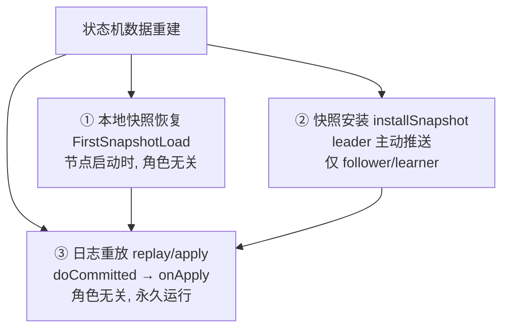
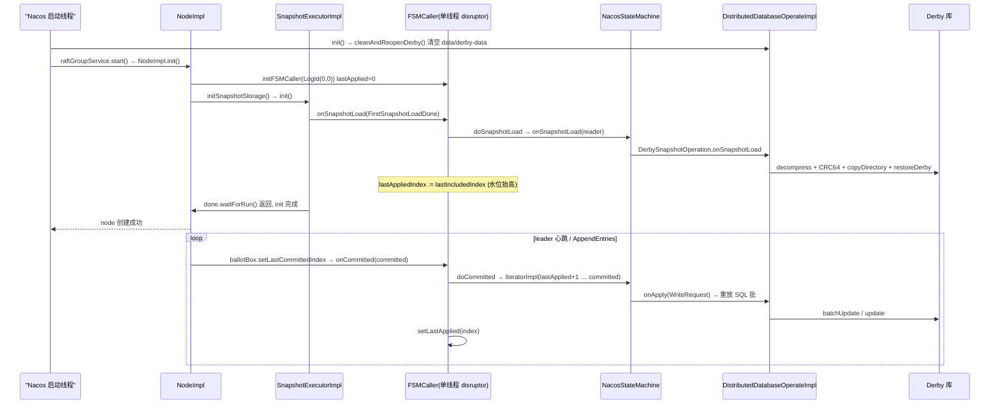

我来把"快照恢复 → 日志重放"这条链完整取证。先并行拉取既有记忆与核心代码。

`onSnapshotLoad` 末尾发布 `DerbyLoadEvent` —— 这可能才是快照后的真正钩子。继续查证。

用户笔记已记录 `DerbyLoadEvent` 无订阅者。现在聚焦"重放"本身——先看恢复后的连接重建与 jraft 版本。

jraft 版本为 **1.3.14**。换源取 jraft 源码。

Gitee 源可用。读取 `FSMCallerImpl` 并同时拉取 `NodeImpl`、`LogManagerImpl`。

`Grep` 无法搜工作区外缓存，改用直接读取。

`doSnapshotLoad` 的证据很关键。但 master 与 Nacos 所用 **1.3.14** 存在重构差异，必须按 tag 取证。

1.3.14 的 `FSMCallerImpl` **没有** `startApplying`/`continueAfterReload`——重放完全靠 `doCommitted`。现在定位 `NodeImpl` 中的触发点。

`initFSMCaller(new LogId(0, 0))` —— 每次启动 `lastAppliedIndex` 都归零，这是重放语义的基石。继续找启动重放与快照安装触发点。

`init` 未显式触发重放——需找 `onCommitted` 的真实调用点与快照安装路径。

找到触发点了：`ballotBox.setLastCommittedIndex(...)`。继续确认闭环与快照后的日志回收。

`logManager.setSnapshot(meta)` 是快照后的关键收尾。确认 `load()` 的调用方与日志回收。

**决定性发现**：本地快照加载发生在 `SnapshotExecutorImpl.init()` 中且同步阻塞等待。最后确认日志回收与重放起点。

最后确认快照安装的触发条件与 leader 侧拒绝逻辑。

全部证据到位（jraft 1.3.14 源码已按 tag 取证）。以下是完整分析。

---

# 〇、结论速览

**是的，leader 和 follower 都必须重放，而且走的是同一条代码路径。** 原因是一个容易被忽略的事实：

```java
// jraft NodeImpl.init()  L1012
if (!initFSMCaller(new LogId(0, 0))) { ... }
```

`lastAppliedIndex` **不落盘**。jraft 只持久化 `term`/`votedFor`（`RaftMetaStorage`）和日志本身（`LogStorage`），不持久化"状态机已应用到哪"。所以每个节点每次启动，`lastAppliedIndex` 都从 0 开始，必须靠"**本地快照抬高起点 + 重放快照点之后的日志**"来重建状态机——这个角色无关。

真正的差异在于**快照从哪来**和**谁推 commit**：

| 维度 | leader | follower |
|---|---|---|
| 启动时加载本地快照 | ✅ 同一处代码 | ✅ 同一处代码 |
| 运行中被推送快照（installSnapshot） | ❌ 不会 | ✅ 仅当 leader 自己也没那条日志时 |
| 重放驱动源 | `BallotBox.commitAt()`（多数派 ack） | `BallotBox.setLastCommittedIndex()`（leader 的 AE/心跳） |
| 重放执行体 | 同一个 `doCommitted → IteratorImpl → onApply` | 同左 |
| `iter.done()` 在重放期 | **null**（closureQueue 是空的） | null |

最后一行是关键：**重放期间 leader 的 `done()` 也是 null**，而 Nacos 的注释把 `done()==null` 解读为"当前节点是 follower"——这在重放场景下不成立，后面细说。

---

# 一、先厘清三个容易混为一谈的动作



- **①** 是"启动时把上次存的快照灌回状态机"，目的是**减少③的量**；
- **②** 是"运行期落后太多，leader 直接把快照发过来"，目的也是**减少③的量**；
- **③** 才是真正把 SQL 打到 Derby 的动作。①② 本身都不执行任何一条日志。

用户问的"快照加载完如何重放"，答案是：**快照加载只做一件事——把 `lastAppliedIndex` 抬到快照点；剩下的③由第一次 commit 通知自然触发，与快照加载没有直接调用关系。**

---

# 二、快照加载的两条入口

## 2.1 入口 A：启动时的本地恢复（同步阻塞，leader/follower 都走）

这是最多人漏掉的一条。它在 `NodeImpl.init` 的 `initSnapshotStorage()` 内部完成：

```java
// NodeImpl.init()  L1012 → L1026
if (!initFSMCaller(new LogId(0, 0))) { ... }     // ① lastAppliedIndex := 0
...
if (!initSnapshotStorage()) { ... }              // ② 内部会加载本地快照
final Status st = this.logManager.checkConsistency();   // ③
```

```java
// SnapshotExecutorImpl.init()  L258-L286
final SnapshotReader reader = this.snapshotStorage.open();   // 打开最后一个本地快照
if (reader == null) { return true; }                          // 没有快照 → 直接返回, lastApplied 保持 0
this.loadingSnapshotMeta = reader.load();                     // 读 __raft_snapshot_meta
this.loadingSnapshot = true;
final FirstSnapshotLoadDone done = new FirstSnapshotLoadDone(reader);
Requires.requireTrue(this.fsmCaller.onSnapshotLoad(done));    // 入 FSM 队列
done.waitForRun();                                            // ★ 同步阻塞等待加载完成
if (!done.status.isOk()) { return false; }                    // 失败 → node.init 失败
```

注意两点：
1. **`initFSMCaller` 必须早于 `initSnapshotStorage`**（L1012 vs L1026），因为 `onSnapshotLoad` 要往 disruptor 里投任务、由 FSM 线程消费，而 `waitForRun()` 在调用线程（Nacos 的 raft 启动线程）阻塞。顺序反了就死锁。
2. **这条路径同步阻塞整个节点启动**。对应 Nacos 侧就是 `DerbySnapshotOperation.onSnapshotLoad` 里那次整库 `copyDirectory` + Derby 重开——它做不完，`raft group` 就建不起来。

## 2.2 入口 B：运行期被 leader 推送（仅 follower）

leader 侧的触发条件非常严格——**不是"follower 落后就发快照"**，而是"leader 自己已经没有 follower 需要的那条日志了"：

```java
// Replicator.sendEmptyEntries()  L773-L781
if (!fillCommonFields(rb, this.nextIndex - 1, isHeartbeat)) {
    // id is unlock in installSnapshot
    installSnapshot();          // ★ 唯一触发点：leader 本地取不到 prevLogIndex 那条日志
    ...
    return;
}
```

follower 侧的准入校验：

```java
// SnapshotExecutorImpl.registerDownloadingSnapshot()  L601-L624
if (this.savingSnapshot) { ... "Node is saving snapshot."  → return false; }
if (ds.request.getTerm() != this.term) { ... return false; }
if (ds.request.getMeta().getLastIncludedIndex() <= this.lastSnapshotIndex) {
    // snapshot is not newer → 回 success=true 但不安装
    return false;
}
// L629 从 leader 拉文件到本地 temp
this.curCopier = this.snapshotStorage.startToCopyFrom(ds.request.getUri(), newCopierOpts());
```

```java
// SnapshotExecutorImpl.loadDownloadingSnapshot()  L578-L582
final InstallSnapshotDone installSnapshotDone = new InstallSnapshotDone(reader);
if (!this.fsmCaller.onSnapshotLoad(installSnapshotDone)) { ... }   // 异步, 不阻塞
```

安装期间会**冻结复制**，避免日志和快照交叉：

```java
// NodeImpl.handleAppendEntriesRequest()  L1952-L1958
if (entriesCount > 0 && this.snapshotExecutor != null && this.snapshotExecutor.isInstallingSnapshot()) {
    return ... RaftError.EBUSY, "Node %s:%s is installing snapshot.";
}
// NodeImpl.preVote()  L2669-L2674：装快照期间不允许发起选举
```

推送完成后 leader 侧复位游标：

```java
// Replicator.onInstallSnapshotReturned()  L738
r.nextIndex = request.getMeta().getLastIncludedIndex() + 1;   // 从快照点+1 继续发日志
```

---

# 三、`DerbySnapshotOperation#onSnapshotLoad` 做了什么（Nacos 侧）

```java
// core/.../DerbySnapshotOperation.java
lock.lock();                                                   // L123 writeLock（见 §6）
DiskUtils.decompress(sourceFile, readerPath, checksum);        // L126 解压 derby_data.zip → readerPath/derby_data/
LocalFileMeta fileMeta = reader.getFileMeta(snapshotArchive);  // L128
if (!Objects.equals(Long.toHexString(checksum.getValue()), fileMeta.get(checkSumKey))) {
    throw new IllegalArgumentException("Snapshot checksum failed");   // L132 CRC64 校验
}
final String loadPath = Paths.get(readerPath, "derby_data", "derby-data").toString();  // L136
doDerbyRestoreFromBackup(() -> {
    DiskUtils.copyDirectory(new File(loadPath), new File(derbyBaseDir));                // L143 整库物理替换
    return null;
});
DiskUtils.deleteDirectory(loadPath);                          // L147
NotifyCenter.publishEvent(DerbyLoadEvent.INSTANCE);           // L148 ★无订阅者
return true;                                                  // L149
```

`restoreDerby` 的三步是"能不能马上接重放"的关键：

```java
// persistence/.../LocalDataSourceServiceImpl.java
public void restoreDerby(String jdbcUrl, Callable<Void> callable) throws Exception {
    doDerbyClean();        // L131  DriverManager.getConnection("jdbc:derby:;shutdown=true") + 删除 data/derby-data
    callable.call();       // L132  copyDirectory：把快照里的库搬到 data/derby-data
    initialize(jdbcUrl);   // L133  重建 Hikari 池 + JdbcTemplate + reload() 跑 derby-schema.sql
}
```

注意 L72 的 URL：

```java
private final String restoreDB = "jdbc:derby:" + derbyBaseDir;      // 没有 ;create=true
// 对比 cleanAndReopenDerby  L119
final String jdbcUrl = "jdbc:derby:" + Paths.get(...) + ";create=true";
```

恢复路径**刻意不给 Derby 建库权限**——如果 `copyDirectory` 拷出来的目录不完整，`initialize` 直接抛异常，`onSnapshotLoad` 返回 false，而不是静默建出一个空库冒充恢复成功。

---

# 四、快照加载完成后，唯一发生的动作是"抬水位"

这是整条链的枢纽，`doSnapshotLoad` 在 `fsm.onSnapshotLoad` 返回 true 之后只有四行有效代码：

```java
// FSMCallerImpl.doSnapshotLoad()  L710-L730
if (!this.fsm.onSnapshotLoad(reader)) {                    // → NacosStateMachine → DerbySnapshotOperation
    done.run(new Status(-1, "StateMachine onSnapshotLoad failed"));
    setError(new RaftException(ERROR_TYPE_STATE_MACHINE, ESTATEMACHINE, "StateMachine onSnapshotLoad failed"));
    return;                                                 // ★失败即让节点进 ERROR
}
...
this.fsm.onConfigurationCommitted(conf);                   // L725 顺带恢复集群配置
this.lastCommittedIndex.set(meta.getLastIncludedIndex());   // L727
this.lastAppliedIndex.set(meta.getLastIncludedIndex());     // L728 ★重放起点被抬高到这里
this.lastAppliedTerm = meta.getLastIncludedTerm();          // L729
done.run(Status.OK());                                      // L730 → onSnapshotLoadDone
```

**这里没有任何"循环应用后续日志"的代码。** 很多资料里说的"装完快照后 `startApplying` 继续重放"在 1.3.14 里已经不存在——我完整读过这个版本的 `FSMCallerImpl`，`startApplying`、`continueAfterReload` 均已移除（全文 789 行，只有 `doCommitted` 一个应用入口）。

`done.run(Status.OK())` 触发的收尾是**日志回收**：

```java
// SnapshotExecutorImpl.onSnapshotLoadDone()  L473-L478
this.lastSnapshotIndex = this.loadingSnapshotMeta.getLastIncludedIndex();
this.logManager.setSnapshot(this.loadingSnapshotMeta);   // ★
// L491
this.node.updateConfigurationAfterInstallingSnapshot();
```

```java
// LogManagerImpl.setSnapshot()  L619-L647
if (this.lastSnapshotId.compareTo(this.appliedId) > 0) { this.appliedId = this.lastSnapshotId.copy(); }
if (term == 0) {
    truncatePrefix(meta.getLastIncludedIndex() + 1, this.writeLock);
} else if (term == meta.getLastIncludedTerm()) {
    // Truncating log to the index of the last snapshot.
    // We don't truncate log before the last snapshot immediately since
    // some log around last_snapshot_index is probably needed by some followers
    if (savedLastSnapshotIndex > 0) {
        truncatePrefix(savedLastSnapshotIndex + 1, this.writeLock);   // ★只回收到"上上次"快照点
    }
} else { reset(meta.getLastIncludedIndex() + 1); }
```

这段注释是整个设计的精髓：**故意不立刻删掉快照点附近的日志**，因为可能正有 follower 需要它们。如果删狠了，`IteratorImpl.next()` 取不到日志会直接把节点打进 ERROR：

```java
// IteratorImpl.next()
this.currEntry = this.logManager.getEntry(this.currentIndex);
if (this.currEntry == null) {
    getOrCreateError().setType(EnumOutter.ErrorType.ERROR_TYPE_LOG);
    getOrCreateError().getStatus().setError(-1, "Fail to get entry at index=%d while committed_index=%d", ...);
}
```

---

# 五、重放引擎：`doCommitted` + `IteratorImpl`

这才是"重放"的全部实现，而且它和正常运行期的 apply 是**同一段代码，没有任何 if 区分**：

```java
// FSMCallerImpl.doCommitted()  L519-L575
private void doCommitted(final long committedIndex) {
    if (!this.error.getStatus().isOk()) { return; }
    final long lastAppliedIndex = this.lastAppliedIndex.get();
    if (lastAppliedIndex >= committedIndex) { return; }          // 幂等闸门
    ...
    final long firstClosureIndex = this.closureQueue.popClosureUntil(committedIndex, closures, taskClosures);
    final IteratorImpl iterImpl = new IteratorImpl(this, this.logManager, closures, firstClosureIndex,
        lastAppliedIndex, committedIndex, this.applyingIndex);    // ★ 起点 = lastAppliedIndex + 1
    while (iterImpl.isGood()) {
        final LogEntry logEntry = iterImpl.entry();
        if (logEntry.getType() != ENTRY_TYPE_DATA) { ...; iterImpl.next(); continue; }  // conf/noop 日志
        doApplyTasks(iterImpl);                                   // → fsm.onApply(iter)
    }
    ...
    setLastApplied(lastIndex, lastTerm);                          // L571 推进水位
}
```

```java
// IteratorImpl 构造  →  this.currentIndex = lastAppliedIndex; next();
// next()           →  ++this.currentIndex; getEntry(this.currentIndex)
// Closure done()   →  if (currentIndex < firstClosureIndex) return null;
```

重放时 `closureQueue` 是重启后新建的（`initFSMCaller` → 空队列），`popClosureUntil` 拿到的 closures 全是 null，所以 **`iter.done() == null`**——这与"节点是不是 follower"无关，纯粹因为是重启重放。

---

# 六、谁触发重放（这是 leader/follower 唯一的实质差异）

## follower / candidate：靠 leader 的 `committed_index`

```java
// NodeImpl.FollowerStableClosure 构造  L1843-L1847
this.committedIndex = Math.min(
    request.getCommittedIndex(),
    // 追加之后的日志不可信，不能 commit
    request.getPrevLogIndex() + request.getEntriesCount());

// FollowerStableClosure.run()  L1893
this.node.ballotBox.setLastCommittedIndex(this.committedIndex);
```

**连心跳都能触发重放**——这是"Nacos 集群没有写流量、follower 重启后照样能追上"的原因：

```java
// NodeImpl.handleAppendEntriesRequest(), entriesCount == 0 分支  L1978-L1988
if (entriesCount == 0) {
    // heartbeat or probe request
    doUnlock = false;
    this.writeLock.unlock();
    // see the comments at FollowerStableClosure#run()
    this.ballotBox.setLastCommittedIndex(Math.min(request.getCommittedIndex(), prevLogIndex));   // ★
    return respBuilder.build();
}
```

```java
// BallotBox.setLastCommittedIndex()  L227-L250（follower 专用）
if (this.pendingIndex != 0 || !this.pendingMetaQueue.isEmpty()) { ... return false; }   // 已是 leader 则拒绝
if (!this.waiter.hasAvailableCapacity(1)) { ... "fsm is busy" return false; }
if (lastCommittedIndex > this.lastCommittedIndex) {
    this.lastCommittedIndex = lastCommittedIndex;
    this.stampedLock.unlockWrite(stamp);          // ★ 先解锁再回调, 避免 FSM 线程被 BallotBox 写锁拖住
    this.waiter.onCommitted(lastCommittedIndex);  // ★ waiter == FSMCaller
}
```

## leader：靠多数派 ack

```java
// NodeImpl.LeaderStableClosure.run()  L1351-L1354
this.node.ballotBox.commitAt(firstLogIndex, firstLogIndex + nEntries - 1, serverId);

// BallotBox.commitAt()  L116-L140
for (long logIndex = startAt; logIndex <= lastLogIndex; logIndex++) {
    hint = bl.grant(peer, hint);
    if (bl.isGranted()) { lastCommittedIndex = logIndex; }
}
...
this.waiter.onCommitted(lastCommittedIndex);      // ★ 同一个入口
```

当选 leader 时只做游标复位，**不重装快照、不重置水位**：

```java
// NodeImpl.becomeLeader()  L1258
this.ballotBox.resetPendingIndex(this.logManager.getLastLogIndex() + 1);
```

## 结论：一次重启的完整时序



一次启动共涉及 **3 条线程**：Nacos 启动线程（阻塞在 `waitForRun`）、`JRaft-FSMCaller-Disruptor-*`（快照加载与重放都在这里）、RPC 处理线程（投递 `onCommitted` 任务）。

---

# 七、关键点

1. **`lastAppliedIndex` 不持久化**（`NodeImpl.init` L1012 传 `new LogId(0,0)`）——这是"leader 和 follower 都必须重放"的根本原因，也是 jraft 不需要维护"apply 位点"这种额外持久化状态的代价。

2. **快照加载与日志重放在同一条线程上串行**（`FSMCallerImpl.runApplyTask` 的 `TaskType.SNAPSHOT_LOAD` 与 `TaskType.COMMITTED` 共用一个 disruptor 单 handler）。所以"装完快照才开始重放"是**天然有序**的，不需要额外同步——这是 `DerbySnapshotOperation` 敢做整库替换的安全前提。

3. **重放没有独立代码路径**：`doCommitted` 对"实时新提交"和"重启重放"完全一致，唯一区别是入参 `lastAppliedIndex` 离 `committedIndex` 有多远。理解这一点，就不会去找"重放在哪个类里"这种不存在的答案。

4. **Nacos 的清库与 jraft 恢复顺序严格咬合**：`DistributedDatabaseOperateImpl.init()` L192 `cleanAndReopenDerby()` → L214 `addRequestProcessors` → `JRaftServer.createMultiRaftGroup` → `NodeImpl.init` → 本地快照恢复 → 重放。先清空、后覆盖、再补日志，所以"不信任任何本地残留"是成立的。

5. **`writeLock` 挡的是读请求，不是 apply**：`DerbySnapshotOperation.onSnapshotLoad` L123 持写锁，而 `onApply`（L523）、`onRequest`（L474）持读锁。因为 apply 与 snapshot load 在同一条 FSM 线程串行，写锁不是用来防自己的，是用来防止**客户端读请求在整库替换的中间态上拿到半截数据**。

6. **重放会顺带重建缓存，快照恢复不会**：`onApply` 的非导入分支 L537 `PersistenceExecutor.executeEmbeddedDump(...)` 会跑 `EmbeddedApplyHook`，`EmbeddedConfigDumpApplyHook.afterApply` 从 `WriteRequest.extendInfo` 还原 `ConfigDumpEvent` 并发布 → `DumpConfigHandler` dump 到磁盘/内存缓存。日志重放时 extendInfo 是随日志条目一起来的，所以缓存能重建。而 `onSnapshotLoad` 只发 `DerbyLoadEvent`（L148，无订阅者）——**整库替换后没有任何缓存重建动作**。这解释了两类不一致窗口的来源不同。

7. **follower 不需要写入流量也能完成重放**：心跳分支 L1987 就会推进 commit。所以 3 节点集群里单独重启一个 follower，几秒内数据即追平（前提是快照/日志够用）。

8. **`setSnapshot` 故意保留上次快照点之后的日志**（LogManagerImpl L637-L647，注释原文）——保证 follower 还能按日志追赶，避免"leader 刚存完快照就把自己和 follower 都逼到只能传快照"。

---

# 八、坑

1. **`onSnapshotLoad` 失败不会回滚 derby 目录**。`DerbySnapshotOperation` L150-L152 catch 后只 `return false`；此时 `restoreDerby` 可能已经执行过 `doDerbyClean()`（删库）而 `copyDirectory` 或 `initialize` 失败 → **本地库是空的或半的**，同时 `doSnapshotLoad` L710-L715 让 FSM 进 `ERROR_TYPE_STATE_MACHINE` → `node.onError` → `NodeImpl.onError` L2528 `stepDown` → Nacos 侧 `DistributedDatabaseOperateImpl.init` 注册的 `RaftDbErrorEvent` 订阅把健康位置 DOWN。表现是"节点起来了但 raft 完全不可用"，而库已经被删了。排查时必须看 raft 日志里的 `Fail to load snapshot from ...`。

2. **Nacos 对 `done()==null` 的注释不准确**，且这条注释直接决定读日志是否被执行：

```java
// NacosStateMachine.onApply  L104-L116
if (iter.done() != null) { closure = (NacosClosure) iter.done(); message = closure.getMessage(); }
else {
    final ByteBuffer data = iter.getData();
    message = ProtoMessageUtil.parse(data.array());
    if (message instanceof ReadRequest) {
        //'iter.done() == null' means current node is follower, ignore read operation   ← 注释
        applied++; index++; iter.next(); continue;
    }
}
```

按 §5，**重启后 leader 重放自己的日志时 `done()` 同样是 null**。所以这段的真实语义是"有调用方 closure 才处理读，否则跳过读"，而不是"follower 跳过读"。写日志（`WriteRequest`）不受影响照常重放——这是正确行为（leader 和 follower 都必须重放写），但按注释去理解会得出错误结论。

3. **`isInstallingSnapshot` 期间的 EBUSY 会让 leader 侧的复制退避**，配合 Nacos 默认 `snapshotIntervalSecs=1800`（`JRaftServer` L249-L255）和整库 zip 压缩（`onSnapshotSave` 在 `PersistenceExecutor` 线程但全程持 `writeLock`），Derby 数据量大时会出现"每 30 分钟一次、持续数十秒的读阻塞"。`onSnapshotSave` 持写锁 L88，与 `onApply`/`onRequest` 的读锁互斥——**保存快照的窗口里读写一起被挡**，这比加载更常见。

4. **"日志已回收 + 本地无快照"会直接打死节点**：`IteratorImpl.next()` 拿不到 entry → `ERROR_TYPE_LOG` → `doCommitted` L564 `setError` → `runTheRestClosureWithError`。若有人手工只删 `data/protocol/raft/nacos_config/snapshot/` 而保留 `log/`，重启即触发。运维上 `snapshot` 与 `log` 必须同进同退。

5. **`requires` 的隐式契约**：`SnapshotExecutorImpl.init` L272 `Requires.requireTrue(this.fsmCaller.onSnapshotLoad(done))` —— 若 FSMCaller 已在 shutdown（`shutdownLatch != null`，`enqueueTask` L245-249 返回 false），这里不是返回 false 而是抛 `IllegalArgumentException`，从 `NodeImpl.init` 冒出，Nacos 侧 `createMultiRaftGroup` 会让整个 raft 启动失败。

6. **`DerbyLoadEvent` 无订阅者**（与你 `design/config/配置发布follower如何leader保持一致.md` 的坑 3 一致）：快照整库替换后缓存不重建。结合 §7 第 6 点，这条的修复方向很明确——`onSnapshotLoad` 成功后应触发一次该 group 的全量 dump（`DumpAllProcessor`），而不是留一个空事件。

---

# 九、总结

**快照加载和日志重放是两个解耦的动作，靠 `lastAppliedIndex` 这一个变量衔接。**

链路是：`NodeImpl.init` 先把 `lastAppliedIndex` 置 0（L1012），随后 `initSnapshotStorage` 同步加载本地快照（`SnapshotExecutorImpl.init` L258-L286），一路走到 Nacos 的 `DerbySnapshotOperation.onSnapshotLoad` 做 CRC64 校验 + 整库替换 + Derby 重开；成功后 `doSnapshotLoad` 把水位抬到 `meta.lastIncludedIndex`（L727-L729），并由 `onSnapshotLoadDone → logManager.setSnapshot → truncatePrefix` 回收旧日志。此后**不再有"重放专用流程"**：下一条来自 leader 的 AppendEntries 甚至纯心跳，都会经由 `ballotBox.setLastCommittedIndex → fsmCaller.onCommitted` 触发 `doCommitted`，用 `IteratorImpl` 从"快照点 + 1"逐条把日志打到 `NacosStateMachine.onApply → DistributedDatabaseOperateImpl.onApply`，执行真实 SQL，直到追平 `committedIndex`。

**leader 和 follower 都要重放，走完全相同的路径**，因为 apply 位点不持久化。二者的真实区别只有两点：其一，`installSnapshot` RPC 只由 leader 的 `Replicator` 发出、只被 follower/learner 接收（Replicator 仅在 `becomeLeader` L1239-L1255 创建），所以 leader 的快照只能来自启动时的本地恢复；其二，推进 commit 的来源不同——leader 用 `commitAt`（多数派 ack，L140），follower 用 `setLastCommittedIndex`（L249）。而一个新当选的 leader，它在当选前作为 follower 阶段就已经完成了装快照和重放，`becomeLeader` 只复位 `pendingIndex`，不会重装。

值得记住的三处设计取舍：**用"不持久化 apply 位点"换取状态机重建逻辑的统一**（代价是重启后必然重放一段日志）；**用"同一线程串行 SNAPSHOT_LOAD 与 COMMITTED"换取快照替换的天然安全**（代价是装快照期间整个 FSM 停顿）；**用"延迟回收快照点附近日志"换取 follower 按日志追赶的机会**（代价是磁盘占用上界由两次快照间隔决定）。对应的三个运维要点：手工清 `snapshot` 目录必须连 `log` 一起清；`onSnapshotLoad` 失败后本地库可能已被删空，要看 raft 日志而不是只看进程是否存活；快照间隔（默认 1800s）同时决定了 apply 停顿频率和 follower 的最大追赶成本。