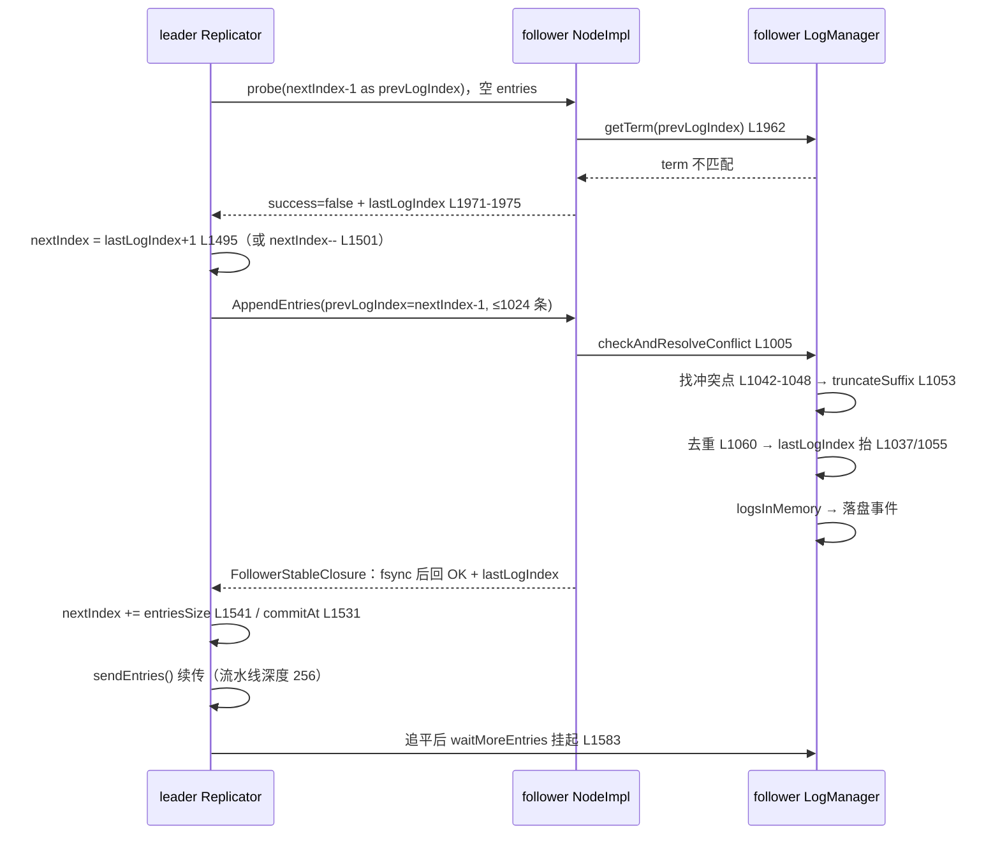

I'll read your note and pull the relevant source in parallel.

笔记已收到（上一轮的回答已完整落盘）。这次的问题聚焦在**追日志与衔接**，需要读冲突截断、快照兜底、装完后重连接口这三段。

`checkAndResolveConflict` 拿到了——这是"衔接"的核心。现在补装快照兜底那条路。

快到位了。补最后两块：装完快照后 apply 位点如何续上，以及 Nacos 侧的 margin 配置。

取证完成（含一个此前没暴露的坑：装快照期间 `BallotBox` 连 commit 位点都不推）。下面回答。

---

# 先给结论

**1. "追日志"这件事，Nacos 里一行代码都没有。** 我把 `core/distributed/raft` 全扫了一遍，Nacos 只有 `JRaftOps` 的运维入口（transferLeader / changePeers / snapshot / resetPeers）。追平完全由 jraft 的三处协作完成：

| 角色 | 位置 | 负责什么 |
|---|---|---|
| **Replicator**（leader 侧，每 peer 一个） | `Replicator.sendEntries` L1626-1705 | 定位 `nextIndex`、批量补发、失败回退 |
| **checkAndResolveConflict**（follower 侧） | `LogManagerImpl` L1005-1065 | **重叠去重 + 分歧截断 + 有洞拒收** |
| **SnapshotExecutorImpl**（兜底） | L516-583 + `LogManagerImpl.setSnapshot` L599-659 | 日志已被截掉时整体换基线 |

**2. "落后"分三档，代码路径完全不同，必须先分档再谈"怎么追"。** 很多人把这三档混为一谈，结果排查方向从一开始就错了。

**3. 衔接的唯一锚点是 `(prevLogIndex, prevLogTerm)` 这一对。** 而这个锚点**能正好落在快照上**，靠的是 `LogManagerImpl.getTerm` 里一个很容易被忽略的分支：

```java
// getTerm(index)  L770-792
if (index == 0) { return 0; }
// check index equal snapshot_index, return snapshot_term
if (index == this.lastSnapshotId.getIndex()) { return this.lastSnapshotId.getTerm(); }   // L777-779 ★★★
if (index > this.lastLogIndex || index < this.firstLogIndex) { return 0; }                // L781-783 → 触发走快照
```

> **快照的 `lastIncludedIndex` 就是日志流的接缝。** `firstLogIndex = lastIncludedIndex + 1`，而 `getTerm(lastIncludedIndex)` 仍然可查——所以"日志接在快照后面"这件事是能**被校验**的，不是靠约定。这就是"如何衔接"的支点。

**4. 三条不许越过的硬边界**（保证衔接不会把数据搞乱）：

- 有洞 → `EINVAL "There's gap between first_index=%d and last_log_index=%d"`（L1019-1024），**绝不填洞**
- 已 apply 的日志 → `FATAL ERROR: Can't truncate logs before appliedId`（L985-989），**绝不回滚状态机**
- 比已 apply 更旧的快照 → `ESTALE "Loading a stale snapshot"`（`FSMCallerImpl.doSnapshotLoad` L703-709），**绝不换旧基线**

---

# 一、先分档：位点表（谁手里到底有什么）

jraft 一个节点上有 7 个位点，"落后"必须说是哪个落后：

| 位点 | 持有者 | 含义 | 源码 |
|---|---|---|---|
| `lastLogIndex` | LogManager | 本地日志尾（**含未落盘的**，L332 进内存即算） | L822-850 |
| `firstLogIndex` | LogManager | 本地日志头，`= 快照位点 + 1` | L812-819 |
| `lastSnapshotId` | LogManager | 已生效快照的 `(index, term)` = **接缝位置** | L616-617 |
| `diskId` | LogManager | 已落盘的日志尾 | L578-596 |
| `appliedId` | LogManager | 已 apply 进状态机的尾 | L1131-1146 |
| `lastCommittedIndex` | **BallotBox** | 共识位点（本地安全下界） | L68-80 |
| `lastAppliedIndex` | **FSMCaller** | 状态机执行位点 | L376-378 |
| `nextIndex` | **Replicator** | leader 认为某个 peer 该从哪儿接着收 | L591-605 / L1541 |

于是三档：

```
档 A：follower.lastLogIndex ≥ committed，只是 lastAppliedIndex 落后
      → 不追日志，只追 apply（心跳就够）
档 B：leader.lastLogIndex > follower.lastLogIndex，且差距 ≥ leader.firstLogIndex
      → AppendEntries 补（主路径）
档 C：leader 已把那段日志截掉（nextIndex < leader.firstLogIndex）或 follower 是空节点
      → InstallSnapshot 换基线
```

判定式在 leader 侧非常明确——就是 `fillCommonFields`：

```java
// Replicator.fillCommonFields  L1551-1566
final long prevLogTerm = this.options.getLogManager().getTerm(prevLogIndex);
if (prevLogTerm == 0 && prevLogIndex != 0) {          // L1553 ★锚点找不到 → 只可能是被压缩了
    if (!isHeartbeat) {
        Requires.requireTrue(prevLogIndex < this.options.getLogManager().getFirstLogIndex());  // L1555 断言
        LOG.debug("logIndex={} was compacted", prevLogIndex);
        return false;                                  // → 调用方走 installSnapshot()
    } else {
        prevLogIndex = 0;   // ★ L1564 心跳特例，见第五节
    }
}
```

---

# 二、档 B：日志补发（最主流的"追"）

## leader 侧：先用一次 probe 把 nextIndex 定位准

follower 的拒绝响应**总是带自己的 `lastLogIndex`**（`NodeImpl.handleAppendEntriesRequest` L1971-1975），leader 据此一步跳位：

```java
// Replicator.onRpcReturned 失败分支  L1489-1508
r.resetInflights();
// prev_log_index and prev_log_term doesn't match
if (response.getLastLogIndex() + 1 < r.nextIndex) {
    r.nextIndex = response.getLastLogIndex() + 1;      // L1495 ★"你比我少"→ 一步跳到你的尾+1
} else {
    // The peer contains logs from old term which should be truncated,
    // decrease _last_log_at_peer by one to test the right index to keep
    if (r.nextIndex > 1) { r.nextIndex--; }             // L1501 ★"你比我多但多的是旧 term"→ 逐条回退找分歧点
}
r.sendProbeRequest();                                   // L1508
```

**这两个分支的区别是理解"衔接"的关键：**
- `nextIndex = lastLogIndex + 1`：解决**"少"**——把起点搬到对方尾巴后面，直接接上。
- `nextIndex--`：解决**"多但不对"**——follower 手里有上一任 leader 留下的、term 不同的尾巴。此时 follower 的 `lastLogIndex` 可能比 leader 的 `nextIndex` 还大，`lastLogIndex + 1` 会倒退过头（把 follower 其实没有的日志当成有），只能**逐条向前试探**，找到第一个 term 匹配的位置。**这就是 Raft 论文里那个 "decrement nextIndex one by one" 的低效实现，jraft 只对"多出来"的场景保留它。**

## follower 侧：`checkAndResolveConflict` 就是"衔接"的本体

这是本次问答最该背下来的一段。`LogManagerImpl` L1005-1065，五种情形：

```java
private boolean checkAndResolveConflict(final List<LogEntry> entries, final StableClosure done, final Lock lock) {
    final LogEntry firstLogEntry = ArrayDeque.peekFirst(entries);
    if (firstLogEntry.getId().getIndex() == 0) {
        // leader 自己追加：index 由本地分配，不存在冲突            L1007-1014
        for (int i = 0; i < entries.size(); i++) { entries.get(i).getId().setIndex(++this.lastLogIndex); }
        return true;
    } else {
        // ① 有洞 → 拒收，绝不填洞
        if (firstLogEntry.getId().getIndex() > this.lastLogIndex + 1) {          // L1019
            runClosureInThread(groupId, done, new Status(RaftError.EINVAL,
                "There's gap between first_index=%d and last_log_index=%d", ...));
            return false;                                                        // L1023
        }
        // ② 全是已 apply 过的老日志 → 当作成功，什么都不做
        final long appliedIndex = this.appliedId.getIndex();                      // L1025
        if (lastLogEntry.getId().getIndex() <= appliedIndex) {                    // L1027
            LOG.warn("Received entries of which the lastLog={} is not greater than appliedIndex={}...", ...);
            runClosureInThread(groupId, done);   // Replicate old logs before appliedIndex should be considered successfully
            return false;                                                         // L1033
        }
        if (firstLogEntry.getId().getIndex() == this.lastLogIndex + 1) {
            this.lastLogIndex = lastLogEntry.getId().getIndex();                  // L1037 ★最干净的衔接：正好接上
        } else {
            // ③ 本地与 leader 有重叠，逐条找第一个 term 不一致的位置
            int conflictingIndex = 0;
            for (; conflictingIndex < entries.size(); conflictingIndex++) {
                if (unsafeGetTerm(entries.get(conflictingIndex).getId().getIndex())
                        != entries.get(conflictingIndex).getId().getTerm()) { break; }   // L1044-1046 ★
            }
            if (conflictingIndex != entries.size()) {
                if (entries.get(conflictingIndex).getId().getIndex() <= this.lastLogIndex) {
                    // Truncate all the conflicting entries to make local logs consensus with the leader.
                    unsafeTruncateSuffix(entries.get(conflictingIndex).getId().getIndex() - 1, lock);   // L1053 ★砍分歧
                }
                this.lastLogIndex = lastLogEntry.getId().getIndex();              // L1055
            } // ④ else：完全重复的 AppendEntriesRequest，只释放 entries 不写盘
            if (conflictingIndex > 0) {
                entries.subList(0, conflictingIndex).clear();                      // L1060 ★去重：本地已有且 term 相同的跳过
            }
        }
        return true;
    }
}
```

**五个要点：**

1. **② 和 ④ 是幂等保障。** leader 的 RPC 重试、`pendingResponses` 乱序、`block` 后重发，都会造成同一批日志到达两次。② 拦"整批都比 appliedId 旧"，④ 拦"整批 term 全都对得上（重复请求）"。两者都**直接回 OK**，不会让 follower 报错、也不会让 leader 误判。
2. **L1044 的比较只看 term，不看内容。** 这是 Raft 的标准做法（同 term + 同 index ⟹ 内容相同，靠 Log Matching 性质传递保证）。前提是 `enable_log_entry_checksum`——**Nacos 默认 false**（`RaftSysConstants` L127），于是这条性质只剩"理论上成立"。
3. **L1053 的截断位置是 `conflictingIndex 对应的 index - 1`。** 当 `conflictingIndex == 0`（第一条就冲突），截断点正好是 `prevLogIndex` —— 即**从锚点之后全部丢弃、按 leader 重写**。这就是"新 leader 抹掉前任未提交尾巴"的实现现场。
4. **L1060 的去重省掉了重复写盘**，所以 leader 从 `nextIndex` 偏小的位置重发一批时，follower 只写缺的那一段。
5. **② 的注释值得单独看**：`Replicate old logs before appliedIndex should be considered successfully`——**给已 apply 的老日志回 OK 是故意的**，因为 leader 侧收到 OK 会推进 `commitAt`，而这些日志早就 commit 过了，不会造成错误推进。

## index 完全由 follower 自己重算

`AppendEntriesRequest` 的 `EntryMeta` 里**根本没有 index 字段**（只有 term/type/dataLen/checksum/peers）：

```java
// NodeImpl.handleAppendEntriesRequest  L2000-2013
long index = prevLogIndex;                                     // L2001 ★从锚点起算
for (int i = 0; i < entriesCount; i++) {
    index++;
    final LogEntry logEntry = logEntryFromMeta(index, allData, entry);   // L2013
    ...
}
// logEntryFromMeta  L2061
logEntry.setId(new LogId(index, entry.getTerm()));
```

**这是衔接成立的结构性原因**：follower 不可能"信错" leader 的编号，它只信 `prevLogIndex` 这个锚点 + 自己数出来的偏移。锚点一旦通过 `getTerm` 校验，后面整段的位置就自动唯一确定。

## 截断与追加不会交错

`unsafeTruncateSuffix` L991-1001 只改内存 + 投一个 `TRUNCATE_SUFFIX` 事件，落盘动作由**单线程 disruptor handler** 串行执行：

```java
// StableClosureEventHandler.onEvent
if (done.getEntries() != null && !done.getEntries().isEmpty()) { this.ab.append(done); }   // L512 追加（会 flush）
else {
    this.lastId = this.ab.flush();                          // L515 ★先 flush 掉攒着的追加
    switch (eventType) {
        case TRUNCATE_PREFIX: logStorage.truncatePrefix(tpc.firstIndexKept);   break;   // L526
        case TRUNCATE_SUFFIX: logStorage.truncateSuffix(tsc.lastIndexKept);             // L537
                            if (ret) { this.lastId.setIndex(tsc.lastIndexKept);
                                       this.lastId.setTerm(tsc.lastTermKept); }        // L539-540
        case RESET:         logStorage.reset(rc.nextLogIndex); break;                   // L551
```

注意 L515：**任何 truncate/reset 事件进来都先 `ab.flush()`**。所以"截断"一定发生在"之前攒着要追加的日志已落盘"之后，顺序不会被 batcher 打乱。L541 还有个断言 `Requires.requireTrue(lastIndexKept == 0 || term != 0)`——截完之后新的尾部必须能查到 term，查不到说明存储坏了。

## 内存日志才是"补发缓冲"

leader 能给 follower 补到多新的日志，取决于 `logsInMemory` 什么时候被清：

```java
// LogManagerImpl.setDiskId  L588-594（落盘完成）
this.diskId = id;
clearId = this.diskId.compareTo(this.appliedId) <= 0 ? this.diskId : this.appliedId;   // L589 ★取 min
clearMemoryLogs(clearId);                                                              // L594
// setAppliedId  L1138-1144 同样的 min
```

**内存日志要等到"既落盘了、又 apply 了"才被清掉**——这是一层为追平准备的缓冲。加上 `prepareEntry` L844 走 `getEntry` → 先查内存（`getEntryFromMemory` L724-738）再查磁盘，所以 **leader 刚 `apply` 还没 fsync 的日志立刻就能发给 follower**（上一轮那条"复制早于落盘"的另一半证据）。

## 收敛过程（档 B 全图）



---

# 三、档 A：只差 commit —— 不追日志，只追 apply

这一档最容易被误判成"复制卡住了"。链路是：

```java
// ① leader 心跳带 commit 位点
rb.setCommittedIndex(this.options.getBallotBox().getLastCommittedIndex());    // fillCommonFields L1573

// ② follower 收到空 entries 时推进（持 writeLock 后立刻释放，L1984-1987）
this.ballotBox.setLastCommittedIndex(Math.min(request.getCommittedIndex(), prevLogIndex));   // NodeImpl L1987

// ③ BallotBox.setLastCommittedIndex 的四道守卫
if (this.pendingIndex != 0 || !this.pendingMetaQueue.isEmpty()) { ... return false; }  // L231 已是 leader
if (!this.waiter.hasAvailableCapacity(1)) {                                             // L237 ★★
    LOG.warn("Node {} fsm is busy, can't set lastCommittedIndex ..."); return false; }
if (lastCommittedIndex < this.lastCommittedIndex) { return false; }                       // L242 不回退
if (lastCommittedIndex > this.lastCommittedIndex) { unlock; this.waiter.onCommitted(...); }  // L245-249

// ④ FSMCaller 从 lastAppliedIndex+1 开始 apply
if (lastAppliedIndex >= committedIndex) { return; }                     // doCommitted L525-527 幂等
final IteratorImpl iter = new IteratorImpl(..., lastAppliedIndex, committedIndex, this.applyingIndex);  // L539-540
while (iterImpl.isGood()) { ... this.fsm.onApply(iter); }                // L541-562 / doApplyTasks L597
setLastApplied(lastIndex, lastTerm);                                     // L571 → logManager.setAppliedId + notify 监听器
```

**L237 那条是本轮的新发现，也是下面坑 1 的主体**：follower 的 FSMCaller disruptor（Nacos 默认 16384 槽）满时，**连 commit 位点都不推**。

---

# 四、档 C：日志已被截掉 → InstallSnapshot 换基线

## 触发点（三处）

| 位置 | 条件 | 备注 |
|---|---|---|
| `sendEntries` L1628-1631 | `fillCommonFields` 返 false（`getTerm(prevLogIndex)==0`） | 主入口 |
| `sendEntries` L1645-1648 | 一条 entry 都取不到，且 `nextSendingIndex < getFirstLogIndex()` | 补漏：nextIndex 落在截断点之前 |
| `sendEmptyEntries` L774-781 | 心跳也遇到截断 → `installSnapshot()` + 给心跳 closure 回 **EAGAIN** | 见 L778 |

## 发送侧：RPC 里**只有 meta 和 uri，没有数据**

```java
// Replicator.installSnapshot  L622-700
if (getState() == State.Snapshot) { LOG.warn("... is installing snapshot, ignore the new request."); unlockId(); return; }  // L623 不并发
if (!this.rpcService.connect(this.options.getPeerId().getEndpoint())) { block(nowMs, EHOSTDOWN); return; }                   // L629 先探活
Requires.requireTrue(this.reader == null, "Replicator ... already has a snapshot reader, current state is %s", ...);       // L636
this.reader = this.options.getSnapshotStorage().open();                    // L639
final String uri = this.reader.generateURIForCopy();                       // L649 reader://ip:port/.../snapshot_<idx>
final RaftOutter.SnapshotMeta meta = this.reader.load();                   // L660
rb.setMeta(meta); rb.setUri(uri);                                          // L677-678 ★只给地址
this.statInfo.runningState = RunningState.INSTALLING_SNAPSHOT;             // L680
final int seq = getAndIncrementReqSeq();
this.rpcService.installSnapshot(peer, request, closure → onRpcReturned(RequestType.Snapshot, ...));   // L691-697
addInflight(RequestType.Snapshot, this.nextIndex, 0, 0, seq, rpcFuture);    // L700
```

**这是 jraft 与"leader 推数据"模型的第二个不同**（第一个是没有 `replicate()`）：快照文件由 **follower 主动反向拉**（`LocalSnapshotCopier` → `RemoteFileCopier` → `InstallSnapshotFileChunk`），分片大小受 `maxByteCountPerRpc`（Nacos 设 128K，`RaftOptionsBuilder` L70）约束。

## 接收侧：排队与顶替规则（`SnapshotExecutorImpl.registerDownloadingSnapshot` L586-697）

```java
if (this.savingSnapshot) { → EBUSY "Node is saving snapshot." }                                 // L601-607
if (ds.request.getTerm() != this.term) { → success=false }                                        // L610-615
// ★幂等：不比本地快照新 → 直接回成功，不下载
if (ds.request.getMeta().getLastIncludedIndex() <= this.lastSnapshotIndex) {                      // L617
    ds.responseBuilder.setSuccess(true); ds.done.sendResponse(...); return false; }
if (m == null) { this.downloadingSnapshot.set(ds);
    this.curCopier = this.snapshotStorage.startToCopyFrom(ds.request.getUri(), newCopierOpts());   // L629 ★开始拉
    return true; }
// 已有任务在装：
if (m.idx == ds.idx)   { saved = m; this.downloadingSnapshot.set(ds); }   // L647-653 同 index = 重试，顶替，旧 session 回 EINTR
else if (m.idx > ds.idx) { → EINVAL "A newer snapshot is under installing" }  // L654-662 来的是旧的
else { if (this.loadingSnapshot) { → EBUSY "A former snapshot is under loading" }  // L665-672 ★已进 loading 不可打断
       else { this.curCopier.cancel(); → EBUSY "trying to cancel" } }               // L674-683
```

`installSnapshot` 主流程 L516-537 有个值得注意的点：

```java
Requires.requireNonNull(this.curCopier, "curCopier");
this.curCopier.join();          // L529 ★阻塞等文件拷完，跑在 appendEntries 处理线程上
loadDownloadingSnapshot(ds, meta);
```

## 衔接点 1：状态机侧（`FSMCallerImpl.doSnapshotLoad` L684-731）

```java
final LogId lastAppliedId = new LogId(this.lastAppliedIndex.get(), this.lastAppliedTerm);   // L701
final LogId snapshotId = new LogId(meta.getLastIncludedIndex(), meta.getLastIncludedTerm());
if (lastAppliedId.compareTo(snapshotId) > 0) {          // L703 ★LogId 字典序，term 优先
    done.run(new Status(RaftError.ESTALE, "Loading a stale snapshot last_applied_index=%d ...")); return; }
if (!this.fsm.onSnapshotLoad(reader)) { ... ERROR_TYPE_STATE_MACHINE ... }   // L710 Nacos 即 DerbySnapshotOperation.onSnapshotLoad
if (meta.getOldPeersCount() == 0) { ... this.fsm.onConfigurationCommitted(conf); }   // L717-726
this.lastCommittedIndex.set(meta.getLastIncludedIndex());   // L727 ★
this.lastAppliedIndex.set(meta.getLastIncludedIndex());     // L728 ★★ 衔接：apply 位点直接跳到快照尾
this.lastAppliedTerm = meta.getLastIncludedTerm();          // L729
done.run(Status.OK());                                      // L730
```

**L728 是"换基线之后不重放"的全部原因**——位点被抬到快照尾，之后 `doCommitted` 从 `lastAppliedIndex+1` 开始，那段日志已经在 Derby 数据文件里了。

## 衔接点 2：日志侧（`LogManagerImpl.setSnapshot` L599-659，最难的一段）

```java
if (meta.getLastIncludedIndex() <= this.lastSnapshotId.getIndex()) { return; }   // L604 幂等
this.configManager.setSnapshot(entry);                                            // L612
final long term = unsafeGetTerm(meta.getLastIncludedIndex());                     // L613 ★先尝试"印证"这个位点
this.lastSnapshotId.setIndex/Term(meta...);                                        // L616-617
if (this.lastSnapshotId.compareTo(this.appliedId) > 0) { this.appliedId = ...; }   // L619-621 抬 appliedId
// NOTICE: not to update disk_id here as we are not sure if this node really
// has these logs on disk storage. Just leave disk_id as it was, which can keep
// these logs in memory all the time until they are flushed to disk. By this
// way we can avoid some corner cases which failed to get logs.  (braft PR#224)
// L622-629 ★故意注释掉 diskId 更新 → 内存日志不丢

if (term == 0) {
    // last_included_index is larger than last_index
    truncatePrefix(meta.getLastIncludedIndex() + 1, this.writeLock);               // L636 ★本地压根没这个位置 → 从快照+1 开新头
} else if (term == meta.getLastIncludedTerm()) {
    // Truncating log to the index of the last snapshot.
    // We don't truncate log before the last snapshot immediately since
    // some log around last_snapshot_index is probably needed by some followers
    if (savedLastSnapshotIndex > 0) { truncatePrefix(savedLastSnapshotIndex + 1, ...); }   // L646 ★只清"上一轮快照之前"的
} else {
    reset(meta.getLastIncludedIndex() + 1);                                          // L649 ★term 对不上 → 全清
}
```

**三个分支就是"如何与已有日志衔接"的三种答案：**

| 分支 | 本地状态 | 动作 | 后果 |
|---|---|---|---|
| `term == 0` | 快照位点超出本地已知范围 | `truncatePrefix(idx+1)` | 本地 `firstLogIndex = idx+1`，接缝在快照上 |
| `term` 匹配 | 本地能印证这个位点 | **只清到"上一个快照 + 1"** | 保留快照位点附近的一段日志，**给其它落后的 follower 用**（L639-641 注释） |
| `term` 不匹配 | 本地这个位置是别的内容 | `reset(idx+1)`：L970-974 清空 `logsInMemory`、`firstLogIndex=idx+1`、`lastLogIndex=idx`，异步 `logStorage.reset` | 彻底以快照为新起点 |

**中间那个分支值得再看一遍**：`savedLastSnapshotIndex` 是**上一个**快照的 index，不是这次装的。也就是说 leader（或任何节点）装完新快照后**不会立刻删掉新快照位点附近还在被 follower 索取的日志**。这是"一个节点落后到要走快照，另一个节点只是在线补发"这种混合场景能同时服务的原因。

## 衔接点 3：leader 侧重新定位（`onInstallSnapshotReturned` L709-758）

```java
r.releaseReader();                                                       // L713
if (!status.isOk()) { notifyReplicatorStatusListener(ERROR); ... break; } // L721-729
if (!response.getSuccess()) { ... break; }                                // L731-736
// success
r.nextIndex = request.getMeta().getLastIncludedIndex() + 1;               // L738 ★★ leader 接受对方的新基线
...
// We don't retry installing the snapshot explicitly.                     // L742
if (!success) { r.resetInflights(); r.setState(State.Probe); r.block(nowMs, code); return false; }  // L744-749
r.hasSucceeded = true; r.notifyOnCaughtUp(SUCCESS, false);                 // L751-752
if (r.timeoutNowIndex > 0 && r.timeoutNowIndex < r.nextIndex) { r.sendTimeoutNow(false, false); }    // L753-755
r.setState(State.Replicate);                                              // L757 ★回到档 B 的正常复制
```

**L738 之后链路自动回到档 B**：`nextIndex` 指向快照尾+1，`fillCommonFields` 用 `getTerm(lastIncludedIndex)` 拿到快照 term（follower 侧 L777-779 同样返回快照 term）→ **匹配成功 → 用 AppendEntries 接着补**。换基线不是终点，而是把接缝挪到了新快照上。

---

# 五、`fillCommonFields` 的心跳特例（一个为追平专门做的降级）

```java
// Replicator L1558-1565
// The log at prev_log_index has been compacted, which indicates
// we is or is going to install snapshot to the follower. So we let
// both prev_log_index and prev_log_term be 0 in the heartbeat
// request so that follower would do nothing besides updating its
// leader timestamp.
prevLogIndex = 0;
```

心跳遇到锚点被截时**不走快照、不改 prevLogIndex，直接置 0**，让 follower 只做 `getTerm(0)==0==prevLogTerm` 匹配通过、然后 `min(committedIndex, prevLogIndex=0) = 0` → `setLastCommittedIndex(0)` → L242 不回退、什么都不推。**唯一效果是刷 `updateLastLeaderTimestamp`（L1950）保住租约。**

这解释了一个容易困惑的现象：**某节点 `state` 长期是 `Snapshot`、日志一直没动，但 leader 完全没把它判为 dead，也没触发选举风暴**——因为心跳被有意降级成了"只刷时间戳"。补数据这件事完全交给 InstallSnapshot。

---

# 六、第四种落后：节点重启 / 首次启动

`NodeImpl.init` 的顺序本身就是衔接流程：

```java
if (!initLogStorage()) ...                       // L1004
if (!initMetaStorage()) ...                      // L1008 读 term/votedFor
if (!initFSMCaller(new LogId(0, 0))) ...         // L1012 ★bootstrapId=0 → lastApplied/lastCommitted 都从 0 起
this.ballotBox = new BallotBox(); ...            // L1016-1024
if (!initSnapshotStorage()) ...                  // L1026 ★这里同步加载本地快照
final Status st = this.logManager.checkConsistency();                                          // L1031
if (!st.isOk()) { LOG.error("Node {} is initialized with inconsistent log, status={}."); return false; }  // L1032-1034
if (this.logManager.getLastLogIndex() > 0) { checkAndSetConfiguration(false); }                 // L1039-1040 conf 从日志恢复
if (!this.conf.isEmpty()) { stepDown(this.currTerm, false, new Status()); }                       // L1100-1102 起 electionTimer
if (this.conf.isStable() && this.conf.getConf().size() == 1 && ...) { electSelf(); }               // L1112-1115 单节点直接当选
```

`initSnapshotStorage` → `SnapshotExecutorImpl.init` L228-287 的关键在最后：

```java
final SnapshotReader reader = this.snapshotStorage.open();      // L258
this.loadingSnapshotMeta = reader.load();                        // L262
this.loadingSnapshot = true;
final FirstSnapshotLoadDone done = new FirstSnapshotLoadDone(reader);
Requires.requireTrue(this.fsmCaller.onSnapshotLoad(done));       // L272
done.waitForRun();                                               // L274 ★阻塞：节点 init 期间就把状态机喂到快照位点
if (!done.status.isOk()) { return false; }                        // L282-285 装不上就 init 失败
```

而 `checkConsistency` L1153-1175 就是**启动时对接缝做的校验**：

```java
if (this.lastSnapshotId.equals(new LogId(0, 0))) {
    return this.firstLogIndex == 1 ? Status.OK() : new Status(EIO, "Missing logs in (0, %d)", this.firstLogIndex); }
if (this.lastSnapshotId.getIndex() >= this.firstLogIndex - 1
    && this.lastSnapshotId.getIndex() <= this.lastLogIndex) { return Status.OK(); }   // L1164-1166 ★接缝必须重叠或紧邻
return new Status(EIO, "There's a gap between snapshot={%d, %d} and log=[%d, %d]");
```

**新 leader 上任时也有一次位点衔接**（`becomeLeader` L1229-1266）：

```java
this.replicatorGroup.resetTerm(this.currTerm);                                  // L1237
for (peer : conf.listPeers()) { this.replicatorGroup.addReplicator(peer); }       // L1239-1247 每个 peer 一个 Replicator，起即 probe
for (peer : conf.listLearners()) { addReplicator(peer, ReplicatorType.Learner); } // L1250-1255
this.ballotBox.resetPendingIndex(this.logManager.getLastLogIndex() + 1);          // L1258 ★
```

`resetPendingIndex` L170-189 里有两处值得注意的守卫：`pendingIndex` 必须已经是 0（否则拒绝，防重复上任），且 **`newPendingIndex <= lastCommittedIndex` 直接拒绝**（L178-182）——配合 `closureQueue.resetFirstIndex(newPendingIndex)` L184，保证上任后不会把已 commit 的日志的回调错排到未 commit 区间。注释 L162-166 说明了为什么必须是 `lastLogIndex+1`：*previous terms 的日志不能在新 term 的日志 commit 之前 commit*。

**重启时未提交的本地铁尾不会被主动删**——留档等新 leader 的 `checkAndResolveConflict` 截掉（L1042-1054）。所以"重启完数据看起来多了一条"在 raft 模式下是正常中间态，只要没 commit 就会被对齐。

顺带一个"官方给的带数据克隆节点"入口：`NodeImpl.bootstrap(BootstrapOptions)` L790-880（伪造 `bootstrapId=(lastLogIndex, 1)` → 写一条 conf entry → 立刻 `doSnapshot` → 断言 `firstLogIndex == lastLogIndex+1` L866）。**Nacos 没有用它**（全仓 Grep 无 `.bootstrap(` 命中），所以 Nacos 扩容只能靠"空节点 → 走 InstallSnapshot"这一条路。

---

# 七、Nacos 侧的全部相关性

| 项 | 事实 |
|---|---|
| 追平逻辑 | **无**，全在 jraft |
| 运维入口 | `JRaftOps`：TRANSFER_LEADER L40 / RESET_RAFT_CLUSTER L53 / DO_SNAPSHOT L67 / REMOVE_PEER L80 / CHANGE_PEERS L124 / RESET_PEERS L153（注释 L149-150 明确写 "Use only in very urgent situations"） |
| 成员变更 | `JRaftProtocol.memberChange` L190-198 → `peerChange` 重试 **5 次、每次 sleep 100ms**，失败只打 `peer removal failed` |
| `snapshotLogIndexMargin` | **Nacos 未设置**（Grep 无命中）→ `NodeOptions` 默认 0 → `doSnapshot` L356-374 的跳过分支基本不生效 |
| SnapshotThrottle / filterBeforeCopyRemote / appendEntriesExecutors | **均未设置**，走 jraft 默认（不限流） |
| 快照分片 | `RaftOptionsBuilder` L70 `setMaxByteCountPerRpc` ← `DEFAULT_MAX_BYTE_COUNT_PER_RPC = 128K` |
| 快照间隔 | `JRaftServer` L255 `setSnapshotIntervalSecs(doSnapshotInterval)`，`loadSnapshotOperate()` 为空时置 0（L253）→ **快照定时器都不启动**（`NodeImpl` L1095-1098 有 `> 0` 判断） |
| 心跳间隔 | `heartbeatTimeout` = `Math.max(electionTimeout / electionHeartbeatFactor, 10)`（`NodeImpl` L882-884）→ **500ms**，本轮拿到方法体确认 |
| 选举随机化 | `randomTimeout` = `nextInt(timeoutMs, timeoutMs + maxElectionDelayMs)`（L886-888）→ 5000~6000ms |

---

# 关键点

1. **先分档再谈追平。** A（只缺 commit）走 `setLastCommittedIndex → doCommitted`；B（缺日志）走 AppendEntries；C（日志被截）走 InstallSnapshot。三档的代码路径、耗时量级、故障表现完全不同。
2. **衔接的锚点是 `(prevLogIndex, prevLogTerm)`，而锚点能落在快照上靠 `getTerm` L777-779 那个分支。** `firstLogIndex = lastIncludedIndex + 1` 是接缝的形式定义，`checkConsistency` L1164 是对它的启动校验。
3. **`checkAndResolveConflict` L1005-1065 是"追日志"唯一的答案。** 五种情形：leader 自追加 / 有洞拒收 / 全旧直接 OK / 正好接上（fast path）/ 重叠时"找冲突点截断 + 去重"。
4. **有洞绝不填。** L1019 一旦发现 `first_index > last_log_index + 1` 立即 EINVAL；leader 侧走的是 RPC 级失败分支（L1444-1448 `block`），**`nextIndex` 不减**，只能靠下一轮 probe 重新定位。
5. **index 由 follower 自己数出来**（L2001 从 `prevLogIndex` 起 `index++`）。RPC 里压根没传 per-entry index，所以不存在"编号被传错"这类分叉。
6. **截断只敢砍到 `appliedId` 为止**（`unsafeTruncateSuffix` L985-989，越界打 FATAL 并拒绝执行）。这是"日志可回滚、状态机不可回滚"的硬边界。
7. **重复请求有两道幂等闸门**：`checkAndResolveConflict` 的 ②（整批 ≤ appliedId）和 ④（term 全对得上），都回 OK 不写盘。
8. **InstallSnapshot 是 follower 反向 pull，不是 leader push。** RPC 只带 `meta + uri`（L677-678），文件走 `LocalSnapshotCopier`，分片受 `maxByteCountPerRpc`（Nacos 128K）限制。
9. **换基线的三个衔接动作缺一不可**：`doSnapshotLoad` L728 抬 `lastAppliedIndex`（apply 侧）→ `setSnapshot` L631-652 对齐日志区间（日志侧）→ `onInstallSnapshotReturned` L738 把 `nextIndex` 设为 `lastIncludedIndex+1`（leader 侧）。之后自动回到档 B。
10. **`setSnapshot` 的中间分支是"为他人留日志"**：只截到"上一个快照 + 1"，因为 L639-641 注释说的 "some log around last_snapshot_index is probably needed by some followers"。装快照不该抢跑其它节点。
11. **`diskId` 在 `setSnapshot` 里被故意不动**（L622-629，引 braft PR#224），配合 `clearMemoryLogs` 的 `min(diskId, appliedId)` 规则（L589/L1139），保证内存里未落盘的日志不会因为换基线被误清——这是"追平期间取不到日志"的最后一道保险。
12. **心跳有专门的降级分支**（`fillCommonFields` L1558-1564）：锚点被截时把 `prevLogIndex` 置 0，只刷 leader 租约，不失败、不触选举、不承担补数据。
13. **重启即衔接**：`initSnapshotStorage` L1026 → `FirstSnapshotLoadDone.waitForRun()` L274 是**同步阻塞 init** 的，节点在 init 完成前状态机就已经喂到快照位点；紧接 `checkConsistency` L1031 不通过就 init 失败。所以"起来了但数据没跟上"不会是启动期快照的问题。
14. **新 leader 靠 `resetPendingIndex(lastLogIndex + 1)` 续上回调链**（L1258 + BallotBox L170-189），并要求 `newPendingIndex > lastCommittedIndex`，保证 closure 队列和 ballot 的起点一致。
15. **Nacos 没有用 `bootstrap()`**，所以扩容节点只能空节点起步 → 必然走一次 InstallSnapshot；同时 `snapshotLogIndexMargin` 未设置意味着 1800s 到点就做快照，日志保留窗口相对窄，落后节点更容易直接掉到档 C。

---

# 坑

**1. FSM disruptor 满会让 commit 位点都不推进，而日志照收不误。** `BallotBox.setLastCommittedIndex` L237 `!waiter.hasAvailableCapacity(1)` → 直接 `return false`。此时 `handle-append-entries` 指标正常、`lastLogIndex` 在涨、raft 没有 error，但 `lastAppliedIndex` 和 `lastCommittedIndex` 一动不动。**Nacos 场景就是 Derby 写慢（SQL 卡顿、大配置发布）**。判据：`jraft-fsm-caller-disruptor` 的 remaining capacity + 日志里 `Node ... fsm is busy, can't set lastCommittedIndex`。注意 `LogManagerImpl.hasAvailableCapacityToAppendEntries` L217 检查的是**另一个** disruptor（16384 槽），所以"复制通道"和"apply 通道"有一个满、另一个还健康，是完全可以同时发生的。

**2. 一台节点在装快照，可能把整个集群的写入拖慢。** `registerDownloadingSnapshot` L529 `curCopier.join()` 阻塞 RPC 处理线程；期间 `handleAppendEntriesRequest` L1952-1958 对所有带日志的请求回 **EBUSY "is installing snapshot"**，leader 侧走 `block`（500ms）反复重试。3 节点集群里剩 2 票恰好等于 quorum——只要另一次抖动（另一个 follower fsync 慢）就写不进去。运维表现是"某个节点 raft 日志里在装快照，同时业务侧发布配置偶发超时"。**建议：`JRaftOps.DO_SNAPSHOT` 手工触发放到低峰，别让它和写入高峰撞车。**

**3. `FATAL ERROR: Can't truncate logs before appliedId` 出现时必须人工介入。** 这条意味着 leader 要求截掉"已经写进 Derby"的日志。jraft 拒绝执行截断（L986-988 `return`），于是该 peer 的 `nextIndex` 定位会一直失败：本地那个位置的 term 还是旧值，匹配不上，反复 probe / block，**永不收敛**。而协议层没有任何对账手段（上一轮已确认）。这时 follower 的 Derby 里可能有 leader 已经丢掉的那条配置——**别用 follower 数据反推客户端写成功**，处理办法是清该节点 raft + data 目录让它重装快照。

**4. `Requires.requireTrue(prevLogIndex < getFirstLogIndex())`（L1555）是断言，不是分支。** 如果 `getTerm(prevLogIndex)` 返回 0 但 `prevLogIndex >= firstLogIndex`（内存和磁盘都取不到这条日志，即日志损坏），这里会抛 `IllegalArgumentException` 而**不会降级到 InstallSnapshot**。本轮你笔记里的坑 1（`enable_log_entry_checksum` 默认 false）会让这种损坏更晚被发现——发现得晚，触发点就从"读自己日志"挪到了"给别人补日志时"，表现成一个莫名 replicator 异常。这是我建议打开 checksum 的第二个理由。

**5. "落后节点一直不收敛"和"追平了但看着没追平"要看同一个字段：`nextIndex` 与 `lastAppliedIndex` 的组合。** 前者靠 `raft status` 里 `replicator-*` 的 `log-lags`；后者靠 `lastAppliedLogIndexListeners` 驱动的 `notifyLastAppliedIndexUpdated`（FSMCaller L582/L513-517）。Nacos 的 `isReady()` / `ProtocolMetaData` 的 leader 元数据都不反映这两个位点，**别拿"有没有 leader"判断"有没有追平"**。

**6. 你笔记 L448（坑 6）的建议现在可以更精确。** 原文我写的是"心跳只推 commit 位点、不搬日志"。本轮补充：`fillCommonFields` L1564 说明**当锚点已被截时，心跳连 commit 都推不动**（prevLogIndex 被置 0 → `min(committed, 0) = 0` → L242 直接 return false）。所以那句话应该改成："心跳推 commit 的前提是 `prevLogIndex` 能在本地匹配上；日志被截后心跳退化为纯租约维持，追平只剩 InstallSnapshot 一条路。"

---

# 总结

**"追日志"是三档三套代码，不是一个流程。**

**档 B（主流）** 的核心是 `LogManagerImpl.checkAndResolveConflict`——它一个方法同时做了 Raft 复制正确性的四件事：**拒绝空洞**（L1019）、**跳过已生效的老日志**（L1027）、**截掉与 leader 分歧的后缀**（L1042-1054）、**去重避免重复写盘**（L1058-1061）。而它之所以能这么干，前提是"每条日志的 index 由 follower 从 `prevLogIndex` 自己数出来"（L2001）。leader 侧只负责把 `nextIndex` 摸准：少了一步跳到位（L1495），多了就逐条回退试 term（L1501）——这个 O(n) 回退是 Raft 论文的原始写法，jraft 只对"多但不对"保留了它。

**档 C（换基线）** 最值得记住的是它**同时动三个位点、且顺序有讲究**：先 `fsm.onSnapshotLoad` 把状态机数据换掉（Nacos 即 Derby 目录覆盖），再 `lastAppliedIndex = lastIncludedIndex`（FSMCaller L728），然后 `logManager.setSnapshot`（Executor L478 → LogManagerImpl L599）处理日志区间，最后回 RPC 让 leader 把 `nextIndex` 设成 `lastIncludedIndex + 1`（Replicator L738）。**接缝之所以能对上，是因为两侧 `getTerm(lastIncludedIndex)` 都返回快照 term（L777-779 / L858-860）**，双方对"这个位置是什么 term"有共识，于是换完基线立刻回到档 B 用 AppendEntries 续传。`setSnapshot` 里那个"只截到上一个快照 +1"的分支（L643-647）和"故意不动 diskId"的注释（L622-629）说明：**jraft 把"我可能还要给别人补日志"这件事写进了换基线的逻辑里**，这不是收尾清洁代码。

**档 A（只缺 commit）** 是排查时最常被误判的一档：日志已经复制到位、`lastLogIndex` 在涨、`handle-append-entries` 指标漂亮，但状态机就是不更新——因为 `BallotBox` L237 在 FSM 队列满时会**拒绝推进 commit 位点**，整条链路卡在 apply 侧。

**回到 Nacos**：这套东西 Nacos 一行都没有改，也没有暴露 `bootstrap`、`snapshotLogIndexMargin`、`SnapshotThrottle` 任何一个可调入口。所以对 Nacos 运维来说，能动的只有快照间隔、`max_entries_size`/`max_body_size`/inflight、以及 `election_timeout_ms`（还有 5000ms 下限）。**真正能缩短"落后到追平"时间的杠杆其实只有一个：别让落后节点直接掉到档 C**——因为档 C 是拷一整个 Derby 快照（128K 一片）+ 三次位点交接，而档 B 只是发几条日志。相应的，最有价值的两个动作是：给 `RaftSysConstants.DEFAULT_DO_SNAPSHOT_INTERVAL_SECS`（1800s）留出足够余量，以及把 `enable_log_entry_checksum` 打开，别让档 B 的 term 比较建立在未经校验的日志之上。

需要的话我可以把这一节（三档判定表 + `checkAndResolveConflict` 五种情形 + `setSnapshot` 三分支 + 位点表）整理成 `Raft选举及落后节点复制日志.md` 的第三章直接给你，接在现有 L462 之后。