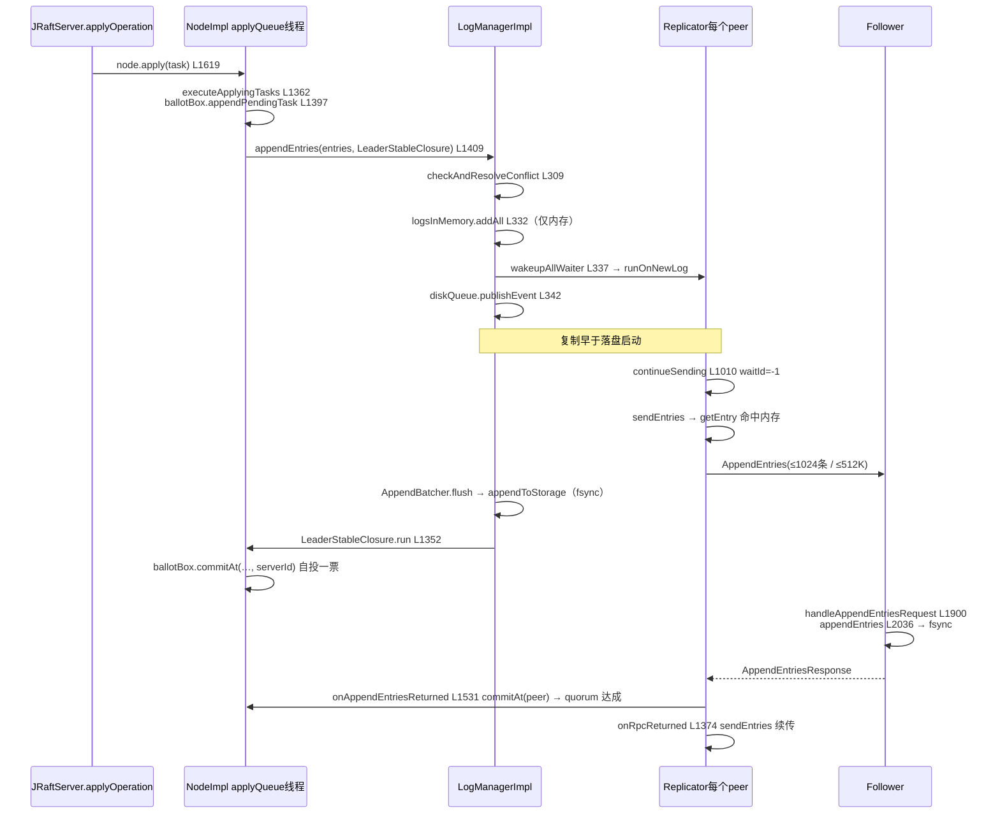

我先看你的笔记，同时去取选举比较与复制触发这两段的源码。

继续取证复制触发点（`notifyReplicator`）和 Replicator 的主循环。

需要确认 1.3.14 里复制的确切触发点（`LeaderStableClosure` 没有直接唤醒 Replicator），继续定位。

找到关键线索（`wakeupAllWaiter` / `waitId`），继续确认 Replicator 的挂起-唤醒机制。

继续：确认 leader 侧的发送节流与 LogManager 的 waiter 注册。

最后核对 Nacos 侧的默认参数取值。

取证完毕，包括一个反直觉的发现（TimeoutNow 路径**不做**日志新旧检查）。下面回答。

---

# 先给结论

**问题一（落后节点不能当 leader）**：不是靠"自己照镜子"，而是靠**别人拒票**。jraft 有两道闸门（prevote / vote），比较的是 `LogId` 的 **(term, index) 字典序**，且比较前**强制 flush**。但 `handleTimeoutNowRequest` 里我一行日志检查都没找到——所以这条规则的最终防线**完全押在投票者身上**，不在候选人身上。

同时要修正一个常见误读：**"落后"的准确定义不是"lastLogIndex 小"，而是"缺少已提交的日志"**。jraft 用的是 term 优先的比较，这恰恰是 Raft 正确性的要求，不是实现偷懒。

**问题二（复制时机）**：三个来源，**没有一个是"leader 主动遍历所有 follower"**（`ReplicatorGroupImpl` 里根本没有 `replicate()` 方法）。而且最关键的一点：

> **复制 RPC 的发出，早于本地日志落盘。** 日志刚进 `logsInMemory`，`wakeupAllWaiter` 就把 Replicator 叫醒了，`diskQueue.publishEvent` 还在它后面一行。

---

# 问题一：落后节点是怎么被挡住三次的

## 闸门一：preVote（不改 term 的预选）

`NodeImpl.preVote` L2665-2725，先自我审查两件事：

```java
if (this.snapshotExecutor != null && this.snapshotExecutor.isInstallingSnapshot()) {
    LOG.warn("Node {} term {} doesn't do preVote when installing snapshot as the configuration may be out of date.");
    return;                                   // L2669-2674 ★正在装快照的节点不参选
}
if (!this.conf.contains(this.serverId)) {
    LOG.warn("Node {} can't do preVote as it is not in conf <{}>.");
    return;                                   // L2675-2678 ★不在集群配置里（被 removePeer）不参选
}
...
final LogId lastLogId = this.logManager.getLastLogId(true);   // L2684 ★isFlush=true
...
    .setTerm(this.currTerm + 1)              // L2709 ★只是"打算"用下一个 term，本地不改
    .setLastLogIndex(lastLogId.getIndex())   // L2710
    .setLastLogTerm(lastLogId.getTerm())     // L2711
this.rpcService.preVote(peer.getEndpoint(), done.request, done);
this.prevVoteCtx.grant(this.serverId);       // L2715 自己给自己一票
```

**注意 L2709：prevote 阶段 term 只是写在请求里，本地 `currTerm` 不动。** 这就是 prevote 的核心价值——一个长期与集群失联、反复超时的落后节点，**不会把集群 term 推高**（社区里叫 "disruptive server" 问题），它的干扰被限制在"发了一些没人理的信"。

对方节点怎么拒（`handlePreVoteRequest` L1679-1715，按顺序）：

| 行号 | 条件 | 落后节点的命运 |
|---|---|---|
| L1680-1684 | 候选人不在 `conf` | 直接 break，granted=false |
| **L1685-1690** | 现任 leader 租约仍有效（`isCurrentLeaderValid`，即 `electionTimeoutMs` 内收过 leader 消息） | **无视 preVote**——这是防止无谓选举的第一道闸 |
| L1691-1697 | `request.term < currTerm` | 拒绝，**顺带 `checkReplicator(candidateId)`**（把落后者的 replicator 补回来） |
| **L1705-1710** | 取本地 `getLastLogId(true)` 后比较 | `granted = requestLastLogId.compareTo(lastLogId) >= 0` |

**L1705 那一行 `getLastLogId(true)` 是整段代码的支点。**

## 闸门二：投票（一次 term 只能投一次，且落盘）

`handleRequestVoteRequest` L1799-1822：

```java
final LogId lastLogId = this.logManager.getLastLogId(true);            // L1799 ★同样强制 flush
...
if (request.getTerm() != this.currTerm) { ... break; }                  // L1804-1807 ABA 复查
final boolean logIsOk = new LogId(request.getLastLogIndex(), request.getLastLogTerm())
    .compareTo(lastLogId) >= 0;                                        // L1809-1810 ★up-to-date 判定
if (logIsOk && (this.votedId == null || this.votedId.isEmpty())) {      // L1812 ★本 term 还没投过
    stepDown(request.getTerm(), false, new Status(RaftError.EVOTEFORCANDIDATE, ...));
    this.votedId = candidateId.copy();
    this.metaStorage.setVotedFor(candidateId);                          // L1816 ★投票立即持久化
}
return RequestVoteResponse.newBuilder()
    .setTerm(this.currTerm)
    .setGranted(request.getTerm() == this.currTerm && candidateId.equals(this.votedId))   // L1822
    .build();
```

三件事叠在一起才构成"一票"：**日志够新 + 这个 term 还没投给别人 + term 匹配**。而 `setVotedFor` 落盘意味着重启后不会在同一 term 重复投票。

## 比较规则：`LogId.compareTo` 是 term 优先

这是"落后"定义的落点，`LogId` 源码原文：

```java
@Override
public int compareTo(final LogId o) {
    // Compare term at first
    final int c = Long.compare(getTerm(), o.getTerm());
    if (c == 0) {
        return Long.compare(getIndex(), o.getIndex());    // term 相同才比 index
    }
    return c;
}
```

**所以 `lastLogIndex` 小的节点，只要 `lastLogTerm` 更高，是可以拿到票的。** 这不是漏洞，而是 Raft 的定义：**up-to-date 就是按 (term, index) 字典序**。理由是 leader 完备性论证——一个 term 更高的节点，必然是因为它的日志通过了那个 term 的投票检查才升上去的；它缺少的那些日志一定还没提交（否则持有它们的多数派节点不会给它投票）。

所以更准确的表述是：

> **jraft 挡住的不是"进度慢的节点"，而是"缺少已提交日志的节点"。** 后者与前者在 99% 的场景重合，但概念上不能混。

回扣上一轮的多数派交集论证：已提交 N 的节点集合 S 与投票者集合 V 必然相交（`|S|+|V| > n`），相交节点既"有 N"又"投了票"，投票条件 ⟹ 候选人日志 ≥ 该节点 ⟹ **候选人必有 N**。这套算术与 term 无关，也保证不会因为 term 比较而漏掉已提交日志。

## 支点：比较前必须 flush

选举安全最怕的是"我内存里有、磁盘上没有"。jraft 把这一点做到了比较动作里：

```java
// LogManagerImpl.getLastLogId(true)  L872-898
if (this.lastLogIndex == this.lastSnapshotId.getIndex()) { return this.lastSnapshotId; }
c = new LastLogIdClosure();
...
offerEvent(c, EventType.LAST_LOG_ID);   // L890 丢进 diskQueue
c.await();                              // L892 ★阻塞等落盘线程处理完
return c.lastLogId;
```

```java
// StableClosureEventHandler，处理 LAST_LOG_ID 事件
this.lastId = this.ab.flush();                       // L515 ★先把攒着的日志 fsync 掉
case LAST_LOG_ID:
    ((LastLogIdClosure) done).setLastLogId(this.lastId.copy());    // L518-519
```

**四个地方都在用它**：`preVote` L2684、`electSelf` L1156、`handlePreVoteRequest` L1705、`handleRequestVoteRequest` L1799。每一次"我比你新"的断言，都是先把自己内存里的日志刷干净之后才敢说的。

## 反直觉发现：TimeoutNow 不做日志检查

`handleTimeoutNowRequest` L3266-3309 全文我只看到两个检查——term 和 state：

```java
if (request.getTerm() != this.currTerm) { ...setSuccess(false)... }      // L3270
if (this.state != State.STATE_FOLLOWER) { ...setSuccess(false)... }      // L3283
final long savedTerm = this.currTerm;
final TimeoutNowResponse resp = TimeoutNowResponse.newBuilder()
    .setTerm(this.currTerm + 1).setSuccess(true).build();
done.sendResponse(resp);                                                 // L3298 先回响应
doUnlock = false;
electSelf();                                                             // L3300 ★直接开始选举，无任何 lastLogIndex 比较
```

**被 leader 指定的落后节点，自己会照样参选。** jraft 把安全性交给下游：它 `electSelf` 后带着 `lastLogId` 去要票，`handleRequestVoteRequest` L1809 的 `logIsOk` 会把它拒了（另外它 `currTerm` 已被 `stepDown` 重置，L1822 的 term 匹配 + `votedId` 判定也会挡）。

这跟 braft 的 C++ 实现（TimeoutNow 里有 `last_log_index >= leader_commit_index` 检查）不一样。理解这一点很重要：**在 jraft 里，"落后不能上位"是一个纯投票者侧的不变式，候选人侧的自检并不存在。** 任何绕过投票的设想（比如手工塞一个 leader）都不会被候选人自己拦下。

## leader 让位时反而是主动挑日志最新的

`stepDown` L1303-1307 与 `ReplicatorGroupImpl.findTheNextCandidate` L273-301：

```java
for (final Map.Entry<PeerId, ThreadId> entry : this.replicatorMap.entrySet()) {
    if (!conf.contains(entry.getKey())) continue;
    final int nextPriority = entry.getKey().getPriority();
    if (nextPriority == ElectionPriority.NotElected) continue;      // L282 ★明确不参选的节点排除
    final long nextIndex = Replicator.getNextIndex(entry.getValue());
    if (nextIndex > maxIndex) { maxIndex = nextIndex; peerId = entry.getKey(); ... }
    else if (nextIndex == maxIndex && nextPriority > priority) { ... }   // L290 ★并列时比优先级
}
```

排序键是 **`nextIndex`（leader 认为该 peer 已复制到哪）——即"追平最多的那个"**，其次才是 priority。配合 `Replicator.getNextIndex` L1885-1896 只在 `hasSucceeded` 时才返回真值，等于**用 leader 侧的复制视图反推谁落后最少**。

然后 `sendTimeoutNowAndStop`（`Replicator.sendTimeoutNow` L1731-1756）只发给它。**注意 `Replicator.transferLeadership` L1852-1863 里那句 `if (this.hasSucceeded && this.nextIndex > logIndex)`——只有已追平到指定位置才发 TimeoutNow，否则登记 `timeoutNowIndex` 等追平再发**（`onAppendEntriesReturned` L1545-1547 检查）。所以让位路径上是有追平检查的，只是检查方在 leader，不在被指定者。

顺带一个 Nacos 事实：`JRaftServer` L196-200 的 conf 来自 `raftConfig.getMembers()`（即 `cluster.conf` 的 `ip:port`），Nacos 没有暴露 priority 配置项，所以**这条"优先级"通道在 Nacos 里是空的**，让位候选只由 `nextIndex` 决定。

## 还有第四种"根本不能选"：learner

`stepDown` L1319-1324 + `isLearner` L1328-1330：

```java
if (!isLearner()) {
    this.electionTimer.restart();          // L1321
} else {
    LOG.info("Node {} is a learner, election timer is not started.", this.nodeId);   // L1323
}
```

learner 连选举定时器都不启动（`preVote` 也就永远不会被触发）；同时它的响应不计入 commit（`Replicator` L1529 `isFollower()`），它的 RPC 响应在 `Ballot.grant` 里一票不扣。三层同时关死。

## 选举被触发的时机（顺带回答"什么时候会去争"）

- `electionTimer` 超时 → `preVote()`。间隔由 `NodeOptions.electionTimeoutMs` + `RaftOptions.maxElectionDelayMs` 随机化；Nacos 默认 **5000ms**（`RaftSysConstants.DEFAULT_ELECTION_TIMEOUT` L32），随机上界 **1000ms**（L81）→ 实际落在 5~6s。
- **Nacos 不允许把选举超时调到 5s 以下**：`JRaftServer` L167-168 用的是 `Math.max(配置值, DEFAULT_ELECTION_TIMEOUT)`——写 `election_timeout_ms=1000` 是没用的，仍是 5000。
- 选举失败重来：`handleVoteTimeout` L2727-2747，`isStepDownWhenVoteTimedout()` 为 false 时**直接再 `electSelf()`**（term 再加一再自投），为 true 时才 stepDown 回 follower 重走 preVote。
- 单节点集群立即当选：`init` L1112-1115，conf 只有自己时不等定时器直接 `electSelf()`。
- `electSelf` L1186-1189：`metaStorage.setTermAndVotedFor` + `voteCtx.grant(serverId)`（自投一票），凑够就 `becomeLeader()`。

---

# 问题二：复制时机

## 结论先行

jraft 1.3.14 的复制**不是定时批量推**，而是**"Replicator 线程睡在 LogManager 的 waiter 上，新日志一到就被叫醒"**，外加三条兜底。而且 `ReplicatorGroupImpl` 全文没有 `replicate()` 这样的方法——它只提供 `addReplicator`/`sendHeartbeat`/`transferLeadershipTo`/`checkReplicator`/`findTheNextCandidate`（L95-306）。**leader 从不主动遍历 replicator 推日志。**

## 主路径：日志进内存 → 立刻唤醒

`LogManagerImpl.appendEntries` L296-352 的**行序就是答案**：

```java
this.writeLock.lock();                                                   // L307
if (!entries.isEmpty() && !checkAndResolveConflict(entries, done, writeLock)) { ... return; }   // L309
for (...) { entry.setChecksum(entry.checksum()); ... configManager.add(conf); }  // L314-329
if (!entries.isEmpty()) {
    done.setFirstLogIndex(entries.get(0).getId().getIndex());
    this.logsInMemory.addAll(entries);                                   // L332 ★只进内存，未落盘
}
doUnlock = false;
if (!wakeupAllWaiter(this.writeLock)) {                                  // L337 ★★★复制在这里被触发
    notifyLastLogIndexListeners();                                       // L338
}
// publish event out of lock
this.diskQueue.publishEvent((event, sequence) -> { event.type = EventType.OTHER; event.done = done; });   // L342 ★落盘事件此刻才排队列
```

`wakeupAllWaiter` L386-403：

```java
if (this.waitMap.isEmpty()) { lock.unlock(); return false; }
final List<WaitMeta> wms = new ArrayList<>(this.waitMap.values());
this.waitMap.clear();                              // L393 ★一次唤醒全部
lock.unlock();
for (final WaitMeta wm : wms) {
    wm.errorCode = errCode;
    ThreadPoolsFactory.runInThread(this.groupId, () -> runOnNewLog(wm));   // L400
}
```

回调链落到 Replicator：

```java
// Replicator.waitMoreEntries  L1577-1589（挂起时登记的回调）
this.waitId = this.options.getLogManager().wait(nextWaitIndex - 1,
    (arg, errorCode) -> continueSending((ThreadId) arg, errorCode), this.id);
this.statInfo.runningState = RunningState.IDLE;
finally { unlockId(); }

// Replicator.continueSending  L991-1018
} else if (errCode != RaftError.ESTOP.getNumber()) {
    // Only reset waitId before sending entries, fixed #842, #838
    r.waitId = -1;                                   // L1010 ★
    r.sendEntries();                                 // L1012 ★开始复制
}
```

**所以"L 收到写请求后多久发给 follower"的答案是：一次线程池派发（微秒级），不等 fsync。**

## 三个设计细节值得单独讲

### 1. `notifyOnNewLog` 的"注册即校验"——防丢唤醒

```java
// LogManagerImpl.wait  L1094-1118
private long notifyOnNewLog(final long expectedLastLogIndex, final WaitMeta wm) {
    this.writeLock.lock();
    try {
        if (expectedLastLogIndex != this.lastLogIndex || this.stopped) {   // L1103 ★
            wm.errorCode = this.stopped ? RaftError.ESTOP.getNumber() : 0;
            ThreadPoolsFactory.runInThread(this.groupId, () -> runOnNewLog(wm));   // L1105 不挂起，立刻再来一轮
            return 0L;
        }
        long waitId = this.nextWaitId++;
        if (waitId < 0) { waitId = this.nextWaitId = 1; }   // L1109-1112 溢出回绕，有效 waitId 从 1 起
        this.waitMap.put(waitId, wm);
        return waitId;
    } finally { this.writeLock.unlock(); }
}
```

Replicator 传的是**它当时看到的 `lastLogIndex`**（`nextWaitIndex - 1`）。如果在"发现没日志了"到"注册 waiter"之间 leader 又追加了日志（`lastLogIndex` 变了），就不进 `waitMap`，直接异步再触发一次 `sendEntries`。这是经典的 check-and-register 原子化，**保证不丢唤醒**。

而"回调可能在 `waitId` 赋值完成前就跑到"这个竞态，是靠 `ThreadId` 锁挡住的：回调第一步是 `id.lock()`（L996），而 `waitMoreEntries` 是**持着 id 锁**调 `wait` 的（注释 `// _id is unlock in _wait_more` L1650），赋值完成后才在 finally 里 `unlockId`。所以 `r.waitId = -1`（L1010）不可能先于赋值执行。这是个非常隐蔽的正确性依赖。

### 2. 流水线（不是"一条一等"）

```java
// Replicator.getNextSendIndex  L591-605
if (this.inflights.isEmpty()) { return this.nextIndex; }                                 // 空闲 → 直接发
if (this.inflights.size() > this.raftOptions.getMaxReplicatorInflightMsgs()) { return -1L; }   // 背压
if (this.rpcInFly != null && this.rpcInFly.isSendingLogEntries()) {
    return this.rpcInFly.startIndex + this.rpcInFly.count;    // ★上一个"带日志的请求"还没回，就接着发下一批
}
return -1L;                                                   // 上一个是心跳/探测 → 必须等它回来
```

`sendEntries()` L1594-1618 是个 **while 循环**，只要 `getNextSendIndex()` 能前进就继续发：

```java
while (true) {
    final long nextSendingIndex = getNextSendIndex();
    if (nextSendingIndex > prevSendIndex) {
        if (sendEntries(nextSendingIndex)) { prevSendIndex = nextSendingIndex; }
        else { doUnlock = false; break; }     // id 已在 sendEntries 内解锁（走快照或挂起）
    } else { break; }
}
```

每批上限由 `sendEntries(next)` L1634-1653 决定：`maxEntriesSize`(1024) 条 & `maxBodySize`(512K)，`prepareEntry` L840/L844-846 取不到 entry 就 break。响应回来后 `onRpcReturned` L1372-1374 又调一次 `sendEntries()` 续传：

```java
if (continueSendEntries) {
    // unlock in sendEntries.
    r.sendEntries();
}
```

**两个必须注意的推论：**
- 顺序由 `pendingResponses` 优先级队列 + `reqSeq/requiredNextSeq` 维护（L1278-1342）：乱序响应会被排队，seq 不匹配就等；`inflight.seq != queuedPipelinedResponse.seq` 时 `resetInflights()` + `block(EREQUEST)`（L1332-1341）。
- **如果上一次 in-flight 是心跳或探测，流水线会停住**（`isSendingLogEntries()` 为 false → 返回 -1）。心跳的 RPC 超时是 `electionTimeoutMs / 2` = 2.5s（L804），所以一个卡住的心跳理论上能让该 peer 的日志复制推迟到它超时为止。这是个真实但少见的延迟源。

### 3. 心跳不搬日志

`sendEmptyEntries` L771-835：`isHeartbeat=true` 分支里 `rb` **从未 addEntries**，只是 `rb.build()` 后发出去（L803），并且 L1573 在里面塞了 `committedIndex`。它的回调 `onHeartbeatReturned` L1172-1256 做的事只有：更高 term → `increaseTermTo`（L1226）；失败且带 lastLogIndex → **`sendProbeRequest()`**（L1240）；否则只 `startHeartbeatTimer(startTimeMs)`（L1250）。

**整个 `onHeartbeatReturned` 里没有一处 `sendEntries()`。** 所以：
- 心跳的作用 = 维持 leader 租约 + 推进 follower 的 `committedIndex`（`handleAppendEntriesRequest` L1987 的 `min(committedIndex, prevLogIndex)`，正是你笔记 L302 关键点 7 的依据）
- 日志的搬运**只由"新日志唤醒"和"响应续传"两条路驱动**
- 你笔记里"follower 不需要写入流量也能完成重放"依然成立（心跳推 commit），但**前提是那些日志已经复制到 follower 磁盘**——`FollowerStableClosure` L1843 的 `min` 和 L1987 的 `min(committedIndex, prevLogIndex)` 都在保证这一点

## 完整时序图



## 触发点汇总表

| # | 触发源 | 代码位置 | 触发条件 | 是否带日志 |
|---|---|---|---|---|
| 1 | **新日志追加（主路径）** | `LogManagerImpl` L337 → `Replicator` L1012 | Replicator 此前已挂起（`waitId` 有效） | ✅ |
| 2 | 响应成功续传 | `onRpcReturned` L1372-1374 | `continueSendEntries == true` | ✅ |
| 3 | 探测 probe | `sendProbeRequest` L1726-1728 → `sendEmptyEntries(false)` | Replicator 新建 L922 / 响应失败 L1508 / seq 乱序 L1286,L1340 / 心跳失败 L1240 | ❌ 空 entries，只为定 nextIndex |
| 4 | 心跳超时 | `startHeartbeatTimer` L611-620 → `onTimeout` L1142 → `onError(ETIMEDOUT)` L1089 | 每 `dynamicHeartBeatTimeoutMs` 且期间无其它 RPC | ❌ 只带 committedIndex |
| 5 | 差距过大 → 换快照 | `sendEntries` L1628-1631 / L1646-1648 | `getTerm(prevLogIndex)==0` 或 `nextIndex < firstLogIndex` | 走 InstallSnapshot |
| 6 | block 到期恢复 | `block` L1036 → `onBlockTimeout` → `continueSending(ETIMEDOUT)` L1001-1007 | RPC 失败 / follower EBUSY | 先探测 |
| 7 | leader 上任 | `becomeLeader` L1239-1255 → `Replicator.start` L920-922 | 每个 peer/learner 各一个 Replicator | 先探测 |
| 8 | 缺失补建 | `ReplicatorGroupImpl.checkReplicator` L179-200 | `handlePreVoteRequest` L1695/L1700、`checkDeadNodes0` L2241 时发现 replicator 不在 | 新建后探测 |

## nextIndex 是怎么"定位"的（复制时机的前置条件）

`onAppendEntriesReturned` 失败分支 L1492-1505 是 jraft 相对论文的一个优化：

```java
if (response.getLastLogIndex() + 1 < r.nextIndex) {
    r.nextIndex = response.getLastLogIndex() + 1;      // ★follower 报了 lastLogIndex → 一步跳到位
} else {
    if (r.nextIndex > 1) { r.nextIndex--; }            // 否则逐条回退（有旧 term 日志要截）
}
r.sendProbeRequest();
```

配合 `handleAppendEntriesRequest` L1963-1976 的拒绝响应**总是带 `lastLogIndex`**：

```java
if (localPrevLogTerm != prevLogTerm) {
    ...
    return AppendEntriesResponse.newBuilder().setSuccess(false)
        .setTerm(this.currTerm).setLastLogIndex(lastLogIndex).build();   // L1971-1975
}
```

→ 落后节点不需要 O(n) 逐条回退，**一次 probe 就能对齐起点**。新 leader 上任时每个 peer 的第一个动作就是 `sendProbeRequest`（L922），也是为此。

## Nacos 侧的实际数值

| 参数 | Nacos 默认 | 键名 | 影响 |
|---|---|---|---|
| `election_timeout_ms` | **5000（且 `Math.max` 不允许更小）** | `RAFT_ELECTION_TIMEOUT_MS` L138 | 落后追平的最坏兜底窗口 |
| `election_heartbeat_factor` | 10（L87） | `ELECTION_HEARTBEAT_FACTOR` | 心跳/`dynamicHeartBeatTimeoutMs` = 5000/10 = **500ms**（`NodeImpl` L1057） |
| `max_entries_size` | 1024（L64） | `MAX_ENTRIES_SIZE` | 单 RPC 最多条数 |
| `max_body_size` | 512K（L70） | `MAX_BODY_SIZE` | 单 RPC 最多字节 |
| `max_append_buffer_size` | 256K（L75） | `MAX_APPEND_BUFFER_SIZE` | `AppendBatcher` L479 一次 flush 前攒的量 |
| `max_replicator_inflight_msgs` | 256（L122） | `MAX_REPLICATOR_INFLIGHT_MSGS` | 流水线深度上限 |
| `replicator_pipeline` | true（L116） | `REPLICATOR_PIPELINE` | — |
| `disruptor_buffer_size` | 16384（L111） | `DISRUPTOR_BUFFER_SIZE` | LogManager 队列，满了 `hasAvailableCapacityToAppendEntries` L217 返 EBUSY |
| `apply_batch` | 32（L93） | `APPLY_BATCH` | apply 批大小 |
| **`enable_log_entry_checksum`** | **false（L127）** | `ENABLE_LOG_ENTRY_CHECKSUM` | ⚠️ jraft 默认是 true，Nacos 关掉了 |
| `sync` / `sync_meta` | true / false（L99/L105） | `SYNC`/`SYNC_META` | follower ACK 前是否 fsync |

一个补充事实：`ReplicatorGroupImpl.init` L67/L71 里 `dynamicTimeoutMs = opts.getHeartbeatTimeoutMs()`，**jraft 1.3.14 的 `dynamicHeartBeatTimeoutMs` 是个固定值，不是自适应估算法**（名字里的 dynamic 是历史遗留）。别指望它会按 RTT 自己调。

---

# 关键点

1. **"落后不能当 leader"是投票者侧的规则。** jraft 里候选人不自查日志新旧；`handleTimeoutNowRequest` L3266-3309 甚至 term/state 检查完就直接 `electSelf()`。安全性来自 `handleRequestVoteRequest` L1809-1822 的 `logIsOk` + 一票一次 + `votedFor` 持久化。
2. **两道检查 + 一个随机化 = prevote 的全部意义。** `preVote` L2709 只把 `currTerm+1` 写进请求、不提升本地 term，所以失联节点**不会污染集群 term**；`handlePreVoteRequest` L1685 更狠——leader 租约还有效时直接无视。
3. **比较是 `LogId` 字典序、term 优先。** 准确说法是"缺少已提交日志的节点不能当选"，而不是"index 小的不能当选"。
4. **所有新旧比较之前都强制 flush**（`getLastLogId(true)` L872-898 → `offerEvent(LAST_LOG_ID)` + `c.await()` → 处理时先 `ab.flush()` L515）。**内存里的日志没有资格声称自己更新**——这是选举安全的支点。
5. **复制触发点是 `wakeupAllWaiter`（L337），位于 `logsInMemory.addAll`（L332）之后、`diskQueue.publishEvent`（L342）之前。** 所以复制和本地落盘是**并行**的，leader 落盘完成（`LeaderStableClosure` → 自投一票，L1352）与 follower ACK（`commitAt` L1531）谁先到都可能。
6. **`notifyOnNewLog` L1103 的 `expectedLastLogIndex != lastLogIndex` 判断，加上 `waitMoreEntries` 持 `ThreadId` 锁跨赋值，共同保证"不丢唤醒 + waitId 不 ABA"。** 这两处是 Replicator 挂起模型的正确性核心。
7. **流水线深度 256、每批 1024 条/512K，但"上一个是心跳/探测"时强制停住**（`getNextSendIndex` L601 `isSendingLogEntries()`）。
8. **心跳和 probe 都不携带日志条目**（`sendEmptyEntries` L786-830 无 `addEntries`），`onHeartbeatReturned` 全程不调 `sendEntries`。心跳只维持租约 + 推 commit。
9. **`nextIndex` 定位靠 follower 回传 `lastLogIndex` 一步跳位**（L1492-1495），跳不动才逐条回退；leader 上任即 probe（L922）。
10. **`ReplicatorGroupImpl` 没有 `replicate()`**——jraft 是"唤醒等待者"模型，不是"生产者广播"模型。看代码找"leader 在哪里遍历 follower 推日志"会一无所获。
11. **让位路径有追平检查，但检查方是 leader**：`transferLeadership` L1852-1863 只有 `hasSucceeded && nextIndex > logIndex` 才发 TimeoutNow；`findTheNextCandidate` L285-293 按 `nextIndex` 挑追平最多的。
12. **learner 三层关死**：不启动 electionTimer（L1320-1324）、不计入 commit 票（`Replicator` L1529）、`Ballot.grant` 不扣票。
13. **Nacos 的 election timeout 有下限**（`JRaftServer` L167-168 `Math.max`），且四个定时器都设了 shared（L173-176）——config 组和 naming 组共用选举/心跳线程，一个组的选举风暴会挤到另一个组。

---

# 坑

**1. `enable_log_entry_checksum` 在 Nacos 默认是 false（`RaftSysConstants` L127），而 jraft 默认 true。** 关掉后 `LogManagerImpl.getTermFromLogStorage` L797-804 和 `handleAppendEntriesRequest` L2017-2029 的校验都跳过。**磁盘位翻转造成的日志损坏不再有机会被发现**，而上一轮已经确认：协议层对状态机分叉没有对账手段。如果你的环境没有"checksum 换性能"的明确诉求，建议显式打开 `nacos.core.protocol.raft.data.enable_log_entry_checksum=true`。

**2. "复制不等落盘"意味着 leader 掉盘故障的表现很特殊。** 如果 `appendToStorage` L418 失败，`reportError(EIO)` L422 + `hasError=true`，此后 `appendEntries` L301-304 会直接给所有请求回 `EIO`——但**在此之前已经发出的 RPC 可能已经落到 follower 磁盘上**。这些日志在 follower 上会留着，等 `checkAndResolveConflict` L1042-1054 与后续 leader 对齐（term 冲突即截）。表现为"日志里有一批请求失败，但某个 follower 的 Derby 里多了一条配置记录"——它只要没被 commit，新 leader 会截掉。**排查时别用 follower 的 Derby 内容反推"客户端写成功了"。**

**3. `handleTimeoutNowRequest` 无日志检查 = 运维命令有真实风险。** 通过 `CoreOpsController` 的 resetLeader / transfer 类命令，或直接对某节点发 TimeoutNow，**它自己不会拒绝**。虽然投票会把它挡下，但它已经 `currTerm++` 并写盘（L1146 + L1186），会让全集群 stepDown 一次（L1786-1788）→ 一轮无谓的 leader 切换。**要限制 leader 落点，只能靠 `ServerMemberManager` 摘除节点或改 conf，不能靠指定。**

**4. `block()` 的注释里 jraft 作者自己写了取舍（L1025-1029）：**"we don't care about error_code… it's fine now"。也就是说**任何一种 RPC 失败都统一 block 一个 `dynamicHeartBeatTimeoutMs`（Nacos 默认 500ms）**。follower 短暂 EBUSY（`handleAppendEntriesRequest` L1992-1998 的 `hasAvailableCapacityToAppendEntries`，即 LogManager disruptor 16384 槽满）与 follower 彻底宕机，走的是一样的退避路径。所以**"某台机器数据不动了"先看 `Replicator` 的 `block-times`/`consecutive-error-times` 指标**（`ReplicatorMetricSet` L204-206），它区分不出故障类型但能告诉你在反复 block。

**5. `onHeartbeatReturned` 不触发 `sendEntries` 是个隐蔽的延迟源。** 设想：日志已追加但 `wakeupAllWaiter` 时 waitMap 恰好为空（因为所有 replicator 都还在 in-flight 状态，没挂起过），而后续 `onRpcReturned` 因为 seq 乱序走了 `block()` 分支（L1340）——此时复制只能等 block 超时后的 probe。低概率但存在。判断依据是 `Replicator` 的 `state` 指标（L207）长期停在 `Probe`。

**6. 你笔记 L302（关键点 7）的表述需要加一个限定。** 原文"follower 不需要写入流量也能完成重放：心跳分支 L1987 就会推进 commit"——**成立，但只对"日志已经复制到该 follower"的情形成立**。因为 L1987 是 `min(committedIndex, prevLogIndex)`，而 `prevLogIndex` 就是它自己的 lastLogIndex。建议补一句："心跳只推 commit 位点、不搬日志；日志缺失时 `min` 会把 commit 卡在自己的 lastLogIndex 上，落后只能靠 AppendEntries 或 InstallSnapshot 补。"

---

# 总结

**问题一。** jraft 把"落后节点不能当 leader"实现成了一条**投票者侧的不变式**，而不是候选人的自我约束。三道力量叠在一起：`handlePreVoteRequest` L1685（现任 leader 还在就直接无视）、L1705-1710（先 flush 再比 `LogId`，够新才给 prevote）、`handleRequestVoteRequest` L1809-1822（够新 + 这个 term 没投过 + 投票落盘，三条同时满足才给票）。这套规则是纯被动的——候选人哪怕明知道自己落后（`handleTimeoutNowRequest` L3266-3309 **一行日志检查都没有**）也会去要票，只是要不到。

同时必须把"落后"的定义校准一次：比较用的是 `LogId.compareTo`，**term 优先，再看 index**。所以被挡住的是"缺少已提交日志的节点"，而不是"lastLogIndex 小的节点"。这两件事在多数派交集的论证下等价（已提交 N 的节点集合与投票者集合必相交，相交节点给了票就说明候选人不缺 N），但概念上必须分开——否则你会觉得"高 term 低 index 也能当选"是实现漏洞，而它其实是 Raft 的定义本身。

**问题二。** 复制时机最值得记的一句话是：**日志刚进 `logsInMemory`（L332）就被拿去复制了，落盘事件还在下一行才排队（L342）**。所以 jraft 的写路径是"内存可见即可复制"，本地 fsync（`AppendBatcher.flush` → `appendToStorage`）与 RPC 发送是两条并行轨道，`ballotBox.commitAt` 的 leader 自投（L1352-1354）在 fsync 完成的那一刻才发生，而 follower 的票要等它自己 fsync + 回响应（`FollowerStableClosure.run` L1855-1895）。commit 因此天然是"两条轨道都到齐"的结果。

而唤醒机制是**睡在 waiter 上等人叫**，不是定时扫：`waitMoreEntries` L1583 把回调注册进 `LogManagerImpl.waitMap`，`notifyOnNewLog` L1103 用"注册时校验 lastLogIndex 是否已变"堵住丢唤醒，`ThreadId` 锁堵住 `waitId` 的 ABA。心跳（500ms）和探测**都不携带日志条目**，只负责租约、commit 位点和 nextIndex 定位；日志只在"新日志唤醒"和"响应续传"两处流动，流水线深度 256、每批 1024 条/512K。

**如果要在你笔记里补一节，我建议就写这三句可执行的判断：** ① 看到"写请求慢"，先分清是 leader fsync 慢（看 `append-logs` 延迟指标，`appendToStorage` L429）还是某个 peer 的 RPC 慢（看 `replicator-*/block-times`、`log-lags`，`ReplicatorMetricSet` L198-204）——两者在这条链路上是并行的，症状却像；② 看到"某节点数据迟迟不更新但 raft 没有 error"，优先怀疑 `waitId` 停在 IDLE 且 block 反复（probe 一直失败）而不是网络断，因为断链会打 `Fail to issue RPC to ...`（L1441）；③ 想缩短落后节点的追平时间，唯一有效的是**别让它靠心跳超时才能被发现**——`election_timeout_ms` 在 Nacos 里有 5000ms 下限，能调的是它（放大到 10s 会让故障检测更慢、追平更慢），以及保证 follower 的 `disruptor_buffer_size` 不被打满（EBUSY 会直接 block 500ms）。