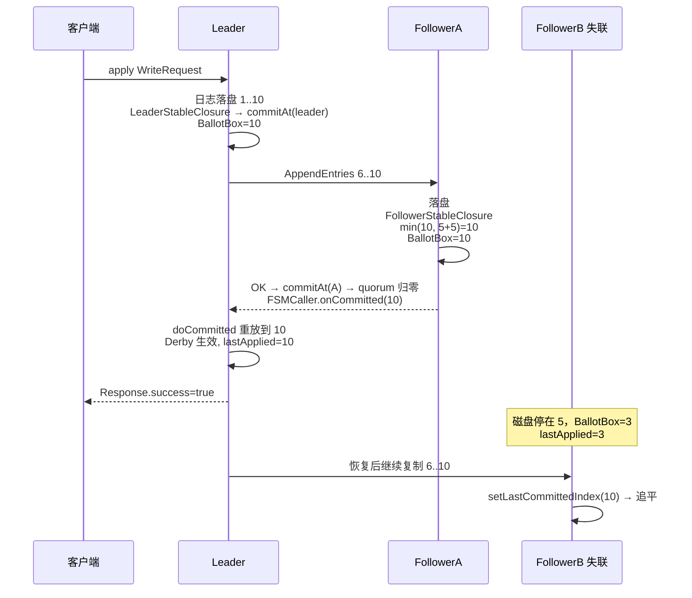

这是个触及 Raft 核心的问题。我先看你的笔记原有理解，同时去取多数派判定的源码。

这里有个关键细节值得核实——多数派的具体算法与选举安全约束。

取证完成，包括多数派的确切算法。下面回答。

---

# 先给结论

你的直觉**完全正确**——那一瞬间集群的 committedIndex 就是不一样的：leader 和响应的 follower 是 10，没结果的那个还是 5。jraft 里这就是真实状态，没有任何机制让它们"必须相等"。

但这不是 bug，而是**你把"共识"理解成了"相等"**。Raft 的共识保证是三条别的性质：

> **① 单调** ② 已提交前缀在所有节点上内容相同 ③ 落后节点必然追平，且**它永远没资格当 leader**

第三条才是回答你问题的钥匙：**那个"没结果"的节点被同时剥夺了两种能力——既不能阻止提交，也不能自己当选把集群带到歧路上。** 它的落后是纯被动的、只会被修正的状态。

---

# 一、committedIndex 不是一个值，而是三个变量

这是所有困惑的源头。jraft 里有三处"类似的东西"，语义完全不同：

| 变量 | 所在类 | 谁写 | 含义 |
|---|---|---|---|
| `BallotBox.lastCommittedIndex` | BallotBox L? | leader：`commitAt`（投票算出）<br/>follower：`setLastCommittedIndex`（leader 告知） | **复制层**：这条日志已经在多数派磁盘上了 |
| `FSMCaller.lastCommittedIndex` | FSMCallerImpl L528 | `doCommitted` 入口 | **派发层**：已经通知状态机可以 apply 到哪 |
| `FSMCaller.lastAppliedIndex` | FSMCallerImpl L579 | `setLastApplied` | **生效层**：Derby 里真的执行完了 |

三个都是**每个节点各存一份的本地字段**，没有任何全局同步。对外 API 也是分开的：

```java
// NodeImpl L3474-3485 / L3487-3498
public long getLastCommittedIndex()  { ... return this.fsmCaller.getLastCommittedIndex(); }
public long getLastAppliedLogIndex() { ... return this.fsmCaller.getLastAppliedIndex(); }
```

注意 `getLastCommittedIndex()` 返回的是 **FSMCaller 层**（状态机派发位点），不是 BallotBox 那个。这两个在同一条日志上可能差好几条。

所以你的问题"commit 会不会不一样"，严格说应该是"**哪个 committedIndex**、**在哪一层**"。答案是：任何一层都随时可能不一样，而这三层的语义是"下界"，不是"进度条"。

---

# 二、3 个节点的算术：为什么 2 票就够

## quorum 的公式在两处独立定义，且一致

```java
// NodeImpl L1532-1538（用于选举计数和 ReadIndex）
private int getQuorum() {
    final Configuration c = this.conf.getConf();
    if (c.isEmpty()) { return 0; }
    return c.getPeers().size() / 2 + 1;      // ★ 3 节点 → 2
}

// Ballot.init() L78（用于每条日志的复制投票）
this.quorum = this.peers.size() / 2 + 1;     // ★ 同一公式
```

顺带说明一件事：**`Configuration` 类里根本没有 `getQuorum()` 方法**。jraft 1.3.14 的多数派计算分散在 `NodeImpl.getQuorum`、`Ballot.init`、`checkDeadNodes0` L2255 三处，公式都是 `n/2+1`。

## leader 自己那一票是从哪来的

这是最多人漏掉的一点。看 `LeaderStableClosure.run` L1350-1354：

```java
@Override
public void run(final Status status) {
    if (status.isOk()) {
        NodeImpl.this.ballotBox.commitAt(this.firstLogIndex, this.firstLogIndex + this.nEntries - 1,
            NodeImpl.this.serverId);          // ★ 第三参数是"自己"
    } else { LOG.error("Node {} append [{}, {}] failed, status={}.", ...); }
}
```

也就是说：**leader 把自己的日志落盘成功后，立刻投自己一票。** 而 `Ballot.grant` 只认 `peers` 列表里的成员，leader 就在列表里，所以这一票有效。

于是 3 节点集群的实际投票构成是：

```
quorum = 2
leader 落盘成功 → commitAt(..., leader) → quorum: 2 → 1
followerA 响应 → commitAt(..., A)        → quorum: 1 → 0 → isGranted() == true → commit!
followerB 无响应                        → 完全不参与
```

`Ballot` 的判定（`isGranted()` L?）：

```java
public boolean isGranted() {
    return this.quorum <= 0 && this.oldQuorum <= 0;
}
```

而 `grant` 的扣减有个关键的幂等保护：

```java
private int quorum;
public PosHint grant(final PeerId peerId, final PosHint hint) {
    UnfoundPeerId peer = findPeer(peerId, this.peers, hint.pos0);
    if (peer != null) {
        if (!peer.found) {          // ★ 同一 peer 重复响应只扣一次
            peer.found = true;
            this.quorum--;
        }
        hint.pos0 = peer.index;
    } else {
        hint.pos0 = -1;             // ★ 不在 peers 里的（如 learner）响应，一票都不扣
    }
    ...
}
```

配合 `Replicator.onAppendEntriesReturned` L1528-1532 的另一道判断：

```java
if (entriesSize > 0) {
    if (r.options.getReplicatorType().isFollower()) {
        // Only commit index when the response is from follower.
        r.options.getBallotBox().commitAt(r.nextIndex, r.nextIndex + entriesSize - 1, r.options.getPeerId());
    }
```

双重保证：**learner 的复制成败不影响 commit 判定。**

## 所以"一个没有结果"根本不构成障碍

3 节点里 leader + 1 follower = 2 票 = quorum。**提交照样成功，客户端照样收到成功响应。** 那个失联节点只是"没参与投票"，而不是"投了反对票"。

---

# 三、时间线：确实不一样，而且允许



第 4 步到第 8 步之间，三个节点的 `BallotBox.lastCommittedIndex` 分别是 `10 / 10 / 3`。**jraft 认为这是正常态。**

而 B 的 `3` 是怎么来的也很值得看——`FollowerStableClosure` L1843-1847：

```java
this.committedIndex = Math.min(request.getCommittedIndex(),
    request.getPrevLogIndex() + request.getEntriesCount());
```

即使 leader 说"提交到 10"，follower 也只承认**已经落到自己磁盘的那部分**。这条 `min` 是整个机制里"follower 对 leader 有限信任"的体现，也保证了 **B 的 committedIndex 永远不会超过 B 的 lastLogIndex**。

---

# 四、共识的真实含义：三条不变式

| 性质 | 内容 | 源码依据 |
|---|---|---|
| **单调** | 任何节点的 committedIndex 只增不减 | `BallotBox.setLastCommittedIndex` L242-244（`<` 直接 return false）+ L245（`>` 才更新）；`commitAt` L135-136 只在推进时改 `pendingIndex` |
| **前缀一致** | 已 committed 的日志在所有节点上（同 index 同 term） | `LogManagerImpl.checkAndResolveConflict` L1042-1054 逐条比 term、冲突即 `unsafeTruncateSuffix` |
| **不可回退** | 已 apply 的日志不允许被截掉 | `unsafeTruncateSuffix` L985-988：`LOG.error("FATAL ERROR: Can't truncate logs before appliedId=...")` 后 **return，拒绝执行** |

注意第二条的措辞：不是"所有节点的 committed 集合相同"，而是"**在它们 committed 集合的交集范围内，内容相同**"。B 提交到 3、L 提交到 10 —— 交集是 `[1,3]`，这段两边完全一致。**没有人对同一个 index 提交了两条不同的日志，这就是共识。**

用一句更本质的话来概括：

> **committedIndex 是每个节点对"我确定这段已经安全了"的本地下界，不是集群的统一进度指针。**
> 下界天然可以不同，只要它满足"绝不虚报"（不能把没多数派的点说成 committed）和"最终都会升上来"。

---

# 五、核心论证：为什么 B 落后不会导致分叉

这是你问题的实质。**"同意的节点 index 大于没结果的节点"为什么不危险？** 因为那个较大的 index 一旦被认定为 committed，就已经在数学上保证了"未来的 leader 一定有它"。

## 论证三步（以 3 节点为例）

**前提**：`quorum = 2`，且任意两个大小为 2 的子集在 3 元集合中必有交集（2 + 2 > 3）。

**第一步**——N 被 committed 意味着什么？
`Ballot.isGranted()` 成立 ⟹ **至少 2 个节点已经把 N 落盘**。记这个集合为 S，`|S| = 2`。

**第二步**——新 leader 当选意味着什么？
它需要拿到 2 张票（`getQuorum()` = 2）。记投票者为 V，`|V| = 2`。

**第三步**——交集节点说了什么？
`S ∩ V ≠ ∅`。取其中任一节点 X：
- X ∈ S ⟹ X 有日志 N
- X ∈ V ⟹ X 投了票，投票的唯一条件是（`handlePreVoteRequest` L1705-1710）：

```java
final LogId lastLogId = this.logManager.getLastLogId(true);          // ★ isFlush=true，先刷盘
final LogId requestLastLogId = new LogId(request.getLastLogIndex(), request.getLastLogTerm());
granted = requestLastLogId.compareTo(lastLogId) >= 0;                 // ★ 候选人日志必须 up-to-date
```

X 投了票 ⟹ 候选人的 lastLogId ≥ X 的 lastLogId ≥ N ⟹ **候选人必然也有日志 N**（Raft 的 log matching 性质保证前缀内容相同）。

**结论：任何新 leader 一定拥有全部已 committed 的日志。** B 停在 5 完全无害。

## B 为什么连"搞破坏"的机会都没有

三个层次把 B 关住了：

1. **它拿不到票**。如果 B 想当 leader，它带出去的 `lastLogIndex = 5` 会被 A（10）和 leader（10）用 L1710 那句 `compareTo(...) >= 0` 直接拒。
2. **它即使上了位也提交不了**。新 leader 的 `BallotBox.resetPendingIndex(lastLogIndex + 1)`（`becomeLeader` L1258）之后，任何 commitAt 都需要 2 票，而它自己 + 谁？
3. **它自己不会虚报**。L1843 的 `min` 让它永远只承认落盘的部分。

而且注意 L1705 那句 `getLastLogId(true)` —— 参数 `true` 表示**强制 flush 后再取**（`LogManagerImpl.getLastLogId` L872-898，走 disruptor 的 `LAST_LOG_ID` 事件并 `c.await()` 等待）。这一步是为选举安全服务的：**不能拿"还在内存缓冲里没落盘"的日志去比别人新**，否则会出现"两个节点都以为自己有最新日志"的假象。

## 一个容易被忽略的推论

**"多数派交集"这个性质只跟节点数有关，跟"几个节点活着"无关。** 3 节点里死 1 个，剩下 2 个仍然两两相交；但如果集群是 **4 节点（quorum = 3）**，死 1 个后剩 3 个，任意两个多数派 `{1,2,3}` 和 `{1,2,4}`…… 交集仍非空 ✓。而 4 节点死 2 个（剩 2 个）就无法达成 quorum=3，直接停写。

这就是为什么 Nacos 生产集群推荐 3/5 节点（奇数），以及为什么 `checkDeadNodes0` L2255 用的判断是：

```java
if (aliveCount >= peers.size() / 2 + 1) {
    updateLastLeaderTimestamp(startLease);
    return true;
}
```

不满足就走 L2219-2225：

```java
LOG.warn("Node {} steps down when alive nodes don't satisfy quorum, term={}, deadNodes={}, conf={}.", ...);
status.setError(RaftError.ERAFTTIMEDOUT, "Majority of the group dies: %d/%d", deadNodes.size(), peers.size());
stepDown(this.currTerm, false, status);
```

**3 节点集群：挂 1 个照常写，挂 2 个 leader 主动退位、集群不可写。** 这也是"1 个没结果"能安全存在的直接证据——jraft 的 leader 保活判定同样是 `n/2+1`，与复制判定共用一个不变式。

---

# 六、但确实存在一个真实的风险窗口（Figure 5.7）

你的问题往前推一步会得到另一个问题：**如果那个"没结果"的节点在 leader 换人之前一直不响应，那 10 条日志到底算不算 committed？**

严格说，jraft 的 `commitAt` 在 `isGranted()` 那一刻就把 `lastCommittedIndex = 10` 定了。但 Raft 论文 5.4.2 有个著名的坑：**不能只靠"日志够新"就提交前一个 term 的日志**。jraft 1.3.14 确实实现了这条规则，证据就在 `BallotBox.resetPendingIndex` 的注释原文（L162-169）：

```java
/**
 * Called when a candidate becomes the new leader, otherwise the behavior is undefined
 * According the the raft algorithm, the logs from previous terms can't be
 * committed until a log at the new term becomes committed, so
 * |newPendingIndex| should be |last_log_index| + 1.
 */
public boolean resetPendingIndex(final long newPendingIndex) {
    if (!(this.pendingIndex == 0 && this.pendingMetaQueue.isEmpty())) { ... return false; }   // L173-177
    if (newPendingIndex <= this.lastCommittedIndex) { ... return false; }                       // L178-182
    this.pendingIndex = newPendingIndex;
    this.closureQueue.resetFirstIndex(newPendingIndex);                                          // L184
```

这就是上一轮我提到"`becomeLeader` L1258 只调 `resetPendingIndex(lastLogIndex+1)`"时没给出理由的那个地方。**理由是**：新 leader 必须在新 term 里至少提交一条日志之后，才允许顺带提交旧 term 的日志。它把 pending 起点强制设成"我的最后一条日志之后"，就是为了先在新 term 写一条 no-op/配置日志来锚定。

`readLeader` L1566-1573 是同一条规则的另一个体现：

```java
final long lastCommittedIndex = this.ballotBox.getLastCommittedIndex();
if (this.logManager.getTerm(lastCommittedIndex) != this.currTerm) {
    // Reject read only request when this leader has not committed any log entry at its term
    closure.run(new Status(RaftError.EAGAIN,
        "ReadIndex request rejected because leader has not committed any log entry at its term, logIndex=%d, currTerm=%d.", ...));
    return;
}
```

刚当选、还没在新 term 提交过任何东西的 leader，**ReadIndex 直接返回 EAGAIN**。这既是安全保护，也解释了一个常见现象：**Nacos 集群刚选完主的那一刻，配置读接口可能短暂报错**（`JRaftServer` L296-303 会 fallback 到 leader read）。

---

# 七、落到 Nacos：你实际会感知到什么

## 写请求的成功承诺

closure 的回调链是：`commitAt` → `waiter.onCommitted` → `doCommitted` → `fsm.onApply` → `NacosStateMachine.postProcessor(response, closure)` → `FailoverClosureImpl.run`。

也就是 **apply 之后才回客户端**。所以当 `addConfigInfo` 返回成功，意味着：这条日志已在 ≥2 个节点落盘，且已在 leader 的 Derby 里生效。**B 落后不影响这个承诺的正确性。**

## 读路径完全收敛到 leader，所以 B 的落后不会造成读旧数据

```java
// JRaftServer L316-318
public void readFromLeader(final ReadRequest request, final CompletableFuture<Response> future) {
    commit(request.getGroup(), request, future);        // ★ 和写请求同一个入口
}

// JRaftServer L332-338
if (node.isLeader()) {
    applyOperation(node, data, closure);                 // leader 直接 apply
} else {
    invokeToLeader(group, data, rpcRequestTimeoutMs, closure);   // 非 leader 转发
}
```

而且 `readFollower`（`NodeImpl` L1540-1551）也做了同样的事：follower 收到 ReadIndex 请求会**转发给 leader**（`.setPeerId(this.leaderId.toString())`）。

**这里有个很多人不知道的副作用值得记住**：`applyOperation` L407-418 把 ReadRequest 也塞进 `node.apply(task)`——**它会作为一条真实的 raft 日志被复制并占用 log index**，只是打了 `REQUEST_TYPE_READ` 标记（L411）：

```java
if (data instanceof ReadRequest) { requestTypeFieldBytes[1] = ProtoMessageUtil.REQUEST_TYPE_READ; }
else { requestTypeFieldBytes[1] = ProtoMessageUtil.REQUEST_TYPE_WRITE; }
...
node.apply(task);
```

到了 `NacosStateMachine.onApply`（L121-127）才分流：`WriteRequest` → `processor.onApply`（写 SQL），`ReadRequest` → `processor.onRequest`（只查不写）。所以：

- leader 兜底读**会推进 commitIndex、会产生日志条目**，但不改数据
- 这条日志被复制到 follower 时 `iter.done() == null` → L109-113 直接 `continue` 跳过，**在 follower 上零副作用**

这正好把上一轮关于 `done() == null` 的讨论串起来了：**读请求日志就是典型的"有 closure 才处理、没 closure 就跳过"的条目。**

## 但 config 的主读路径根本不经过 raft

这一点必须说清楚。查询配置走的是磁盘 dump 缓存（你笔记 L326-333 也记了）：

```
ConfigController.getConfig → ConfigServletInner.doGetConfig → ConfigQueryChainService
  → FormalHandler.handle → ConfigRocksDbDiskService.getContent
```

**这条链上没有 raft，没有 Derby，只有本地 RocksDB dump 文件。**

所以 B 落后的真实影响不是"读到旧配置"（raft 保证不了这个，但也没必要，因为），而是：**B 的 dump 文件落后**。它靠两条路径补齐——`ConfigDumpEvent` 的集群 RPC 广播（`RpcConfigChangeNotifier`），或自身 raft apply 追上时 `EmbeddedConfigDumpApplyHook.afterApply` 重建。

这就解释了那个经典运维现象："**配置发布成功了，但打到某台机器的客户端读到了旧值**"——根因不在 raft 的 committedIndex 差异（那个差异是无害的），而在 **dump 是异步的、且不受 raft 保护**。

---

# 八、关键点

1. **committedIndex 是本地变量，不是集群状态。** jraft 有三层（`BallotBox` / `FSMCaller.committed` / `FSMCaller.applied`），每节点各存一份，任意时刻不相等是正常态。
2. **3 节点 quorum = 2，leader 自己占一票。** `NodeImpl.getQuorum` L1537 与 `Ballot.init` L78 都是 `n/2+1`；leader 的那票来自 `LeaderStableClosure.run` L1352-1354 的自投。**所以只需 1 个 follower 响应即可提交。**
3. **`isGranted()` 用的是 `&&`（`quorum <= 0 && oldQuorum <= 0`）** —— 联合一致性（成员变更）期间**新旧两个配置必须各自都过半**。这是防止"新配置认为提交、旧配置认为没提交"的关键。
4. **`Ballot.grant` 的两处细节**：`if (!peer.found)` 保证重复响应不重复扣票；`findPeer` 返回 null 时什么都不做，保证 learner / 已移出节点的响应无效——配合 `Replicator` L1529 的 `isFollower()` 判断是双重保险。
5. **follower 不会虚报自己的 committed**：`FollowerStableClosure` L1843 的 `Math.min` 把它钳在自己的 lastLogIndex 以内。**committedIndex > lastLogIndex 在 jraft 里是不可能状态。**
6. **"落后节点无害"的证明靠多数派交集 + 选举 up-to-date 约束**（`handlePreVoteRequest` L1710）。3 节点里 2+2>3 ⟹ 新 leader 必然拥有所有已 committed 日志。**这是 Raft 安全性的数学根基，不是实现技巧。**
7. **选举比较前强制 flush**：`getLastLogId(true)`（L1705）走 disruptor 等待落盘。**不能用未持久化的日志去论证自己更新。**
8. **`resetPendingIndex` L164-166 的注释就是 Raft Figure 5.7 规则的落地**：新 term 必须先提交一条日志，才能顺带提交旧 term 的。`readLeader` L1566-1573 的 EAGAIN 是同一规则的读侧表现。
9. **容错预算**：3 节点挂 1 个照常写但已无冗余；挂 2 个 leader 主动 `stepDown`（`checkDeadNodes0` L2255 + `checkDeadNodes` L2219-2225，日志 `Majority of the group dies: %d/%d`）。
10. **Nacos 的强一致读全部收敛到 leader**（`readFromLeader` L316 → `commit` L332 判断 / `readFollower` L1546 转发）。所以 committedIndex 差异不会让客户端从 B 读到旧值。
11. **但 config 的主读路径不走 raft**，走本地 dump 文件。B 的真实风险是"缓存落后"而不是"读旧数据"——这两件事的根因完全不同，排查方向也不同。
12. **leader 兜底读会产生 raft 日志条目**（`applyOperation` L418 `node.apply`）。所以 `log/` 目录的增长量 **不等于** 写请求数量，包含了一部分读流量。

---

# 九、坑（含你笔记里需要修正的两处）

## 需要修正的

**笔记 L271「写 lastLogIndex 到快照文件」——错，是 `lastAppliedIndex`。** 依据是 `FSMCallerImpl.doSnapshotSave` L611-613：

```java
final long lastAppliedIndex = this.lastAppliedIndex.get();
final RaftOutter.SnapshotMeta.Builder metaBuilder = ...
    .setLastIncludedIndex(lastAppliedIndex)          // ★ 不是 lastLogIndex
```

这个区别是实质性的：如果用 lastLogIndex，快照会宣称包含"已复制但未 apply"的日志，而 Derby 里根本没有那些数据 → 恢复后水位虚高 → **那段日志又被 `setSnapshot` 回收 → 数据永久丢失**。

**笔记 L293「writeLock 挡的是读请求，不是 apply」——不够准确。** 在 `onSnapshotLoad` 场景成立（load 与 apply 同线程串行，确实不需要防自己），但在 `onSnapshotSave` 场景**不成立**：`DerbySnapshotOperation.onSnapshotSave` L84 把备份丢到 `PersistenceExecutor.executeSnapshot` 异步线程并持 writeLock，而 FSM 线程处理下一个 COMMITTED 任务时，`DistributedDatabaseOperateImpl.onApply` L523-524 要拿 **readLock** → **会被阻塞**。所以备份期间 apply 是真的被冻结了。这也才是"快照内容与快照点严格对应"的后半段保证。

## 新增的坑

**1. `commitAt` L110-111 越界直接抛 `ArrayIndexOutOfBoundsException`。** 若 leader 收到一个 `lastLogIndex >= pendingIndex + pendingMetaQueue.size()` 的响应（乱序/重放/rpc 复用错乱），异常发生在 `LeaderStableClosure.run` 或 RPC 回调线程里，**该批 pending 任务可能永远得不到 commit**。日志里看到这条异常时，优先怀疑 term 切换与 in-flight 响应的清理时序。

**2. `BallotBox.setLastCommittedIndex` L237-241 的静默返回。** `if (!this.waiter.hasAvailableCapacity(1)) { LOG.warn("fsm is busy"); return false; }` —— FSM disruptor ring buffer（Nacos 侧 `disruptor_buffer_size`，默认 1024）满时，**follower 会丢弃这次 commit 通知**。它不是错误，但会拖慢 apply 追赶；一旦 `pendingMetaQueue` 有积压，L231-235 还会 `return false` 并可能触发 `Requires.requireTrue` 断言。表现为"follower 数据迟迟不更新，但 raft 层没有任何 error 日志"。

**3. `isGranted()` 的 `&&` 在成员变更时会放大停顿。** 4→3 变更的联合阶段，需要**新旧两个配置各自过半**（旧 4 节点要 3 票，新 3 节点要 2 票）。此时旧配置里挂 2 个就完全无法提交，即使新配置看起来还活着 2 个。运维上批量替换 Nacos 节点时如果一次动多个，会踩到这个窗口。而 `commitAt` L126-131 的注释里 jraft 作者自己写了 *"which is not well proved right now"* —— 偶数变奇数时 quorum 减小导致的路径是明确标注的未严格证明点。

**4. ReadIndex 的 `failPeersThreshold`（L1472）用了奇偶区分：**
```java
this.failPeersThreshold = peersCount % 2 == 0 ? (quorum - 1) : quorum;
```
偶数节点时容忍一次失败。**但注意 L1489 的成功判定是 `ackSuccess + 1 >= quorum`（+1 是 leader 自己）**。3 节点里如果有 1 个失联，成功最多 1 票 → `1 + 1 = 2 >= 2` 恰好通过；但 4 节点（quorum=3）挂 1 个只剩 2 票 → 不通过，而 threshold 是 `3-1=2` → **失败计数达 2 才放弃**，会白等一轮心跳超时。偶数节点集群的读延迟在这种场景会明显劣化。

**5. 「1 个没结果」长期不解决的真实代价**是 `pendingMetaQueue` 持续膨胀和该 peer 的 `Replicator` 反复 block（`block()` L1036 用 `dynamicHeartBeatTimeoutMs`）→ leader 对该 peer 的 `nextIndex` 一直探测不到 → 每次 `sendProbeRequest`（L1508）都在耗 CPU。Nacos 里这个节点仍会被 `ServerMemberManager` 视为健康成员（raft 失联不等于摘除），**所以它不会自动被踢出集群**，需要人工 `removePeer`（`CoreOpsController` 的命令，见你笔记 L61）。

---

# 总结

**你的观察是对的，但结论要换一下方向。** 3 节点、2 票通过、第 3 个不知情——那一瞬间集群的 committedIndex 就是不一致的，jraft 既没有试图阻止它，也没有任何字段去记录"集群统一的 committedIndex"。因为**这个量在设计上就不该是统一的**。

`BallotBox.lastCommittedIndex` 的语义是"**我此刻有把握说这段日志已经安全了**"的本地下界，而不是"集群写到哪了"的进度条。既然是下界，节点慢一点、失联一会儿，它的下界就低一点，这没有任何问题——只要它满足三条性质：不虚报（leader 有 `min` 钳制、`commitAt` 有 quorum 门槛）、不回退（`setLastCommittedIndex` 单调 + `unsafeTruncateSuffix` 禁止截断已 applied）、最终升上来（leader 持续复制）。

**"同意方的 index 大于没结果的那方"之所以不危险，是因为那个较大的值背后站着 2 个节点，而未来任何 leader 也必须从 3 个节点里拿 2 张票——两个多数派必然相交。** 相交的那个节点"已经落了 N"且"投票给了新 leader"，投票的唯一条件是候选人日志不少于自己（`granted = requestLastLogId.compareTo(lastLogId) >= 0`），于是新 leader 必然也有 N。**这是纯集合论的结论，与网络时序、时钟、节点存活数都无关。** 反过来看那个落后的节点：它的日志不够新，所以它**拿不到票、当不了 leader、也阻止不了别人当选**——它被这套算术彻底边缘化了，只剩"被动追平"一条路。

**对 Nacos 而言，这个差异的实际影响比想象中小的多。** 写侧：客户端拿到成功响应时，日志已在多数派落盘且已在 leader 生效，B 的落后不动摇这个承诺。读侧：`readFromLeader`、`readFollower` 两条路都把读流量收敛到 leader，B 根本没机会提供陈旧读。**真正会被人感知的"某台机器数据和别人不一样"，几乎都不是 raft committedIndex 的差异，而是 dump 环节的异步性**——config 的查询主路径读的是本地磁盘缓存，那条链上没有 raft 保护，靠 `ConfigDumpEvent` 广播和本地 apply 追平。所以排查这类问题时，先看 `Nacos Raft` 日志确认 apply 位点是否追平，再看 dump 是否成功，两者是不同的故障源。

最后一个提醒：**"1 个没结果"是安全但昂贵的状态。** 它把 3 节点集群的容错预算直接耗光——再挂任何一个，`checkDeadNodes0` L2255 判定失败，leader 主动 stepDown（日志关键词 `Majority of the group dies`），整个 config 的嵌入式存储就不可写了。所以这个状态不应该长期存在，发现后要么修好它，要么明确它会被 `ServerMemberManager` 当成健康成员保留（raft 失联 ≠ 集群摘除），必须人工 `removePeer`。