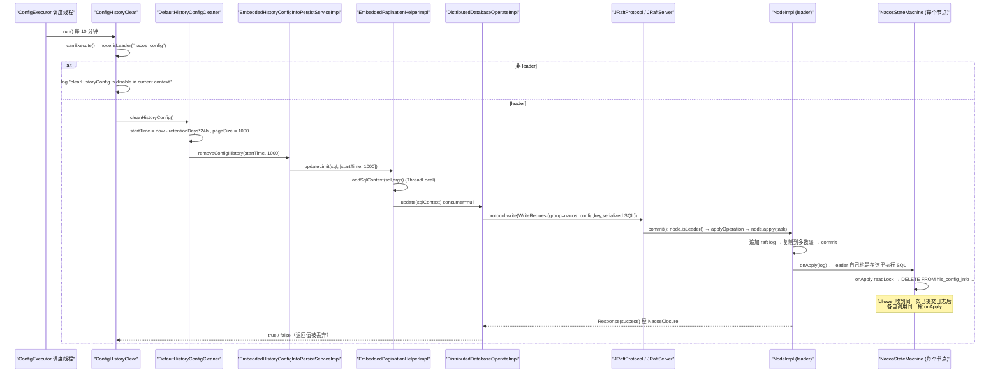
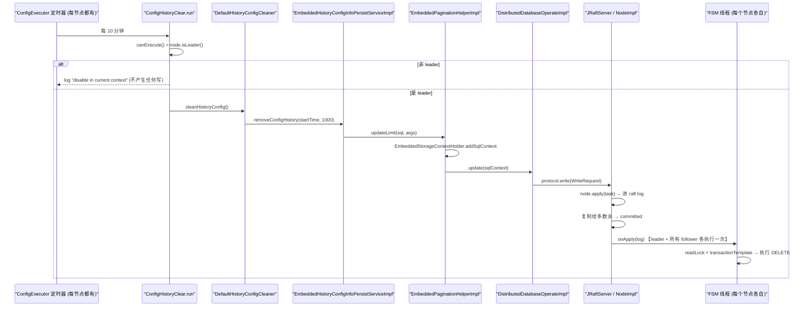

我先读取 `DumpService` 的 `ConfigHistoryClear` 实现与其删除路径。

继续定位 `canExecute()`、`HistoryConfigCleaner` 的实现与其删除路径。

读取 cleaner 实现、嵌入式 `canExecute` 与 cleaner 管理器。

关键是 `removeConfigHistory` 在嵌入式实现里是否走 raft 日志。

追踪 `updateLimit` → raft 写入路径。

核对 raft 写入门禁（是否必须本地为 leader）与 Derby 侧 DELETE 语句、`onApply` 执行路径。

确认 `protocol.write` 的 leader 依赖与 `EmbeddedDumpService` 全貌。

读取 `JRaftServer.commit` 确认非 leader 的写入行为。

核对 `DumpChangeConfigWorker` 对历史表的依赖、保留天数默认值，以及是否存在绕过 raft 的历史删除路径。

补最后一处：`DatabaseOperate.update` 的重载归属与保留天数默认值。

## 结论速览

**不会因为"只有 leader 触发"而导致历史配置不一致。** 你的前提里有一个需要修正的地方：`canExecute()` 限制 leader，**不是因为"只有 leader 才能删数据"，而是为了"集群里只有一个节点去提交这个清理任务"**。真正的删除是以 **raft 日志** 的形式落地的——leader 提交，**所有 follower 在 `onApply` 里重放同一条 DELETE**，历史表因此同步收敛。

| 问题 | 事实 | 代码位置 |
|---|---|---|
| 清理走不走 raft？ | 走。`updateLimit` → `EmbeddedStorageContextHolder.addSqlContext` → `databaseOperate.update` → `protocol.write` | `EmbeddedPaginationHelperImpl` L99-106、`DistributedDatabaseOperateImpl` L423-447 |
| follower 会执行删除吗？ | 会。raft 日志 commit 后 `NacosStateMachine.onApply` → `DistributedDatabaseOperateImpl.onApply` 执行 SQL | L519-533 |
| 非 leader 能不能发起清理？ | **能**。`commit()` 里非 leader 会 `invokeToLeader` 转发 | `JRaftServer` L332-338 |
| 那 `canExecute()` 为什么判 leader？ | 单写者去重（避免 N 个节点各自每 10 分钟提交一份清理任务），不是能力限制 | `EmbeddedDumpService` L167-175 |
| cutoff 时间会不会因节点时钟差而不一致？ | 不会。`startTime` 在 leader 侧算好后**作为 SQL 参数进入日志**，follower 用的是同一个值 | `DefaultHistoryConfigCleaner` L43-46 |
| 真正的一致性隐患在哪？ | Derby 的 DELETE 子查询**没有 `ORDER BY`**，配合 limit 属于非确定性语句复制 | `HistoryConfigInfoMapperByDerby` L36-37 |

---

## 一、完整调用链



调度点只有一处，且**每个节点都会注册**：

```java
// DumpService.dumpOperate()  L251-253
HistoryConfigCleaner cleaner = HistoryConfigCleanerManager.getHistoryConfigCleaner(
        HistoryConfigCleanerConfig.getInstance().getActiveHistoryConfigCleaner());
ConfigExecutor.scheduleConfigTask(new ConfigHistoryClear(cleaner), 10, 10, TimeUnit.MINUTES);
```

`dumpOperate()` 在嵌入式集群模式下由 leader 变更观察者触发（`EmbeddedDumpService` L115），在 MySQL 模式下由 `@PostConstruct init()` 直接调用（`ExternalDumpService` L57-59）。也就是说**follower 上同样挂了这个每 10 分钟的任务**，只是被 `canExecute()` 挡住——这正是"leader 切换后新 leader 能在自己下一个 tick 接管清理"的原因。

---

## 二、逐段源码：删除为什么是 raft 写

### ① 触发与门控

```java
// DumpService.ConfigHistoryClear  L169-183
@Override
public void run() {
    LOGGER.warn("clearHistoryConfig get scheduled");
    if (canExecute()) {                       // ★ 唯一的路由判断
        try {
            historyConfigCleaner.cleanHistoryConfig();
            LOGGER.warn("history config cleaner successfully");
        } catch (Throwable e) {
            LOGGER.error("clearConfigHistory error : {}", e.toString());   // ★ 全异常吞掉
        }
    } else {
        LOGGER.warn("clearHistoryConfig is disable in current context");
    }
}

// EmbeddedDumpService  L167-175
@Override
protected boolean canExecute() {
    if (EnvUtil.getStandaloneMode()) { return true; }
    // if is derby + raft mode, only leader can execute
    CPProtocol protocol = protocolManager.getCpProtocol();
    return protocol.isLeader(PersistenceConstant.CONFIG_MODEL_RAFT_GROUP);
}
```

`isLeader` 的实现顺带解决了一个你之前关注过的问题——它对 raft node 为 null 做了保护：

```java
// JRaftProtocol L219-226
@Override
public boolean isLeader(String group) {
    Node node = raftServer.findNodeByGroup(group);
    if (node == null) { throw new NoSuchRaftGroupException(group); }   // 不会 NPE
    return node.isLeader();
}
```

所以 raft group 起不来时，这里表现为日志里一行 `clearConfigHistory error : no such raft group`，而不是启动崩溃。

### ② 清理策略

```java
// DefaultHistoryConfigCleaner L42-47
@Override
public void cleanHistoryConfig() {
    Timestamp startTime = getBeforeStamp(TimeUtils.getCurrentTime(), 24 * getRetentionDays());  // now - N 天
    int pageSize = 1000;                                   // ★ 硬编码，且单次只删一批
    getHistoryConfigInfoPersistService().removeConfigHistory(startTime, pageSize);
}
private int getRetentionDays() { return PropertyUtil.getConfigRententionDays(); }  // 默认 30
```

`PropertyUtil` L116 是 `private static int configRententionDays = 30;`，配置键 `nacos.config.retention.days`，只有 `> 0` 才生效（L282）。**注意这里没有 while 循环**——老版本 Nacos 是 `do { ... } while (count > 0)` 反复删，现在每 10 分钟只提交一次批量删除。

### ③ 关键：`removeConfigHistory` 如何变成 raft 日志

```java
// EmbeddedHistoryConfigInfoPersistServiceImpl L114-124
@Override
public void removeConfigHistory(final Timestamp startTime, final int limitSize) {
    HistoryConfigInfoMapper mapper = mapperManager.findMapper(
            dataSourceService.getDataSourceType(), TableConstant.HIS_CONFIG_INFO);   // ★ 拿到 Derby 版 mapper
    MapperContext context = new MapperContext();
    context.putWhereParameter(FieldConstant.START_TIME, startTime);
    context.putWhereParameter(FieldConstant.LIMIT_SIZE, limitSize);
    MapperResult mapperResult = mapper.removeConfigHistory(context);
    PaginationHelper<ConfigInfo> helper = createPaginationHelper();   // EmbeddedPaginationHelperImpl
    helper.updateLimit(mapperResult.getSql(), mapperResult.getParamList().toArray());
}
```

```java
// EmbeddedPaginationHelperImpl L99-106  ← 这就是"写进 raft"的开关
@Override
public void updateLimit(final String sql, final Object[] args) {
    EmbeddedStorageContextHolder.addSqlContext(sql, args);          // ⑴ 暂存到 ThreadLocal
    try {
        databaseOperate.update(EmbeddedStorageContextHolder.getCurrentSqlContext());  // ⑵ 提交
    } finally {
        EmbeddedStorageContextHolder.cleanAllContext();
    }
}
```

嵌入式模式下注入的 `DatabaseOperate` 实现就是 `DistributedDatabaseOperateImpl`（`@Conditional(ConditionDistributedEmbedStorage.class)`），`update(List)` 走 `DatabaseOperate` 的 default 方法转成 `update(list, null)`：

```java
// DistributedDatabaseOperateImpl L423-447
public Boolean update(List<ModifyRequest> sqlContext, BiConsumer<Boolean, Throwable> consumer) {
    final String key = System.currentTimeMillis() + "-" + group() + "-" + memberManager.getSelf().getAddress()
            + "-" + MD5Utils.md5Hex(sqlContext.toString(), DEFAULT_ENCODE);     // 幂等/追踪用签名
    WriteRequest request = WriteRequest.newBuilder().setGroup(group()).setKey(key)
            .setData(ByteString.copyFrom(serializer.serialize(sqlContext)))     // ★ SQL+参数被序列化进日志
            .putAllExtendInfo(EmbeddedStorageContextHolder.getCurrentExtendInfo())
            .setType(sqlContext.getClass().getCanonicalName()).build();
    if (Objects.isNull(consumer)) {
        Response response = this.protocol.write(request);                        // ★ 同步等，最长 10s
        if (response.getSuccess()) { return true; }
        LOGGER.error("execute sql modify operation failed : {}", response.getErrMsg());
        return false;
    }
    ...
}
```

`protocol.write` → `raftServer.commit(group, request, future)`：

```java
// JRaftServer.commit L320-340
final Node node = tuple.node;
if (node.isLeader()) {
    applyOperation(node, data, closure);      // leader：node.apply(task) → 追加日志 → 复制 → 提交
} else {
    invokeToLeader(group, data, rpcRequestTimeoutMs, closure);   // ★ follower：## 结论速览

**不会导致 leader / follower 的历史配置不一致。**

关键区分：**"只有 leader 触发" ≠ "只有 leader 删除"**。`ConfigHistoryClear` 的删除不是本地 JDBC 直删，而是一次 **raft 写请求**——DELETE 语句连同参数被序列化进 raft log，复制并 commit 后，**leader 和所有 follower 都会在 `NacosStateMachine.onApply → DistributedDatabaseOperateImpl.onApply` 里执行同一条 DELETE**。

`canExecute()` 里的 leader 门禁（`EmbeddedDumpService` L168-175）本质是**单写者去重**（避免 3 个节点各调度一份、往日志里塞 3 条重复 DELETE），而不是权限限制——事实上 follower 也能发起，`JRaftServer.commit` L335-337 会 `invokeToLeader` 转发。

真正值得担心的不一致来源在**另一处**：Derby 的删除语句子查询**没有 `ORDER BY`**（见"坑 1"）。

| 问题 | 答案 | 证据 |
|---|---|---|
| 删除是否进 raft log | 是 | `EmbeddedPaginationHelperImpl.updateLimit` L99-106 → `databaseOperate.update` → `DistributedDatabaseOperateImpl.update` L437-442 → `protocol.write` |
| follower 是否执行 | 是，走 `onApply` | `DistributedDatabaseOperateImpl.onApply` L519-533，`update(transactionTemplate, jdbcTemplate, sqlContext)` |
| 删除的 cutoff 时间会不会因节点时钟不同而不同 | 不会，cutoff 由 leader 算好后作为 SQL 参数进日志 | `DefaultHistoryConfigCleaner` L43 + `TimeUtils.getCurrentTime()` L33-35 |
| 会不会删掉不同的行 | **理论上可能**（子查询无 ORDER BY + gmt_modified 相同值时按 RID tie-break） | `HistoryConfigInfoMapperByDerby` L36-37 |
| MySQL 模式的对照 | 共享库，任意节点删都全局可见，门禁换成 `memberManager.isFirstIp()` | `ExternalDumpService` L62-64 |

---

## 一、完整链路



注意这张图的重点：**`onApply` 那条边对每个节点都会发生**，raft 的"日志复制 + 状态机重放"天然保证了删除动作的全集群生效，跟"谁触发"无关。

---

## 二、逐段源码分析

### ① 调度：每个节点都注册了定时器，用 `canExecute()` 决定谁真的干活

```java
// DumpService.dumpOperate()  L251-253
HistoryConfigCleaner cleaner = HistoryConfigCleanerManager.getHistoryConfigCleaner(
        HistoryConfigCleanerConfig.getInstance().getActiveHistoryConfigCleaner());
ConfigExecutor.scheduleConfigTask(new ConfigHistoryClear(cleaner), 10, 10, TimeUnit.MINUTES);
```

`dumpOperate()` 在**所有节点**上都会被调用（嵌入式模式下由 `EmbeddedDumpService.init` L136-137 订阅 `LEADER_META_DATA` 的 observer 触发，L115）。所以清理任务在每个节点都在跑，只是——

```java
// DumpService.ConfigHistoryClear.run()  L170-183
public void run() {
    LOGGER.warn("clearHistoryConfig get scheduled");
    if (canExecute()) {                                  // ★ 门禁
        try {
            historyConfigCleaner.cleanHistoryConfig();
        } catch (Throwable e) {
            LOGGER.error("clearConfigHistory error : {}", e.toString());   // ★ 全量吞
        }
    } else {
        LOGGER.warn("clearHistoryConfig is disable in current context");
    }
}
```

三种部署形态的门禁语义完全不同，这是理解"为什么这么设计"的入口：

| 场景 | `canExecute()` | 原因 |
|---|---|---|
| 嵌入式 + raft（derby） | `protocol.isLeader(CONFIG_MODEL_RAFT_GROUP)`（`EmbeddedDumpService` L168-175） | 数据靠 raft 复制，多节点同时触发只会产生重复日志与写放大，选一个 leader 做单写者即可 |
| standalone | 直接 `true`（L169-171） | 单进程，无复制 |
| 外部 MySQL | `memberManager.isFirstIp()`（`ExternalDumpService` L62-64） | 全集群共享同一个库，任何节点删都全局可见，只需去重 → 用"cluster.conf 第一个 IP"当静态主责节点 |

这里的 `isLeader` 实现也顺带说明一下它是判空的：

```java
// JRaftProtocol.isLeader  L219-226
Node node = raftServer.findNodeByGroup(group);
if (node == null) { throw new NoSuchRaftGroupException(group); }   // 不会 NPE
return node.isLeader();
```

抛出的 `NoSuchRaftGroupException` 会被 L177 的 `catch (Throwable)` 吞成一行 error 日志。

### ② Cleaner：一次只删 1000 行，且**没有循环**

```java
// DefaultHistoryConfigCleaner.cleanHistoryConfig  L42-47
Timestamp startTime = getBeforeStamp(TimeUtils.getCurrentTime(), 24 * getRetentionDays());  // now - 30d*24h
int pageSize = 1000;
getHistoryConfigInfoPersistService().removeConfigHistory(startTime, pageSize);
```

- `getRetentionDays()` → `PropertyUtil.getConfigRententionDays()`，默认 **30 天**（`PropertyUtil` L116 `configRententionDays = 30`），可通过 `nacos.config.retention.days` 覆盖，且 L282 要求 `tmp > 0`；
- `getBeforeStamp` L56-62 做了一次 `SimpleDateFormat` 格式化再 `Timestamp.valueOf`，**精度截断到秒**——这个细节后面会影响"tie-break"讨论；
- **关键**：这里只有单次调用，没有 `do { ... } while (affected > 0)`。所以每 10 分钟最多清 1000 行。

### ③ 落到持久层：走的是"raft 写"，不是 `jt.update`

```java
// EmbeddedHistoryConfigInfoPersistServiceImpl.removeConfigHistory  L115-124
MapperResult mapperResult = historyConfigInfoMapper.removeConfigHistory(context);
PaginationHelper<ConfigInfo> helper = createPaginationHelper();   // EmbeddedPaginationHelperImpl
helper.updateLimit(mapperResult.getSql(), mapperResult.getParamList().toArray());
```

```java
// EmbeddedPaginationHelperImpl.updateLimit  L99-106
public void updateLimit(final String sql, final Object[] args) {
    EmbeddedStorageContextHolder.addSqlContext(sql, args);       // 放进 ThreadLocal 待执行 SQL 列表
    try {
        databaseOperate.update(EmbeddedStorageContextHolder.getCurrentSqlContext());  // ★ 注意返回 Boolean 被丢弃
    } finally {
        EmbeddedStorageContextHolder.cleanAllContext();
    }
}
```

对比一下外部存储模式（`ExternalHistoryConfigInfoPersistServiceImpl` L115-124）——**代码形状一模一样**，但注入的是 `ExternalPaginationHelperImpl`，那里 `updateLimit` 直接 `jt.update(sql, args)`。同一个接口，两种语义，这是 Nacos 嵌入式/外部存储最常见的混淆点。

### ④ `DatabaseOperate.update` → raft 日志

```java
// DistributedDatabaseOperateImpl.update  L423-447
final String key = System.currentTimeMillis() + "-" + group() + "-" + memberManager.getSelf().getAddress()
        + "-" + MD5Utils.md5Hex(sqlContext.toString(), DEFAULT_ENCODE);        // ★ 幂等/追踪键
WriteRequest request = WriteRequest.newBuilder().setGroup(group()).setKey(key)
        .setData(ByteString.copyFrom(serializer.serialize(sqlContext)))        // 序列化 List<ModifyRequest>
        .putAllExtendInfo(EmbeddedStorageContextHolder.getCurrentExtendInfo())
        .setType(sqlContext.getClass().getCanonicalName()).build();
if (Objects.isNull(consumer)) {
    Response response = this.protocol.write(request);                          // 同步等
    if (response.getSuccess()) { return true; }
    LOGGER.error("execute sql modify operation failed : {}", response.getErrMsg());
    return false;
}
```

```java
// JRaftProtocol.write  L178-182
CompletableFuture<Response> future = writeAsync(request);
return future.get(10_000L, TimeUnit.MILLISECONDS);      // ★ 只等 10 秒
```

```java
// JRaftServer.commit  L320-340
if (node.isLeader()) {
    applyOperation(node, data, closure);        // leader：node.apply(task) → 写进 raft log
} else {
    invokeToLeader(group, data, rpcRequestTimeoutMs, closure);   // ★ follower：转发给 leader，仍然能提交
}
```

**`else` 分支就是本次问题的答案所在**：即使 `canExecute()` 写成 `return true`，follower 的删除也不会"只删本地"——它会把请求转发给 leader，最终仍然变成一条全局 raft 日志。也就是说 leader 门禁带来的唯一影响是**少几条重复日志**，而不是一致性。

（`key` 里带 `md5(sqlContext)`，同一次清理在三个节点上如果都触发，leader 会收到 3 条内容相同但 key 时间戳不同的日志——raft 不做去重，会真的执行 3 次 DELETE。第二次起删的是"另外的 1000 行"，所以去重是有意义的优化，但仍不会造成"只有 leader 有数据变化"。）

### ⑤ follower 侧：同一条日志被 `onApply` 重放

```java
// DistributedDatabaseOperateImpl.onApply  L519-544
final Lock lock = readLock;                 // 读写锁的读锁
lock.lock();
try {
    List<ModifyRequest> sqlContext = serializer.deserialize(byteString.toByteArray(), List.class);
    sqlLimiter.doLimitForModifyRequest(sqlContext);
    if (log.containsExtendInfo(DATA_IMPORT_KEY)) { isOk = doDataImport(...); }
    else {
        sqlContext.sort(Comparator.comparingInt(ModifyRequest::getExecuteNo));
        isOk = update(transactionTemplate, jdbcTemplate, sqlContext);   // ★ 真的执行 DELETE
        PersistenceExecutor.executeEmbeddedDump(() -> { for (EmbeddedApplyHook each : ...) each.afterApply(log); });
    }
    return Response.newBuilder().setSuccess(isOk).build();
}
```

`NacosStateMachine.onApply` 在 **leader 和 follower 上都会被 jraft 调用**（committed 之后），因此 `his_config_info` 的删除行集合来自同一份日志、同一个 cutoff 参数。

### ⑥ SQL 本体（derby / mysql 差异）

```java
// HistoryConfigInfoMapperByDerby.removeConfigHistory  L36-37
"DELETE FROM his_config_info WHERE nid IN( "
      + "SELECT nid FROM his_config_info WHERE gmt_modified < ? OFFSET 0 ROWS FETCH NEXT ? ROWS ONLY)"

// HistoryConfigInfoMapperByMySql  L36
"DELETE FROM his_config_info WHERE gmt_modified < ? LIMIT ?"
```

Derby 不支持 `DELETE ... LIMIT`，所以改写成 `nid IN (子查询 + FETCH NEXT)`。语义等价，但**两个版本都没有 `ORDER BY`**——这是唯一真正的非确定性来源。

顺带确认 `his_config_info` 上是有 `gmt_modified` 索引的（`META-INF/derby-schema.sql` L66 `CREATE INDEX hisconfiginfo_gmt_modified_idx`），所以这个子查询走索引扫描，不是全表扫。

---

## 三、一致性为什么成立（三条独立支撑）

1. **复制单位是"已参数化的 SQL"，不是"节点本地决策"。** cutoff `startTime` 在 leader 上算完（`TimeUtils.getCurrentTime()`，leader 时钟），作为 `ModifyRequest.args[0]` 序列化进日志；follower 重放时用的是日志里的这个常量，**follower 自己的时钟完全不参与**。节点间时钟漂移不会造成删除范围差异。

2. **被删的那些行本身也是 raft 复制来的。** `his_config_info` 的 INSERT 走 `insertConfigHistoryAtomic` → `EmbeddedStorageContextHolder.addSqlContext`（L111），与 `config_info` 的写同批进日志；`nid` 也是 leader 侧 `idGeneratorManager.nextId(RESOURCE_CONFIG_HISTORY_ID)` 生成后作为参数进日志（`EmbeddedConfigInfoPersistServiceImpl` L215、L224）。所以"候选删除集合"在各节点是逐行相同的（含 `gmt_modified`，它同样来自日志里的 `now` 参数）。

3. **日志顺序全局唯一。** 清理 DELETE 与后续业务 INSERT 的相对次序在所有节点一致，不存在"A 节点先删后插、B 节点先插后删"的交错。

补充一条：**快照维度也一致**。`nacos_config` group 的 `DerbySnapshotOperation` 打的整库备份本身包含 `his_config_info`，而清理动作进 raft log，所以"快照点 + 尾部日志"恢复出来的历史表同样在各节点一致——这条链不会因为清理只在 leader 触发而断裂。

---

## 四、关键点

| # | 关键点 | 说明 |
|---|---|---|
| 1 | 清理是 raft 写，不是本地 JDBC | `updateLimit → databaseOperate.update → protocol.write`，与配置发布同一条通道 |
| 2 | leader 门禁 = 单写者去重，非权限 | `JRaftServer.commit` L335 的 `invokeToLeader` 证明 follower 提交也会被转发执行 |
| 3 | follower 通过 `onApply` 得到同样的删除结果 | `DistributedDatabaseOperateImpl.onApply` L533 |
| 4 | cutoff 进日志，屏蔽节点时钟差 | `DefaultHistoryConfigCleaner` L43 |
| 5 | 每节点都注册了 10 分钟定时器 | `dumpOperate` L253，`ConfigExecutor.scheduleConfigTask(..., 10, 10, MINUTES)` |
| 6 | 单次上限 1000 行、无循环 | 与旧版 `while(true)` 逐页删的写法不同，当前是"每 10 分钟最多 1000 行" |
| 7 | 保留期默认 30 天，且必须 > 0 | `PropertyUtil` L116/L276-289；解析失败或非正数静默沿用 30 |
| 8 | 外部 MySQL 换成 `isFirstIp()` | 共享库模型下"谁删"等价，只需去重；嵌入式才需要 leader 语义 |
| 9 | 失败与异常全部只落日志 | `ConfigHistoryClear` L177 `catch (Throwable)`；`updateLimit` 丢弃 `update` 的 Boolean 返回 |
| 10 | DELETE 与 INSERT 共享同一锁模型 | `onApply` 用 `readLock`（L523），线性读 `onRequest` 也用 `readLock`（L474）→ 清理与读并发，但会与快照 save/load 的 `writeLock` 互斥 |

---

## 五、坑

1. **`FETCH NEXT ? ROWS ONLY` 无 `ORDER BY` —— 这才是唯一真实的一致性风险**
   子查询从"所有 `gmt_modified < cutoff`"的行里任取 1000 行。当可删行 > 1000 时，选哪 1000 行取决于 Derby 的执行计划与索引扫描顺序。有 `hisconfiginfo_gmt_modified_idx` 时通常按索引序取最旧 1000 行，各节点一致；但**`gmt_modified` 存在相同值时（批量发布/同秒写入），tie-break 落到 Derby 的 RID（行物理位置）**，而 RID 在两种情况下可能不同：① 某节点是通过 `DerbySnapshotOperation.onSnapshotLoad` 整库恢复出来的（拷贝出来的文件布局与原库不同）；② 某节点是新 join 后从快照 + 日志重建。后果：**行数仍相同，但留下的 nid 集合可能不同**——表现为"历史详情按 nid 查，A 节点有、B 节点空"（`detailConfigHistory(nid)` 返回 null）。加上 `getBeforeStamp` 把时间截断到秒（L60），同秒内多行发布其实很容易造成 tie。
   正确写法应当是 `ORDER BY gmt_modified, nid`（`nid` 由 raft 复制，天然全局一致，可作确定性 tie-break）。

2. **清理吞吐有硬上限，历史表可能永久超过保留期**
   1000 行 / 10 分钟 = **144,000 行/天**。高频发布场景（每分钟几十次变更 + 灰度 + 回滚）产出的历史行速度可以超过这个值，`his_config_info` 就会持续增长，`nacos.config.retention.days` 形同失效。而且没有循环/批量放大机制，也没有把 pageSize 做成可配置项（硬编码 L44）。

3. **静默失败三重叠加**
   `updateLimit` 返回 `void`（`PaginationHelper` 接口本身如此）→ `update` 的 `Boolean` 被丢弃；raft 写失败只 `LOGGER.error("execute sql modify operation failed")`；`protocol.write` 只等 10 秒，超时会抛 `NacosRuntimeException`，被 `ConfigHistoryClear` 的 `catch (Throwable)` 降成一行 error。也就是说：**清理长期不生效在监控上是不可见的**，只能靠 grep `config-persist.log` / raft 日志。

4. **大表 DELETE 拖慢状态机**
   DELETE 走 raft 日志后必须在 `onApply` 里执行；`his_config_info` 累积到百万行时这条语句可能耗时可观，而它占用的是**FSM apply 线程**（readLock 内），会推迟同 group 后续日志的 apply → 表现为 follower 追日志变慢、线性读排队、`write()` 10 秒超时连锁失败。这是"清理任务反过来放大不一致窗口"的路径（对比前几轮分析的 `snapshot_interval_secs` 是收敛时间上界，这里是短期停滞）。

5. **主从切换有最长 10 分钟空窗**
   定时器是固定 10 分钟周期、无 leader 变更事件驱动。leader 挂掉后新 leader 要等自己下一次 tick 才执行，期间历史表完全不减。功能无损，但排障时容易误判"清理停了"。

6. **`retention.days` 改动需重启**
   `PropertyUtil.loadSetting()` 只在 `ApplicationContextInitializer.initialize` 时执行一次（L366-368），`configRententionDays` 是普通 static int，修改 `application.properties` 不会热生效。

7. **standalone 与嵌入式行为不一致（对照坑）**
   `canExecute()` 在 standalone 直接 `true`，此时删除走的是同一个 `EmbeddedHistoryConfigInfoPersistServiceImpl` → raft（单节点 group 仍能 commit，多数派 = 1）。这条链没有降级为直连 JDBC，所以**单机模式下历史清理同样会写 raft log**（`data/protocol/raft/nacos_config/log`），这是排查"单机模式 log 目录为何增长"时的一个来源。

---

## 六、总结

`DumpService.ConfigHistoryClear#run` 的一致性结论是**否定的（不会不一致）**，理由要分两层看。触发层：`EmbeddedDumpService.canExecute()` 用 `protocol.isLeader("nacos_config")` 把执行者收窄到 leader，但这是**去重**而非**权限**——因为 `JRaftServer.commit` L332-338 对非 leader 会 `invokeToLeader` 转发，任何节点的写请求最终都变成 leader 上的一条 raft 日志。执行层：这条日志的内容是"参数化的 DELETE 语句"（`List<ModifyRequest>` 序列化，cutoff 时间与 1000 都在 args 里），commit 之后 leader 和 follower 各自在 `NacosStateMachine.onApply → DistributedDatabaseOperateImpl.onApply`（readLock + transactionTemplate）重放同一条 SQL；而被删的那些历史行本身也是 raft 复制进来的（`insertConfigHistoryAtomic` 只 `addSqlContext`，`nid` 来自 leader 的 `idGeneratorManager`），所以候选集、cutoff、日志顺序三者在各节点全部相同。MySQL 模式下这个门禁换成 `isFirstIp()`，因为共享库下"谁删"根本等价，只需要避免重复调度——这个对照恰好印证 leader 判断的目的就是"选一个干活的"。

真正的风险不在"谁能删"，而在**删哪 1000 行**：`HistoryConfigInfoMapperByDerby` 的子查询用 `OFFSET 0 ROWS FETCH NEXT ? ROWS ONLY` 却没有 `ORDER BY`，这是"基于语句复制"的经典非确定性模式。多数情况下 Derby 会走 `hisconfiginfo_gmt_modified_idx` 取最旧的 1000 行而各节点一致，但 `gmt_modified` 相同（`getBeforeStamp` 还刻意截断到秒）时 tie-break 依赖行物理位置 RID，而 RID 在"从快照恢复出来的节点"与"连续运行未换过快照的节点"之间可能不同，于是会留下不同的 nid 集合——行数相同、内容不同，表现为按 nid 查历史详情在不同节点一边有一边无。这是本条链路唯一需要在代码层面修的点（补 `ORDER BY gmt_modified, nid` 即可，`nid` 因 raft 复制天然全局一致）。此外三个运维级要点要记住：单次 1000 行且无循环使清理吞吐封顶在 144k 行/天，超过就永久超出保留期；失败路径三层静默（`updateLimit` 无返回、raft 失败只 log、`write` 只等 10 秒）使清理停摆不可观测；大表 DELETE 占用 FSM apply 线程，反而会在清理那一刻放大 follower 的滞后窗口。