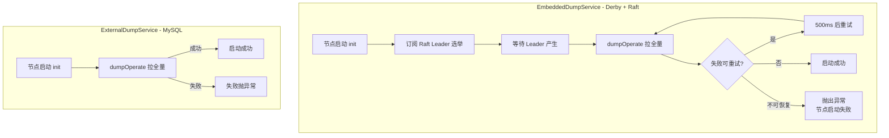

## ExternalDumpService vs EmbeddedDumpService 区别总结

### 一、根本区别：存储模式不同

| 维度 | EmbeddedDumpService | ExternalDumpService |
|------|---------------------|---------------------|
| **存储介质** | 内嵌 Derby 数据库 | 外部 MySQL/PostgreSQL 等关系型数据库 |
| **一致性协议** | Raft (CP) | 共享数据库 |
| **适用场景** | 单机/小型集群（默认 cluster.conf） | 生产集群（推荐） |
| **配置开关** | `spring.datasource.platform=embedded` (默认) | `spring.datasource.platform=mysql` |

**条件装配机制**:

```java
// EmbeddedDumpService
@Conditional(ConditionOnEmbeddedStorage.class)
public class EmbeddedDumpService extends DumpService { ... }
// matches() → DatasourceConfiguration.isEmbeddedStorage()

// ExternalDumpService
@Conditional(ConditionOnExternalStorage.class)
@DependsOn({"rpcConfigChangeNotifier", "configGrayModelMigrateService"})
public class ExternalDumpService extends DumpService { ... }
// matches() → !DatasourceConfiguration.isEmbeddedStorage()
```

二者互斥，运行时只会激活一个。

---

### 二、init() 启动逻辑差异

#### 2.1 ExternalDumpService（极简）

```java
@PostConstruct
@Override
protected void init() throws Throwable {
    dumpOperate();   // 直接同步执行全量 dump
}
```

**特点**:
- 因为外部 MySQL 是单一可信源，所有节点读到的数据是一致的
- 启动时直接拉取全量配置 → 写入本地磁盘缓存
- 无需关心 Leader 选举或节点角色

#### 2.2 EmbeddedDumpService（复杂）

```java
@PostConstruct
@Override
protected void init() throws Throwable {
    // 单机模式：直接 dump
    if (EnvUtil.getStandaloneMode()) {
        dumpOperate();
        return;
    }
    
    // 集群模式：等待 Raft Leader 产生
    CPProtocol protocol = protocolManager.getCpProtocol();
    AtomicReference<Throwable> errorReference = new AtomicReference<>(null);
    CountDownLatch waitDumpFinish = new CountDownLatch(1);
    
    Observer observer = new Observer() {
        @Override
        public void update(Observable o) {
            Object arg = ((ProtocolMetaData.ValueItem) o).getData();
            GlobalExecutor.executeByCommon(() -> {
                if (Objects.isNull(arg)) {
                    return;   // 还没有 Leader，不做处理
                }
                // 标记：需要读到数据才返回
                EmbeddedStorageContextHolder.putExtendInfo(
                    PersistenceConstant.EXTEND_NEED_READ_UNTIL_HAVE_DATA, "true");
                
                // 死循环重试 dump
                boolean canEnd = false;
                for (; ; ) {
                    try {
                        dumpOperate();
                        protocol.protocolMetaData().unsubscribe(
                            CONFIG_MODEL_RAFT_GROUP, LEADER_META_DATA, this);
                        canEnd = true;
                    } catch (Throwable ex) {
                        if (!shouldRetry(ex)) {
                            errorReference.set(ex);
                            canEnd = true;
                        }
                    }
                    if (canEnd) {
                        ThreadUtils.countDown(waitDumpFinish);
                        break;
                    }
                    ThreadUtils.sleep(500L);
                }
            });
        }
    };
    
    // 订阅 Raft Leader 变更事件
    protocol.protocolMetaData().subscribe(
        CONFIG_MODEL_RAFT_GROUP, MetadataKey.LEADER_META_DATA, observer);
    
    // 阻塞 Spring 启动，直到 dump 完成
    ThreadUtils.latchAwait(waitDumpFinish);
    
    if (Objects.nonNull(errorReference.get())) {
        throw errorReference.get();   // 抛出，导致节点启动失败
    }
}
```

**核心要点**:
1. **单机模式**：直接 dump，与 External 一致
2. **集群模式**：必须等 Raft 选出 Leader 才能执行
3. **重试机制**：区分可重试与不可重试错误

```java
private boolean shouldRetry(Throwable ex) {
    // 不可重试：FSMCaller 过载、状态机错误
    for (String failedMsg : errorMessages) {  // "FSMCaller is overload.", "STATE_ERROR"
        if (StringUtils.containsIgnoreCase(errMsg, failedMsg)) {
            return false;
        }
    }
    // 可重试：协议暂时不可用
    for (final String retryMsg : retryMessages) {  
        // "The conformance protocol is temporarily unavailable for reading"
        if (StringUtils.containsIgnoreCase(errMsg, retryMsg)) {
            return true;
        }
    }
    return false;
}
```

---

### 三、canExecute() 差异（用于后台定时任务）

此方法用于判断当前节点是否有权执行**聚合任务、历史清理任务**（避免多节点重复执行）。

#### 3.1 ExternalDumpService

```java
@Override
protected boolean canExecute() {
    return memberManager.isFirstIp();   // 集群中 IP 最小的节点
}
```

**判定规则**: 所有 Nacos 节点共享同一个 MySQL，为避免历史清理等任务被多节点重复执行，约定由"第一个 IP"节点承担。

#### 3.2 EmbeddedDumpService

```java
@Override
protected boolean canExecute() {
    if (EnvUtil.getStandaloneMode()) {
        return true;   // 单机必然执行
    }
    // Derby + Raft 模式：只有 Leader 才能执行
    CPProtocol protocol = protocolManager.getCpProtocol();
    return protocol.isLeader(PersistenceConstant.CONFIG_MODEL_RAFT_GROUP);
}
```

**判定规则**: 因为 Derby 是嵌入式数据库，每个节点持有独立数据副本，只有 Leader（Raft 主节点）的数据是权威写入源。

---

### 四、依赖与初始化顺序

| 项目 | EmbeddedDumpService | ExternalDumpService |
|------|--------------------|---------------------|
| 额外依赖 | `ProtocolManager` (Raft 协议管理) | 无 |
| @DependsOn | 无 | `rpcConfigChangeNotifier`, `configGrayModelMigrateService` |
| 启动阻塞 | `CountDownLatch` 阻塞等待 Leader + dump 完成 | 同步直接完成 |

External 的 `@DependsOn` 保证了：
- **rpcConfigChangeNotifier** 先初始化：避免启动 dump 完成后变更事件无法推送
- **configGrayModelMigrateService** 先初始化：兼容旧灰度模型迁移

---

### 五、架构对比图



---

### 六、关键差异速查表

| 差异点 | EmbeddedDumpService | ExternalDumpService |
|-------|---------------------|---------------------|
| **@Conditional** | `ConditionOnEmbeddedStorage` | `ConditionOnExternalStorage` |
| **@DependsOn** | 无 | `rpcConfigChangeNotifier`、`configGrayModelMigrateService` |
| **init - 单机** | 直接 dump | 直接 dump |
| **init - 集群** | 订阅 Leader 事件 + CountDownLatch 阻塞 + 重试 | 直接 dump |
| **canExecute - 单机** | `true` | `memberManager.isFirstIp()`（通常 true） |
| **canExecute - 集群** | `protocol.isLeader(CONFIG_MODEL_RAFT_GROUP)` | `memberManager.isFirstIp()` |
| **失败重试** | 区分可重试/不可重试错误 | 无重试（依赖异常抛出） |
| **一致性保障** | Raft CP 协议 | 外部数据库共享 |
| **节点间数据** | 各节点独立 Derby 副本 | 所有节点共享 MySQL |
| **生产推荐** | 不推荐（3 节点起，运维复杂） | 推荐（成熟、易运维） |

---

### 七、总结要点

1. **本质区别**：**数据源是共享的还是分片的**
    - External：所有节点读同一份 MySQL → 无角色概念 → 逻辑简单
    - Embedded：每节点独立 Derby + Raft 同步 → 存在 Leader 选举 → 逻辑复杂

2. **启动阻塞**：Embedded 集群启动必须等 Leader 产生，防止启动时读到"半成品"数据；External 无需等待。

3. **任务去重**：定时任务（dumpAll、历史清理）只能有一个节点执行：
    - External 用 **IP 排序** 选主
    - Embedded 用 **Raft Leader** 选主

4. **容错策略**：Embedded 通过 `shouldRetry()` 做精细化重试（区分协议临时不可用 vs 状态机错误），External 直接抛错（外部 DB 本身高可用）。

5. **可替换性**：两者通过 `DumpService` 抽象基类屏蔽差异，上层调用方（如 `ConfigChangeClusterSyncRequestHandler`）无需感知。