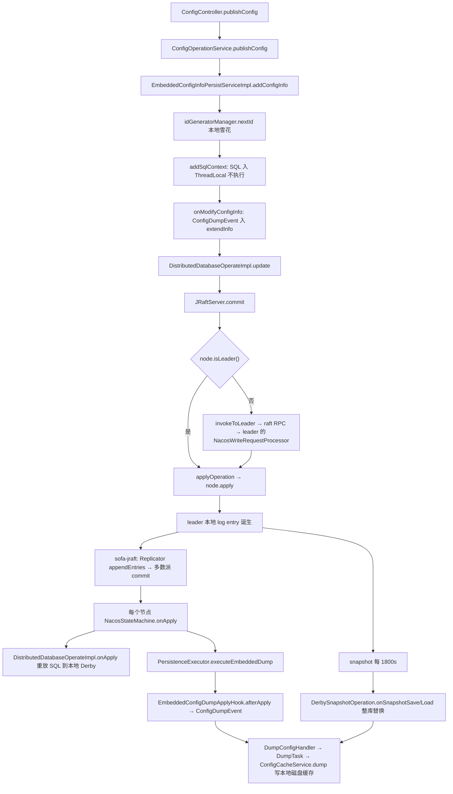

我先读一下你给的链路笔记与几处关键实现，再顺着 JRaft 的复制边界往下取证。

找到 `DerbySnapshotOperation`——这是 follower 追数据的关键一环。继续取证。

`cleanAndReopenDerby()` 与物理快照这两点很关键。再确认闭包回传链与事件订阅方。

`DerbyLoadEvent` 似乎没有订阅方，这点要确认。同时看 dump hook 与 apply 期的限流。

再确认 Derby 的启动清库/restore 与快照参数、日志回放的解析。

最后确认增量 dump 兜底通道与 extendInfo 写入细节。

最后核对熔断依据与缓存层的重建入口。

## 〇 一句话结论

**Follower 的 Derby 数据不是"从 leader 同步过来的副本"，而是"同一条 Raft 日志在自己机器上重放出来的结果"。**

Leader 只做一件事：把一串带参数的 SQL 变成一个**被多数派确认的日志条目**。之后 follower 的一致性由三条互相独立的腿支撑：

| 腿 | 复制的内容 | 落地位置 | 触发时机 | 保证的对象 |
|---|---|---|---|---|
| ① 日志重放 | `List<ModifyRequest>`（SQL 文本 + 参数） | 每个节点的 Derby | 每次写，实时 | **表数据**一致 |
| ② 快照 install | `derby_data.zip`（整库物理备份） | 覆盖整个 `derby-data` 目录 | 默认 1800s 一次 / 日志被 trim / 节点落后 | 追不上时的**兜底重建** |
| ③ apply 后 hook | `extendInfo` 里的 `ConfigDumpEvent` | 每个节点的磁盘缓存 / RocksDB | 随日志复制，apply 完成后异步 | **客户端可见的配置缓存**一致 |

你笔记里第 5 行"如果是 leader，直接写到底层数据库"这句需要修正：**leader 也不直接写库，leader 也是通过 `onApply` 重放写的**——这样 leader 和 follower 走的才是同一段代码，才可能一致。

---

## 一、先划清边界：Nacos 只提供 3 个钩子



Nacos 侧真正实现的只有：

- `NacosStateMachine`：`onApply` / `onSnapshotSave` / `onSnapshotLoad` / `onLeaderStart` / `onStartFollowing` / `onError`
- `RequestProcessor4CP`（这里是 `DistributedDatabaseOperateImpl`）：`onApply` / `onRequest` / `loadSnapshotOperate` / `group`
- `SnapshotOperation`（这里是 `DerbySnapshotOperation`）：物理备份与恢复

复制协议本身（选主、AppendEntries、commitIndex 推进）在 `com.alipay.sofa.jraft` 里，Nacos 不碰。

**一个容易被忽略的事实**：follower 收到写请求后**不会自己生成日志条目**。它是把请求原样 RPC 给 leader（`invokeToLeader`，L421-L452），由 leader 的 `AbstractProcessor.handleRequest` 二次确认 `isLeader()` 后重新 `applyOperation`（L92）。所以：

> 集群里**任何一条**日志都只在 leader 上诞生一次，follower 永远是"接收方 + 重放方"。这就是"以 leader 为准"的第一性保证——不存在两个节点各自生成日志再对齐的问题。

---

## 二、日志条目里装的是什么

`DistributedDatabaseOperateImpl.update` L434-L440：

```java
final String key = System.currentTimeMillis() + "-" + group() + "-" + memberManager.getSelf().getAddress()
        + "-" + MD5Utils.md5Hex(sqlContext.toString(), PersistenceConstant.DEFAULT_ENCODE);   // 仅标识，onApply 不使用
WriteRequest request = WriteRequest.newBuilder().setGroup(group())      // "nacos_config"
        .setKey(key)
        .setData(ByteString.copyFrom(serializer.serialize(sqlContext))) // Hessian(List<ModifyRequest>)
        .putAllExtendInfo(EmbeddedStorageContextHolder.getCurrentExtendInfo())  // ConfigDumpEvent JSON
        .setType(sqlContext.getClass().getCanonicalName()).build();
```

这里有一个**直接决定跨节点一致性的注释**（L426-L428）：

```java
// Since the SQL parameter is Object[], in order to ensure that the types of
// array elements are not lost, the serialization framework, rather than protobuff
```

SQL 参数是 `Object[]`，里面混着 `String / Long / Timestamp / Integer`。如果走 protobuf 的 `bytes` 裸传，`Timestamp` 和 `Long` 会在某节点还原成不同类型，`jdbcTemplate.update` 的绑定行为就可能不同。所以这里刻意降级用 **Hessian** 做 Java 原生类型保真序列化——**复制的是"带类型的调用"，不是"文本"**。

---

## 三、`onApply`：leader 和 follower 共用同一段落地代码

### 3.1 状态机骨架

```java
// NacosStateMachine.onApply L101-L129
while (iter.hasNext()) {
    if (iter.done() != null) {
        closure = (NacosClosure) iter.done();      // ← 只有发起 apply 的那个节点有回调
        message = closure.getMessage();
    } else {
        message = ProtoMessageUtil.parse(iter.getData().array());   // ← 无回调来源
        if (message instanceof ReadRequest) { applied++; index++; iter.next(); continue; }
    }
    if (message instanceof WriteRequest) {
        Response response = processor.onApply((WriteRequest) message);   // ★ 每个节点都执行
        postProcessor(response, closure);          // closure 为 null 时什么都不做
    }
}
```

`postProcessor` 只有一行 `closure.setResponse(data)`（L241-L245）。

**关键点**：follower 侧 `closure == null`，所以 `onApply` 返回的 `Response{success=false}` **在 follower 上没有归宿、不会回传给任何人**。这个事实后面会变成本回答里最大的坑。

### 3.2 落地逻辑

```java
// DistributedDatabaseOperateImpl.onApply L519-L557
final ByteString byteString = log.getData();
final Lock lock = readLock;                  // ① 读锁，快照才是写锁
lock.lock();
try {
    List<ModifyRequest> sqlContext = serializer.deserialize(byteString.toByteArray(), List.class);
    sqlLimiter.doLimitForModifyRequest(sqlContext);                     // ② 每节点各自限流
    if (log.containsExtendInfo(DATA_IMPORT_KEY)) {
        isOk = doDataImport(jdbcTemplate, sqlContext);
    } else {
        sqlContext.sort(Comparator.comparingInt(ModifyRequest::getExecuteNo));   // ③ 强制顺序
        isOk = update(transactionTemplate, jdbcTemplate, sqlContext);            // ④ 此刻才开本地事务
        PersistenceExecutor.executeEmbeddedDump(() -> {                          // ⑤ 异步，不阻塞状态机
            for (EmbeddedApplyHook each : EmbeddedApplyHookHolder.getInstance().getAllHooks()) {
                each.afterApply(log);
            }
        });
    }
    return Response.newBuilder().setSuccess(isOk).build();
} catch (BadSqlGrammarException | DataIntegrityViolationException e) {
    return Response.newBuilder().setSuccess(false).setErrMsg(e.toString()).build();   // 不抛
} catch (DataAccessException e) {
    throw new ConsistencyException(e.toString());                                        // 抛 → 状态机 ERROR
} catch (Exception e) {
    return Response.newBuilder().setSuccess(false).setErrMsg(e.toString()).build();     // 不抛
} finally { lock.unlock(); }
```

| # | 设计 | 为什么必须这样 |
|---|---|---|
| ③ | `sort(executeNo)` | 复制的是**无序字节流**；`addSqlContext` 入队时写入递增 `executeNo`。若不排序，3 条 SQL（`config_info` → `config_tags_relation(id=…)` → `his_config_info`）在某节点乱序，外键语义与结果就分叉 |
| ④ | 事务在 apply 里，不在业务线程里 | 原子性的载体是**一条日志**，落地时每个节点各自开一个本地事务重放整批 SQL，任一条失败整批回滚 → 各节点要么全有要么全无 |
| ① | apply 用 `readLock`、快照用 `writeLock` | 反直觉但正确：apply 之间可以并发（Derby 自己管行锁），而**快照必须是一个全局原子的时间点切面**，所以要独占写锁挡住所有 apply |
| ② | 限流在 apply 期执行 | 见坑 3 |
| ⑤ | dump 丢进异步线程池 | 状态机 apply 线程被阻塞会拖慢整条复制链；代价是缓存层更新是"尽力而为" |

### 3.3 `readFromLeader` 与 `ReadRequest` 的跳过

`readFromLeader` → `commit(group, ReadRequest, future)` → leader 的 `applyOperation` 也会给读请求打上前缀标签（L407-L413）。因为 `ReadRequest` 没有对应的重放语义，`onApply` 在 `done()==null`（即"没有人在等这个结果"）时必须 `continue` 跳过，否则一次纯读会在别的节点上变成一次无主的本地查询。

---

## 四、第二层：Derby 一致了，客户端读的缓存还得一致

这是用户笔记里最缺的一环。`getConfig` **根本不查 Derby**（你笔记 L60-L67 已经写了链路是 `ConfigRocksDbDiskService.getContent`）。所以"follower 本地数据一致"其实是两个目标：

```
raft log ──onApply──> 本地 Derby 表        （强一致，多数派）
   │
   └─ extendInfo(ConfigDumpEvent) ─hook─> 本地磁盘/RocksDB 缓存 + ConfigCacheService 内存 md5 （最终一致）
```

`EmbeddedConfigDumpApplyHook`（L47-L67）从**日志的 extendInfo** 里取出事件并广播：

```java
@Override public void afterApply(WriteRequest log) { handleExtendInfo(log.getExtendInfoMap()); }
// 单个：Constants.EXTEND_INFO_CONFIG_DUMP_EVENT → publishEvent(ConfigDumpEvent)
// 批量：Constants.EXTEND_INFOS_CONFIG_DUMP_EVENT → list.forEach(NotifyCenter::publishEvent)
```

注意 `EmbeddedApplyHook` 是**抽象类靠构造函数自注册**到 `EmbeddedApplyHookHolder`（L31-L33），所以 Spring 实例化 `EmbeddedConfigDumpApplyHook` 这个动作本身就完成了挂载。

事件最终落到 `ConfigCacheService.dumpWithMd5`（L84-L157），这里有两道**幂等/乱序保护**：

```java
if (lastModifiedTs < ConfigCacheService.getLastModifiedTs(groupKey)) { return true; }  // 旧事件直接忽略
if (md5 == null) { md5 = MD5Utils.md5Hex(content, PERSIST_ENCODE); }
if (md5Changed) { ConfigDiskServiceFactory.getInstance().saveToDisk(...); updateMd5(...); }
else if (newLastModified) { updateTimeStamp(...); }   // md5 相同只推进时间戳，不重复写盘
```

**"随日志携带"而非"leader 广播"的精妙之处**：因为 dump 事件被塞进了同一条 raft 日志，各节点看到的 **dump 事件顺序 == SQL 重放顺序**。如果用外部广播（MySQL 模式下的 `ConfigDataChangeEvent` + `ConfigChangeClusterSyncRequest`），广播与写库是两条独立管道，可能 A 节点的 dump 早于它的 SQL 落地，读到旧值。这也正是 `ConfigChangePublisher.notifyConfigChange` 在 derby 集群下直接 `return` 的原因——避免双重通知，也避免乱序通知。

### 缓存层的三条自愈通道

| 通道 | 触发 | 是否分 leader | 代码 |
|---|---|---|---|
| apply hook | 每条日志 apply 后 | 每节点 | `EmbeddedConfigDumpApplyHook` |
| 启动全量 | `@PostConstruct`，等 leader 出现 | 每节点 | `EmbeddedDumpService.init` L82-L149 |
| 增量轮询 | `DumpChangeConfigWorker`，比对 `his_config_info.md5` | **每节点都跑**（无 `canExecute` 判断） | L108-L142 |
| 周期全量 | `DumpAllProcessorRunner`，默认 10min | 每节点都调度 | `DumpService.dumpOperate` L236-L239 |
| 历史清理 | 10min | **仅 leader**（`canExecute()`） | `DumpService.ConfigHistoryClear` L172 |

`canExecute()`（`EmbeddedDumpService` L167-L175）只在 derby+raft 集群下要求 `protocol.isLeader(CONFIG_MODEL_RAFT_GROUP)`，而它**只约束"会写库的后台任务"**（历史清理）。所有只读的 dump 重建通道都在每个节点跑——这个取舍是对的：清理是全局唯一动作，不该重复；dump 是本地动作，必须重复。

启动那条通道还有两个细节值得学：

```java
// 订阅 raft 元数据的 leader 路径，而不是定时轮询
protocol.protocolMetaData().subscribe(CONFIG_MODEL_RAFT_GROUP, MetadataKey.LEADER_META_DATA, observer);
// 标记：本次读必须等到有数据为止（用 aGetData().join()，绕开 5s 超时）
EmbeddedStorageContextHolder.putExtendInfo(EXTEND_NEED_READ_UNTIL_HAVE_DATA, "true");   // "00--0-read-join-0--00"
ThreadUtils.latchAwait(waitDumpFinish);      // 主初始化线程阻塞等待
```

并且错误被分成"可重试"和"不可重试"两组字符串匹配（L59-L64，L151-L165）——`"The conformance protocol is temporarily unavailable for reading"` 可重试，`"FSMCaller is overload."` / `"STATE_ERROR"` 直接判定节点启动失败。

---

## 五、第三条腿：追不上时整库替换

### 5.1 开关与周期

```java
// JRaftServer.createMultiRaftGroup L249-L255
int doSnapshotInterval = ConvertUtils.toInt(raftConfig.getVal(RAFT_SNAPSHOT_INTERVAL_SECS),
        DEFAULT_RAFT_SNAPSHOT_INTERVAL_SECS);                                    // 30 * 60 = 1800s
// If the business module does not implement a snapshot processor, cancel the snapshot
doSnapshotInterval = CollectionUtils.isEmpty(processor.loadSnapshotOperate()) ? 0 : doSnapshotInterval;
copy.setSnapshotIntervalSecs(doSnapshotInterval);
```

**没实现快照就不开快照**——否则日志无限增长后新节点永远加不进集群。

### 5.2 存储：物理备份，不是逻辑导出

```java
private final String backupSql = "CALL SYSCS_UTIL.SYSCS_BACKUP_DATABASE(?)";
private final String snapshotArchive = "derby_data.zip";

// onSnapshotSave：writeLock + 异步线程池
doDerbyBackup(parentPath);                                  // Derby 在线热备份
DiskUtils.compress(writePath, snapshotDir, outputFile, checksum);   // zip + CRC64
meta.append(checkSumKey, Long.toHexString(checksum.getValue()));
callFinally.accept(writer.addFile(snapshotArchive, meta), null);
```

对比 naming 的 `PersistentInstanceSnapshotOperation`（导出 `ClientSyncData` 的逻辑对象图），config 这边直接**备份整个数据库目录**。原因很直白：配置数据横跨 `config_info / config_tags_relation / config_info_tag / config_info_beta / config_info_gray / his_config_info / roles / permissions` 等多张表且不断增表，逻辑快照要逐表维护，物理备份则永远全量正确。

### 5.3 恢复：先删再拷

```java
// onSnapshotLoad L118-L149
DiskUtils.decompress(sourceFile, readerPath, checksum);
if (!Objects.equals(Long.toHexString(checksum.getValue()), fileMeta.get(checkSumKey))) {
    throw new IllegalArgumentException("Snapshot checksum failed");   // 防 bit rot / 半包
}
doDerbyRestoreFromBackup(() -> { DiskUtils.copyDirectory(srcDir, destDir); return null; });
NotifyCenter.publishEvent(DerbyLoadEvent.INSTANCE);
```

```java
// LocalDataSourceServiceImpl.restoreDerby L130-L147
public void restoreDerby(String jdbcUrl, Callable<Void> callable) throws Exception {
    doDerbyClean();        // DriverManager.getConnection("jdbc:derby:;shutdown=true") + deleteDirectory
    callable.call();       // 拷贝快照目录进来
    initialize(jdbcUrl);   // 重新开库、重建 Hikari 池
}
```

注意恢复用的 URL 是 `jdbc:derby:{derbyBaseDir}`（**不带 `create=true`**，L72），因为它依赖"目录已经拷进来了"，而不是"新建一个空库"。

### 5.4 最强的一条：启动即清库

```java
// DistributedDatabaseOperateImpl.init L190-L192
// Because in Raft + Derby mode, ensuring data consistency depends on the Raft's
// log playback and snapshot recovery capabilities, and the last data must be cleared
this.dataSourceService.cleanAndReopenDerby();
```

每次节点启动都**删掉本地 `derby-data` 目录重建**，然后完全靠 `raft log + snapshot` 恢复。这是整个设计里最"狠"也最干净的一招：**不信任任何本地残留**，因此不存在"上次崩溃留下的半条数据"这类不一致源头。代价是重启后必须等 apply 追平（配合 `EXTEND_NEED_READ_UNTIL_HAVE_DATA` 与 latch）。

---

## 六、读侧：`readIndex` 保证不读到旧写

```java
// JRaftServer.get L286-L312
node.readIndex(BytesUtil.EMPTY_BYTES, new ReadIndexClosure() {
    public void run(Status status, long index, byte[] reqCtx) {
        if (status.isOk()) { future.complete(processor.onRequest(request)); return; }
        readFromLeader(request, future);     // 降级：转发给 leader 读
    }
});
```

| 层次 | 超时 | 语义 |
|---|---|---|
| `protocol.write` | 10s | 等多数派 commit（`JRaftProtocol` L181） |
| `protocol.getData` | 5s | 单次 readIndex（L169） |
| `aGetData().join()` | 无 | 启动 dump 专用 |
| Derby `TransactionTemplate` | 5s | `tjt.setTimeout(5000)`（L167） |
| Derby `JdbcTemplate` | 5s / maxRows 50000 | L163-L164 |

`getConfigInfoOperateResult`（写后立即回读）之所以能读到，是因为 readIndex 保证"本地 apply 至少追到读请求发起前的提交点"。

---

## 七、失败语义：什么情况下 follower 会不一致

| 错误类型 | 抛出位置 | leader 侧后果 | **follower 侧后果** |
|---|---|---|---|
| `DataIntegrityViolation` / `BadSqlGrammar` | `onApply` | `success=false` → `update()` 返回 false → 被 `addConfigInfo` 忽略 | `success=false` **无处可去** → 静默跳过，日志继续 commit |
| `SQLException`（限流拒绝） | `sqlLimiter` → `onApply` 的 `catch (Exception)` | 同上 | 同上 |
| `DataAccessException`（连接/驱动级） | `onApply` 抛出 | `iter.setErrorAndRollback` → 状态机 ERROR | 同样 ERROR |
| 状态机 ERROR | `NacosStateMachine.onError` L216-L223 | `RaftDbErrorEvent` → `setHealthStatus("DOWN")` + `CircuitFilter.isDowngrading=true` → 503 | 同 |
| 快照 CRC 不匹配 | `onSnapshotLoad` return false | `onSnapshotLoad` false → jraft 判定快照失败 → 状态机错误 | 同 |
| apply 落后 | 多数派仍 OK | 写成功返回 | 表数据旧，缓存层靠 hook + worker 追 |

这里的设计哲学是清楚的：**宁可让节点自己下线（fail-fast），也不让它带着不确定的数据服务**。`setErrorAndRollback` 会停掉整条 apply 链并触发 `onError` → 降级 503 → 流量被摘掉。

但两个"单向门"值得警惕（见下文坑 5）。

---

## 八、设计关键点清单

| # | 关键点 | 位置 | 说明 |
|---|---|---|---|
| 1 | 日志条目只在 leader 诞生 | `JRaftServer.commit` L332 / `AbstractProcessor.handleRequest` L51 | follower 是转发方 + 重放方，天然无"双主写"分裂 |
| 2 | 复制的是调用而非结果 | `WriteRequest.data = Hessian(List<ModifyRequest>)` | leader 不做"我先写，再告诉你写了啥"，而是"大家一起执行同一段代码" |
| 3 | 类型保真用 Hessian 而非 protobuf | `update` L426-L428 注释 | `Object[]` 里的 `Timestamp/Long` 不能漂 |
| 4 | `executeNo` 排序 | `onApply` L532 | 保证 N 节点重放顺序全等 |
| 5 | 主键由 leader 显式生成 | `idGeneratorManager.nextId`（雪花，纯本地） | 不依赖各库自增，否则 id 分叉 |
| 6 | 事务下沉到 apply | `BaseDatabaseOperate.update` L217-L251 | 原子性发生在每个节点 |
| 7 | 跨节点通知塞进日志 | `putAllExtendInfo` + `EmbeddedConfigDumpApplyHook` | dump 顺序 == SQL 顺序，且省一次广播 |
| 8 | 集群通知短路 | `ConfigChangePublisher.notifyConfigChange` | 避免"日志已复制 + 再广播一次"的双写 |
| 9 | apply/readLock、snapshot/writeLock | `DistributedDatabaseOperateImpl` L170-L174 | 快照需要原子时间点 |
| 10 | 快照 = 整库物理备份 | `SYSCS_BACKUP_DATABASE` | 不随表结构演进而需维护 |
| 11 | CRC64 校验 | `DerbySnapshotOperation` L125-L134 | 防传输/磁盘 bit rot |
| 12 | 未实现快照则关闭快照 | `createMultiRaftGroup` L253 | 避免新节点永远追不上 |
| 13 | 启动清库 | `cleanAndReopenDerby` + 注释 L190-L192 | 不信任本地残留 |
| 14 | 恢复 = 关库 + 删目录 + 拷 + 重开 | `restoreDerby` L130-L134 | 避免旧连接持有已删文件句柄 |
| 15 | 缓存层三道自愈 | hook / DumpChangeConfigWorker / DumpAllProcessor | 每节点都跑 |
| 16 | `canExecute` 只约束写类后台任务 | `EmbeddedDumpService` L167-L175 | 只读 dump 每节点都做 |
| 17 | `md5 + lastModifiedTs` 双门 | `ConfigCacheService.dumpWithMd5` L99-L138 | 幂等、乱序安全、避免无谓写盘 |
| 18 | 读用 readIndex，失败降级 leader 读 | `JRaftServer.get` | 线性一致读 |
| 19 | 启动读用无限等 | `EXTEND_NEED_READ_UNTIL_HAVE_DATA = "00--0-read-join-0--00"` | 绕开 5s 超时 |
| 20 | 错误分级 | `onApply` 三段 catch | SQL 错不熔断，DB 错才熔断 |
| 21 | 无 leader 不放行 | `CircuitFilter` L111-L124 | 阻止无主期写入 |
| 22 | leader 变更走元数据订阅 | `JRaftProtocol.init` L126-L157 + `injectProtocolMetaData` | 而非轮询 |

---

## 九、坑

**坑 1（结构性，最重要）：follower 的 apply 失败没有任何回传路径。**
`onApply` 返回 `success=false` 时，follower 侧 `closure == null`，`postProcessor` 什么也不做；而日志已经被多数派 commit，**jraft 不会重发也不会回滚**。于是 leader 有这行数据、follower 没有，且集群层面显示"写成功"。可复现的场景：某节点 Derby 索引损坏、某节点磁盘满、唯一键在个别节点上冲突。唯一的事后修正手段是 30 分钟一次的快照 install——**最坏情况下 follower 会带着错误数据服务 30 分钟**。这与上次分析 naming 持久实例时发现的"leader/follower 错误语义不对称"同源（`FailoverClosureImpl.run` 只看 `status.isOk()`），但这里更严重：连错误都不曾被任何人看见。

**坑 2：`addConfigInfo` 丢弃 `blockUpdate` 返回值。** `update()` 在 `consumer==null` 时是检查了 `response.getSuccess()` 的（L443-L447），但 `addConfigInfo` 直接 `databaseOperate.blockUpdate(consumer);` 不接返回值，而同文件的 `updateConfigInfoCas` 检查了。同类问题未全覆盖。批量导入靠 `batchInsertOrUpdate` 传 consumer 补上了这条缝，单条新增没有。

**坑 3：限流器在 apply 期执行，是"配置不一致 → 数据不一致"的直达路径。** `sqlLimiter.doLimitForModifyRequest` 在每个节点独立判断 `nacos.persistence.sql.derby.limit.enabled`。若集群里有一台设成 `false` 或版本较旧没有该配置项，同一批 SQL 在 A 通过、在 B 抛 `SQLException` → B 返回 `false`（无 closure）→ 静默分叉。任何"在 onApply 里读取本地配置的逻辑"都违反状态机的确定性前提。

**坑 4：`DerbyLoadEvent` 没有订阅者。** 全仓 `grep` 只在 `DerbySnapshotOperation` L148（发布）和 `DistributedDatabaseOperateImpl` L200（`registerToSharePublisher`）出现，**没有任何 `subscribeType()` 返回它**。后果：快照整库替换后，本节点的磁盘/RocksDB 缓存不会立刻重建，出现"表数据已是快照点状态、缓存还是旧内容"的窗口，只能等 `DumpChangeConfigWorker`（默认间隔较大）或下次全量 dump 收敛。这个事件明显是为该场景预留的，接线漏了。

**坑 5：两个"单向门"，故障后不可自愈。**

- `LocalDataSourceServiceImpl.setHealthStatus` 全仓**只有一处调用且只传 "DOWN"**（`DistributedDatabaseOperateImpl` L205）；没有任何地方把它恢复为 `"UP"`。
- `RaftDbErrorRecoverEvent` 只有 `CircuitFilter` 订阅（L135-L136 置 `isDowngrading=false`），**全仓无发布者**。

即：一旦状态机 `DataAccessException` 触发降级，该节点的 `/v1/cs/ops/health` 位与熔断开关**永久停在故障态**，必须重启进程恢复。运维上这是"好事"（不会自动带回可能已脏的节点），但告警文案要写清楚，否则会被误认为是自动恢复失灵。

**坑 6：超时嵌套方向反了。** 外层 `protocol.write` 等 10s，内层 `tjt.setTimeout(5000)` + `jt.setQueryTimeout(5000)`。apply 慢时先超时的是内层 → 抛 `DataAccessException` 类 → 走 `ConsistencyException` → **把一次性能抖动放大成节点降级**。

**坑 7：commit ≠ applied，写返回成功后仍有可见性窗口。** `protocol.write` 返回只代表多数派拿到日志。此时：
- 读 Derby：readIndex 能挡住（会等 apply 追平到读点）；
- 读客户端缓存（`getConfig` 的真实路径）：**不受 raft 保护**，取决于 apply hook 的异步线程池是否已经跑完。这也是 `dump-ignore`/`dump-change` 那些日志的价值所在。

**坑 8：`WriteRequest.key` 是纯装饰。** 那串 `timestamp-group-address-md5` 没有任何一处代码用它做幂等或去重（两个 `onApply` 实现都只读 `data` 和 `extendInfo`）。不要以为它有防重放能力。

---

## 十、总结

**1. 设计上把"复制"和"写入"合并成了同一件事。**
传统 MySQL 主从是"leader 写成功 → binlog → follower 回放"，存在两个真相源（leader 的表 + binlog）。Nacos 的选择是**取消 leader 的特权写入**：leader 也走 `node.apply → onApply`，跟 follower 跑同一段 `BaseDatabaseOperate.update`。于是系统里只有一个真相源——**日志**；Derby 表只是日志的一个物化视图。这让"follower 与 leader 一致"退化成"两个节点重放同一段确定性代码"，而确定性靠 `executeNo` 排序、Hessian 类型保真、leader 侧生成主键这三件事来保证。

**2. 三条腿各管一段时间尺度。**
日志重放管**毫秒级**日常一致；`DumpChangeConfigWorker` / `DumpAllProcessor` 管**分钟级**缓存自愈；快照 install 管**天级**的灾难恢复与新节点追赶。三者互不重叠又互为兜底，所以第 5 节里那些看似冗余的设计（hook 已经发了 dump 事件，还要轮询比对 md5）实际上是刻意的分层防御——因为坑 1 决定了 hook 可能悄悄失败。

**3. 一致性代价被精确地放在了"多数派 fsync"上。**
一次发布 = 2 次本地雪花 + 1 次 Hessian + 1 条 raft 日志的多数派落盘 + N 个节点各一次本地事务 + N 次异步 dump + 1 次 readIndex 回读。TPS 天花板由 raft 的串行 pipeline 决定，而不是 Derby。所以生产上配置写多、或有批量导入需求时，这套模型不适合，应切 MySQL——这也解释了官方为什么把 embedded+derby 定位成"小规模/无外部依赖"的部署形态。

**4. 这套模型的软肋集中在"错误被状态机边界吃掉"。**
`FailoverClosureImpl.run` 只看 `status.isOk()`、follower 无 closure、`sqlLimiter` 在非确定位置执行、`DerbyLoadEvent` 无人接、健康位与熔断只有单向门——它们不是四个孤立的 bug，而是同一个结构的四个侧面：**Nacos 把正确性押在"日志重放必然确定"这个假设上，一旦某节点的重放结果偏离，协议层没有任何手段发现、上报或纠正**。生产上因此必须自建对账（例如定期比对各节点 `config_info` 的 count/max(id)，或用 `/v1/cs/ops/derby` 抽样核验），并把 raft 的 `snapshot` 间隔与 `DumpChangeConfigWorker` 间隔作为一致性收敛上界来监控。

> 回到你的问题：**follower 与 leader 保持一致，靠的不是"leader 把自己数据库的变化推给 follower"，而是"leader 把要做的事告诉 follower，follower 自己在本地做一遍"**——所以任何 follower 上的差异，本质都是"这一遍没做成功，而且没人知道"。