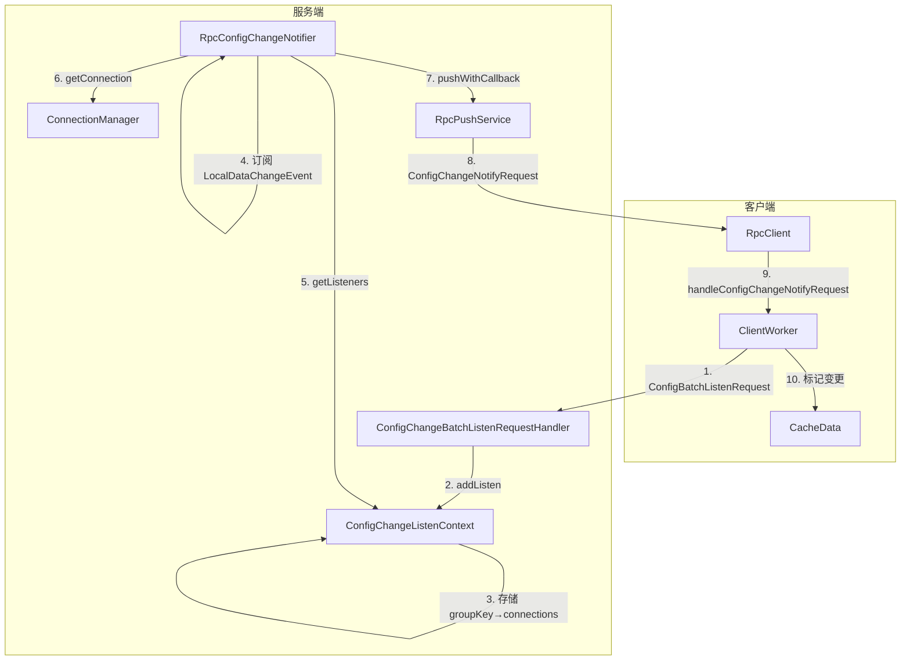
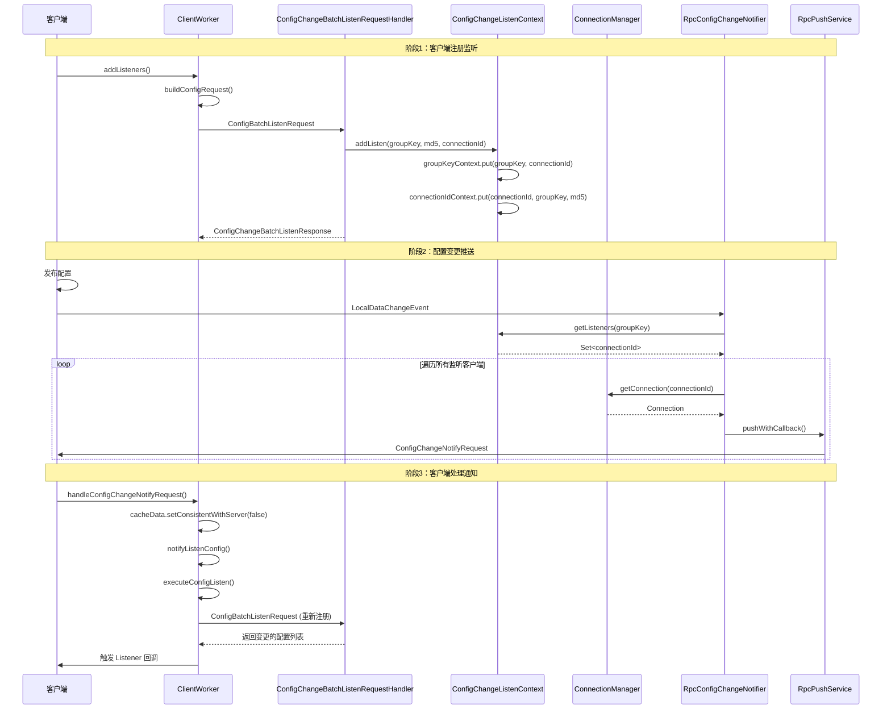

我来详细分析 RpcConfigChangeNotifier 的通知机制，包括客户端注册、配置变更接收、服务端管理和推送逻辑。

现在我已经收集了足够的信息，让我为你详细分析 RpcConfigChangeNotifier 的通知机制。

---

## RpcConfigChangeNotifier 通知机制源码分析

### 一、整体架构



---

### 二、客户端注册监听

#### 2.1 客户端发起注册请求

**源码位置**: `ClientWorker.java` (第1017-1021行)

```java
// 构建监听请求
ConfigBatchListenRequest configChangeListenRequest = buildConfigRequest(listenCaches);
configChangeListenRequest.setListen(true);

// 发送请求到服务端
ConfigChangeBatchListenResponse listenResponse = (ConfigChangeBatchListenResponse) requestProxy(
        rpcClient, configChangeListenRequest);
```

**构建请求详情** (第1116-1124行):

```java
private ConfigBatchListenRequest buildConfigRequest(List<CacheData> caches) {
    ConfigBatchListenRequest configChangeListenRequest = new ConfigBatchListenRequest();
    for (CacheData cacheData : caches) {
        // 添加每个配置的监听上下文
        configChangeListenRequest.addConfigListenContext(
            cacheData.group, 
            cacheData.dataId, 
            cacheData.tenant,
            cacheData.getMd5()  // 客户端本地 MD5 值
        );
    }
    return configChangeListenRequest;
}
```

#### 2.2 服务端处理注册请求

**源码位置**: `ConfigChangeBatchListenRequestHandler.java` (第51-82行)

```java
@Override
public ConfigChangeBatchListenResponse handle(ConfigBatchListenRequest configChangeListenRequest, RequestMeta meta)
        throws NacosException {
    String connectionId = StringPool.get(meta.getConnectionId());
    
    for (ConfigBatchListenRequest.ConfigListenContext listenContext : configChangeListenRequest.getConfigListenContexts()) {
        // 1. 构建 groupKey (dataId+group+tenant)
        String groupKey = GroupKey2.getKey(listenContext.getDataId(), listenContext.getGroup(),
                listenContext.getTenant());
        
        String md5 = StringPool.get(listenContext.getMd5());
        
        if (configChangeListenRequest.isListen()) {
            // 2. 注册监听到上下文
            configChangeListenContext.addListen(groupKey, md5, connectionId);
            
            // 3. 检查配置是否与客户端一致
            boolean isUptoDate = ConfigCacheService.isUptodate(groupKey, md5, meta.getClientIp(), tag,
                    meta.getAppLabels());
            if (!isUptoDate) {
                // 4. 如果不一致，返回需要更新的配置
                configChangeBatchListenResponse.addChangeConfig(
                    listenContext.getDataId(), 
                    listenContext.getGroup(),
                    listenContext.getTenant()
                );
            }
        } else {
            // 取消监听
            configChangeListenContext.removeListen(groupKey, connectionId);
        }
    }
    return configChangeBatchListenResponse;
}
```

#### 2.3 监听上下文管理

**源码位置**: `ConfigChangeListenContext.java` (第55-60行)

```java
// 双向映射数据结构
private ConcurrentHashMap<String, HashSet<String>> groupKeyContext = new ConcurrentHashMap<>();
// groupKey -> Set<connectionId>

private ConcurrentHashMap<String, HashMap<String, String>> connectionIdContext = new ConcurrentHashMap<>();
// connectionId -> Map<groupKey, md5>

// 添加监听
public synchronized void addListen(String groupKey, String md5, String connectionId) {
    // 1. 正向映射：groupKey → connections
    groupKeyContext.computeIfAbsent(groupKey, k -> new HashSet<>()).add(connectionId);
    
    // 2. 反向映射：connectionId → groupKeys (带 MD5)
    connectionIdContext.computeIfAbsent(connectionId, k -> new HashMap<>(16)).put(groupKey, md5);
}
```

**设计要点**:
- 使用双向映射：既可以通过 groupKey 查找所有监听的客户端，也可以通过 connectionId 查找客户端监听的所有配置
- MD5 用于快速判断客户端配置是否与服务器一致

---

### 三、服务端管理客户端连接

#### 3.1 连接管理

**源码位置**: `ConnectionManager.java` (第61-63行, 102-127行)

```java
// 连接存储
Map<String, Connection> connections = new ConcurrentHashMap<>();
// connectionId -> Connection

// 客户端 IP 连接计数
Map<String, AtomicInteger> connectionForClientIp = new ConcurrentHashMap<>(16);
// clientIp -> connectionCount

// 注册新连接
public synchronized boolean register(String connectionId, Connection connection) {
    if (connection.isConnected()) {
        String clientIp = connection.getMetaInfo().clientIp;
        
        // 1. 连接限流检查
        if (checkLimit(connection)) {
            return false;
        }
        
        // 2. 存储连接
        connections.put(connectionId, connection);
        
        // 3. 更新 IP 连接计数
        connectionForClientIp.computeIfAbsent(clientIp, k -> new AtomicInteger(0)).getAndIncrement();
        
        // 4. 通知监听器
        clientConnectionEventListenerRegistry.notifyClientConnected(connection);
        return true;
    }
    return false;
}
```

#### 3.2 连接断开处理

**源码位置**: `ConnectionManager.java` (第147-162行)

```java
public synchronized void unregister(String connectionId) {
    Connection remove = this.connections.remove(connectionId);
    if (remove != null) {
        String clientIp = remove.getMetaInfo().clientIp;
        
        // 1. 更新 IP 连接计数
        AtomicInteger atomicInteger = connectionForClientIp.get(clientIp);
        if (atomicInteger != null) {
            int count = atomicInteger.decrementAndGet();
            if (count <= 0) {
                connectionForClientIp.remove(clientIp);
            }
        }
        
        // 2. 关闭连接
        remove.close();
        
        // 3. 通知监听器
        clientConnectionEventListenerRegistry.notifyClientDisConnected(remove);
    }
}
```

#### 3.3 连接清理（监听上下文）

**源码位置**: `ConfigChangeListenContext.java` (第121-143行)

```java
// 当连接断开时，清理相关监听上下文
public synchronized void clearContextForConnectionId(final String connectionId) {
    // 1. 获取该连接监听的所有配置
    Map<String, String> listenKeys = getListenKeys(connectionId);
    
    if (listenKeys == null) {
        connectionIdContext.remove(connectionId);
        return;
    }
    
    // 2. 从 groupKeyContext 中移除该连接
    for (Map.Entry<String, String> groupKey : listenKeys.entrySet()) {
        Set<String> connectionIds = groupKeyContext.get(groupKey.getKey());
        if (CollectionUtils.isNotEmpty(connectionIds)) {
            connectionIds.remove(connectionId);
            if (connectionIds.isEmpty()) {
                groupKeyContext.remove(groupKey.getKey());
            }
        } else {
            groupKeyContext.remove(groupKey.getKey());
        }
    }
    
    // 3. 从 connectionIdContext 中移除
    connectionIdContext.remove(connectionId);
}
```

---

### 四、服务端推送配置变更

#### 4.1 事件触发

**源码位置**: `RpcConfigChangeNotifier.java` (第113-129行)

```java
// 订阅本地数据变更事件
@Override
public void onEvent(LocalDataChangeEvent event) {
    String groupKey = event.groupKey;
    
    // 1. 解析 groupKey
    String[] strings = GroupKey.parseKey(groupKey);
    String dataId = strings[0];
    String group = strings[1];
    String tenant = strings.length > 2 ? strings[2] : "";
    
    // 2. 通知所有监听的客户端
    configDataChanged(groupKey, dataId, group, tenant);
}

@Override
public Class<? extends Event> subscribeType() {
    return LocalDataChangeEvent.class;
}
```

#### 4.2 推送逻辑

**源码位置**: `RpcConfigChangeNotifier.java` (第87-111行)

```java
public void configDataChanged(String groupKey, String dataId, String group, String tenant) {
    // 1. 获取监听该配置的所有客户端连接
    Set<String> listeners = configChangeListenContext.getListeners(groupKey);
    if (CollectionUtils.isEmpty(listeners)) {
        return;
    }
    
    int notifyClientCount = 0;
    for (final String client : listeners) {
        // 2. 获取连接
        Connection connection = connectionManager.getConnection(client);
        if (connection == null) {
            continue;
        }
        
        ConnectionMeta metaInfo = connection.getMetaInfo();
        String clientIp = metaInfo.getClientIp();
        
        // 3. 构建推送请求
        ConfigChangeNotifyRequest notifyRequest = ConfigChangeNotifyRequest.build(dataId, group, tenant);
        
        // 4. 创建推送任务（带重试机制）
        RpcPushTask rpcPushRetryTask = new RpcPushTask(
            notifyRequest,
            ConfigCommonConfig.getInstance().getMaxPushRetryTimes(),  // 最大重试次数
            client,       // connectionId
            clientIp,     // clientIp
            metaInfo.getAppName()  // appName
        );
        
        // 5. 执行推送
        push(rpcPushRetryTask, connectionManager);
        notifyClientCount++;
    }
    Loggers.REMOTE_PUSH.info("push [{}] clients, groupKey=[{}]", notifyClientCount, groupKey);
}
```

#### 4.3 获取监听客户端

**源码位置**: `ConfigChangeListenContext.java` (第92-101行)

```java
public synchronized Set<String> getListeners(String groupKey) {
    HashSet<String> strings = groupKeyContext.get(groupKey);
    if (CollectionUtils.isNotEmpty(strings)) {
        Set<String> listenConnections = new HashSet<>();
        safeCopy(strings, listenConnections);  // 安全拷贝，避免并发问题
        return listenConnections;
    }
    return null;
}
```

#### 4.4 推送任务执行

**源码位置**: `RpcConfigChangeNotifier.java` (第131-196行)

```java
class RpcPushTask implements Runnable {
    ConfigChangeNotifyRequest notifyRequest;
    int maxRetryTimes = -1;  // 最大重试次数
    int tryTimes = 0;        // 当前重试次数
    String connectionId;
    String clientIp;
    String appName;
    
    @Override
    public void run() {
        tryTimes++;
        
        // 1. TPS 限流检查
        TpsCheckRequest tpsCheckRequest = new TpsCheckRequest();
        tpsCheckRequest.setPointName(POINT_CONFIG_PUSH);
        if (!tpsControlManager.check(tpsCheckRequest).isSuccess()) {
            // 限流则延迟重试
            push(this, connectionManager);
        } else {
            // 2. 异步推送
            rpcPushService.pushWithCallback(
                connectionId, 
                notifyRequest,
                new RpcPushCallback(this, tpsControlManager, connectionManager),
                ConfigExecutor.getClientConfigNotifierServiceExecutor()
            );
        }
    }
}
```

#### 4.5 推送回调处理

**源码位置**: `RpcConfigChangeNotifier.java` (第198-247行)

```java
static class RpcPushCallback extends AbstractPushCallBack {
    @Override
    public void onSuccess() {
        // 推送成功，记录 TPS
        TpsCheckRequest tpsCheckRequest = new TpsCheckRequest();
        tpsCheckRequest.setPointName(POINT_CONFIG_PUSH_SUCCESS);
        tpsControlManager.check(tpsCheckRequest);
    }
    
    @Override
    public void onFail(Throwable e) {
        // 推送失败，记录 TPS
        TpsCheckRequest tpsCheckRequest = new TpsCheckRequest();
        tpsCheckRequest.setPointName(POINT_CONFIG_PUSH_FAIL);
        tpsControlManager.check(tpsCheckRequest);
        
        Loggers.REMOTE_PUSH.warn("Push fail, dataId={}, group={}, tenant={}, clientId={}",
                rpcPushTask.getNotifyRequest().getDataId(), 
                rpcPushTask.getNotifyRequest().getGroup(),
                rpcPushTask.getNotifyRequest().getTenant(), 
                rpcPushTask.getConnectionId(), e);
        
        // 失败重试
        push(rpcPushTask, connectionManager);
    }
}

// 重试策略
private static void push(RpcPushTask retryTask, ConnectionManager connectionManager) {
    if (retryTask.isOverTimes()) {
        // 超过最大重试次数，注销连接
        Loggers.REMOTE_PUSH.warn("push callback retry fail over times... will unregister client.");
        connectionManager.unregister(retryTask.getConnectionId());
    } else if (connectionManager.getConnection(retryTask.getConnectionId()) != null) {
        // 延迟重试：第1次 0s，第2次 2s，第3次 4s...
        ConfigExecutor.scheduleClientConfigNotifier(
            retryTask, 
            retryTask.getTryTimes() * 2,  // 指数退避
            TimeUnit.SECONDS
        );
    }
    // 客户端已离线，忽略任务
}
```

---

### 五、客户端接收配置变更通知

#### 5.1 注册请求处理器

**源码位置**: `ClientWorker.java` (第694-704行)

```java
private void initRpcClientHandler(final RpcClient rpcClientInner) {
    // 注册配置变更通知处理器
    rpcClientInner.registerServerRequestHandler((request, connection) -> {
        if (request instanceof ConfigChangeNotifyRequest) {
            return handleConfigChangeNotifyRequest(
                (ConfigChangeNotifyRequest) request,
                rpcClientInner.getName()
            );
        }
        return null;
    });
}
```

#### 5.2 处理配置变更通知

**源码位置**: `ClientWorker.java` (第668-686行)

```java
ConfigChangeNotifyResponse handleConfigChangeNotifyRequest(
        ConfigChangeNotifyRequest configChangeNotifyRequest, String clientName) {
    
    LOGGER.info("[{}] [server-push] config changed. dataId={}, group={},tenant={}", 
            clientName,
            configChangeNotifyRequest.getDataId(), 
            configChangeNotifyRequest.getGroup(),
            configChangeNotifyRequest.getTenant());
    
    // 1. 构建 groupKey
    String groupKey = GroupKey.getKeyTenant(
        configChangeNotifyRequest.getDataId(),
        configChangeNotifyRequest.getGroup(), 
        configChangeNotifyRequest.getTenant()
    );
    
    // 2. 获取本地缓存数据
    CacheData cacheData = cacheMap.get().get(groupKey);
    if (cacheData != null) {
        synchronized (cacheData) {
            // 3. 标记收到变更通知
            cacheData.getReceiveNotifyChanged().set(true);
            // 4. 标记与服务器不一致
            cacheData.setConsistentWithServer(false);
            // 5. 触发监听执行
            notifyListenConfig();
        }
    }
    return new ConfigChangeNotifyResponse();
}
```

#### 5.3 触发配置拉取

**源码位置**: `ClientWorker.java` (第804-806行)

```java
@Override
public void notifyListenConfig() {
    // 放入信号量，触发 executeConfigListen 执行
    listenExecutebell.offer(bellItem);
}
```

**源码位置**: `ClientWorker.java` (第808-849行)

```java
@Override
public void executeConfigListen() throws NacosException {
    Map<String, List<CacheData>> listenCachesMap = new HashMap<>(16);
    
    for (CacheData cache : cacheMap.get().values()) {
        synchronized (cache) {
            checkLocalConfig(cache);
            
            // 检查本地监听器与服务器的一致性
            if (cache.isConsistentWithServer()) {
                cache.checkListenerMd5();  // 检查本地 listener MD5
                continue;
            }
            
            if (!cache.isDiscard()) {
                // 需要监听的配置
                List<CacheData> cacheDatas = listenCachesMap.computeIfAbsent(
                    String.valueOf(cache.getTaskId()), k -> new LinkedList<>());
                cacheDatas.add(cache);
            }
        }
    }
    
    // 执行监听，向服务器注册并获取变更配置
    boolean hasChangedKeys = checkListenCache(listenCachesMap);
    
    if (hasChangedKeys) {
        // 有配置变更，触发回调
        // ...
    }
}
```

---

### 六、完整时序图



---

### 七、核心设计总结

| 设计点 | 实现方式 | 优势 |
|--------|----------|------|
| **双向映射** | `groupKeyContext` + `connectionIdContext` | 支持快速查询客户端监听的配置，也支持快速查询配置的所有监听客户端 |
| **MD5 一致性检查** | 客户端上报本地 MD5，服务端对比 | 避免不必要的配置拉取，减少网络开销 |
| **指数退避重试** | `tryTimes * 2` 秒延迟 | 避免推送失败时雪崩式重试 |
| **TPS 限流** | `TpsControlManager` 控制推送速率 | 防止大量配置变更时压垮服务器 |
| **连接健康检查** | `RuntimeConnectionEjector` 定期清理不活跃连接 | 释放资源，避免无效推送 |
| **异步推送** | `RpcPushTask` + 回调机制 | 不阻塞主流程，提高吞吐量 |