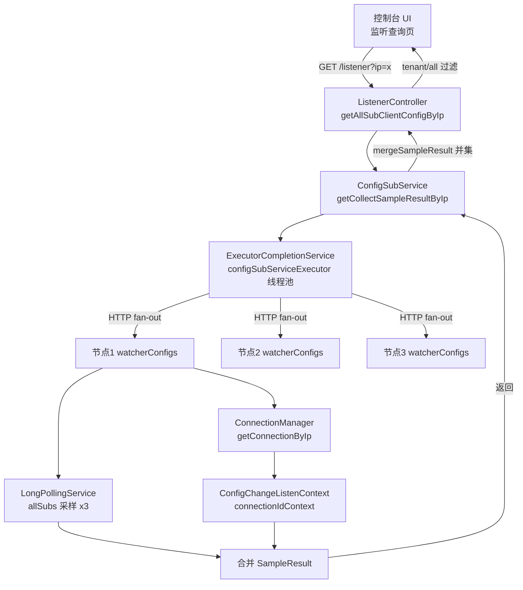

用户切换了话题，现在要分析监听控制器。让我读取该类及其依赖。

让我深入分析核心服务 `ConfigSubService` 及相关模型类。

让我查看各节点实际提供数据的 `CommunicationController`（被查询的对端接口）以及相关常量。

查看 `LongPollingService` 中被调用的采样方法，补全数据来源。

## ListenerController 监听控制器完整分析

### 一、定位：运维诊断接口，非业务读接口

**URL 路径**：`GET ${BASE_PATH}/listener?ip=xxx&all=&tenant=&sampleTime=`（`Constants.LISTENER_CONTROLLER_PATH`）

**方法签名**：`getAllSubClientConfigByIp`（第 60 行选中处）

**核心用途一句话**：**查询某台客户端 IP 机器上，当前正在监听的所有配置及它们在该客户端本地的 MD5 副本值**。

这**不是**给业务客户端用的接口（业务客户端拿配置走 `ConfigController`/`ConfigQueryRequestHandler`），而是给 **Nacos 控制台 UI** 或运维工具用的诊断入口。

---

### 二、典型使用场景

| 场景 | 具体动作 | 想看到什么 |
|------|---------|-----------|
| **控制台"监听查询"页** | 运维输入客户端 IP | 该机器监听的所有 groupKey + 该机器内存中缓存的 MD5 |
| **配置未生效排查** | 对比服务端 MD5 与客户端 MD5 | 若不一致 → 推送丢失，通知未到达 |
| **灰度发布验证** | 查看特定灰度实例收到的内容 MD5 | 确认命中灰度还是走了正式配置 |
| **推送链路可观测** | 采样多次取并集 | 观察长轮询/gRPC 连接是否稳定注册 |
| **下线残留排查** | 查某 IP 是否还有监听 | 判断客户端是否已彻底断开 |

响应结构 `GroupkeyListenserStatus`：
```java
private int collectStatus;                              // 200
private Map<String, String> lisentersGroupkeyStatus;    // groupKey -> 客户端MD5
```

---

### 三、Controller 处理逻辑源码分析

```java
@GetMapping
@Secured(resource = Constants.LISTENER_CONTROLLER_PATH, action = ActionTypes.READ, signType = SignType.CONFIG)
public GroupkeyListenserStatus getAllSubClientConfigByIp(
        @RequestParam("ip") String ip,
        @RequestParam(value = "all", required = false) boolean all,
        @RequestParam(value = "tenant", required = false) String tenant,
        @RequestParam(value = "sampleTime", required = false, defaultValue = "1") int sampleTime,
        ModelMap modelMap) {
    // 1) 集群 fan-out 采集
    SampleResult collectSampleResult = configSubService.getCollectSampleResultByIp(ip, sampleTime);
    
    GroupkeyListenserStatus gls = new GroupkeyListenserStatus();
    gls.setCollectStatus(200);
    Map<String, String> configMd5Status = new HashMap<>(100);
    if (collectSampleResult.getLisentersGroupkeyStatus() == null) {
        return gls;
    }
    
    // 2) 三种过滤策略
    Map<String, String> status = collectSampleResult.getLisentersGroupkeyStatus();
    for (Map.Entry<String, String> config : status.entrySet()) {
        if (!StringUtils.isBlank(tenant) && config.getKey().contains(tenant)) {
            configMd5Status.put(config.getKey(), config.getValue());   // 按 tenant 过滤
            continue;
        }
        if (all) {
            configMd5Status.put(config.getKey(), config.getValue());   // 全量返回
        } else {
            // 默认：只返回公共命名空间（tenant 为空）的配置
            String[] configKeys = GroupKey2.parseKey(config.getKey());
            if (StringUtils.isBlank(configKeys[2])) {
                configMd5Status.put(config.getKey(), config.getValue());
            }
        }
    }
    gls.setLisentersGroupkeyStatus(configMd5Status);
    return gls;
}
```

**关键点**：
- `@Secured(READ, CONFIG)`：只读权限即可访问
- **默认视图**：不传 `all` 也不传 `tenant` 时，只返回**公共命名空间**的配置（`configKeys[2]` 即 tenant 为空）
- **`@ExtractorManager.Extractor(httpExtractor = ConfigDefaultHttpParamExtractor.class)`**：走 Nacos 自定义 HTTP 参数提取器做参数校验（防 SQL 注入等）
- **注意**：`GroupKey2.parseKey` 解析的是 `dataId+group+tenant` 三级结构（`%2B` 分隔），因此这里能取出 `configKeys[2]` 判断 tenant

---

### 四、Service 层：跨节点 Fan-out 聚合

**核心问题**：客户端的连接是**分摊到集群各节点**上的，单个节点只能看到自己那部分监听者，因此必须做一次 fan-out。

```java
public SampleResult getCollectSampleResultByIp(String ip, int sampleTime) {
    Map<String, String> params = new HashMap<>(50);
    params.put("ip", ip);
    BlockingQueue<Future<SampleResult>> queue = new LinkedBlockingDeque<>(
            memberManager.getServerList().size());
    CompletionService<SampleResult> completionService = new ExecutorCompletionService<>(
            ConfigExecutor.getConfigSubServiceExecutor(), queue);
    
    SampleResult sampleCollectResult = new SampleResult();
    for (int i = 0; i < sampleTime; i++) {
        // 每一轮 sampleTime 都会向所有节点发一次 HTTP
        List<SampleResult> sampleResults = runConfigListenerByIpCollectionJob(params, completionService);
        if (sampleResults != null) {
            sampleCollectResult = mergeSampleResult(sampleCollectResult, sampleResults);
        }
    }
    return sampleCollectResult;
}
```

**Fan-out 抽象在 `ClusterJob<T>`**：

```java
List<T> runJobs() {
    Collection<Member> ipList = serverMemberManager.allMembers();
    List<T> collectionResult = new ArrayList<>(ipList.size());
    
    // 阶段1：向所有成员节点并发提交 HTTP 任务
    for (Member ip : ipList) {
        completionService.submit(new Job<T>(ip.getAddress()) {});
    }
    
    // 阶段2：poll(1000ms) + get(500ms) 双超时收集，超时 cancel
    for (Member member : ipList) {
        Future<T> f = completionService.poll(1000, TimeUnit.MILLISECONDS);
        try {
            if (f != null) {
                sampleResults = f.get(500, TimeUnit.MILLISECONDS);
                if (sampleResults != null) {
                    collectionResult.add(sampleResults);
                }
            }
        } catch (TimeoutException e) {
            if (f != null) { f.cancel(true); }   // 单节点拖堂不影响其他
        }
    }
    return collectionResult;
}
```

**设计要点**：
- 泛型反射（`ParameterizedType`）从 `ClusterJob` 子类拿到 `SampleResult.class`，用于 `JacksonUtils.toObj` 反序列化
- 使用 `ExecutorCompletionService` + 独立线程池 `configSubServiceExecutor`，避免占用业务线程
- 集群任一节点宕机或超时不影响整体返回（**局部失败降级**）
- URL 常量：`ClusterListenerByIpJob.URL = /communication/watcherConfigs`

---

### 五、被调用端：CommunicationController.watcherConfigs

对端节点接到 `GET /v1/cs/configs/communication/watcherConfigs?ip=xxx` 后：

```java
@GetMapping("/watcherConfigs")
public SampleResult getSubClientConfigByIp(HttpServletRequest request, HttpServletResponse response,
        @RequestParam("ip") String ip, ModelMap modelMap) {
    
    // 来源 A：HTTP 长轮询监听者
    SampleResult result = longPollingService.getCollectSubscribleInfoByIp(ip);
    
    // 来源 B：gRPC 长连接监听者
    List<Connection> connectionsByIp = connectionManager.getConnectionByIp(ip);
    for (Connection connectionByIp : connectionsByIp) {
        Map<String, String> listenKeys = configChangeListenContext
                .getListenKeys(connectionByIp.getMetaInfo().getConnectionId());
        if (listenKeys != null) {
            result.getLisentersGroupkeyStatus().putAll(listenKeys);
        }
    }
    return result;
}
```

**双通道来源合并**（对应 Nacos 1.x→2.x 通信协议演进）：

| 通道 | 数据存放位置 | 采样策略 |
|------|------------|---------|
| **HTTP 长轮询** | `LongPollingService.allSubs` (`Queue<ClientLongPolling>`)，每个连接持有 `clientMd5Map` | `SAMPLE_TIMES=3`，`SAMPLE_PERIOD=100ms`（因异步连接会不断刷新） |
| **gRPC 双向流** | `ConfigChangeListenContext.connectionIdContext`（`connectionId → Map<groupKey, md5>`） | 直接读取（结构本身就是最新的） |

**关键**：这里返回的 MD5 是**客户端上报的 MD5**（`clientMd5Map` / `connectionIdContext` 里存的），代表"客户端认为自己手上配置是什么"，而不是服务端 dump 出来的配置 MD5。所以运维拿这个 MD5 与 `ConfigCacheService.getContentMd5(groupKey)` 对比，就能判断**推送有没有到位**。

---

### 六、完整调用链路图



---

### 七、总结

| 维度 | 结论 |
|------|------|
| **本质** | 集群 fan-out 聚合的**运维诊断接口**，非配置读取路径 |
| **入口** | `GET /listener?ip=xxx&all=&tenant=&sampleTime=` |
| **返回** | `Map<groupKey, 客户端上报MD5>` |
| **数据来源** | 全部走**内存注册表**（`allSubs` + `connectionIdContext`），**零 DB 查询** |
| **跨节点** | `CompletionService` 并发对 `allMembers()` 发 HTTP；`poll(1000ms)` + `get(500ms)` 双超时；节点宕机降级不影响整体 |
| **协议兼容** | 同时兼容 1.x HTTP 长轮询 与 2.x gRPC 双向流两种监听 |
| **采样策略** | 长轮询侧 3 次 × 100ms（应对异步连接动态增删）；gRPC 侧一次性读 |
| **权限** | `@Secured(READ, CONFIG)` 只读鉴权 |
| **默认视图** | 只回公共命名空间；`tenant=x` 精确过滤；`all=true` 全放开 |

**与 Dump 的关系**（呼应上一轮讨论）：

- Dump 出来的配置走 **`ConfigCacheService`**（服务端视角的"配置真值"）
- 监听查询走 **`allSubs` + `connectionIdContext`**（客户端视角的"配置副本 MD5"）
- 两者是**完全独立的两份内存结构**，都不查 DB
- 运维诊断时，**同时对比两份 MD5** 就能定位问题在集群内还是在推送链路上

**一句话总结**：`ListenerController` 是 Nacos 配置中心"可观测性"能力的具现——一个跨节点聚合、纯内存读、支持 1.x/2.x 双协议、面向运维的**监听拓扑快照 API**。