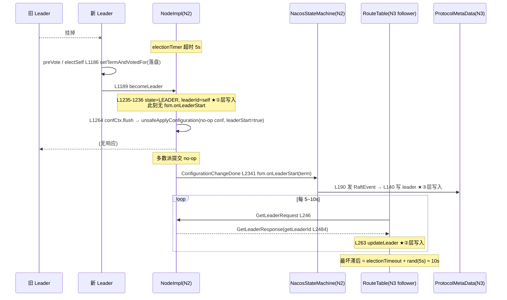

我先读 `JRaftServer` 全文，同时定位 `peerChange` 的调用方和 leader 监听器的注册点。

已看到 `getLeader` 只是读 `RouteTable` 缓存。继续读状态机、运维服务与元数据链路。

核心链路已浮现（Nacos 侧 leader 靠 `RouteTable` 缓存 + `RaftEvent` 广播）。继续取 Nacos 侧三个关键类与 jraft 的 leaderId 持久化点。

Nacos 侧三层已清楚。现在补 jraft 侧 leaderId 的权威写入点与元数据消费方。

`resetLeaderId`（L1196-1208）找到了。再确认 `onLeaderStart` 的调用点，并识别两个尚未归类的缓存文件。

CliServiceImpl 已抓到。继续读它 + NodeImpl 尾部（`ConfigurationCtx` 内部类与 `onLeaderStart` 调用点）。

最后一轮：确认端口偏移常量、默认超时值与 `RaftConfig.setMembers` 语义。

我先补齐最后一处未闭环的证据（`ConfigurationCtx.flush` 是否会触发 `fsm.onLeaderStart`），然后给出完整分析。

已取证完毕（含最后一环 `ConfigurationCtx` 的推断依据）。下面是完整分析。

---

# 结论先行

**问题一：leader 信息"什么时候写进去"——Nacos 里 leader 存在三份独立副本，写入时机完全不同，而 `JRaftServer#getLeader` 读的是最不可靠的那一份。**

| # | 存放位置 | 写入者 | 写入时机 | 是否落盘 | 谁在读 |
|---|---|---|---|---|---|
| ① 协议权威 | `NodeImpl.leaderId`（`PeerId`） | `resetLeaderId` / `becomeLeader` | 收到新 leader 的**第一条 AppendEntries（哪怕纯心跳）**；或自己选主成功 | **否，纯内存** | `getLeaderId()` L2484 应答 `GetLeaderRequest`；`readFollower` L1541 |
| ② 进程路由缓存 | `RouteTable.GroupConf.leader` | `RouteTable.updateLeader` L150-167 | **定时任务刷新**：`JRaftServer.refreshRouteTable` L496，周期 `electionTimeout(5s)+rand(5s)` | 否 | ★`JRaftServer.getLeader` L370、`invokeToLeader` L424、`isReady` L526 |
| ③ 业务元数据 | `ProtocolMetaData["leader"]` | `JRaftProtocol` 的 `RaftEvent` 订阅者 L140 | FSM 回调 `onLeaderStart` L184 / `onStartFollowing` L200 发事件之后 | 否（但随 `Member.extendVal["raftMetaData"]` L215 扩散到全集群） | `EmbeddedDumpService`、`CircuitFilter`、控制台 |

三个反直觉的事实：
1. **jraft 只把 `term` 和 `votedFor` 落盘**（`metaStorage.setTermAndVotedFor` L1186/L1300、`setVotedFor` L1816），leader 身份从不持久化 → 进程重启后一律"不知道谁是 leader"，必须靠选举或对方心跳重建。
2. **投票 ≠ 认主**：`handleRequestVoteRequest` L1812-1817 给候选者投票时只做 `stepDown` + 记 `votedFor`，而 `stepDown` L1286 恰恰**清空** leaderId；真正的"认主"发生在收到对方第一条 AppendEntries 时（`handleAppendEntriesRequest` L1936 → `checkStepDown` L1224-1226 → `resetLeaderId` L1206）。
3. **②和③都没有失效机制**：leader 下台时 `onLeaderStop` L194-198 不发任何事件，`updateLeader` 又有 "Empty leader" 断言 L153-156，所以 `getLeader` 完全可能返回一个**已经下台的节点**，且 `invokeToLeader` L424 会往这个错地址转发。

**问题二：集群成员变更的业务处理——Nacos 只实现了"缩容"，扩容是节点自己启动时循环 `addPeer` 完成的；且缩容只有一次 500ms 的重试窗口，对一次需要 5s+ 的选举几乎无效。**

`peerChange` L455 的原注释就是答案：
> `// This is only dealing with node deletion, the Raft protocol, where the node adds itself to the cluster when it starts up`

---

# 一、第①层：`NodeImpl.leaderId` 的四个写入时机

## 1.1 唯一的写入函数 `resetLeaderId`

`jraft-core-1.3.14/NodeImpl.java` L1196-1208：

```java
private void resetLeaderId(final PeerId newLeaderId, final Status status) {
    if (newLeaderId.isEmpty()) {
        if (!this.leaderId.isEmpty() && this.state.compareTo(State.STATE_TRANSFERRING) > 0) {
            this.fsmCaller.onStopFollowing(new LeaderChangeContext(this.leaderId.copy(), this.currTerm, status)); // L1199
        }
        this.leaderId = PeerId.emptyPeer();                                    // L1201 清空
    } else {
        if (this.leaderId == null || this.leaderId.isEmpty()) {                 // ★L1203 只在"从空变非空"通知
            this.fsmCaller.onStartFollowing(new LeaderChangeContext(newLeaderId, this.currTerm, status)); // L1204
        }
        this.leaderId = newLeaderId.copy();                                    // ★L1206 写入
    }
}
```

**关键点 L1203**：同一个 term 内后续所有心跳都不会再触发 `onStartFollowing` → Nacos 的 `RaftEvent` 不会被心跳刷爆。这是"每认一次主只发一个事件"的幂等保证。

## 1.2 四个写入/清除时机

| 时机 | 代码 | 动作 |
|---|---|---|
| **A. 自己选上 leader** | `becomeLeader` L1235-1236 | `state = STATE_LEADER; this.leaderId = this.serverId.copy();` |
| **B. 认别人做 leader** | `checkStepDown` L1224-1226 → `resetLeaderId` | 见下 |
| **C. 下台** | `stepDown` L1286 `resetLeaderId(PeerId.emptyPeer(), status)` | 清空 |
| **D. 双主冲突** | `handleAppendEntriesRequest` L1937-1948 | 双方 term+1 全部下台重选 |

`checkStepDown` L1211-1227（在 writeLock 内被调用）：

```java
private void checkStepDown(final long requestTerm, final PeerId serverId) {
    final Status status = new Status();
    if (requestTerm > this.currTerm) {                       // 更高 term → 新 leader
        status.setError(RaftError.ENEWLEADER, "Raft node receives message from new leader with higher term.");
        stepDown(requestTerm, false, status);                // 先清空 leaderId 并把 term 抬上去
    } else if (this.state != State.STATE_FOLLOWER) {         // 我还是 candidate
        status.setError(RaftError.ENEWLEADER, "Candidate receives message from new leader with the same term.");
        stepDown(requestTerm, false, status);
    } else if (this.leaderId.isEmpty()) {                    // 我已知 term 但没 leader
        status.setError(RaftError.ENEWLEADER, "Follower receives message from new leader with the same term.");
        stepDown(requestTerm, false, status);
    }
    // save current leader
    if (this.leaderId == null || this.leaderId.isEmpty()) {  // ★L1224 只有为空时才写
        resetLeaderId(serverId, status);                     // ★L1225 → 写入 leaderId
    }
}
```

**L1224 的"仅在为空时覆盖"是一个非常重要的设计**：同 term 内我已经认了 X 当 leader，之后 Y 也自称 leader 发来心跳，**不会**把 leaderId 改成 Y，而是走 L1937-1948 的冲突分支：

```java
// handleAppendEntriesRequest, L1936 之后
checkStepDown(request.getTerm(), serverId);                    // L1936 ★注意：在 entriesCount 判断之前
if (!serverId.equals(this.leaderId)) {                         // L1937
    LOG.error("Another peer {} declares that it is the leader at term {} which was occupied by leader {}.", ...);
    increaseTermTo(...); stepDown(request.getTerm() + 1, false,
        new Status(RaftError.ELEADERCONFLICT, "More than one leader in the same term."));  // L1942
    return AppendEntriesResponse.newBuilder().setSuccess(false).setTerm(request.getTerm() + 1).build();
}
```

**L1936 的位置决定了一件大事**：`checkStepDown` 在 `if (entriesCount > 0)`（L1952）**之前**执行，所以**一条不含任何日志的空心跳就能让 follower 认主并写入 leaderId**。这就是集群"leader 信息"最主要的写入路径——不是选举投票，而是新 leader 的第一轮心跳。

## 1.3 投票时为什么不写 leaderId

`handleRequestVoteRequest` L1812-1817：

```java
if (logIsOk && (this.votedId == null || this.votedId.isEmpty())) {
    stepDown(request.getTerm(), false, new Status(RaftError.EVOTEFORCANDIDATE,
        "Raft node votes for some candidate, step down to restart election_timer."));   // L1813 → 内部 L1286 清空 leaderId
    this.votedId = candidateId.copy();
    this.metaStorage.setVotedFor(candidateId);                                          // L1816 只有 votedFor 落盘
}
return RequestVoteResponse.newBuilder().setTerm(this.currTerm)
    .setGranted(request.getTerm() == this.currTerm && candidateId.equals(this.votedId)).build();
```

设计上"我投你一票"不等于"我承认你是我的 leader"（Raft 论文语义：leader 要靠心跳维持权威）。所以 follower 投票后 leaderId 依然是空，直到收到该候选者当选后发来的第一条 AppendEntries。

## 1.4 leaderId 与 `NacosStateMachine.isLeader` 不是一回事

- `node.isLeader()`（`JRaftServer.commit` L332 用它决定本地 apply 还是转发）读的是 `state == STATE_LEADER`；
- `NacosStateMachine.isLeader`（L75 `AtomicBoolean`）只在 `onLeaderStart` L188 置 true、`onLeaderStop` L197 置 false。

而 **`becomeLeader` 里并没有调用 `fsmCaller.onLeaderStart`**（L1229-1266 全函数无此调用）。真正的通知链是：

```
becomeLeader L1264  confCtx.flush(conf.getConf(), conf.getOldConf())
        ↓
ConfigurationCtx.flush → node.unsafeApplyConfiguration(newConf, null, /*leaderStart=*/true)   L2349
        ↓ 写一条 ENTRY_TYPE_CONFIGURATION 的 no-op 日志（peers=新conf，无 oldPeers）L2352-2359
        ↓ ballotBox.appendPendingTask(newConf, null, configurationChangeDone)  L2362  ← 用新 conf 算多数派
        ↓ 多数派 ack → doCommitted 弹出该 closure（FSMCallerImpl L550-554 iterImpl.done().run(Status.OK())）
ConfigurationChangeDone.run  L2337-2342
        ├─ onConfigurationChangeDone(term) L2339 → confCtx.nextStage() L2478
        └─ if (leaderStart) getOptions().getFsm().onLeaderStart(term)  ★L2341
        ↓
NacosStateMachine.onLeaderStart L184 → 发 RaftEvent → JRaftProtocol 订阅者 L140 写元数据
```

> 取证说明：`jraft-core/.../core/ConfigurationCtx.java` 源码本次未能抓取（gitee/github/jsdelivr 多次 404 或连接重置）。上述 `flush → unsafeApplyConfiguration(..., true)` 的依据是：① `unsafeApplyConfiguration` 存在 `leaderStart` 形参且 L2341 是唯一消费点；② `becomeLeader` L1259-1260 注释 *"Register _conf_ctx to reject configuration changing before the first log is committed"*；③ 上游 braft 同源实现 `ConfigurationCtx::flush(..., leader_start=true)`。结论可信度高，但请知悉它不是直接读到的行号。

**这条链的直接业务后果**：新 leader 的 `NodeImpl.state/leaderId` 在选主瞬间就生效（①层），但 Nacos 的 `isLeader`、`leaderIp`、`ProtocolMetaData["leader"]`（③层）必须等到**这条 no-op 日志被多数派提交**才更新。若集群半数节点此刻不可达，no-op 提交不了 → `onLeaderStart` 永不触发 → Nacos 元数据里 leader 永远停留在旧值，而 jraft 层面它确实是 leader。

---

# 二、第②层：`getLeader` 的真实语义 = 读一个可能过期的缓存

`JRaftServer` L369-371：

```java
protected PeerId getLeader(final String raftGroupId) {
    return RouteTable.getInstance().selectLeader(raftGroupId);   // 只是一次 StampedLock 乐观读
}
```

`RouteTable`（注意：**`com.alipay.sofa.jraft.RouteTable` 是具体类，core 包下没有 RouteTableImpl**）L122-141：

```java
/** Make sure calls {@link #refreshLeader} already before invoke this method. */   // L115-117 官方注释自承是缓存
public PeerId selectLeader(final String groupId) {
    final GroupConf gc = this.groupConfTable.get(groupId);
    if (gc == null) { return null; }
    long stamp = this.stampedLock.tryOptimisticRead();
    PeerId leader = gc.leader;                       // 乐观读
    ...
}
```

## 2.1 谁往缓存里写

唯一的写入口是 `refreshLeader` L223-282，由 Nacos 的定时任务调用：

```java
// JRaftServer L483-508
void refreshRouteTable(String group) {
    if (isShutdown) { return; }
    RouteTable instance = RouteTable.getInstance();
    Configuration oldConf  = instance.getConfiguration(groupName);                 // L492 仅为日志对比
    String oldLeader = Optional.ofNullable(instance.selectLeader(groupName))
            .orElse(PeerId.emptyPeer()).getEndpoint().toString();                  // L493-494
    // fix issue #3661  https://github.com/alibaba/nacos/issues/3661
    status = instance.refreshLeader(this.cliClientService, groupName, rpcRequestTimeoutMs);  // L496 ★写 leader
    if (!status.isOk()) {
        Loggers.RAFT.error("Fail to refresh leader for group : {}, status is : {}", groupName, status);  // ★L498 失败只打日志，不清空
    }
    status = instance.refreshConfiguration(this.cliClientService, groupName, rpcRequestTimeoutMs);       // L500 ★写 conf
    ...
}
```

调度参数（`createMultiRaftGroup` 尾部 L267-270）：

```java
final int random = RandomUtils.nextInt(5) + 1;
long period = nodeOptions.getElectionTimeoutMs() + random.nextInt(5 * 1000);      // ★L268 5s ~ 10s
RaftExecutor.scheduleRaftMemberRefreshJob(() -> refreshRouteTable(groupName),
        nodeOptions.getElectionTimeoutMs(), period, TimeUnit.MILLISECONDS);        // L269-270
```

`refreshLeader` 的实现（L223-282）值得逐行看：

```java
final Configuration conf = getConfiguration(groupId);
if (conf == null) {
    return new Status(RaftError.ENOENT, "Group %s is not registered in RouteTable, forgot to call updateConfiguration?");  // L229
}
for (final PeerId peer : conf) {
    ... GetLeaderRequest ...
    final Message msg = result.get(timeoutMs, TimeUnit.MILLISECONDS);
    if (msg instanceof ErrorResponse) { ... }
    else {
        updateLeader(groupId, ((GetLeaderResponse) msg).getLeaderId());   // ★L263 第一个应答者即胜出
        return Status.OK();                                               // ★L264 问到一个就撤，不是多数派
    }
}
```

**这不是共识读取**：它按 conf 顺序问，谁先返回就信谁。若网络里存在一个刚下台、状态未清理的节点（`describe` 之前它仍答自己是 leader），②层就可能被污染。

## 2.2 缓存的两个致命细节

```java
public boolean updateLeader(final String groupId, final PeerId leader) {
    if (leader != null) {
        Requires.requireTrue(!leader.isEmpty(), "Empty leader");    // ★L153-156 空 leader 直接抛异常
    }
    ... gc.leader = leader;
}
public boolean updateLeader(final String groupId, final String leaderStr) {
    if (!leader.isEmpty()) { ... return true; }
    LOG.error("Fail to parse leaderStr : {}", leaderStr); return false;   // ★L176-187 静默失败
}

public void updateConfiguration(final String groupId, final Configuration conf) {
    ... gc.conf = conf;
    if (gc.leader != null && !gc.conf.contains(gc.leader)) { gc.leader = null; }   // ★L77-79 全类唯一清空 leader 的地方
}
```

结论：**"集群没有 leader" 这个事实永远无法写进 ②层缓存**。节点全下台时，`refreshLeader` 要么抛 "Empty leader"、要么 parse 失败返回 false，`gc.leader` 保持旧值；只有等 `refreshConfiguration` 拉到新 conf 且旧 leader 不在其中时，才会被 L77-79 间接清掉。所以 `getLeader` 的语义应当理解为"**我最后一次成功问到的那个 leader**"，而不是"当前 leader"。

## 2.3 初始化顺序也是硬约束

```java
// createMultiRaftGroup L262
RouteTable.getInstance().updateConfiguration(groupName, configuration);   // ★必须先注册 group
RaftExecutor.executeByCommon(() -> registerSelfToCluster(groupName, localPeerId, configuration));  // L264
```
少了 L262，`refreshLeader` 永远 ENOENT，`selectLeader` 永远返回 null（`gc == null` 分支），`isReady()` 在 strictMode 下直接 false（L526）。

## 2.4 三层视图的时间线



---

# 三、第③层：`RaftEvent` → `ProtocolMetaData` → 全集群扩散

## 3.1 事件源（`NacosStateMachine`）

```java
@Override public void onLeaderStart(final long term) {                     // L184
    super.onLeaderStart(term);
    this.term = term;
    this.isLeader.set(true);
    this.leaderIp = node.getNodeId().getPeerId().getEndpoint().toString(); // L189 自己
    NotifyCenter.publishEvent(RaftEvent.builder().groupId(groupId).leader(leaderIp)
            .term(term).raftClusterInfo(allPeers()).build());              // L190-191
}
@Override public void onLeaderStop(final Status status) {                  // L194
    super.onLeaderStop(status);
    this.isLeader.set(false);                                              // ★L197 不发任何事件！
}
@Override public void onStartFollowing(LeaderChangeContext ctx) {          // L200
    this.term = ctx.getTerm();
    this.leaderIp = ctx.getLeaderId().getEndpoint().toString();            // L203 从协议层 ctx 取
    NotifyCenter.publishEvent(RaftEvent.builder()....build());             // L204-206
}
@Override public void onConfigurationCommitted(Configuration conf) {       // L209
    NotifyCenter.publishEvent(RaftEvent.builder().groupId(groupId)
            .raftClusterInfo(JRaftUtils.toStrings(conf.getPeers())).build()); // ★L211-212 不带 leader
}

private List<String> allPeers() {                                          // L229
    if (node == null) return Collections.emptyList();
    if (node.isLeader()) return JRaftUtils.toStrings(node.listPeers());    // L235 权威
    return JRaftUtils.toStrings(RouteTable.getInstance()
            .getConfiguration(node.getGroupId()).getPeers());              // ★L238 follower 读②缓存
}
```

三个坑就藏在这里：`onLeaderStop` 不发事件、`onConfigurationCommitted` 不带 leader、`allPeers()` 在 follower 上读的是缓存。

补充一条本次新推演出的结论——**`onConfigurationCommitted` 在 Nacos 的正常缩容流程里几乎不会被调用**：

```java
// FSMCallerImpl.doCommitted L544-548
if (logEntry.getType() == ENTRY_TYPE_CONFIGURATION) {
    if (logEntry.getOldPeers() != null && !logEntry.getOldPeers().isEmpty()) {
        // Joint stage is not supposed to be noticeable by end users.
        this.fsm.onConfigurationCommitted(new Configuration(iterImpl.entry().getPeers()));
    }
}
```
而 `unsafeApplyConfiguration` L2356-2359 只在 `oldConf != null` 时才写 oldPeers；jraft/braft 对**单成员变更跳过 joint consensus**（`next_stage` 中 `_nchanges > 1` 才进 JOINT），Nacos 的 `REMOVE_PEERS` 又恰好是逐个删（`JRaftOps` L108-118）。→ 单节点缩容产生的 conf 日志**没有 oldPeers** → `onConfigurationCommitted` 不触发 → ③层的 `RAFT_GROUP_MEMBER` 只能等下一次 leader 切换（`onLeaderStart`/`onStartFollowing` 的 `allPeers()`）才更新。

## 3.2 事件消费与元数据落库（`JRaftProtocol`）

```java
NotifyCenter.registerToSharePublisher(RaftEvent.class);                     // L120 RaftEvent extends SlowEvent → 共享慢线程
NotifyCenter.registerSubscriber(new Subscriber<RaftEvent>() {               // L124 注释：只留一个消费者保证内部有序
    @Override public void onEvent(RaftEvent event) {
        Loggers.RAFT.info("This Raft event changes : {}", event);           // L129
        final String leader = event.getLeader();
        ...
        MapUtil.putIfValNoEmpty(properties, MetadataKey.LEADER_META_DATA, leader);        // ★L140 空值不覆盖 → 永不删
        MapUtil.putIfValNoNull(properties, MetadataKey.TERM_META_DATA, event.getTerm());
        MapUtil.putIfValNoEmpty(properties, MetadataKey.RAFT_GROUP_MEMBER, event.getRaftClusterInfo());
        MapUtil.putIfValNoEmpty(properties, MetadataKey.ERR_MSG, event.getErrMsg());
        value.put(groupId, properties);
        metaData.load(value);                                               // L146
        injectProtocolMetaData(metaData);                                    // L149
    }
});

private void injectProtocolMetaData(ProtocolMetaData metaData) {
    Member member = memberManager.getSelf();
    member.setExtendVal("raftMetaData", metaData);                          // ★L215
    memberManager.update(member);                                           // ★L216 → 随成员信息广播到其它机器
}
```

`ProtocolMetaData` 自己在类注释 L51-52 承认了风险：

> `Does not guarantee thread safety ... time-1 data overwrites time-2`（乱序覆盖）

`ValueItem.setData` L162-171 里观察者是在 writeLock 内**同步**通知的，所以 `EmbeddedDumpService` L116-137 的 dump 动作实际跑在 NotifyCenter 的共享慢事件线程上——这也解释了为什么"元数据变更触发 dump"必须做得很轻。

---

# 四、成员变更的实际业务处理（从探活到 jraft 日志）

```mermaid
swimlane
graph TD
    A["AbstractMemberLookup.refresh L42<br/>(或 HTTP 改 cluster.conf)"] --> B["ServerMemberManager.memberChange L364-426 (synchronized)"]
    B --> B1["L366 空集合直接 return false"]
    B --> B2["L370-379 自己不在列表则加回自己(自我防踢)"]
    B --> B3["L401 只有 NodeState.UP 进 memberAddressInfos"]
    B --> B4["L411-413 在 synchronized 内发布事件(保证有序)"]
    B --> B5["L416 MemberUtil.syncToFile 写 cluster.conf"]
    B --> C["MembersChangeEvent"]
    C --> D["ProtocolManager.onEvent L163-179 (单线程池)"]
    D --> E["L177 ProtocolExecutor.cpMemberChange → cpProtocol.memberChange"]
    E --> F["ProtocolManager.toCPMembersInfo L76-84<br/>ip:(port-1000) 8848→7848"]
    F --> G["JRaftProtocol.memberChange L190-198<br/>5 次 × sleep100ms = 500ms 窗口"]
    G --> H["JRaftServer.peerChange L454-481"]
    H --> H1["L457 先改本地 raftConfig.members"]
    H --> H2["L458-461 无删除项 → return true (扩容场景静默成功)"]
    H --> H3["L470 REMOVE_PEERS × 每个 raft group"]
    H3 --> I["JRaftMaintainService.execute L53-70 → single L72-86"]
    I --> J["JRaftOps.REMOVE_PEERS L101-122<br/>逐个 cliService.removePeer"]
    J --> K["CliServiceImpl.removePeer L168-198<br/>checkLeaderAndConnect L118 → getLeader L441-494 (实时RPC问)"]
    K --> L["NodeImpl.removePeer L3028-3041<br/>newConf = 当前conf - peer"]
    L --> M["unsafeRegisterConfChange L2373-2408 四道门"]
    M --> N["confCtx.start → nextStage<br/>unsafeApplyConfiguration L2349-2371"]
    N --> O["多数派提交 → ConfigurationChangeDone L2337"]
    O --> P["被删节点收到新 conf<br/>preVote L2675-2678 拒参选 → 安静退场"]
```

## 4.1 触发与过滤：`ServerMemberManager.memberChange` L364-426

```java
public synchronized boolean memberChange(Collection<Member> members) {
    if (members == null || members.isEmpty()) { return false; }                 // L366-368 ★拒绝空集群
    boolean isContainSelf = members.stream().anyMatch(...);
    if (!isContainSelf) {
        members.add(this.self);                                                 // L370-379 ★自我防踢
        LOGGER.warn("self member is not contained in member(s), ...");
    }
    Collection<String> memberAddressInfos = new HashSet<>();
    for (Member each : members) {
        if (NodeState.UP.equals(each.getState())) { memberAddressInfos.add(each.getAddress()); }  // ★L401-403 只有 UP 才算数
    }
    currentMembers = members;
    ...
    // ★L411-413 注释：事件发布必须在同步块内，以保证监听者收到的变更顺序
    MemberUtil.syncToFile(memberAddressInfos);                                   // L416 写 cluster.conf（带 #时间戳 头）
    ... AbstractConsistencyProtocol 相关的 MembersChangeEvent 发布 ...            // L417-418
}
```

状态迁移由探活驱动：`MemberUtil.onSuccess` L143-151 / `onFail` L188-205 —— `UP → SUSPICIOUS`，`SUSPICIOUS → DOWN` 需要 `failAccessCnt > 3`（`nacos.core.member.fail-access-cnt`，L54）或异常信息含 "Connection refused"，随后 `notifyMemberChange` → `memberChange`。

## 4.2 地址换算：`ProtocolManager` L76-84 + `MemberUtil` L119-121

```java
private Set<String> toCPMembersInfo(Collection<Member> members) {
    Set<String> addresses = new HashSet<>();
    members.forEach(member -> addresses.add(member.getAddress()...ip + ":" + MemberUtil.calculateRaftPort(member)));  // L76-84
}
public static int calculateRaftPort(Member member) { return member.getPort() - DEFAULT_RAFT_OFFSET_PORT; }  // L119-121, 常量=1000
```
→ **8848 的主端口换算成 7848 的 raft 端口**，这是 jraft 侧 `PeerId` 的真实地址。

## 4.3 业务本体：`peerChange` L454-481

```java
boolean peerChange(JRaftMaintainService maintainService, Set<String> newPeers) {
    // This is only dealing with node deletion, the Raft protocol, where the node adds itself to the cluster when it starts up
    Set<String> oldPeers = new HashSet<>(this.raftConfig.getMembers());        // L456 快照旧值
    this.raftConfig.setMembers(localPeerId.toString(), newPeers);              // ★L457 先改本地，后面失败不回滚
    oldPeers.removeAll(newPeers);
    if (oldPeers.isEmpty()) { return true; }                                   // ★L459-461 纯新增 → 静默成功，什么都不做
    Set<String> waitRemove = oldPeers;
    AtomicInteger successCnt = new AtomicInteger(0);
    multiRaftGroup.forEach((group, tuple) -> {
        Map<String, String> params = new HashMap<>();
        params.put(JRaftConstants.GROUP_ID, group);
        params.put(JRaftConstants.COMMAND_NAME, JRaftConstants.REMOVE_PEERS);  // ★L470 只有 REMOVE，没有 ADD/CHANGE
        params.put(JRaftConstants.COMMAND_VALUE, StringUtils.join(waitRemove, StringUtils.COMMA));
        RestResult<String> result = maintainService.execute(params);
        if (result.ok()) { successCnt.incrementAndGet(); }
        else { Loggers.RAFT.error("Node removal failed : {}", result); }
    });
    return successCnt.get() == multiRaftGroup.size();                           // L480 要求所有 group 都成功
}
```

**扩容路径**完全在另一个地方（`registerSelfToCluster` L350-367）：新节点启动后由 `RaftExecutor.executeByCommon` L264 异步跑死循环：

```java
while (!isShutdown) {
    List<PeerId> peerIds = cliService.getPeers(groupId, conf);      // L353 conf 用的是 initialConf 的 copy（L237）
    if (peerIds.contains(selfIp)) { return; }                       // L354-356
    Status status = cliService.addPeer(groupId, conf, selfIp);      // L357
    if (status.isOk()) { return; }
    Loggers.RAFT.warn("Failed to join the cluster, retry...");
    ThreadUtils.sleep(1_000L);                                      // ★L365 每秒一次，无限重试直到成功或 shutdown
}
```

## 4.4 `JRaftOps.REMOVE_PEERS` L101-122：逐个删、部分成功

```java
final Configuration configuration = node.getOptions().getInitialConf();          // ★L104 用 initialConf，不是当前真实 conf
for (String peer : waitRemoves) {
    final List<PeerId> peerIds = cliService.getPeers(groupId, configuration);     // ★L108 每删一个都重新取一遍
    if (!peerIds.contains(new PeerId()/*parse peer*/)) { continue; }              // ★L111-113 幂等：已不在就跳过
    Status status = cliService.removePeer(groupId, configuration, waitRemove);    // L115
    if (!status.isOk()) { return ResultUtils.fail(...); }                          // ★L116-118 遇错立即返回 → 部分成功
}
```

## 4.5 jraft 侧：`conf` 参数只是"找谁能回答"，不参与变更计算

这是最容易误解的一点，三处交叉证明：

```java
// CliServiceImpl.removePeer L168-198
Requires.requireTrue(!peer.isEmpty(), "Removing peer is blank");                 // L173
final Status st = checkLeaderAndConnect(groupId, conf, leaderId);                // L176
... this.cliClientService.removePeer(leaderId.getEndpoint(), rb, null).get();    // ★L186 同步阻塞，未传超时
recordConfigurationChange(groupId, "removePeer", peer, ...);                     // L189 → 只 LOG.info

// CliServiceImpl.getLeader L441-494：遍历 conf 逐个发 GetLeaderRequest，第一个 parse 成功即 break  // ★L476-478
// NodeImpl.removePeer L3028-3041
Requires.requireTrue(this.conf.getConf().contains(peer), "Peer not found in current configuration");  // ★L3033
final Configuration newConf = new Configuration(this.conf.getConf());            // ★L3035 用 leader 本地真实 conf
newConf.removePeer(peer);
unsafeRegisterConfChange(this.conf.getConf(), newConf, done);                     // L3037
```

⇒ 传入的 `conf` 只用来"找到一个能告诉我 leader 是谁的节点"，真正的 old/new conf 由 leader 本地决定。好处是 `initialConf` 过期一般不影响正确性；坏处是 `initialConf` 里的地址**全都不可达**时，连 leader 都问不出来，变更彻底失灵。

## 4.6 `unsafeRegisterConfChange` L2373-2408：四道门

```java
Requires.requireTrue(newConf.isValid(), "Invalid new conf: %s", newConf);                       // L2375 ★新 conf 不能为空
Requires.requireTrue(new ConfigurationEntry(null, newConf, oldConf).isValid(), ...);             // L2377
if (this.state != State.STATE_LEADER) {                                                          // L2380
    → STATE_TRANSFERRING ? EBUSY "Is transferring leadership." : EPERM "Not leader";             // L2385/L2387
}
if (this.confCtx.isBusy()) {                                                                      // L2394
    → EBUSY "Doing another configuration change.";                                                // ★L2398 同一时刻只允许一个变更
}
if (this.conf.getConf().equals(newConf)) { runClosure(done, Status.OK()); return; }                // ★L2403-2406 幂等短路
this.confCtx.start(oldConf, newConf, done);                                                        // L2407
```

配合 `becomeLeader` L1259-1264（`confCtx` 在首条日志提交前一直 busy）→ **新主上任的头几秒，所有成员变更都会被 EBUSY 挡掉**。这正是 Nacos 5 次×100ms 重试不够用的根因。

## 4.7 两阶段落地与退场

```java
// unsafeApplyConfiguration L2349-2371
final LogEntry entry = new LogEntry(ENTRY_TYPE_CONFIGURATION); entry.setId(new LogId(0, this.currTerm));  // L2352-2353
entry.setPeers(newConf.listPeers()); entry.setLearners(...);
if (oldConf != null) { entry.setOldPeers(oldConf.listPeers()); entry.setOldLearners(...); }                // L2356-2359
final ConfigurationChangeDone done = new ConfigurationChangeDone(this.currTerm, leaderStart);              // L2360
// Use the new_conf to deal the quorum of this very log                                                     // L2361
this.ballotBox.appendPendingTask(newConf, oldConf, done);                                                    // L2362 ★本条日志用新 conf 判多数派
this.logManager.appendEntries(entries, new LeaderStableClosure(entries));                                     // L2369
checkAndSetConfiguration(false);                                                                            // L2370
```

被删节点收到新 conf 日志后，`preVote` 处自我封印：

```java
// NodeImpl.preVote L2669-2678
if (this.snapshotExecutor.isInstallingSnapshot()) { ... return; }        // L2669 快照下载中不参选（conf 可能过期）
if (!this.conf.contains(this.serverId)) {
    LOG.warn("Node {} can't do preVote as it is not in conf <{}>.", getNodeId(), this.conf);
    return;                                                             // ★L2675-2678 被移出的节点不再抢主
}
```
`handlePreVoteRequest` L1680-1684 也对不在 conf 里的候选者直接拒绝，L1685-1690 则在自己 leader 租约仍有效时忽略别人的 preVote（防止被抢主）。这就是"被踢节点安静退场"的机制。

---

# 五、`JRaftOps` 七个运维命令 ↔ `CliService` ↔ `NodeImpl` 对应表

| JRaftOps 命令 | 行号 | CliService | NodeImpl | 需 leader? | 走日志? | Nacos 用途 |
|---|---|---|---|---|---|---|
| `TRANSFER_LEADER` | L40-51 | `transferLeader` L393-418 | `transferLeadershipTo` L3190-3258 | 是 | 是(定时器) | 手工切主 |
| `RESET_RAFT_CLUSTER` | L53-65 | `changePeers` L59 | `changePeers` L3043-3054 | **是** | 是 | 名字是 reset，实际是 changePeers |
| `DO_SNAPSHOT` | L67-78 | `snapshot(groupId, peerId)` L421-439 | `snapshot` L3149-3152 | **否，直连该 peer** | 否 | 手工打快照 |
| `PEERS_OF_GROUP` | L80-91 | `getPeers` | — | 否 | 否 | 查成员 |
| `ADD_PEERS` | L93-99 | `addPeer` L141-166 | `addPeer` L3013-3026 | 是 | 是 | 仅启动时 `registerSelfToCluster` |
| `REMOVE_PEERS` | L101-122 | `removePeer` L168-198 | `removePeer` L3028-3041 | 是 | 是 | ★自动缩容唯一路径 |
| `CHANGE_PEERS` | L124-144 | `changePeers` L200-232 | `changePeers` L3043-3054 | 是 | 是 | 手工整体替换 |
| `RESET_PEERS` | L153-169 | `resetPeer` L234-257 | `resetPeers` L3056-3095 | **否** | **★否** | 灾难恢复 |
| `MAKE_LEARNER_FOLLOWER` | L146-151 | `learner2Follower` L355-362 | L3097-3147 | 是 | 是 | — |

`RESET_PEERS` 最危险，它**不经过共识**，直接改本地 conf 并强制抬 term：

```java
// NodeImpl.resetPeers L3072-3090
if (this.conf.getConf().isEmpty()) { this.conf.setConf(newConf); stepDown(currTerm + 1, false, ESETPEER ...); return OK; }  // L3072-3077 空集群 bootstrap
if (this.state == State.STATE_LEADER && this.confCtx.isBusy()) { return EBUSY; }                                            // L3078-3081
this.conf.setConf(newConf); this.conf.getOldConf().reset();                                                                  // L3088-3089
stepDown(this.currTerm + 1, false, new Status(RaftError.ESETPEER, "Raft node set peer normally"));                           // ★L3090 term+1 立刻重选
```
且它只作用于被指定的那一个节点（`JRaftOps` L162 `node.getNodeId().getPeerId()`），三台机器要分别执行。`JRaftOps` L149-150 也照抄了官方警告：*"Use only in very urgent situations where availability is more important!"*

HTTP 入口与自动缩容共用一条通道：`CoreOpsController` L68 / `CoreOpsV2Controller` L76 → `protocolManager.getCpProtocol().execute(commands)` → `JRaftProtocol.execute` L208-211 → `JRaftMaintainService.execute`。

---

# 关键点

1. **`getLeader` 是缓存读，不是共识读。** 语义是"上次成功问到的 leader"，最坏滞后 `electionTimeout + rand(5s)` ≈ 10s（L268）。判活的 `isReady()`（L526）和写转发的 `invokeToLeader`（L424）都建立在这个滞后之上。
2. **jraft 的持久化只覆盖 `term` + `votedFor`**（L1186/L1300/L1816），leader 身份是纯软状态。重启后必须重新建立，这决定了 `refreshRouteTable` 这个定时任务不能省。
3. **"认主"的触发者是心跳而不是投票**：`checkStepDown` L1936 在 `entriesCount>0` 判断之前，所以新 leader 上任后的第一轮空心跳就让所有 follower 写好了 `leaderId`（并且只在"从空变非空"时发 `onStartFollowing`，L1203）。
4. **`leaderId` 一旦被写入，同 term 内不可被另一个自称 leader 的节点覆盖**（L1224-1226 的条件），冲突时走 L1942 双下台。这是防脑裂的最后一道闸。
5. **Nacos 侧 leader 生效比 jraft 晚一拍**：`becomeLeader` L1236 立刻生效，但 `onLeaderStart` 必须等 no-op 配置日志被多数派提交（L1264 → L2341）。因此"jraft 有 leader 但 Nacos 元数据没有 leader"是正常窗口，不是 bug。
6. **三份 leader 视图都没有失效通知**：`onLeaderStop` L194-198 不发事件、`updateLeader` 拒绝空值 L153-156、`refreshRouteTable` 失败只打 error L498。唯一清缓存的是 `updateConfiguration` L77-79。
7. **成员变更 = 只有缩容**。`peerChange` L459-461 对"纯新增"直接 `return true`，扩容靠新节点自己 `registerSelfToCluster` L351-366 的无限重试；两种方向的非对称设计让"节点起来就自动加入、节点挂了才被摘除"成为可能。
8. **`raftConfig.members` 是"期望态"而非"实际态"**：L457 在真实变更之前就本地改写，失败不回滚。它随后又成为下一次 `peerChange` 的 `oldPeers` 基线（L456）——好在 `JRaftOps` L111-113 的 contains 检查和 `unsafeRegisterConfChange` L2403-2406 的幂等短路兜住了重试。
9. **成员变更是串行 + 单步的**：`confCtx.isBusy()` L2394 保证同 group 同时只有一个变更；单步变更跳过 joint consensus（`_nchanges>1` 才进 JOINT）以省一轮 RTT，但副作用是 `onConfigurationCommitted` 不触发（`FSMCallerImpl` L545 要求 oldPeers 非空），Nacos 的 `onConfigurationCommitted` L209-213 在正常缩容路径上是**死代码**。
10. **变更必须经 leader，但"谁是 leader"是实时 RPC 问出来的**（`CliServiceImpl.getLeader` L441-494），完全不使用 Nacos 的 ②层缓存 —— 这是 Nacos 侧 `getLeader` 过期而成员变更仍能成功的原因，两者不在同一条读路径上。
11. **被删节点的退场是自驱的**：收到新 conf 日志后 `preVote` L2675-2678 拒绝参选、`handlePreVoteRequest` L1680-1684 拒绝替它投票，无需任何中心协调。
12. **事件与线程模型**：`MembersChangeEvent` 必须在 `memberChange` 的 synchronized 块内发布（`ServerMemberManager` L411-413 注释）+ `ProtocolManager` 用单线程池（L165-172）+ `RaftEvent` 走 `SlowEvent` 共享线程（`JRaftProtocol` L120）—— 三层串行化，全是为了保证"成员变更顺序"不被并发打乱。

# 运维坑

1. **`getLeader` 返回已下台节点 → 写请求转发失败**：`updateLeader` 空值断言（L153-156）/parse 静默失败（L176-187）+ `refreshRouteTable` 失败仅日志（L498），缓存不会被清空。表现是 `NoLeaderException` 不出现，但 `invokeToLeader` L426 一直超时。此时看 `node describe` 或直接请求 `/v1/core/ops/raft` 才是准的。
2. **`ProtocolMetaData` 里的 leader 永不消失**：`onLeaderStop` 不发事件 + `putIfValNoEmpty`（L140）。用它判断"谁是 leader"在集群全下台时是错的；`EmbeddedDumpService` 只在"leader 出现"时 dump，不会在"leader 消失"时回退。
3. **`peerChange` 与真实 conf 分叉**：L457 先写本地。若 `REMOVE_PEERS` 失败，`raftConfig.members` 已经少了那个节点，下一次变更算不出 `waitRemove`，只能等下一次完整 `MembersChangeEvent` 重放。
4. **`JRaftOps` 用 `initialConf`**（L104/L134/L56）：① `CHANGE_PEERS` L134 用 `Objects.equals(initialConf, newConf)` 判"无需变更"会静默返回 success；② `initialConf` 里的地址全挂时，再也问不到 leader → 缩容永久失败。这就是老集群换 IP 后必须改 `cluster.conf` 并重启的原因。
5. **500ms 重试窗口 << 一次选举 5s**：`memberChange` L191-196（5×100ms，失败仅 warn "peer removal failed"）撞上 `confCtx.isBusy()` L2394 和"新主首条日志前禁止变更" L1259-1264 → 宕机后偶发 `peer removal failed` 是**预期行为**，需等下一个探活周期产生的 `MembersChangeEvent`。
6. **`REMOVE_PEERS` 部分成功**：L116-118 任一节点删除失败就返回 fail，但前面的已生效；`peerChange` L480 又要求"全部 group 全成功"。多 raft group 场景下会出现 A group 已缩、B group 未缩的中间态。
7. **`RESET_PEERS` 不走日志 + `stepDown(currTerm+1)`**（L3088-3090）：与仍在工作的 leader 同时使用时会产生两个 term 相邻的"自封集群"，属于人为制造脑裂；且每台要单独执行。
8. **`CliServiceImpl.removePeer` L186 的 `.get()` 无超时**：阻塞时长完全依赖 `cliOptions` 默认值，卡住时会一直占住 `ProtocolExecutor` 的 CP 单线程池（`ProtocolManager` L177 + L38），后续所有成员变更事件排队堆积。
9. **`ConfigurationChangeDone` L2341 是同步调 FSM**：它由 `FSMCallerImpl.doCommitted` L550-554 在 **FSM disruptor 线程**上执行，此时 `setLastApplied`（L571）还没跑。若在 `onLeaderStart` 里做重活（Nacos 目前只发事件，很轻），会拖住整批日志的应用与 lastApplied 推进。
10. **follower 广播的成员列表可能滞后一个刷新周期**：`allPeers()` L238 在非 leader 上读 `RouteTable` 缓存；再叠加坑 9 里 `onConfigurationCommitted` 不触发，其它机器 `Member.extendVal["raftMetaData"]` 中的 `raft_group_member` 收敛完全依赖下一次 leader 切换事件。

---

# 总结

**关于 leader 信息的写入时机**，jraft/Nacos 做了一个刻意的分层：协议层把 leader 当作**纯软状态**（只有 `term`/`votedFor` 落盘），它的写入只有一个来源——**来自当前 term 真正 leader 的 AppendEntries（含空心跳）**，或者自己 `becomeLeader` 时写自己；投票不产生 leader 认知，同 term 内的 leader 认知不可被覆盖，冲突就双双抬 term 重来。这个设计保证了"leader 的合法性由持续的心跳供给来证明"，而不是由一次投票背书。

Nacos 在此之上叠了两层派生视图：`RouteTable` 是**进程内的定时轮询缓存**（5~10s 一次，问到一个就走，非多数派），`ProtocolMetaData` 是**面向业务的广播元数据**（由 FSM 回调驱动的 `RaftEvent` 写入，并随成员信息扩散到全集群）。用户给的查询入口 `JRaftServer#getLeader` 恰好落在中间那层，它既不是权威（①）也不是共识（③），而且**三层之间没有任何失效通知**：`onLeaderStop` 不发事件、`updateLeader` 拒绝空值、刷新失败只打日志。所以运维定位 leader 时，`getLeader` 的结果只能作为"上一次观测值"来看，真相要看 `NodeImpl.describe()` 或直接向各节点发 `GetLeaderRequest`。另外要记住时间差：jraft 选主瞬间 leaderId 已生效，但 Nacos 的 `isLeader`/元数据 leader 要等新主的 no-op 配置日志被多数派提交（`confCtx.flush` → `ConfigurationChangeDone.leaderStart`）才更新——这解释了"刚切主瞬间元数据仍是旧 leader"这一常见现象。

**关于成员变更的业务处理**，Nacos 走的是极简路线：**只做缩容，不做扩容**。扩容交给新节点启动后的 `registerSelfToCluster` 死循环 `addPeer`（每秒重试，无上限），缩容则由探活状态机驱动：`AbstractMemberLookup` → `ServerMemberManager.memberChange`（synchronized，拒绝空集群、拒绝踢自己、只认 `UP`）→ `MembersChangeEvent` → `ProtocolManager` 单线程池 → 端口换算（`port - 1000`）→ `JRaftProtocol.memberChange`（5×100ms 重试）→ `peerChange`（先改本地 `raftConfig.members`，再对每个 raft group 下发 `REMOVE_PEERS`）→ `CliServiceImpl.removePeer`（实时 RPC 找 leader）→ `NodeImpl.removePeer/unsafeRegisterConfChange`（四道门：新 conf 合法、必须是 leader、confCtx 串行、幂等短路）→ `unsafeApplyConfiguration` 写一条 `ENTRY_TYPE_CONFIGURATION` 日志（**本条日志用新 conf 计算多数派**）→ 提交后 `ConfigurationChangeDone` 收尾 → 被删节点收到新 conf 后靠 `preVote` L2675-2678 自我封印安静退场。整个过程没有集中式的"集群管理器"，每个 raft group（naming_persistent / config / ...）各自独立执行，`peerChange` 要求全部 group 成功才算成功。

设计上最值得记的一句话是：**jraft 把成员变更当作一次普通的共识写入（一条 conf 日志），因此"改成员"天然继承了"写日志"的所有前置条件——必须有 leader、必须过半数、同一时刻只能有一个、新主必须先提交一条 no-op。**而 Nacos 侧的重试窗口只有 500ms，这与一次 5s 量级的选举根本不在同一时间尺度上，所以"宕机后日志里出现 `peer removal failed`、过一会儿自愈"是这套架构的正常表现，而不是故障。