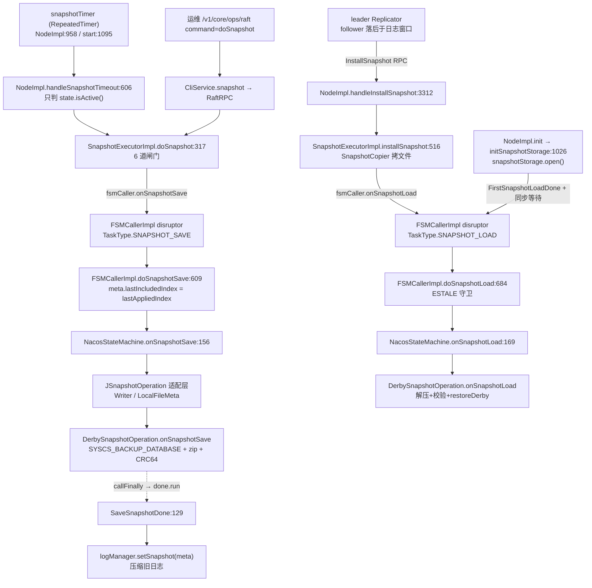
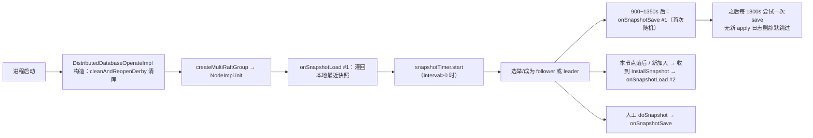

我先读取状态机快照相关代码，并全仓检索快照的触发点。

状态机里这两个方法只是"转发"，真正的触发在 JRaft 库侧。我先查 Nacos 侧的配置与手动触发入口。

直连 raw 失败，换 CDN 源验证 JRaft 库内的触发点。

库源码已缓存到本地。我来定位其中的快照触发分支。

最后核实一处启动顺序（`cleanAndReopenDerby` 与 raft 节点初始化的先后）。

## 〇、一句话结论

`NacosStateMachine#onSnapshotSave / #onSnapshotLoad` **不是 Nacos 自己调的**，它是 sofa-jraft 回调状态机的两个钩子；Nacos 只负责把回调转译给业务侧的 `SnapshotOperation`（`adapterToJRaftSnapshot`，[NacosStateMachine.java#L251-L319](/System/Volumes/Data/resource/github/nacos/core/src/main/java/com/alibaba/nacos/core/distributed/raft/NacosStateMachine.java)）。真正的时机由 jraft 的 `NodeImpl` / `SnapshotExecutorImpl` / `FSMCallerImpl` 三层决定，一共 **save 有 1 个主入口 + 3 个次入口，load 只有 2 个入口**：

| 钩子 | 触发方 | 条件 | Nacos 默认 |
|---|---|---|---|
| `onSnapshotSave` | **① 本节点 snapshotTimer 定时** | `snapshotExecutor != null && snapshotIntervalSecs > 0`，且状态 `isActive`（**leader、follower 都会**） | 1800s，首次随机化到 900~1350s |
| | ② 运维手动 | `POST /v1/core/ops/raft` `command=doSnapshot` → `cliService.snapshot(group, peer)` | 需人工 |
| | ③ `Node#snapshot(Closure)` / `snapshotSync` | 应用代码主动 | Nacos 未用 |
| | ④ `NodeImpl#bootstrap()` | 引导迁移时同步做一次 | Nacos 未用 |
| `onSnapshotLoad` | **① 节点启动加载本地最近快照** | `SnapshotExecutorImpl.init()` 里 `snapshotStorage.open()` 拿到快照 | 每次进程启动 |
| | **② leader 发 InstallSnapshot RPC** | follower 落后到日志已被压缩 | 追数据/新节点加入 |

---

## 一、分层职责：谁在什么时候按下按钮



关键点：**save 与 load 都走 `FSMCallerImpl` 的同一个 disruptor 单线程队列**（`JRaft-FSMCaller-Disruptor`），任务类型 `SNAPSHOT_SAVE / SNAPSHOT_LOAD` 与 `COMMITTED`(即 `onApply`) 是互斥串行的（[FSMCallerImpl.java#L413-L458]）。这就是"快照点必然是一个干净的 apply 边界"的机制基础。

---

## 二、`onSnapshotSave` 的触发时机（逐个拆）

### 2.1 定时器（唯一日常来源）

```java
// NodeImpl.init(),  jraft v1.3.14 L958-L984
name = "JRaft-SnapshotTimer-" + suffix;
this.snapshotTimer = new RepeatedTimer(name, this.options.getSnapshotIntervalSecs() * 1000,
    TIMER_FACTORY.getSnapshotTimer(this.options.isSharedSnapshotTimer(), name)) {
    private volatile boolean firstSchedule = true;
    @Override protected void onTrigger() { handleSnapshotTimeout(); }
    @Override protected int adjustTimeout(final int timeoutMs) {
        if (!this.firstSchedule) { return timeoutMs; }
        this.firstSchedule = false;
        // Randomize the first snapshot trigger timeout
        int half = timeoutMs / 2; return half + ThreadLocalRandom.current().nextInt(half);
    }
};
// L1095-L1098：两个条件同时满足才启动定时器
if (this.snapshotExecutor != null && this.options.getSnapshotIntervalSecs() > 0) {
    this.snapshotTimer.start();
}
```

对应 Nacos 侧的三个开关：

| Nacos 位置 | 作用 |
|---|---|
| [JRaftServer.java#L249-L255](/System/Volumes/Data/resource/github/nacos/core/src/main/java/com/alibaba/nacos/core/distributed/raft/JRaftServer.java) | `interval = raftConfig(snapshot_interval_secs, 默认 1800)`；**若该 group 没实现 SnapshotOperation → 强制 0，等于关掉定时器** |
| [JRaftServer.java#L176](/System/Volumes/Data/resource/github/nacos/core/src/main/java/com/alibaba/nacos/core/distributed/raft/JRaftServer.java) | `setSharedSnapshotTimer(true)`：本机所有 raft group 共享一个定时器池 |
| [JRaftUtils.java#L89-L104](/System/Volumes/Data/resource/github/nacos/core/src/main/java/com/alibaba/nacos/core/distributed/raft/utils/JRaftUtils.java) | 每个 group 都设 `snapshotUri = data/protocol/raft/{group}/snapshot` → `initSnapshotStorage()` 必然创建 `SnapshotExecutorImpl`（否则 snapshotUri 为空时 `snapshotExecutor == null`，快照彻底禁用） |

时间数值（默认 1800s）：
- **首次触发 = 900s ~ 1350s 之间随机**（`half + rand(half)`，不是 1800s），目的是打散三台节点同时打快照的磁盘尖峰
- 之后每 1800s 一次，固定不随机

### 2.2 触发后要过 6 道闸门

```java
// SnapshotExecutorImpl.doSnapshot(done, sync) L317-L401
if (this.stopped)                              → EPERM  "Is stopped."
if (this.downloadingSnapshot.get() != null)     → EBUSY  "Is loading another snapshot."   // 装快照优先
if (this.savingSnapshot)                        → EBUSY  "Is saving another snapshot."
if (fsmCaller.getLastAppliedIndex() == lastSnapshotIndex) → 静默 return，连日志都没有      // ★ 无新日志不打快照
if (lastApplied - lastSnapshotIndex < snapshotLogIndexMargin) → ECANCELED                  // Nacos 未设，默认 0
if (snapshotStorage.create() == null)           → EIO + reportError
```

**闸门 4 是最常被误解的一条**：空闲集群（没有配置发布）永远不产新快照文件。所以"目录里快照文件很旧"≠ 快照坏了。

### 2.3 快照点取的是 `lastAppliedIndex`

```java
// FSMCallerImpl.doSnapshotSave L609-L641
final long lastAppliedIndex = this.lastAppliedIndex.get();
final SnapshotMeta.Builder metaBuilder = SnapshotMeta.newBuilder()
    .setLastIncludedIndex(lastAppliedIndex).setLastIncludedTerm(this.lastAppliedTerm);
final ConfigurationEntry confEntry = this.logManager.getConfiguration(lastAppliedIndex);  // 成员列表也进快照
...
this.fsm.onSnapshotSave(writer, done);   // ← 这里才进 NacosStateMachine
```

这条很重要：**Nacos 的状态机数据（Derby 库 / 内存 client 表）全部是 `onApply` 的产物**，所以"快照 = lastAppliedIndex 时刻的状态"是自洽的；保存成功后 `logManager.setSnapshot(meta)`（[SnapshotExecutorImpl.java#L448]）把 `<= lastIncludedIndex` 的日志删掉——这正是后面 follower 必须靠 `InstallSnapshot` 追赶的原因。

### 2.4 手动入口（Nacos 唯一暴露的运维路径）

```java
// JRaftOps.DO_SNAPSHOT (core/.../raft/utils/JRaftOps.java L67-L78)
Status status = cliService.snapshot(groupId, peerId);   // 走 Raft RPC 到指定 peer
// JRaftMaintainService.execute(Map) L55-L69：不传 groupId 就遍历所有 group，遇到第一个失败立即 return
```
HTTP：`POST /nacos/v1/core/ops/raft`（v2：`/nacos/v2/admin/core/raft`），body：
```json
{"groupId":"nacos_config","command":"doSnapshot","value":"10.0.0.2:7848"}
```
不传 `groupId` 时会对**本机每个 raft group 的 `value` 指定 peer** 依次触发。

---

## 三、`onSnapshotLoad` 的触发时机（只有 2 个）

### 3.1 启动加载本地最近快照（每次进程启动必然一次）

```java
// SnapshotExecutorImpl.init() L258-L286
final SnapshotReader reader = this.snapshotStorage.open();     // 取最近一个 committed 快照
if (reader == null) { return true; }                            // ★ 全新节点无快照 → 不回调 onSnapshotLoad
this.loadingSnapshotMeta = reader.load();
LOG.info("Loading snapshot, meta={}.", this.loadingSnapshotMeta);
final FirstSnapshotLoadDone done = new FirstSnapshotLoadDone(reader);
Requires.requireTrue(this.fsmCaller.onSnapshotLoad(done));      // 丢进 FSMCaller 队列
done.waitForRun();                                              // ★ 同步阻塞直到 fsm.onSnapshotLoad 返回
if (!done.status.isOk()) { return false; }                      // 失败 → 节点启动失败
```

它被 `NodeImpl.init() → initSnapshotStorage()`（L1026）调用，**早于 snapshotTimer.start()（L1095）**，也早于任何 raft 通信。

Nacos 侧的启动顺序因此非常关键（这是"嵌入式 derby 集群为什么启动要清库"的闭环）：

```java
// DistributedDatabaseOperateImpl 构造函数 → init() L186-L214
this.dataSourceService.cleanAndReopenDerby();     // ① 先删本地 derby-data 再重建空库
...
this.protocol.addRequestProcessors(singletonList(this));  // ② → createMultiRaftGroup → RaftGroupService.start → NodeImpl.init
                                                          // ③ initSnapshotStorage → onSnapshotLoad（把快照灌回新空库）
                                                          // ④ 日志重放：lastAppliedIndex 之后到 committed 的日志 → onApply
```
即 **清库 → 装快照 → 重放增量日志**，三者顺序由构造函数里"clean 在前、注册 processor 在后"这一行代码保证。

### 3.2 远端 InstallSnapshot（follower 追赶 / 新节点加入）

```java
// NodeImpl.handleInstallSnapshot L3312-L3373：state.isActive / term / checkStepDown 校验后
this.snapshotExecutor.installSnapshot(request, InstallSnapshotResponse.newBuilder(), done);
// SnapshotExecutorImpl.installSnapshot L516-L583
registerDownloadingSnapshot(ds);  curCopier.join();       // 把 leader 的快照文件拷进本地 .tmp
loadDownloadingSnapshot(ds, meta);
    → this.fsmCaller.onSnapshotLoad(new InstallSnapshotDone(reader));   // → SNAPSHOT_LOAD → fsm.onSnapshotLoad
```

装快照期间的"保护动作"（都是 `handleInstallSnapshot`/`NodeImpl` 里的显式判断）：

| 位置 | 行为 |
|---|---|
| `NodeImpl` L1952 | `entriesCount > 0 && isInstallingSnapshot()` → AppendEntries 直接回 `EBUSY "Node is installing snapshot"` |
| `NodeImpl.preVote` L2669 | 正在装快照时**不允许发起选举**（"configuration may be out of date"） |
| `NodeImpl.stepDown` L1292 | `interruptDownloadingSnapshots(term)` 打断传输 |
| `doSnapshot` L333 | 正在装快照时**跳过本地 save** |

加载成功后（`FSMCallerImpl.doSnapshotLoad` L710-L730 + `onSnapshotLoadDone` L466-L512）：

```java
if (!this.fsm.onSnapshotLoad(reader)) {        // ← NacosStateMachine 返回 false
    done.run(new Status(-1, "StateMachine onSnapshotLoad failed"));
    setError(new RaftException(ERROR_TYPE_STATE_MACHINE, ESTATEMACHINE, "StateMachine onSnapshotLoad failed"));
    return;                                     // ★ 索引不推进
}
this.lastCommittedIndex.set(meta.getLastIncludedIndex());
this.lastAppliedIndex.set(meta.getLastIncludedIndex());   // ★ 直接把 apply 进度推到快照点
```
外加 `logManager.setSnapshot(meta)` 截断本地日志、`node.updateConfigurationAfterInstallingSnapshot()` 用快照里的成员列表刷新 conf。

还有一个反向守卫：`lastAppliedId > snapshotId` → 回 `ESTALE`，**不会调用 fsm**（[FSMCallerImpl.java#L701-L709]），所以"旧快照覆盖新数据"在协议层就被挡住了。

---

## 四、Nacos 侧这两个回调到底做了什么（决定"何时"的第二层）

```java
// NacosStateMachine L156-L166：注意 save 是"提交即返回"
public void onSnapshotSave(SnapshotWriter writer, Closure done) {
    for (JSnapshotOperation operation : operations) { operation.onSnapshotSave(writer, done); }
}
```

| 模块 | SnapshotOperation | 执行线程 | 锁 | 数据形态 |
|---|---|---|---|---|
| config | `DerbySnapshotOperation` | `PersistenceExecutor.EMBEDDED_SNAPSHOT_EXECUTOR`（**单线程池** `com.alibaba.nacos.persistence.embedded.snapshot`） | `writeLock`（`DistributedDatabaseOperateImpl` 的读写锁，apply 拿的是 `readLock`） | 整库物理备份 `CALL SYSCS_UTIL.SYSCS_BACKUP_DATABASE(?)` → `derby_data.zip` + CRC64 |
| naming v2 | `PersistentInstanceSnapshotOperation` | `RaftExecutor.doSnapshot`（`raft-snapshot` 池，大小 = core_thread_num/2） | `writeLock` | 逻辑快照：`serializer.serialize(Map<ClientId, ClientSyncData>)` + load 时 add/update/remove 三段 diff |
| naming metadata | `ServiceMetadataSnapshotOperation` / `InstanceMetadataSnapshotOperation` | 同上 | 同上 | 文件 |
| naming v1 switch | `SwitchManager.snapshotOperation` | 同上 | `raftLock.writeLock` | `copyDirectory` |

所以 **`onSnapshotSave` 从 jraft 视角"被调用"的瞬间只是入队，真正落盘发生在另一个线程**；jraft 要等 `callFinally` → `done.run(status)` 才认为这次快照结束（`savingSnapshot` 复位、`runningJobs.countDown()`）。这也解释了 [NacosStateMachine.java#L270-L285] 那段 `callFinally`：它把 Nacos 侧 `Writer.listFiles()` 逐个 `writer.addFile(...)` 注册进 jraft 快照目录，再统一 `done.run(status)`。

---

## 五、哪些 group 会触发快照

| group | 来源 | 有 SnapshotOperation | 定时器 interval |
|---|---|---|---|
| `nacos_config` | `DistributedDatabaseOperateImpl#loadSnapshotOperate` L466 | ✅ Derby | 1800s |
| `naming_persistent_service_v2` | `PersistentClientOperationServiceImpl` L265 | ✅ | 1800s |
| `naming_service_metadata` / `naming_instance_metadata` | `ServiceMetadataProcessor` L75 / `InstanceMetadataProcessor` L71 | ✅ | 1800s |
| `naming_persistent_service`(switch) | `SwitchManager` L404 | ✅ | 1800s |
| 其他 CP group | `RequestProcessor4CP#loadSnapshotOperate()` 默认返回空 | ❌ | **强制 0（不产快照）** |

⚠️ 但注意：即使 interval=0，`snapshotUri` 仍然被设置了 → `SnapshotExecutorImpl.init()` 仍会执行 → 这类 group 的 `NacosStateMachine.onSnapshotLoad` **启动时依然会被调用一次**，只是因为 `operations` 为空而 for 循环什么都不做、直接 `return true`。

---

## 六、时间线（一个集群从启动到稳态）



---

## 七、设计关键点

| # | 关键点 | 出处 |
|---|---|---|
| 1 | 快照是**每个节点自治的本地行为**，leader 和 follower 都打；只有 `InstallSnapshot` 方向是 leader→follower | `handleSnapshotTimeout` 只判 `isActive()` |
| 2 | 定时器开关有两级：`snapshotUri`（决定 executor 是否存在）+ `snapshotIntervalSecs`（决定定时器是否启动） | `initSnapshotStorage` L560、L1095 |
| 3 | Nacos 用"业务未实现快照 → interval 置 0"防止没有 `SnapshotOperation` 的 group 产出无意义快照 | `JRaftServer` L253 |
| 4 | 首次触发随机化到 `[0.5x, 1x)`，规避多节点同时备份 derby 的 IO 风暴 | `adjustTimeout` L970-L983 |
| 5 | "无新 apply 日志 → 跳过"，避免空集群反复做整库备份 | `doSnapshot` L345 |
| 6 | 快照点 = `lastAppliedIndex`，与"状态全由 apply 产生"的 Nacos 模型天然一致 | `doSnapshotSave` L611 |
| 7 | save/load 与 apply 同在 FSMCaller 单线程队列里串行，快照点必然是干净的 apply 边界 | `runApplyTask` L413-L458 |
| 8 | 装快照期间拒绝 AppendEntries / 禁止 preVote / 禁止本地 save，三处互锁防止配置被半更新 | L1952、L2669、L333 |
| 9 | `ESTALE` 双向守卫：load 时快照比本地旧 → 不加载；save 时快照点比上次旧 → 丢弃 | L703、L411 |
| 10 | load 成功后把 `lastApplied/lastCommitted` 直接推到快照点，并截断日志 → 追赶成本从 O(全量日志) 降到 O(快照+增量) | L727-L729 |
| 11 | 启动路径的 load 是**同步阻塞**（`waitForRun`），保证节点不会带着空状态机参与 raft | `SnapshotExecutorImpl.init` L274 |
| 12 | Nacos 把 save 做成异步 + 单线程池，避免长耗时 derby 备份占住 FSMCaller 线程（代价见坑 4） | `PersistenceExecutor.executeSnapshot` |
| 13 | 快照拷贝分块 128K + `snapshotThrottle`，控制跨节点传输带宽 | `DEFAULT_MAX_BYTE_COUNT_PER_RPC` |
| 14 | `NacosStateMachine` 用适配层屏蔽 jraft 的 `SnapshotWriter/Reader`，业务只看到 `Writer/Reader/LocalFileMeta`，并注释"保护不同 raft 实现" | L267-L268 |
| 15 | `NacosStateMachine.onSnapshotLoad` 任一个 operation 失败即 `return false`（短路），错误上抛也返回 false | L170-L181 |
| 16 | 快照文件带 CRC64 写入 `LocalFileMeta`，load 时比对，防半截 zip | `DerbySnapshotOperation` L103/L131 |
| 17 | 失败后果分层：启动期 load 失败 → `NodeImpl.init` 返回 false → **进程起不来**；运行期 load 失败 → `setError(ESTATEMACHINE)` → `NacosStateMachine.onError` → `processor.onError` → `RaftDbErrorEvent` → derby `healthStatus=DOWN` | 两处调用链 |

---

## 八、坑

**坑 1｜"只有 leader 打快照"是错觉，但也别反过来误解。**
save 确实每节点自己做；但 `logManager.setSnapshot(meta)` 也是各自压缩自己的日志。这意味着三台节点的 `firstIndexInLog` 不同，leader 给某个 follower 传的是 **leader 自己的快照**——follower 拿到的是"leader 视角的状态"，与它本地已 apply 的内容无关。所以 Nacos 侧的 `restoreDerby` 必须**先删干净再拷**（`LocalDataSourceServiceImpl.restoreDerby` → `doDerbyClean`），否则会出现"半新半旧"的库。

**坑 2｜interval=1800s 就是"分叉修正上界"。**
承接上次分析：follower 的 `onApply` 失败没有回传路径（closure==null），数据分叉只能等下一次 `InstallSnapshot` 被修正。定时器最坏 1800s 一次 + 闸门 5 的"无新日志跳过"，意味着**低峰期分叉可能长时间无人修正**（因为没有新日志就没人打快照，也没人会来 install）。排查手段：比对各节点 `count(*)/max(id)`，或 `POST /v1/cs/ops/derby` 抽样。

**坑 3｜`savingSnapshot` 是一个可能永久卡死的位。**
`doSnapshot` L339 见到 `savingSnapshot=true` 就回 EBUSY，而 Nacos 的 `onSnapshotSave` 是**异步**的：置位由 jraft 做，复位完全依赖 `callFinally.accept(...)` 被调用。`DerbySnapshotOperation` 的 `catch (Throwable)` 覆盖了绝大多数路径，但如果任务被线程池拒绝（shutdown 中）或线程 OOM 直接死掉，`done.run` 永不执行 → `savingSnapshot` 永久 true → 之后**所有快照都 EBUSY**，且 `runningJobs` 不归零会导致 `NodeImpl.join()` 挂住。识别方式：`raft.log` 里反复出现 `Is saving another snapshot.`

**坑 4｜异步 save 破坏了"快照点与备份内容严格对应"的约定。**
jraft 的用户文档明确要求：`onSnapshotSave` 应同步捕获状态机当前状态；若要异步，需要自己做"快照点之后的变更暂存与合并"。Nacos 没做这个（靠 writeLock 缓解）。后果是备份内容可能**比 meta 的 `lastIncludedIndex` 更新**，于是恢复后 `lastApplied` 被设为 meta 索引，那段"库里已经有了但日志还没删"的 SQL 会被**重放第二次** → derby 主键/唯一键冲突 → 整批事务回滚 → `success=false`。config 侧靠显式雪花主键 + `executeNo` 排序 + 幂等 dump 勉强收敛，但这正是"重放偶发失败"的成因之一。

**坑 5｜`snapshotLogIndexMargin` 没在 Nacos 暴露。**
`doSnapshot` L357 用它做"至少差 N 条日志才打快照"，Nacos 只在 `NodeOptions` 默认值（0）上运行，`RaftSysConstants` 也没有对应配置键。想改成"每 N 条才快照"必须自己扩 `JRaftUtils/RaftOptionsBuilder`。

**坑 6｜`NacosStateMachine.onSnapshotSave` 的多 operation 语义不严谨。**
`for (operation : operations) operation.onSnapshotSave(writer, done)` —— 每个 operation 都拿到同一个 jraft `done`（`SaveSnapshotClosure`），两个 operation 完成就会 `done.run` 两次，导致 `savingSnapshot`/`runningJobs` 计数错乱。现状无害（5 个 group 全是 `Collections.singletonList`），**但如果有人给 config group 加第二个 SnapshotOperation，就会踩中**。

**坑 7｜运维 `doSnapshot` 命令的返回语义。**
`JRaftMaintainService.execute(Map)` 在不传 `groupId` 时遍历所有 group，`if (!result.ok()) return result;` —— 第一个失败就中断，后面的 group 不再触发，而 HTTP 层看起来像"部分成功"。另外 `cliService.snapshot(group, peerId)` 是对**远端 peer 发 RPC**，`value` 必须写 `ip:raftPort`（不是 `-1`，`-1` 在部分 jraft 命令里表示本机）。

**坑 8｜配置文件注释里的 `=30` 不是默认值。**
[distribution/conf/application.properties#L234] 写的是 `# nacos.core.protocol.raft.data.snapshot_interval_secs=30`，而代码默认是 `DEFAULT_RAFT_SNAPSHOT_INTERVAL_SECS = 30 * 60 = 1800`。照着注释"取消注释即改成 30 秒"会让快照频率放大 60 倍，直接放大坑 4 的窗口和 derby 备份的 IO 压力。

---

## 九、总结

`onSnapshotSave` 的时机可以用一句话概括：**本节点自己的 `JRaft-SnapshotTimer` 到点（Nacos 默认 interval=1800s，首次落在 900~1350s），且 executor 存在 + interval>0 + 状态 active + 有新 apply 日志 + 没有正在进行的 save/install**；外加 `CliService#snapshot`（Nacos 的 `doSnapshot` 运维命令）和 `Node#snapshot/bootstrap` 三个人工入口。

`onSnapshotLoad` 的时机只有两个：**进程启动时在 `NodeImpl.init → initSnapshotStorage → SnapshotExecutorImpl.init` 里同步加载本地最近快照**（这就是 Nacos 嵌入式集群"清库后靠快照+日志重建"的第一环），以及**运行期收到 leader 的 `InstallSnapshot` RPC**（落后追赶 / 新节点加入）。两者最终都汇入 `FSMCallerImpl.doSnapshotLoad`，在 FSMCaller 单线程里与 `onApply` 串行执行。

理解这两个钩子，最有价值的三件事是：① 快照是**每个节点自治**的，不是 leader 分发；② 快照点等于 `lastAppliedIndex`，所以它与 Nacos"状态是 apply 产物"的模型天然一致；③ Nacos 把 save 异步化换来了 FSM 线程不被 derby 备份拖死，代价是快照点与备份内容的一致性只能靠 `writeLock` 和业务幂等兜住——这与之前发现的"follower apply 失败静默分叉"是同一处软肋的两个侧面，也是运维上必须把 `snapshot_interval_secs` 当作**一致性收敛时间上界**来审视的原因。
