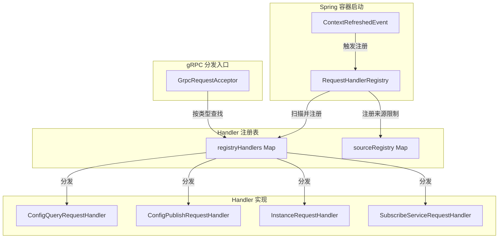
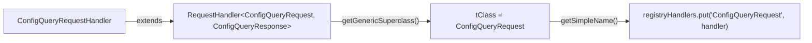
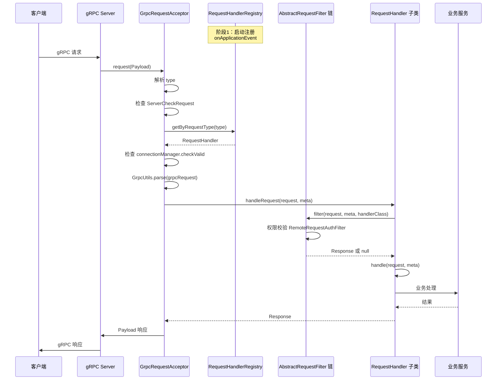

让我先读取 RequestHandlerRegistry 的源码，再分析相关的 handler。

## RequestHandlerRegistry#onApplicationEvent 源码分析

---

### 一、整体架构



---

### 二、onApplicationEvent 核心逻辑

**源码位置**: `RequestHandlerRegistry.java` (第75-122行)

```java
@Override
public void onApplicationEvent(ContextRefreshedEvent event) {
    // 1. 扫描所有 RequestHandler 类型的 Bean
    Map<String, RequestHandler> beansOfType = event.getApplicationContext()
            .getBeansOfType(RequestHandler.class);
    Collection<RequestHandler> values = beansOfType.values();
    
    for (RequestHandler requestHandler : values) {
        Class<?> clazz = requestHandler.getClass();
        
        // 2. 向上查找直接继承 RequestHandler 的类
        boolean skip = false;
        while (!clazz.getSuperclass().equals(RequestHandler.class)) {
            if (clazz.getSuperclass().equals(Object.class)) {
                skip = true;
                break;
            }
            clazz = clazz.getSuperclass();
        }
        if (skip) {
            continue;
        }
        
        // 3. 注册 TPS 限流点
        try {
            Method method = clazz.getMethod("handle", Request.class, RequestMeta.class);
            if (method.isAnnotationPresent(TpsControl.class) && TpsControlConfig.isTpsControlEnabled()) {
                TpsControl tpsControl = method.getAnnotation(TpsControl.class);
                String pointName = tpsControl.pointName();
                ControlManagerCenter.getInstance().getTpsControlManager().registerTpsPoint(pointName);
            }
        } catch (Exception e) {
            //ignore.
        }
        
        // 4. 通过泛型反射获取 Request 类型
        Class tClass = (Class) ((ParameterizedType) clazz.getGenericSuperclass())
                .getActualTypeArguments()[0];
        
        // 5. 注册调用来源限制
        try {
            if (clazz.isAnnotationPresent(InvokeSource.class)) {
                InvokeSource invokeSource = clazz.getAnnotation(InvokeSource.class);
                String[] sources = invokeSource.source();
                if (sources != null && sources.length > 0) {
                    sourceRegistry.put(tClass.getSimpleName(), Sets.newHashSet(sources));
                }
            }
        } catch (Exception e) {
            //ignore.
        }
        
        // 6. 建立 requestType -> handler 映射
        registryHandlers.putIfAbsent(tClass.getSimpleName(), requestHandler);
    }
}
```

**执行时机**: Spring 容器刷新完成后（`ContextRefreshedEvent`），所有 Bean 已创建并注入完毕。

---

### 三、泛型反射获取 Handler 的 Request 类型



**关键反射逻辑**:
```java
// 获取直接父类的泛型参数
// ConfigQueryRequestHandler extends RequestHandler<ConfigQueryRequest, ConfigQueryResponse>
Class tClass = (Class) ((ParameterizedType) clazz.getGenericSuperclass())
        .getActualTypeArguments()[0];  // 第一个泛型参数 = Request 类型
```

**向上查找机制**：处理多层继承时，找到**直接继承 RequestHandler** 的那一层，而不是无限向上。

---

### 四、Handler 调用分发入口

**源码位置**: `GrpcRequestAcceptor.java` (第111-195行)

```java
@Override
public void request(Payload grpcRequest, StreamObserver<Payload> responseObserver) {
    String type = grpcRequest.getMetadata().getType();
    
    // 1. 服务器启动状态检查
    if (!ApplicationUtils.isStarted()) {
        // 返回 INVALID_SERVER_STATUS 错误
        return;
    }
    
    // 2. ServerCheckRequest 特殊处理（无需 handler）
    if (ServerCheckRequest.class.getSimpleName().equals(type)) {
        // 直接返回连接确认响应
        return;
    }
    
    // 3. 查找 Handler
    RequestHandler requestHandler = requestHandlerRegistry.getByRequestType(type);
    if (requestHandler == null) {
        // 返回 NO_HANDLER 错误
        return;
    }
    
    // 4. 连接有效性检查
    boolean requestValid = connectionManager.checkValid(connectionId);
    if (!requestValid) {
        // 返回 UN_REGISTER 错误
        return;
    }
    
    // 5. 解析请求体
    Request request = (Request) GrpcUtils.parse(grpcRequest);
    
    // 6. 构建元数据并处理
    Response response = requestHandler.handleRequest(request, requestMeta);
    
    // 7. 限流特殊处理（延迟1秒响应）
    if (response.getErrorCode() == NacosException.OVER_THRESHOLD) {
        RpcScheduledExecutor.CONTROL_SCHEDULER.schedule(() -> {
            responseObserver.onNext(payloadResponse);
            responseObserver.onCompleted();
        }, 1000L, TimeUnit.MILLISECONDS);
    }
}
```

---

### 五、RequestHandler 抽象基类

**源码位置**: `RequestHandler.java` (第33-71行)

```java
public abstract class RequestHandler<T extends Request, S extends Response> {
    
    @Autowired
    private RequestFilters requestFilters;
    
    // 模板方法：先过滤，再处理
    public Response handleRequest(T request, RequestMeta meta) throws NacosException {
        // 1. 执行过滤器链
        for (AbstractRequestFilter filter : requestFilters.filters) {
            Response filterResult = filter.filter(request, meta, this.getClass());
            if (filterResult != null && !filterResult.isSuccess()) {
                return filterResult;  // 过滤器拦截，直接返回
            }
        }
        // 2. 调用子类实现
        return handle(request, meta);
    }
    
    // 抽象方法：子类实现具体业务
    public abstract S handle(T request, RequestMeta meta) throws NacosException;
}
```

**过滤器链** (AbstractRequestFilter): 如 `RemoteRequestAuthFilter`（权限验证），在 `handle()` 之前执行。

---

### 六、各模块 Handler 分类与注解

#### 6.1 Config 模块 Handler

| Handler | Request 类型 | TPS 限流点 | 权限动作 | 作用 |
|---------|-------------|-----------|---------|------|
| `ConfigQueryRequestHandler` | ConfigQueryRequest | ConfigQuery | READ | 配置查询 |
| `ConfigPublishRequestHandler` | ConfigPublishRequest | ConfigPublish | WRITE | 配置发布 |
| `ConfigRemoveRequestHandler` | ConfigRemoveRequest | ConfigRemove | WRITE | 配置删除 |
| `ConfigChangeBatchListenRequestHandler` | ConfigBatchListenRequest | ConfigListen | READ | 监听注册 |
| `ConfigChangeClusterSyncRequestHandler` | ConfigChangeClusterSyncRequest | ClusterConfigChangeNotify | 无 | 集群同步 |

#### 6.2 Naming 模块 Handler

| Handler | Request 类型 | 作用 |
|---------|-------------|------|
| `InstanceRequestHandler` | InstanceRequest | 单实例注册/心跳/注销 |
| `BatchInstanceRequestHandler` | BatchInstanceRequest | 批量实例操作 |
| `ServiceListRequestHandler` | ServiceListRequest | 服务列表查询 |
| `ServiceQueryRequestHandler` | ServiceQueryRequest | 服务实例查询 |
| `SubscribeServiceRequestHandler` | SubscribeServiceRequest | 服务订阅 |
| `PersistentInstanceRequestHandler` | PersistentInstanceRequest | 持久化实例操作 |
| `DistroDataRequestHandler` | DistroDataRequest | Distro 协议数据同步 |

#### 6.3 Core 模块 Handler

| Handler | Request 类型 | 作用 |
|---------|-------------|------|
| `HealthCheckRequestHandler` | HealthCheckRequest | 健康检查 |
| `MemberReportHandler` | MemberReportRequest | 集群成员信息上报 |
| `ServerLoaderInfoRequestHandler` | ServerLoaderInfoRequest | 服务器负载信息查询 |
| `ServerReloaderRequestHandler` | ServerReloadRequest | 服务器配置重载 |

---

### 七、Handler 注解关键点

#### 7.1 @TpsControl - 流量控制

```java
@TpsControl(pointName = "ConfigQuery")
public ConfigQueryResponse handle(ConfigQueryRequest request, RequestMeta meta) { ... }
```

**注册时机**：`onApplicationEvent` 启动时自动注册 TPS 点，限流在 `handleRequest()` 调用时由 Spring AOP 拦截。

#### 7.2 @Secured - 权限控制

```java
@Secured(action = ActionTypes.READ, signType = SignType.CONFIG)
```

**由 AbstractRequestFilter 链执行**（`RemoteRequestAuthFilter`），在 handle 之前进行身份验证和权限校验。

#### 7.3 @InvokeSource - 调用来源限制

**源码位置**: `ConfigChangeClusterSyncRequestHandler.java` (第46-47行)

```java
@Component
@InvokeSource(source = {RemoteConstants.LABEL_SOURCE_CLUSTER})  // 只允许集群内部调用
public class ConfigChangeClusterSyncRequestHandler
        extends RequestHandler<ConfigChangeClusterSyncRequest, ConfigChangeClusterSyncResponse> { ... }
```

**校验时机**: `GrpcRequestAcceptor` 处理时，通过 `sourceRegistry` 检查调用来源是否在允许列表中。

#### 7.4 @ExtractorManager.Extractor - 参数提取

```java
@ExtractorManager.Extractor(rpcExtractor = ConfigRequestParamExtractor.class)
```

用于从 RPC 请求中提取关键参数，填入 `RequestContext`，供后续权限验证和审计使用。

---

### 八、ConfigPublishRequestHandler 示例分析

**源码位置**: `ConfigPublishRequestHandler.java` (第63-137行)

```java
@Override
@TpsControl(pointName = "ConfigPublish")      // TPS 限流
@Secured(action = ActionTypes.WRITE, signType = SignType.CONFIG)  // 写权限
@ExtractorManager.Extractor(rpcExtractor = ConfigRequestParamExtractor.class)  // 参数提取
public ConfigPublishResponse handle(ConfigPublishRequest request, RequestMeta meta) throws NacosException {
    try {
        // 1. 提取请求参数
        String dataId = request.getDataId();
        String group = request.getGroup();
        String content = request.getContent();
        final String tenant = NamespaceUtil.processNamespaceParameter(request.getTenant());
        
        // 2. 参数校验
        ParamUtils.checkParam(dataId, group, "datumId", content);
        ParamUtils.checkParam(tag);
        
        // 3. 构建 ConfigForm
        ConfigForm configForm = new ConfigForm();
        configForm.setDataId(dataId);
        configForm.setGroup(group);
        configForm.setNamespaceId(tenant);
        configForm.setContent(content);
        
        // 4. 构建 ConfigRequestInfo
        ConfigRequestInfo configRequestInfo = new ConfigRequestInfo();
        configRequestInfo.setSrcIp(srcIp);
        configRequestInfo.setSrcType(RPC);  // 标记为 RPC 来源
        configRequestInfo.setCasMd5(request.getCasMd5());  // CAS 乐观锁
        
        // 5. 加密处理
        Pair<String, String> pair = EncryptionHandler.encryptHandler(dataId, content);
        content = pair.getSecond();
        encryptedDataKeyFinal = pair.getFirst();
        
        // 6. 调用业务层发布配置
        configOperationService.publishConfig(configForm, configRequestInfo, encryptedDataKeyFinal);
        return ConfigPublishResponse.buildSuccessResponse();
        
    } catch (Exception e) {
        return ConfigPublishResponse.buildFailResponse(..., e.getMessage());
    }
}
```

---

### 九、完整请求处理时序图



---

### 十、核心设计总结

| 设计要点 | 实现方式 | 目的 |
|---------|---------|------|
| **自动发现注册** | `ApplicationListener<ContextRefreshedEvent>` | Spring 启动后自动扫描，无需手动配置 |
| **泛型路由映射** | `ParameterizedType` 反射获取 Request 类 | 建立 `requestType → handler` 的一一映射 |
| **模板方法模式** | `handleRequest()` 先过滤后 `handle()` | 统一横切关注点（权限/限流），业务逻辑解耦 |
| **注解驱动限流** | `@TpsControl` + `registerTpsPoint()` | Handler 级别独立限流点管理 |
| **注解驱动权限** | `@Secured` + `AbstractRequestFilter` | 声明式权限控制，无需在业务代码中判断 |
| **来源隔离** | `@InvokeSource` + `sourceRegistry` | 集群内部 API 不对外暴露 |
| **继承层次容错** | `while` 循环向上查找直接父类 | 支持三层以上继承，找到持有泛型的那层 |