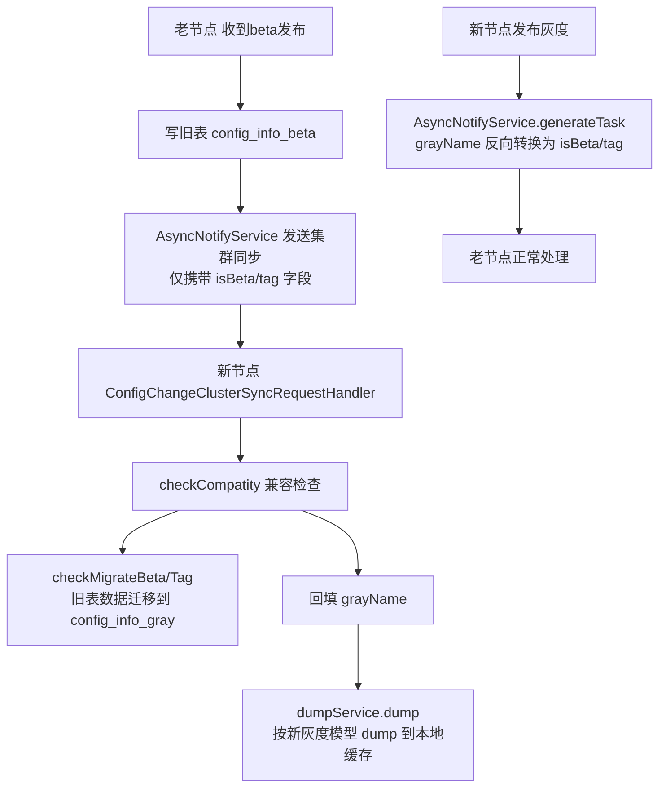

让我查看灰度迁移服务的相关实现来准确说明这个方法的作用。

## `checkCompatity` 方法作用解析

**一句话总结**：这是 Nacos **灰度模型新旧版本兼容的适配方法**，用于在集群滚动升级期间，将**老版本节点**发来的 `beta/tag` 旧格式集群同步请求，**自动迁移并转换**为新版本的统一灰度模型（grayName）。

---

### 一、背景：为什么需要兼容？

Nacos 2.4+ 对灰度发布做了架构重构：

| 版本 | 存储模型 | 标识方式 |
|------|---------|---------|
| **旧版本** | `config_info_beta` + `config_info_tag` 两张表 | 请求字段 `isBeta` / `tag`（现已 `@Deprecated`） |
| **新版本** | 统一 `config_info_gray` 一张表 | 请求字段 `grayName`（如 `beta`、`tag_xxx`） |

集群**滚动升级**时会出现**新老节点混布**：老节点发出的 `ConfigChangeClusterSyncRequest` 只有 `isBeta`/`tag`，没有 `grayName`。新节点收到后如果不处理，就无法按新模型 dump 灰度配置。

**证据** — `ConfigChangeClusterSyncRequest.java` (第33-37行)：

```java
String grayName;        // 新字段

@Deprecated
boolean isBeta;         // 旧字段，仅为兼容保留

@Deprecated
String tag;             // 旧字段，仅为兼容保留
```

---

### 二、源码逐行分析

```java
private void checkCompatity(ConfigChangeClusterSyncRequest configChangeSyncRequest) {
    // 条件1：开启兼容模式 && 请求中没有新模型的 grayName
    //   → 说明这个请求极可能来自"老版本节点"
    if (PropertyUtil.isGrayCompatibleModel() && StringUtils.isBlank(configChangeSyncRequest.getGrayName())) {
        
        // 条件2：携带旧模型的 beta 或 tag 标识
        if (configChangeSyncRequest.isBeta() || StringUtils.isNotBlank(configChangeSyncRequest.getTag())) {
            
            String grayName = null;
            if (configChangeSyncRequest.isBeta()) {
                // 3a. Beta 迁移：把 config_info_beta 表的数据迁移到 config_info_gray 表
                configGrayModelMigrateService.checkMigrateBeta(
                        dataId, group, tenant);
                grayName = BetaGrayRule.TYPE_BETA;   // "beta"
            } else {
                // 3b. Tag 迁移：把 config_info_tag 表的数据迁移到 config_info_gray 表
                configGrayModelMigrateService.checkMigrateTag(
                        dataId, group, tenant, tag);
                grayName = TagGrayRule.TYPE_TAG + "_" + tag;   // "tag_xxx"
            }
            // 4. 回填新字段，让后续 dump 走统一灰度模型
            configChangeSyncRequest.setGrayName(grayName);
        }
    }
}
```

**执行前提**（两个条件缺一不可）：

| 条件 | 来源 | 说明 |
|------|------|------|
| `isGrayCompatibleModel()` | 配置 `nacos.config.gray.compatible.model`（默认 `true`） | 兼容模式开关 |
| `grayName` 为空 | 请求体 | 判定请求来自老节点 |

---

### 三、迁移逻辑（checkMigrateBeta / checkMigrateTag）

以 `checkMigrateBeta` 为例（`ConfigGrayModelMigrateService.java` 第190-215行）：

```java
public void checkMigrateBeta(String dataId, String group, String tenant) {
    // 1. 查旧 beta 表
    ConfigInfoBetaWrapper configInfo4Beta = configInfoBetaPersistService.findConfigInfo4Beta(...);
    
    if (configInfo4Beta == null) {
        // 2. 旧表已删除 → 同步删除新 gray 表中的对应记录（保持删除一致）
        configInfoGrayPersistService.removeConfigInfoGray(..., BetaGrayRule.TYPE_BETA, ...);
        return;
    }
    // 3. 旧表有数据，且新表无数据 或 新表数据更旧 → 按时间戳迁移
    ConfigInfoGrayWrapper configInfo4Gray = configInfoGrayPersistService.findConfigInfo4Gray(...);
    if (configInfo4Gray == null || configInfo4Gray.getLastModified() < configInfo4Beta.getLastModified()) {
        // 4. 将 beta 数据转换写入 config_info_gray 表，srcUser = "nacos_auto_migrate"
        configInfoGrayPersistService.insertOrUpdateGray(configInfo4Beta, BetaGrayRule.TYPE_BETA, ...);
    }
}
```

**迁移的三个特性**：
1. **幂等性**：通过 `lastModified` 时间戳比较，重复迁移不会产生脏数据
2. **双向同步删除**：旧表数据被删 → 新表同步删除
3. **可追溯**：迁移写入的操作者标记为 `nacos_auto_migrate`

---

### 四、在整条链路中的位置



**注意发送端也有对称的逆向兼容逻辑** — `AsyncNotifyService.generateTask()`：

```java
// 新节点发给老节点时，把 grayName 拆回 isBeta/tag
if (PropertyUtil.isGrayCompatibleModel() && StringUtils.isNotBlank(configDataChangeEvent.grayName)) {
    if (!(Boolean) member.getExtendInfo().getOrDefault(SUPPORT_GRAY_MODEL, Boolean.FALSE)) {
        task.setBeta(BetaGrayRule.TYPE_BETA.equals(grayName));
        if (grayName.startsWith("tag_")) {
            task.setTag(grayName.substring(4));
        }
    }
}
```

即**双向兼容**：
- **新 → 老**：发送时把 `grayName` 降级翻译成 `isBeta`/`tag`
- **老 → 新**：接收时（`checkCompatity`）把 `isBeta`/`tag` 升级迁移为 `grayName`

---

### 五、总结

| 要点 | 内容 |
|------|------|
| **本质作用** | 集群同步请求的**协议版本适配器** + **数据迁移触发器** |
| **调用时机** | 收到其他节点的 `ConfigChangeClusterSyncRequest` 时，dump 之前 |
| **触发条件** | 兼容模式开启 + 请求无 `grayName` + 携带 `isBeta` 或 `tag` |
| **做了什么** | ① 把旧表（beta/tag）数据按时间戳迁移到新表（gray）② 回填 `grayName` 字段 |
| **为什么必须做** | 否则后续 `dumpService.dump()` 因缺少 `grayName` 会走 `dumpFormal` 正式 dump 分支，**灰度配置丢失** |
| **开关** | `nacos.config.gray.compatible.model`（默认 true）；纯新集群可设为 false 跳过检查提升性能 |
| **设计模式** | 典型的**滚动升级兼容**方案：读写双向转换 + 惰性数据迁移（lazy migration，仅在收到通知时按需迁移单条），配合启动时 `migrate()` 的全量迁移 |