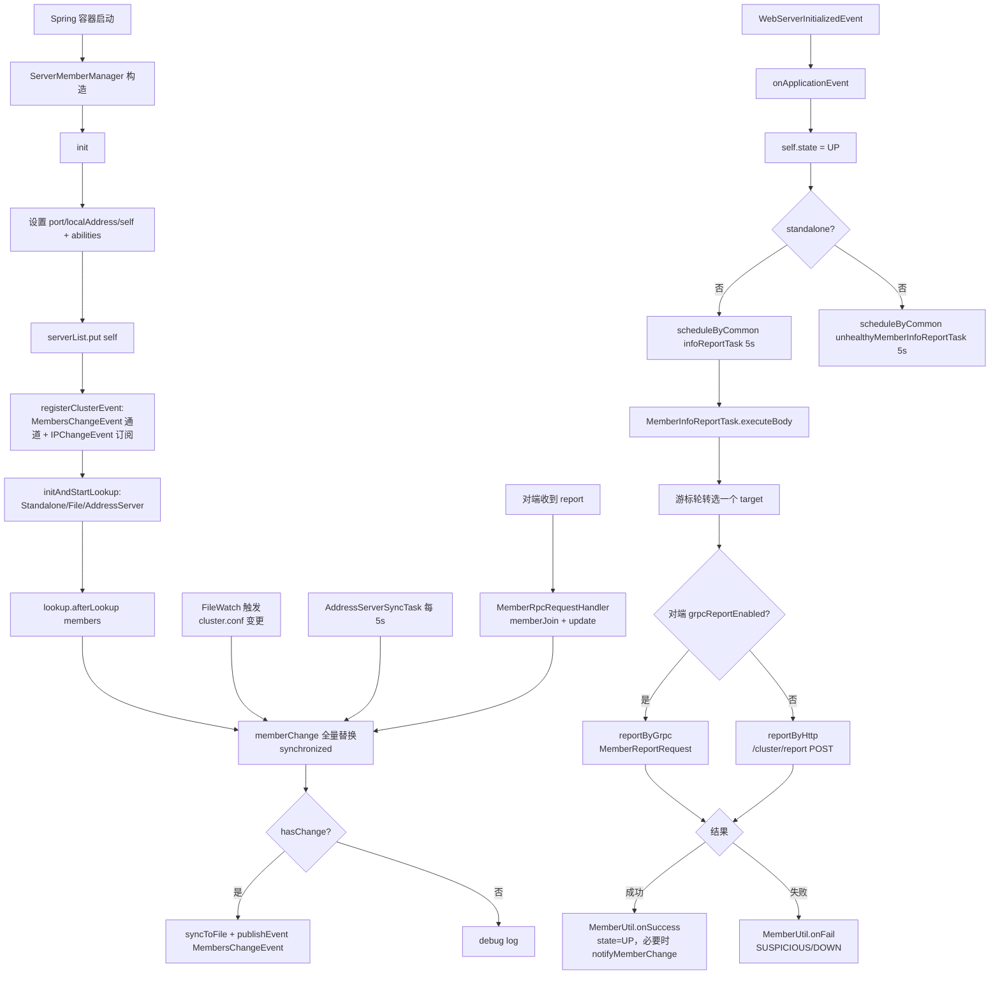
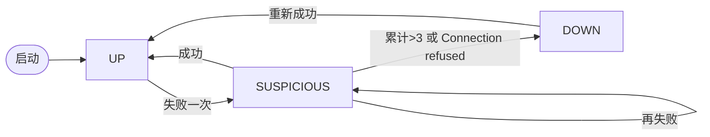

## ServerMemberManager 集群成员管理源码分析

### 一、类的定位

```java
@Component(value = "serverMemberManager")
public class ServerMemberManager implements ApplicationListener<WebServerInitializedEvent> {
```

**一句话定位**：Nacos 集群的"花名册管理员"——维护 `Member ↔ Cluster` 的完整生命周期，是所有跨节点通信（Raft、Config 同步、Naming 集群、ListenerController fan-out、健康检查、灰度能力协商）的**唯一权威数据源**。

**核心内部状态**：

| 字段 | 类型 | 语义 |
|------|------|------|
| `serverList` | `ConcurrentSkipListMap<String, Member>` | 集群全部成员（含自己），Key=ip:port，**有序**（决定 isFirstIp） |
| `memberAddressInfos` | `ConcurrentHashSet<String>` | 只包含 `UP` 状态成员的地址视图 |
| `self` | `volatile Member` | 本机节点对象，携带 abilities、extendInfo |
| `localAddress` | `String` | `InetUtils.getSelfIP() + ":" + port` |
| `lookup` | `MemberLookup` | 寻址策略实例（策略模式） |
| `isInIpList` | `static volatile boolean` | 本机是否还在集群列表中（运维摘流依据） |

---

### 二、`init()` 源码逐行解析

```java
protected void init() throws NacosException {
    Loggers.CORE.info("Nacos-related cluster resource initialization");
    // ① 端口 & 本机地址
    this.port = EnvUtil.getProperty(SERVER_PORT_PROPERTY, Integer.class, DEFAULT_SERVER_PORT);
    this.localAddress = InetUtils.getSelfIP() + ":" + port;
    
    // ② 构造 self 成员对象（初始 UP）
    this.self = MemberUtil.singleParse(this.localAddress);
    this.self.setExtendVal(MemberMetaDataConstants.VERSION, VersionUtils.version);
    // 灰度模型能力标记，用于兼容期滚动升级（呼应 checkCompatity）
    this.self.setExtendVal(MemberMetaDataConstants.SUPPORT_GRAY_MODEL, true);
    this.self.setGrpcReportEnabled(true);        // 默认走 gRPC 上报
    
    // ③ 汇聚所有 SPI 能力初始化器
    this.self.setAbilities(initMemberAbilities());
    
    // ④ 先把自己放进花名册（保底，防止后面 lookup 空返回）
    serverList.put(self.getAddress(), self);
    
    // ⑤ 注册事件通道
    registerClusterEvent();
    
    // ⑥ 初始化并启动寻址模式（策略模式）
    initAndStartLookup();
    
    if (serverList.isEmpty()) {
        throw new NacosException(NacosException.SERVER_ERROR, "cannot get serverlist, so exit.");
    }
}
```

**关键设计**：
- **`MemberUtil.singleParse`** 会预置 `RAFT_PORT = port - 1000`、`READY_TO_UPGRADE = true`、`state = UP`、`grpcReportEnabled = true`
- **`initMemberAbilities`** 通过 SPI 遍历 `ServerAbilityInitializerHolder`（如 `ServerControlAbilityInitializer`、`ServerRemoteAbilityInitializer`），把本节点支持的通信能力、控制能力写入 `ServerAbilities`——这**直接决定了后续跨节点协议选择**（HTTP 还是 gRPC、是否支持灰度模型）
- **`SUPPORT_GRAY_MODEL`** 是灰度兼容开关：其他节点通过 report 拿到本节点的 abilities，就能知道能不能用 `grayName` 新字段而不是老的 `isBeta/tag`

---

### 三、事件通道注册：`registerClusterEvent`

```java
private void registerClusterEvent() {
    // ① MembersChangeEvent 发布通道（队列大小 128）
    NotifyCenter.registerToPublisher(MembersChangeEvent.class, 
        EnvUtil.getProperty("nacos.member-change-event.queue.size", Integer.class, 128));
    
    // ② 订阅本机 IP 变化事件（自适应网卡切换 / DHCP 变更）
    NotifyCenter.registerSubscriber(new Subscriber<InetUtils.IPChangeEvent>() {
        @Override
        public void onEvent(InetUtils.IPChangeEvent event) {
            String newAddress = event.getNewIP() + ":" + port;
            ServerMemberManager.this.localAddress = newAddress;
            EnvUtil.setLocalAddress(localAddress);
            
            Member self = ServerMemberManager.this.self;
            self.setIp(event.getNewIP());
            
            String oldAddress = event.getOldIP() + ":" + port;
            serverList.remove(oldAddress);
            serverList.put(newAddress, self);
            memberAddressInfos.remove(oldAddress);
            memberAddressInfos.add(newAddress);
        }
        ...
    });
}
```

**设计动机**：容器/K8s 场景下 Pod IP 会漂移。这里做了**原子替换**——同一 self 对象在 serverList 中的 Key 由旧 IP 迁到新 IP，避免整个模块重启。

---

### 四、寻址模式：`initAndStartLookup` 的策略模式

```java
private void initAndStartLookup() throws NacosException {
    this.lookup = LookupFactory.createLookUp(this);
    isUseAddressServer = this.lookup.useAddressServer();
    this.lookup.start();
}
```

**LookupFactory 选择顺序**（`chooseLookup`）：

| 优先级 | 条件 | 类型 | 实现 |
|------|------|------|------|
| 0 | `standalone=true` | STANDALONE | `StandaloneMemberLookup` |
| 1 | 显式配置 `nacos.core.member.lookup.type` | 用户指定 | — |
| 2 | `cluster.conf` 文件存在 或 `nacos.member.list` 非空 | **FILE_CONFIG** | `FileConfigMemberLookup` |
| 3 | 兜底 | **ADDRESS_SERVER** | `AddressServerMemberLookup` |

**三种 Lookup 的触发方式**（都调用父类 `AbstractMemberLookup.afterLookup(members)` → `memberManager.memberChange(members)`）：

- **FileConfigMemberLookup**：`doStart()` 读盘一次 + 通过 `WatchFileCenter.registerWatcher` 用 inotify 监听 `cluster.conf` 变更，文件一改自动 reload
- **AddressServerMemberLookup**：`doStart()` 同步拉取（重试 5 次） + 起 `AddressServerSyncTask` 每 5 秒拉一次；连续失败 12 次标记 `isAddressServerHealth=false`
- **StandaloneMemberLookup**：只做 self，不做任何动态更新

---

### 五、集群变更核心：`memberChange` — 全量替换语义

```java
synchronized boolean memberChange(Collection<Member> members) {
    if (members == null || members.isEmpty()) {
        return false;   // 空列表不覆盖，防止误清空
    }
    
    // ① 检查 self 是否还在列表中（摘流检测）
    boolean isContainSelfIp = members.stream()
            .anyMatch(ipPortTmp -> Objects.equals(localAddress, ipPortTmp.getAddress()));
    if (isContainSelfIp) {
        isInIpList = true;
    } else {
        isInIpList = false;
        members.add(this.self);   // 保底把 self 塞回去
        Loggers.CLUSTER.warn("[serverlist] self ip {} not in serverlist {}", self, members);
    }
    
    // ② 变更判定 & 增量保留元数据
    boolean hasChange = members.size() != serverList.size();
    ConcurrentSkipListMap<String, Member> tmpMap = new ConcurrentSkipListMap<>();
    Set<String> tmpAddressInfo = new ConcurrentHashSet<>();
    for (Member member : members) {
        final String address = member.getAddress();
        Member existMember = serverList.get(address);
        if (existMember == null) {
            hasChange = true;                    // 新加入
            tmpMap.put(address, member);
        } else {
            // ★ 保留已上报的 extendInfo 与 abilities（避免被文件解析的默认值覆盖）
            tmpMap.put(address, existMember);
        }
        if (NodeState.UP.equals(member.getState())) {
            tmpAddressInfo.add(address);
        }
    }
    
    // ③ 原子替换（volatile 语义）
    serverList = tmpMap;
    memberAddressInfos = tmpAddressInfo;
    Collection<Member> finalMembers = allMembers();
    
    // ④ 变更才持久化 + 发事件（synchronized 保证事件顺序）
    if (hasChange) {
        MemberUtil.syncToFile(finalMembers);           // 写回 cluster.conf
        Event event = MembersChangeEvent.builder().members(finalMembers).build();
        NotifyCenter.publishEvent(event);
    }
    return hasChange;
}
```

**关键设计**：

1. **`synchronized` + 全量替换**：Lookup 提供的是**权威快照**（file 或 address server），不做 diff，直接整体换。用 `synchronized` 保证事件按变更顺序发布（源码注释特意标注 `<important>`）。
2. **保留 existMember**：Lookup 只能拿到 ip:port 基础信息，但 abilities/extendInfo 是**通过 MemberInfoReportTask 动态上报**得来的。这里用 existMember 替换，避免每次 file reload 把能力信息打回默认值。
3. **写回 cluster.conf**：Address Server 模式下，拉到最新列表后本地会持久化一份，作为下次启动的**降级备份**。

---

### 六、增量语义：`memberJoin` / `memberLeave` / `update`

```java
public synchronized boolean memberJoin(Collection<Member> members) {
    Set<Member> set = new HashSet<>(members);
    set.addAll(allMembers());           // 新加入 ∪ 现有
    return memberChange(set);
}

public synchronized boolean memberLeave(Collection<Member> members) {
    Set<Member> set = new HashSet<>(allMembers());
    set.removeAll(members);             // 现有 - 要摘除
    return memberChange(set);
}
```

- **`memberJoin`**：**自动触发**——节点启动后通过 MemberReport 被别人发现时调用（`MemberRpcRequestHandler` 或 `MemberController.report` 会调）
- **`memberLeave`**：**只能手动触发**——运维通过 API `/v1/core/cluster/remove` 摘除节点

**`update(Member newMember)`** — 单点元数据刷新（不改变成员数量）：

```java
public boolean update(Member newMember) {
    String address = newMember.getAddress();
    if (!serverList.containsKey(address)) {
        return false;                    // 不在列表则忽略
    }
    serverList.computeIfPresent(address, (s, member) -> {
        if (NodeState.DOWN.equals(newMember.getState())) {
            memberAddressInfos.remove(newMember.getAddress());
        }
        boolean isPublishChangeEvent = MemberUtil.isBasicInfoChanged(newMember, member);
        newMember.setExtendVal(MemberMetaDataConstants.LAST_REFRESH_TIME, System.currentTimeMillis());
        MemberUtil.copy(newMember, member);        // 逐字段复制到旧对象（引用不变）
        if (isPublishChangeEvent) {
            notifyMemberChange(member);             // 只在基本属性变了才发事件
        }
        return member;
    });
    return true;
}
```

**精妙之处**：
- **复制而非替换**：`MemberUtil.copy` 把字段拷贝到原对象，保持 `serverList` 里 Member 引用的**身份稳定**（其他模块持有引用的地方不会失效）
- **`isBasicInfoChanged`** 判定包含：ip / port / address / state / grpcReportEnabled / `BASIC_META_KEYS`（VERSION、RAFT_PORT 等）。**避免每次 report 都发事件**（每 2 秒一次全表刷新，如果每次事件都发会导致下游雪崩）

---

### 七、健康状态机：`MemberUtil.onSuccess` / `onFail`

```
              onSuccess                        onFail
    ┌───────────────────────┐         ┌──────────────────────────┐
    │                       ▼         ▼                          │
    │                 ┌──────────┐  ┌────────────┐         ┌────┴───┐
    │                 │    UP    │←─│ SUSPICIOUS │←────────│  NEW   │
    │                 └────┬─────┘  └─────┬──────┘         └────────┘
    │                      │              │
    │                      │              │ failAccessCnt > 3
    │                      │              │ 或 Connection refused
    │                      │              ▼
    │                      │         ┌───────┐
    │                      │         │ DOWN  │
    │                      │         └───┬───┘
    │                      │             │ 下一次成功
    │                      └─────────────┘
    │                      ▲
    └──状态变化时 notifyMemberChange → MembersChangeEvent
```

**源码要点**：

```java
public static void onSuccess(ServerMemberManager manager, Member member) {
    NodeState old = member.getState();
    manager.getMemberAddressInfos().add(member.getAddress());
    member.setState(NodeState.UP);
    member.setFailAccessCnt(0);          // 计数清零
    if (!Objects.equals(old, member.getState())) {
        manager.notifyMemberChange(member);   // 只有状态转换才发事件
    }
}

public static void onFail(ServerMemberManager manager, Member member, Throwable ex) {
    manager.getMemberAddressInfos().remove(member.getAddress());
    NodeState old = member.getState();
    member.setState(NodeState.SUSPICIOUS);
    member.setFailAccessCnt(member.getFailAccessCnt() + 1);
    int maxFailAccessCnt = EnvUtil.getProperty("nacos.core.member.fail-access-cnt", Integer.class, 3);
    if (member.getFailAccessCnt() > maxFailAccessCnt
            || StringUtils.containsIgnoreCase(ex.getMessage(), "Connection refused")) {
        member.setState(NodeState.DOWN);   // 拒绝连接直降 DOWN，跳过 SUSPICIOUS
    }
    if (!Objects.equals(old, member.getState())) {
        manager.notifyMemberChange(member);
    }
}
```

**双成功路径**：
- `onSuccess(manager, member)`：只更新状态
- `onSuccess(manager, member, receivedMember)`（2.1.2+）：额外用收到的元数据（abilities、extendInfo）覆盖，`isMetadataChanged` 判定变更后才发事件——**这是节点能力协商的动态更新入口**

---

### 八、心跳广播：`MemberInfoReportTask` + `UnhealthyMemberInfoReportTask`

两个任务在 `onApplicationEvent(WebServerInitializedEvent)` 中启动（集群模式）：

```java
@Override
public void onApplicationEvent(WebServerInitializedEvent event) {
    if ("management".equals(event.getApplicationContext().getServerNamespace())) {
        return;   // 忽略 actuator 端口的启动事件（fix#7230）
    }
    getSelf().setState(NodeState.UP);
    if (!EnvUtil.getStandaloneMode()) {
        GlobalExecutor.scheduleByCommon(this.infoReportTask, 5_000L);
        GlobalExecutor.scheduleByCommon(this.unhealthyMemberInfoReportTask, 5_000L);
    }
    EnvUtil.setPort(event.getWebServer().getPort());
    EnvUtil.setLocalAddress(this.localAddress);
}
```

**双任务分工**（继承关系：`UnhealthyMemberInfoReportTask extends MemberInfoReportTask`）：

| 任务 | 频率 | 目标 | 策略 |
|------|------|------|------|
| `MemberInfoReportTask` | **每 2 秒**（after 里重新调度） | **游标轮转**，每轮只报一个成员 | 平滑压力，`cursor = (cursor+1) % size`；每 50 秒打印一次 membercount 日志 |
| `UnhealthyMemberInfoReportTask` | **每 5 秒** | **所有非 UP 成员** | 加速恢复期收敛 |

**双通道上报**（`executeBody` 里根据对端能力协商选择）：

```java
if (target.getAbilities().getRemoteAbility().isGrpcReportEnabled() || target.isGrpcReportEnabled()) {
    reportByGrpc(target);   // 走 ClusterRpcClientProxy
} else {
    reportByHttp(target);   // 走 /cluster/report HTTP POST
}
```

**双向降级机制**（滚动升级兼容核心）：

```java
// HTTP 失败 → 下次尝试 gRPC
} else {
    MemberUtil.onFail(...);
    target.setGrpcReportEnabled(true);
    target.getAbilities().getRemoteAbility().setGrpcReportEnabled(true);
}

// gRPC 报 NO_HANDLER（说明对端是老版本，没这个 handler）→ 下次尝试 HTTP
} catch (NacosException e) {
    if (e.getErrCode() == NacosException.NO_HANDLER) {
        target.getAbilities().getRemoteAbility().setGrpcReportEnabled(false);
        target.setGrpcReportEnabled(false);
    }
}
```

**这正是 2.x 集群兼容 1.x 节点的关键：每个节点独立探测对方能力，自动选择协议**。

---

### 九、辅助 API

| 方法 | 语义 | 被谁使用（呼应前面讨论） |
|------|------|-----------------------|
| `isFirstIp()` | `serverList.firstKey() == localAddress` | **`ExternalDumpService.canExecute()`**——多节点定时任务去重 |
| `allMembersWithoutSelf()` | 排除 self 的其他成员 | **`AsyncNotifyService`**——配置集群同步 fan-out |
| `getMemberAddressInfos()` | 只返回 UP 成员地址集合 | `Naming` 模块的健康视图 |
| `hasMember(address)` | 精确 + 模糊（`contains`）双判定 | 传入只有 IP 时兼容 |
| `isUnHealth(address)` | 状态非 UP | 集群路由前的过滤 |
| `getServerListUnhealth()` | 返回 DOWN 列表 | 运维 API |
| `stateCheck(address, states)` | 状态白名单判定 | `upgrade` 场景 |
| `switchLookup(name)` | 运行时热切换寻址模式 | `NacosRemotingServerConfig` 或运维 API |

---

### 十、完整生命周期时序图



---

### 十一、总结

| 维度 | 设计要点 |
|------|---------|
| **本质定位** | 集群"花名册"，唯一权威数据源；不做选主、不做健康探测的执行者，只做**状态视图 + 事件分发** |
| **成员来源** | 3 种 Lookup：Standalone、File（inotify 热更新）、AddressServer（5s HTTP 拉取） |
| **变更入口** | 4 个：`memberChange`（全量）、`memberJoin`/`memberLeave`（增/摘）、`update`（元数据） |
| **并发策略** | 结构：`ConcurrentSkipListMap`（有序，支持 `isFirstIp`）；变更：`synchronized memberChange` 保证事件顺序；替换：`volatile serverList = tmpMap` 原子可见 |
| **事件模型** | `MembersChangeEvent`（下游 Raft/Config/Naming 都订阅）、`IPChangeEvent`（自适应 IP 漂移） |
| **心跳上报** | 双任务：稳态游标轮转（2s/1个）+ 收敛态全扫（5s 全 DOWN/SUSPICIOUS） |
| **协议兼容** | HTTP/gRPC 双通道 + **自动降级**：HTTP 失败试 gRPC，gRPC NO_HANDLER 回退 HTTP |
| **能力协商** | `ServerAbilities` SPI 初始化 + `SUPPORT_GRAY_MODEL` 等扩展位；决定下游 checkCompatity 的行为 |
| **状态机** | `UP ↔ SUSPICIOUS → DOWN`；连续失败阈值 `nacos.core.member.fail-access-cnt=3`；`Connection refused` 直降 DOWN |
| **精准事件** | `isBasicInfoChanged` 过滤，避免每次 report 都刷 `MembersChangeEvent` |
| **持久化** | `MemberUtil.syncToFile` 写回 `cluster.conf`（AddressServer 模式的降级备份） |
| ** shutdown** | `@PreDestroy`：清空 serverList/memberAddressInfos + `infoReportTask.shutdown()` + `LookupFactory.destroy()` |

**串联之前分析过的模块**：

1. `ExternalDumpService.canExecute()` → **`memberManager.isFirstIp()`**
2. `AsyncNotifyService` 集群配置同步 → **`allMembersWithoutSelf()`**
3. `ListenerController` fan-out → **`allMembers()`**
4. `checkCompatity` 灰度兼容 → **`self.setExtendVal(SUPPORT_GRAY_MODEL, true)`** 上报给对端
5. Raft 选主感知 Leader → **订阅## ServerMemberManager 集群成员管理源码深度解析

### 一、类定位

```java
@Component(value = "serverMemberManager")
public class ServerMemberManager implements ApplicationListener<WebServerInitializedEvent>
```

Nacos 集群拓扑的**唯一权威源**（Source of Truth）。所有需要感知"集群里有哪些节点、状态如何、能力如何"的模块（Raft 选举、配置 dump、AsyncNotifyService、Naming SwitchDomain、远程连接治理）都通过它取数，且通过它订阅变更。

类头 JavaDoc 明确列出 12 个契约方法，可归为四类：**初始化 / 查询 / 变更 / 生命周期**。

---

### 二、`init()` 方法六步曲

```java
protected void init() throws NacosException {
    // ① 解析本机端口与地址
    this.port = EnvUtil.getProperty(SERVER_PORT_PROPERTY, Integer.class, DEFAULT_SERVER_PORT);
    this.localAddress = InetUtils.getSelfIP() + ":" + port;
    
    // ② 构造 self Member（含 extendInfo: RAFT_PORT、READY_TO_UPGRADE、grpcReportEnabled=true）
    this.self = MemberUtil.singleParse(this.localAddress);
    this.self.setExtendVal(MemberMetaDataConstants.VERSION, VersionUtils.version);
    this.self.setExtendVal(MemberMetaDataConstants.SUPPORT_GRAY_MODEL, true);
    this.self.setGrpcReportEnabled(true);
    
    // ③ SPI 加载能力矩阵
    this.self.setAbilities(initMemberAbilities());
    
    // ④ 先把自己塞进 serverList（保证非空）
    serverList.put(self.getAddress(), self);
    
    // ⑤ 注册事件：MembersChangeEvent 发布器 + IPChangeEvent 订阅器
    registerClusterEvent();
    
    // ⑥ 选择并启动寻址模式，触发首轮 memberChange
    initAndStartLookup();
    
    if (serverList.isEmpty()) {
        throw new NacosException(NacosException.SERVER_ERROR, "cannot get serverlist, so exit.");
    }
}
```

#### 每一步的关键设计

**① 端口解析**：读 `server.port`，默认 8848。IPv6 地址由 `InetUtils` 内部处理。

**② self 元信息**（`MemberUtil.singleParse`）：
```java
Member target = Member.builder().ip(address).port(port).state(NodeState.UP).build();
extendInfo.put(MemberMetaDataConstants.RAFT_PORT, String.valueOf(port - 1000)); // 7848
extendInfo.put(MemberMetaDataConstants.READY_TO_UPGRADE, true);
target.setGrpcReportEnabled(true);
```
- **RAFT_PORT = 主端口 - 1000**：Nacos 内置约定，7848/7849 承载 JRaft 通信
- **SUPPORT_GRAY_MODEL**：灰度模型新特性标志，与上一轮 `ConfigChangeClusterSyncRequestHandler.checkCompatity` 相呼应

**③ 能力初始化 SPI**（`ServerAbilityInitializerHolder.getInstance().getInitializers()`）：
```java
for (ServerAbilityInitializer each : ...) {
    each.initialize(serverAbilities);   // RemoteAbility、ClusterAbility 等
}
```
采用 **SPI 插件化**，各模块可注册自己的 AbilityInitializer 填充 `ServerAbilities`，供对端节点判断本节点能力。

**⑤ `registerClusterEvent()`** 做两件事：
- `NotifyCenter.registerToPublisher(MembersChangeEvent.class, queueSize=128)`（可通过 `nacos.member-change-event.queue.size` 调节）
- 注册 **`InetUtils.IPChangeEvent` 订阅器**：本机 IP 变更时（如 DHCP 续租、双网卡切换）**热替换** `serverList` 与 `memberAddressInfos` 中旧地址：
```java
public void onEvent(InetUtils.IPChangeEvent event) {
    String newAddress = event.getNewIP() + ":" + port;
    ServerMemberManager.this.localAddress = newAddress;
    EnvUtil.setLocalAddress(localAddress);
    Member self = ServerMemberManager.this.self;
    self.setIp(event.getNewIP());
    String oldAddress = event.getOldIP() + ":" + port;
    serverList.remove(oldAddress);
    serverList.put(newAddress, self);
    memberAddressInfos.remove(oldAddress);
    memberAddressInfos.add(newAddress);
}
```

**⑥ `initAndStartLookup()`**：三种寻址模式选一。

---

### 三、三种寻址模式（`LookupFactory`）

```java
public static MemberLookup createLookUp(ServerMemberManager memberManager) {
    if (!EnvUtil.getStandaloneMode()) {
        String lookupType = EnvUtil.getProperty("nacos.core.member.lookup.type");
        LookupType type = chooseLookup(lookupType);   // 显式配置 → 文件存在 → 地址服务器
        LOOK_UP = find(type);
    } else {
        LOOK_UP = new StandaloneMemberLookup();
    }
    LOOK_UP.injectMemberManager(memberManager);
    return LOOK_UP;
}
```

| 模式 | 数据源 | 变更触发 | 特性 |
|------|-------|---------|------|
| **Standalone** | 只有 self | 无 | 单机模式 |
| **FileConfig** | `conf/cluster.conf` | `WatchFileCenter` inotify 监听文件变化 | 修改文件立即生效；每次变更后 **回写 cluster.conf** 形成闭环 |
| **AddressServer** | `http://jmenv.tbsite.net:8080/...serverlist` | 启动同步（最多重试 5 次）+ 5s 定时拉取 | 连续失败 12 次判定 `isAddressServerHealth=false`；适配云上弹性伸缩 |

**FileConfig 的闭环**：
- `doStart()` → `readClusterConfFromDisk()` → `afterLookup(members)` → `memberChange(members)` → 若有变更 `MemberUtil.syncToFile(finalMembers)` 回写 `cluster.conf` → 触发 `FileWatcher.onChange` → 再次 `readClusterConfFromDisk()`…
- 但由于回写内容与实际读入相同，第二次 `memberChange.hasChange=false`，链路自然终止。

**AddressServer 启动强一致**：如果首轮 5 次都拉不到 serverlist，直接 `throw NacosException`，节点拒绝启动。

---

### 四、核心数据结构：`ConcurrentSkipListMap` 的用意

```java
private volatile ConcurrentSkipListMap<String, Member> serverList;   // key=ip:port
private volatile Set<String> memberAddressInfos;                     // 只装 UP 状态
private volatile Member self;
```

**为什么用 `ConcurrentSkipListMap` 而不是 `HashMap`**？
- **有序**：`serverList.firstKey()` 返回字典序最小地址 → `isFirstIp()` O(log n) 判定；`ExternalDumpService.canExecute()` 就用它决定"由谁执行 6 小时全量 dump"，避免了额外的选主协议
- **并发读快照**：`volatile` + 整体引用替换（见 `memberChange`），读方永远拿到完整一致的 map，不需要加锁

---

### 五、变更管理四板斧

### 5.1 `memberChange(Collection)` — **全量替换语义**（最核心）

```java
synchronized boolean memberChange(Collection<Member> members) {
    if (members == null || members.isEmpty()) {
        return false;   // 空集合不改，防止误清空
    }
    
    // ① 自检：本机 IP 必须在集群列表中
    boolean isContainSelfIp = members.stream()
            .anyMatch(ipPortTmp -> Objects.equals(localAddress, ipPortTmp.getAddress()));
    if (isContainSelfIp) {
        isInIpList = true;
    } else {
        isInIpList = false;
        members.add(this.self);   // 强制把 self 加回，防止自己被"踢出"
        Loggers.CLUSTER.warn("[serverlist] self ip {} not in serverlist {}", self, members);
    }
    
    // ② 差异检测：size 不同 或 有新增 address 视为有变更
    boolean hasChange = members.size() != serverList.size();
    ConcurrentSkipListMap<String, Member> tmpMap = new ConcurrentSkipListMap<>();
    Set<String> tmpAddressInfo = new ConcurrentHashSet<>();
    for (Member member : members) {
        final String address = member.getAddress();
        Member existMember = serverList.get(address);
        if (existMember == null) {
            hasChange = true;
            tmpMap.put(address, member);
        } else {
            // 关键：保留 existMember，以维持 extendInfo 和 abilities 的动态上报值
            tmpMap.put(address, existMember);
        }
        if (NodeState.UP.equals(member.getState())) {
            tmpAddressInfo.add(address);
        }
    }
    
    // ③ volatile 引用整体替换：无锁读侧
    serverList = tmpMap;
    memberAddressInfos = tmpAddressInfo;
    Collection<Member> finalMembers = allMembers();
    
    // ④ 变更才落盘 + 发事件（synchronized 保证事件顺序）
    if (hasChange) {
        MemberUtil.syncToFile(finalMembers);
        Event event = MembersChangeEvent.builder().members(finalMembers).build();
        NotifyCenter.publishEvent(event);
    }
    return hasChange;
}
```

**四大设计要点**：

1. **自我防踢**：即使运维误操作把 self 从 cluster.conf 中删了，代码也强制把 self 塞回去，只置 `isInIpList=false` 报警告，不会导致本节点孤立
2. **保留动态元信息**：`existMember` 覆盖 `newMember` 里的静态字段之外，还**保留了 abilities 和 extendInfo**（这些是 report 通道动态上报的，不能被寻址结果覆盖）
3. **volatile 引用替换**：读侧完全无锁，代价是每次变更要新建一个 map（低频可接受）
4. **事件顺序保证**：JavaDoc 特别标注 `<important> need to put the event publication into a synchronized block` — 若不加锁，两次变更可能乱序发布

### 5.2 `memberJoin` / `memberLeave` — 增量语义

```java
public synchronized boolean memberJoin(Collection<Member> members) {
    Set<Member> set = new HashSet<>(members);
    set.addAll(allMembers());        // 并集
    return memberChange(set);
}

public synchronized boolean memberLeave(Collection<Member> members) {
    Set<Member> set = new HashSet<>(allMembers());
    set.removeAll(members);          // 差集
    return memberChange(set);
}
```

**都归结为 `memberChange` 全量替换**。区别只是集合运算方向。

`memberJoin` 可由外部**自动触发**（如 AddressServer 拉到新节点）；`memberLeave` **只能手动调用**（如运维通过 API 摘流量），不会被寻址过程自动触发。

### 5.3 `update(Member)` — 单节点信息更新

```java
public boolean update(Member newMember) {
    String address = newMember.getAddress();
    if (!serverList.containsKey(address)) {
        return false;   // 不在列表拒更新
    }
    serverList.computeIfPresent(address, (s, member) -> {
        if (NodeState.DOWN.equals(newMember.getState())) {
            memberAddressInfos.remove(newMember.getAddress());
        }
        boolean isPublishChangeEvent = MemberUtil.isBasicInfoChanged(newMember, member);
        newMember.setExtendVal(MemberMetaDataConstants.LAST_REFRESH_TIME, System.currentTimeMillis());
        MemberUtil.copy(newMember, member);   // 就地覆盖
        if (isPublishChangeEvent) {
            notifyMemberChange(member);
        }
        return member;
    });
    return true;
}
```

**与 `memberChange` 的关键差异**：
- `update` **只改单节点**，不动 serverList 结构 → 无需 synchronized（`computeIfPresent` 自带原子性）
- 只当**基本信息**（ip/port/state/extendInfo 里 `BASIC_META_KEYS` / abilities / grpcReportEnabled）变了才发事件
- **不写 cluster.conf**（因为节点集合未变）

---

### 六、健康判定与状态机（`MemberUtil.onSuccess/onFail`）

```java
// 成功：SUSPICIOUS/DOWN → UP
public static void onSuccess(final ServerMemberManager manager, final Member member) {
    final NodeState old = member.getState();
    manager.getMemberAddressInfos().add(member.getAddress());
    member.setState(NodeState.UP);
    member.setFailAccessCnt(0);
    if (!Objects.equals(old, member.getState())) {
        manager.notifyMemberChange(member);   // 只在真发生状态迁移时发事件
    }
}

// 失败：UP → SUSPICIOUS → DOWN（连续 3 次 或 Connection refused 直接 DOWN）
public static void onFail(final ServerMemberManager manager, final Member member, Throwable ex) {
    manager.getMemberAddressInfos().remove(member.getAddress());
    final NodeState old = member.getState();
    member.setState(NodeState.SUSPICIOUS);
    member.setFailAccessCnt(member.getFailAccessCnt() + 1);
    int maxFailAccessCnt = EnvUtil.getProperty("nacos.core.member.fail-access-cnt", Integer.class, 3);
    if (member.getFailAccessCnt() > maxFailAccessCnt
            || StringUtils.containsIgnoreCase(ex.getMessage(), "Connection refused")) {
        member.setState(NodeState.DOWN);
    }
    if (!Objects.equals(old, member.getState())) {
        manager.notifyMemberChange(member);
    }
}
```

**状态迁移图**：



- **SUSPICIOUS** 中间态避免网络抖动误判
- **Connection refused 直通 DOWN**：端口未监听是明确信号，无需累积
- **UP 状态才进入 `memberAddressInfos`**：`getMemberAddressInfos()` 提供给上层"可用节点视图"

---

### 七、双向 Report 广播机制（`MemberInfoReportTask`）

节点启动只把自己塞进列表还不够，**必须让其他节点也感知到自己**，靠 report 广播。

**触发时机**：`onApplicationEvent(WebServerInitializedEvent)`

```java
@Override
public void onApplicationEvent(WebServerInitializedEvent event) {
    // 过滤 actuator 独立 management context（fix #7230）
    if ("management".equals(event.getApplicationContext().getServerNamespace())) {
        return;
    }
    getSelf().setState(NodeState.UP);
    if (!EnvUtil.getStandaloneMode()) {
        GlobalExecutor.scheduleByCommon(this.infoReportTask, 5_000L);
        GlobalExecutor.scheduleByCommon(this.unhealthyMemberInfoReportTask, 5_000L);
    }
    EnvUtil.setPort(event.getWebServer().getPort());
    EnvUtil.setLocalAddress(this.localAddress);
}
```

**两个任务分工**：

| 任务 | 周期 | 目标 | 用途 |
|------|-----|------|------|
| **MemberInfoReportTask** | 2s（`after`） | **游标轮转**，每次只 report 一个成员（`cursor = (cursor+1) % size`） | 常规心跳，平摊集群负载 |
| **UnhealthyMemberInfoReportTask** | 5s | **遍历所有非 UP 节点**，逐个 report | 快速拉起可疑节点，避免等游标轮转 |

**双通道自适应**（协议兼容降级）：

```java
if (target.getAbilities().getRemoteAbility().isGrpcReportEnabled() || target.isGrpcReportEnabled()) {
    reportByGrpc(target);      // 2.x 优先
} else {
    reportByHttp(target);      // 1.x 兼容
}
```

- **HTTP 路径**：POST `/v1/core/cluster/report`，body = self，携带 `Nacos-Server: {version}` header + 认证头
- **gRPC 路径**：`MemberReportRequest(self)` → 通过 `ClusterRpcClientProxy.sendRequest(target, req)`

**协议探测与降级**：
- HTTP 失败 → 强制 `target.setGrpcReportEnabled(true)`：**下次改用 gRPC**（因为老 HTTP 端点在新版本可能已下线）
- gRPC 返回 `NO_HANDLER` → 强制 `target.setGrpcReportEnabled(false)`：**下次改回 HTTP**（对端是老版本没有 gRPC handler）

这是滚动升级期间新老节点混布的关键自适应逻辑。

**响应处理**：
- 成功且 body 是 `Member` JSON → `MemberUtil.onSuccess(manager, target, receivedMember)`（**顺便同步对端元信息**）
- 成功且 body 是 `true`/`false` → 视为老版本兼容，仅切状态 UP
- 失败 → `MemberUtil.onFail`

---

### 八、`MembersChangeEvent` 的下游订阅者

变更事件一旦发布，整个 Nacos 都会响应：

```java
NotifyCenter.publishEvent(MembersChangeEvent.builder()
    .trigger(member)
    .members(allMembers())
    .build());
```

主要订阅方（可 Grep 验证）：
- **Raft 协议层**：`RaftProtocol`、`NacosEventListener` — 重新计算 Leader、切换 Follower
- **Naming 模块**：`SwitchDomain`、`ClusterLeaderFinder`、`ClientBeatProcessorV2`
- **Config 模块**：`AsyncNotifyService`（更新 `otherMembers` 集合）、`RaftConsistency`
- **Core 远程层**：`ClusterClientConnectionManager` 维护到对端的 gRPC 长连接

---

### 九、查询 API 一览

| 方法 | 返回 | 用途 |
|------|------|------|
| `getSelf()` | `Member` | 本节点信息 |
| `getServerList()` | `Map<String, Member>` | **不可变视图**（`unmodifiableMap`） |
| `getMemberAddressInfos()` | `Set<String>` | 只含 UP 地址，供上层健康视图 |
| `allMembers()` | `Collection<Member>` | HashSet 拷贝，含 self |
| `allMembersWithoutSelf()` | `List<Member>` | 排除 self，供集群广播 |
| `hasMember(String)` | `boolean` | 支持精确 ip:port + 模糊 ip 匹配 |
| `find(String)` | `Member` | 精确查找 |
| `stateCheck(address, nodeStates)` | `boolean` | 判断状态是否命中集合 |
| `isUnHealth(String)` | `boolean` | 非 UP 即不健康 |
| `isFirstIp()` | `boolean` | `serverList.firstKey()==localAddress`，用于任务去重（如 `ExternalDumpService.canExecute()`） |
| `getServerListUnhealth()` | `List<String>` | DOWN 状态列表 |

---

### 十、生命周期

```java
@PreDestroy
public void shutdown() throws NacosException {
    serverList.clear();
    memberAddressInfos.clear();
    infoReportTask.shutdown();
    LookupFactory.destroy();
}
```

`Task.shutdown()` 只是置 `volatile boolean shutdown=true`，下一次 `run()` 不再重投递（`after()` 不再执行）。

---

### 十一、总结

| 维度 | 设计要点 |
|------|---------|
| **架构定位** | 集群拓扑的**唯一权威源**，Spring `@Component`，实现 `WebServerInitializedEvent` 监听 |
| **初始化** | 6 步：port → self → abilities → 注册事件 → 启动 lookup → 非空校验 |
| **数据结构** | `ConcurrentSkipListMap`（有序、volatile 替换） + `Set<UP addresses>` + self |
| **寻址模式** | Standalone / FileConfig(inotify) / AddressServer(5s 同步) 三选一 |
| **变更语义** | `memberChange` 全量替换、`memberJoin/Leave` 集合运算、`update` 单节点元信息 |
| **状态机** | UP ↔ SUSPICIOUS ↔ DOWN，`failAccessCnt>3` 或 `Connection refused` 直降 DOWN |
| **广播机制** | 双 Task（游标轮转 + 全量非 UP）+ 双通道（gRPC/HTTP）+ 协议自适应降级 |
| **事件驱动** | `MembersChangeEvent` 通知 Raft/Naming/Config/Remote 全部子系统 |
| **持久化** | `MemberUtil.syncToFile` 回写 `cluster.conf`，供重启快速恢复 |
| **并发保证** | 写侧 `synchronized`（保事件顺序）+ 读侧 `volatile` 引用替换（无锁快照）|
| **能力扩展** | `ServerAbilityInitializer` SPI 动态扩展；`extendInfo` 承载版本、灰度、raft 端口等元数据 |
| **IP 热替换** | `InetUtils.IPChangeEvent` Subscriber 保证机器 IP 变更后自更新 |
| **特殊语义** | `isFirstIp()` 提供天然去中心化选主（无需 ZK/Raft）用于任务去重 |
| **升级兼容** | 通过 `grpcReportEnabled` + `NO_HANDLER` 反馈实现新老协议自动切换 |

**一句话总结**：`ServerMemberManager` 是 Nacos 集群的"编舞师"——**用 `ConcurrentSkipListMap` 承载有序拓扑，用三种寻址模式适配不同部署形态，用双向 Report 广播 + 状态机维护节点健康视图，用 `MembersChangeEvent` 驱动整个 Nacos 各模块感知拓扑变化**，是分布式协调层最核心的一个组件。