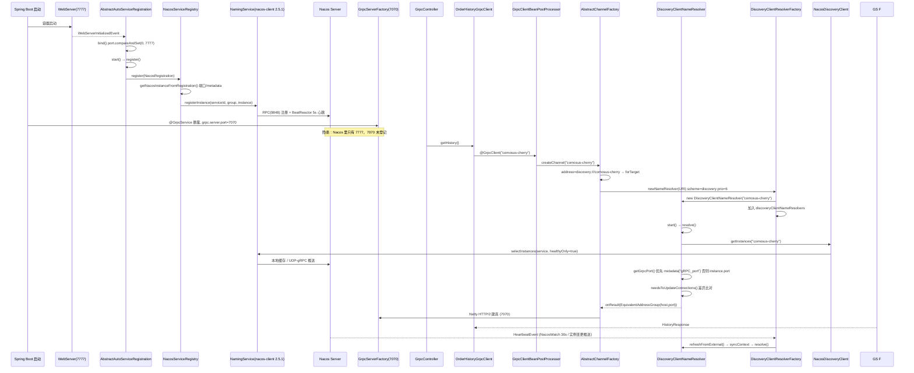

我先梳理相关代码，理解 gRPC + Nacos 服务注册与发现的完整链路。

已定位客户端与服务端入口。接着查看 Nacos 注册相关的自定义配置类和依赖版本。

查看依赖版本管理与启动配置，确认 Spring Cloud / Nacos / grpc-starter 的版本组合。

理解了整体依赖版本。现在确认 `discovery:///` 解析器实现与服务端注册端口的实际配置。

查看调用入口 Controller，并验证 grpc-client-spring-boot-starter 中 `discovery` 解析器的源码实现。

查看运行日志中的注册与解析痕迹，同时确认本地依赖是否包含 discovery 解析器。

定位本地 Maven 仓库中的 grpc starter 与 nacos discovery 依赖。

本地默认仓库未包含相关 jar，检查 IDE 记录的依赖库真实路径。

本地 Maven 仓库位于 `/System/Volumes/Data/tools/.m2`。我拉取相关库源码以给出准确的源码级流程。

已确认 `discovery` 解析器机制。继续拉取关键类的源码细节以支撑分析。

核心解析器源码已获取。继续拉取工厂注册链路与 Nacos 侧注册/发现源码。

已经拿到全部关键源码链路。下面给出完整的源码级过程、分析与总结。

---

# 一、先厘清角色与依赖版本

本仓库中 `comosus-berry` **同时是 gRPC Server 和 gRPC Client**，而 `comosus-cherry` 是它调用的目标 Provider。

| 组件 | 版本 | 承担的职责 |
|---|---|---|
| `spring-cloud-starter-alibaba-nacos-discovery` | 2.2.6.RELEASE | **注册**（`NacosAutoServiceRegistration`）+ **发现**（`NacosDiscoveryClient`） |
| `nacos-client` | 2.5.1 | 与 Nacos Server 通信（`NamingService`） |
| `net.devh:grpc-client-spring-boot-starter` | 2.15.0.RELEASE | `@GrpcClient` 注入、Channel 工厂、**`discovery:///` 名称解析器** |
| `net.devh:grpc-server-spring-boot-starter` | 2.15.0.RELEASE | 启动 7070 端口的 gRPC Server、`@GrpcService` 暴露 |
| `spring-cloud-commons` | 2.2.6.RELEASE | `AbstractAutoServiceRegistration`、`HeartbeatEvent` 事件体系 |

关键结论：**gRPC 框架本身（grpc-java、grpc-spring、grpc-server-starter）完全不认识 Nacos**。桥接点只有两处：

1. 注册侧 —— 靠 Spring Cloud 的 `ServiceRegistry` 抽象（Nacos 实现）
2. 发现侧 —— 靠 grpc-java 的 `NameResolverProvider` SPI（grpc-spring 实现，内部委托给 Spring Cloud `DiscoveryClient`）

---

# 二、服务注册过程（Provider 侧源码链路）

## 2.1 触发源头：Web 容器启动事件

注册的起点不是 gRPC Server 启动，而是 **Tomcat 启动完成**。`spring-cloud-commons` 的模板类：

```java
// org.springframework.cloud.client.serviceregistry.AbstractAutoServiceRegistration
public abstract class AbstractAutoServiceRegistration<R extends Registration>
        implements AutoServiceRegistration, ApplicationContextAware,
        ApplicationListener<WebServerInitializedEvent> {

    private final AtomicInteger port = new AtomicInteger(0);

    @Override
    @SuppressWarnings("deprecation")
    public void onApplicationEvent(WebServerInitializedEvent event) {
        bind(event);
    }

    @Deprecated
    public void bind(WebServerInitializedEvent event) {
        ApplicationContext context = event.getApplicationContext();
        // management 独立端口不参与业务注册
        if (!(context instanceof ConfigurableWebServerApplicationContext) ||
                !"management".equals(((ConfigurableWebServerApplicationContext) context)
                        .getServerNamespace())) {
            this.port.compareAndSet(0, event.getWebServer().getPort());
            this.start();
        }
    }

    public void start() {
        if (!this.isEnabled()) { return; }
        if (!this.running.get()) {
            this.context.publishEvent(new InstancePreRegisteredEvent(this, this.getRegistration()));
            this.register();                    // ← 真正注册
            this.context.publishEvent(new InstanceRegisteredEvent<>(this, this.getConfiguration()));
            this.running.compareAndSet(false, true);
        }
    }

    protected void register() {
        this.serviceRegistry.register(this.getRegistration());
    }
}
```

对应到本项目：`event.getWebServer().getPort()` = **7777**（`server.port`），不是 `grpc.server.port=7070`。这是后面所有端口问题的根源。

## 2.2 Nacos 的实现类：端口与开关判定

```java
// com.alibaba.cloud.nacos.registry.NacosAutoServiceRegistration
@Override
protected void register() {
    if (!this.properties.isRegisterEnabled()) {   // spring.cloud.nacos.discovery.register-enabled
        log.debug("Registration disabled.");
        return;
    }
    if (this.registration.getPort() < 0) {
        this.registration.setPort(super.getPort());
    }
    super.register();   // → NacosServiceRegistry.register(registration)
}
```

配置项 `spring.cloud.nacos.discovery.register-enabled=true` 就是在这里生效的。

## 2.3 落到 Nacos：`Registration` → `Instance` → `NamingService`

```java
// com.alibaba.cloud.nacos.registry.NacosServiceRegistry
@Override
public void register(Registration registration) {
    if (StringUtils.isEmpty(registration.getServiceId())) {
        log.warn("No service to register for nacos client...");
        return;
    }
    NamingService namingService = namingService();
    String serviceId = registration.getServiceId();      // spring.application.name -> comosus-berry
    String group = nacosDiscoveryProperties.getGroup();  // DEFAULT_GROUP
    Instance instance = getNacosInstanceFromRegistration(registration);
    try {
        namingService.registerInstance(serviceId, group, instance);
        log.info("nacos registry, {} {} {}:{} register finished",
                group, serviceId, instance.getIp(), instance.getPort());
    } catch (Exception e) { ... }
}

private Instance getNacosInstanceFromRegistration(Registration registration) {
    Instance instance = new Instance();
    instance.setIp(registration.getHost());
    instance.setPort(registration.getPort());            // ★ 7777
    instance.setWeight(nacosDiscoveryProperties.getWeight());
    instance.setClusterName(nacosDiscoveryProperties.getClusterName());
    instance.setEnabled(nacosDiscoveryProperties.isInstanceEnabled());
    instance.setMetadata(registration.getMetadata());     // ★ 元数据来源
    instance.setEphemeral(nacosDiscoveryProperties.isEphemeral());
    return instance;
}
```

注意 `instance.setMetadata(registration.getMetadata())`：元数据来自 `spring.cloud.nacos.discovery.metadata.*`。**这正是 gRPC 端口能被"带出去"的唯一通道**，本项目没有配置它。

## 2.4 Nacos Client 内部

`NacosNamingService.registerInstance()` 拆成三件事：

- `BeatReactor.addBeatReq()` —— 启动 5s 周期心跳（Nacos 1.x 的 HTTP 心跳模型）
- `ServiceInfoHolder` + `subscribe()` —— 订阅该服务，建立长连接
- `clientProxy.registerService()` —— nacos-client **2.5.1 走 `NamingGrpcClientProxy`（RPC 通道，默认 `server-addr` + 1000 = 9848）**，而非 HTTP 8848

所以 `server-addr=127.0.0.1:8848` 只需配 8848，gRPC 端口 9848 是自动推导的。

## 2.5 反注册（优雅下线）

`spring-cloud-alibaba` 体系下，`AbstractAutoServiceRegistration` 监听 `ContextClosedEvent` → `stop()` → `NacosServiceRegistry.deregister()`：

```java
namingService.deregisterInstance(serviceId, group,
        registration.getHost(), registration.getPort(),
        nacosDiscoveryProperties.getClusterName());
```

因此仓库里那两个手写类 **已经没有必要**：

- `NacosDiscoveryRegistrar`（`@Component` 被注释掉）—— 手动 `registerInstance("comosus-berry", port=7070)`
- `NacosDiscoveryDeregister`（整个文件被注释掉）—— 它依赖的是老的 `com.alibaba.boot:nacos-discovery-*`（0.2.3），不是当前的 spring-cloud-alibaba

这两个类的存在恰好印证了作者曾踩过的坑：**spring-cloud-alibaba 注册的是 Web 端口，而不是 gRPC 端口**。

---

# 三、服务发现过程（Consumer 侧源码链路）

## 3.1 代码入口

```java
@Service
public class OrderHistoryGrpcClient {
    @GrpcClient("comosus-cherry")
    private OrderHistoryGrpcServiceGrpc.OrderHistoryGrpcServiceBlockingStub orderHistoryGrpcService;
    ...
    return orderHistoryGrpcService.getHistory(request);
}
```

`"comosus-cherry"` 同时是**配置键**和**Nacos 服务名**，通过下面这行配置绑定：

```properties
grpc.client.comosus-cherry.address=discovery:///comosus-cherry
```

## 3.2 注入期：`@GrpcClient` → Stub → Channel

```
GrpcClientBeanPostProcessor.postProcessBeforeInitialization()
  → 扫描 @GrpcClient 字段
  → StubFactory（按 Stub 类型匹配：Blocking/Async/Future）
  → GrpcChannelFactory.createChannel("comosus-cherry")
```

`AbstractChannelFactory` 的源码（grpc-spring 2.15.0）：

```java
@Override
public Channel createChannel(final String name, final List<ClientInterceptor> customInterceptors,
        final boolean sortInterceptors) {
    final Channel channel;
    synchronized (this) {
        if (this.shutdown) { throw new IllegalStateException("GrpcChannelFactory is already closed!"); }
        channel = this.channels.computeIfAbsent(name, this::newManagedChannel);   // ★ Channel 缓存/复用
    }
    ...
    return ClientInterceptors.interceptForward(channel, interceptors);
}

protected ManagedChannel newManagedChannel(final String name) {
    final T builder = newChannelBuilder(name);   // 内部解析 grpc.client.<name>.address
    configure(builder, name);                    // keepAlive / plaintext / limits / compression
    final ManagedChannel channel = builder.build();
    final Duration timeout = this.properties.getChannel(name).getImmediateConnectTimeout();
    if (!timeout.isZero()) { connectOnStartup(name, channel, timeout); }
    watchConnectivityState(name, channel);
    return channel;
}
```

要点：`computeIfAbsent` 说明 **Channel 是按 client 名全局复用的单例**，这也是为什么 `OrderHistoryGrpcManualClient` 里 `channel.shutdown()` 被注释掉是对的——那个 channel 是共享的，关掉会把注入式客户端一起打死。

```java
@Service
public class OrderHistoryGrpcManualClient {
    @Autowired private GrpcChannelFactory grpcChannelFactory;
    ...
    channel = (ManagedChannel) grpcChannelFactory.createChannel("comosus-cherry");
```

它绕过了 `@GrpcClient` 注解，但仍复用同一个工厂，**解析逻辑完全一致**。

## 3.3 关键枢纽：`discovery` scheme 的 NameResolverProvider 注册

`grpc.client.*.address=discovery:///comosus-cherry` 被塞进 `NettyChannelBuilder.forTarget(...)`。grpc-java 会按 URI 的 scheme 去 `NameResolverRegistry` 里找 provider，按 **priority** 竞争：

| scheme | priority | 来源 |
|---|---|---|
| `static` | 4 | grpc-spring |
| `dns` | 5 | grpc-java 内置 |
| **`discovery`** | **6** | grpc-spring（条件启用） |

启用条件是存在 `DiscoveryClient` Bean：

```java
// net.devh.boot.grpc.client.autoconfigure.GrpcDiscoveryClientAutoConfiguration
@Configuration(proxyBeanMethods = false)
@ConditionalOnBean(DiscoveryClient.class)   // ← 由 spring-cloud-starter-alibaba-nacos-discovery 提供
public class GrpcDiscoveryClientAutoConfiguration {
    @ConditionalOnMissingBean
    @Lazy
    @Bean
    DiscoveryClientResolverFactory grpcDiscoveryClientResolverFactory(final DiscoveryClient client) {
        return new DiscoveryClientResolverFactory(client);
    }
}
```

如果哪天 Nacos 依赖被 exclude 掉，`DiscoveryClient` 不存在，这个 Bean 就不装配，`discovery:///` 会直接报 `Unable to resolve name` —— 这是这类配置最常见的隐性故障点。

## 3.4 URI 解析与服务名提取

```java
// net.devh.boot.grpc.client.nameresolver.DiscoveryClientResolverFactory
public class DiscoveryClientResolverFactory extends NameResolverProvider {

    public static final String DISCOVERY_SCHEME = "discovery";
    public static final Key<String> DISCOVERY_SERVICE_NAME_KEY = Key.create("serviceName");
    public static final Key<String> DISCOVERY_INSTANCE_ID_KEY = Key.create("instanceId");

    private final Set<DiscoveryClientNameResolver> discoveryClientNameResolvers = ConcurrentHashMap.newKeySet();
    private final HeartbeatMonitor monitor = new HeartbeatMonitor();
    private final DiscoveryClient client;

    @Nullable
    @Override
    public NameResolver newNameResolver(final URI targetUri, final NameResolver.Args args) {
        if (DISCOVERY_SCHEME.equals(targetUri.getScheme())) {
            final String serviceName = targetUri.getPath();
            if (serviceName == null || serviceName.length() <= 1 || !serviceName.startsWith("/")) {
                throw new IllegalArgumentException("Incorrectly formatted target uri; expected: '"
                        + DISCOVERY_SCHEME + ":///<service-name>'; but was '" + targetUri + "'");
            }
            final DiscoveryClientNameResolver nameResolver =
                    newNameResolver(serviceName.substring(1), args);
            this.discoveryClientNameResolvers.add(nameResolver);   // ★ 登记，供心跳刷新遍历
            return nameResolver;
        }
        return null;
    }

    @Override public String getDefaultScheme() { return DISCOVERY_SCHEME; }
    @Override protected boolean isAvailable() { return true; }
    @Override protected int priority() { return 6; }  // More important than DNS
}
```

`discovery:///comosus-cherry` → `getPath()` = `"/comosus-cherry"` → `substring(1)` = **`comosus-cherry`**。注意 Java 的 `URI` 里 authority 段（`//` 后）不参与解析，**三斜杠不能少**，少了就变成 `discovery://comosus-cherry`，`getPath()` 为空，直接抛 `IllegalArgumentException`。

## 3.5 解析与端口选取（最关键的一段源码）

```java
// net.devh.boot.grpc.client.nameresolver.DiscoveryClientNameResolver
@Override
public void start(final Listener2 listener) {
    checkState(!isActive(), "already started");
    if (this.usingExecutorResource) { this.executor = SharedResourceHolder.get(this.executorResource); }
    this.listener = checkNotNull(listener, "listener");
    resolve();                     // ★ 启动即解析一次
}

protected List<ServiceInstance> discoverServers() {
    return this.client.getInstances(this.name);   // → NacosDiscoveryClient
}

protected int getGrpcPort(final ServiceInstance instance) {
    final Map<String, String> metadata = instance.getMetadata();
    if (metadata == null || metadata.isEmpty()) {
        return instance.getPort();                // ★★ 兜底：用注册的服务端口
    }
    String portString = metadata.get(CLOUD_DISCOVERY_METADATA_PORT);   // "gRPC_port"
    if (portString == null) {
        portString = metadata.get(LEGACY_CLOUD_DISCOVERY_METADATA_PORT); // "gRPC.port"
        if (portString == null) {
            return instance.getPort();            // ★★ 兜底：用注册的服务端口
        }
        ...
    }
    return Integer.parseInt(portString);
}

private void resolve() {
    log.debug("Scheduled resolve for {}", this.name);
    if (this.resolving) { return; }
    this.resolving = true;
    this.executor.execute(new Resolve(this.listener));   // 异步，不阻塞 RPC 线程
}
```

内部 `Resolve` 类是完整的四段式流程：

```java
private List<ServiceInstance> resolveInternal() {
    // 1) 发现
    final List<ServiceInstance> newInstanceList = discoverServers();
    if (CollectionUtils.isEmpty(newInstanceList)) {
        log.error("No servers found for {}", getName());
        this.savedListener.onError(Status.UNAVAILABLE.withDescription("No servers found for " + getName()));
        return Lists.newArrayList();
    }
    // 2) 差异比对
    if (!needsToUpdateConnections(newInstanceList)) {
        log.debug("Nothing has changed... skipping update for {}", getName());
        return KEEP_PREVIOUS;
    }
    // 3) 推送给 grpc-java
    this.savedListener.onResult(ResolutionResult.newBuilder()
            .setAddresses(toTargets(newInstanceList)).build());
    log.info("Done updating server list for {}", getName());
    // 4) 记录快照
    return newInstanceList;
}

private EquivalentAddressGroup toTarget(final ServiceInstance instance) {
    final String host = instance.getHost();
    final int port = getGrpcPort(instance);
    final Attributes attributes = getAttributes(instance);
    log.debug("Found gRPC server {}:{} for {}", host, port, getName());
    return new EquivalentAddressGroup(new InetSocketAddress(host, port), attributes);
}
```

`needsToUpdateConnections()` 用 `host + getGrpcPort()` 做集合比对，**相同则跳过 `onResult`**，避免 Channel 无谓重建（重建会切断进行中的流）。

## 3.6 落到 Nacos Client

```java
// com.alibaba.cloud.nacos.discovery.NacosDiscoveryClient
@Override
public List<ServiceInstance> getInstances(String serviceId) {
    try { return serviceDiscovery.getInstances(serviceId); }
    catch (Exception e) {
        throw new RuntimeException("Can not get hosts from nacos server. serviceId: " + serviceId, e);
    }
}
```

```java
// com.alibaba.cloud.nacos.discovery.NacosServiceDiscovery
public List<ServiceInstance> getInstances(final String serviceId, Map<String, String> transparentParams)
        throws NacosException {
    Service service = getService(serviceId, transparentParams);   // name + clusters + subscribe
    String groupName = NacosUtils.getGroupName(nacosDiscoveryProperties, transparentParams);
    List<Instance> instances = namingService.selectInstances(service, true);   // ★ true = healthyOnly
    return instances.stream()
            .map(instance -> new NacosServiceInstance(instance, nacosDiscoveryProperties))
            .collect(Collectors.toList());
}
```

`selectInstances(..., true)` 只返回健康实例，并且 Nacos Client 侧有**本地缓存 + 推送更新**，所以这一步通常是本地内存读取，不走网络（首次除外）。

---

# 四、动态刷新链路（实例上下线如何被感知）

这是 gRPC 场景里最容易被忽略的一环。`NameResolver` 不像 Ribbon/Feign 那样每次调用都查列表，它只在收到通知时重解析：

```java
// DiscoveryClientResolverFactory
@EventListener(HeartbeatEvent.class)
public void heartbeat(final HeartbeatEvent event) {
    if (this.monitor.update(event.getValue())) {                     // 值没变则不刷新
        for (final DiscoveryClientNameResolver r : this.discoveryClientNameResolvers) {
            r.refreshFromExternal();
        }
    }
}

// DiscoveryClientNameResolver
public void refreshFromExternal() {
    this.syncContext.execute(() -> {      // ★ 切回 grpc SynchronizationContext，线程安全
        if (isActive()) { resolve(); }
    });
}
```

而 `HeartbeatEvent` 由 `NacosWatch` 产生：

```java
// com.alibaba.cloud.nacos.discovery.registry.NacosWatch implements SmartLifecycle
private long watchDelay = 30000;

@Override public void start() {
    if (this.running.compareAndSet(false, true)) {
        this.watchFuture = this.taskScheduler.scheduleWithFixedDelay(
                this::nacosServicesWatch, watchDelay);    // 默认 30s 轮询服务列表
    }
}

public void nacosServicesWatch() {
    ListView<String> listView = namingService.getServicesOfServer(1, Integer.MAX_VALUE);
    ... // 服务名增减判定 changed
    // 对每个服务名 namingService.subscribe(serviceName, eventListener)
    //   eventListener → publishEvent(new HeartbeatEvent(this, nacosWatchIndex.getAndIncrement()))
    if (changed) { publishEvent(new HeartbeatEvent(this, nacosWatchIndex.getAndIncrement())); }
}
```

两条路径共同驱动刷新：**Nacos 实例变更推送 → `HeartbeatEvent`**，以及 **30s 定时轮询兜底**。可用 `spring.cloud.nacos.discovery.watch.enabled=false` 关闭，但一旦关闭，`discovery:///` 几乎等于静态地址列表。

---

# 五、配置逐行解读

```properties
spring.application.name=comosus-berry     # ← Nacos 服务名（getServiceId）
server.port=7777                          # ← 实际注册到 Nacos 的端口
grpc.server.port=7070                     # ← 真实 gRPC 监听端口，但【没有】进入 Nacos

spring.cloud.nacos.discovery.register-enabled=true   # NacosAutoServiceRegistration.register() 开关
spring.cloud.nacos.discovery.server-addr=127.0.0.1:8848
spring.cloud.nacos.discovery.username=nacos
spring.cloud.nacos.discovery.password=123456
#spring.cloud.nacos.discovery.namespace=public        # 注释=用 public，与 cherry 必须一致

grpc.client.comosus-cherry.address=discovery:///comosus-cherry   # key=client 名，value=URI
grpc.client.comosus-cherry.enableKeepAlive=true                  # → keepAliveTime/Timeout
grpc.client.comosus-cherry.keepAliveWithoutCalls=true            # 空闲也发 ping
grpc.client.comosus-cherry.negotiationType=plaintext             # → usePlaintext()
```

---

# 六、问题分析（按严重程度）

## 🔴 P0：gRPC 端口从未进入 Nacos，`discovery:///` 必然解析到错误端口

源码依据串起来看：

1. `AbstractAutoServiceRegistration.bind()` → `port = 7777`（Web 容器）
2. `NacosServiceRegistry.getNacosInstanceFromRegistration()` → `instance.setPort(7777)`，`metadata` 取自 `spring.cloud.nacos.discovery.metadata.*`，本项目**为空**
3. `DiscoveryClientNameResolver.getGrpcPort()` → metadata 为空 → `return instance.getPort()` → **7777**
4. `toTarget()` → `new EquivalentAddressGroup(new InetSocketAddress(host, 7777))`
5. Netty 连到 7777 的 Tomcat，用 HTTP/2 preface 去握手 → Tomcat 返回 HTTP/1.1 400 或直接断开 → 表现为 `UNAVAILABLE` / `Connection refused` / `Received unexpected HTTP-status`

官方文档在这一段特意加了警告，正对应这个坑：

> Note: The number of slashes is important! **Also make sure that you don't try to connect to a normal web/REST/non-grpc server (port).**

同仓库里 `NacosDiscoveryRegistrar` 手写 `instance.setPort(7070)`、`NacosDiscoveryDeregister` 手写 `register.setPort(7070)`，说明这个坑已经踩过一次，最后的处理方式是**注释掉**而不是修正注册链路，问题依然潜伏着。

## 🟠 P1：berry 对外提供的 gRPC 服务同样不可被路由

`UnifyOrderHistoryGrpcServiceImpl` 带 `@GrpcService` 在 7070 端口暴露，但注册到 Nacos 的是 `comosus-berry → 7777`。任何调用方用 `discovery:///comosus-berry` 都会失败。

## 🟡 P2：`enableKeepAlive` 缺少周期参数

`configureKeepAlive()` 会把 `keepAliveTime` / `keepAliveTimeout` 一起设置，二者都有默认值。真正需要注意的是 Nacos 2.x 服务端 `allow_only_server_ping` 与 GRPC 帧的 5 分钟限制——长空闲链路（`keepAliveWithoutCalls=true` 会在无 RPC 时也发 ping）在跨 NAT / LB 环境下需要显式设定 `keep-alive-time` 与 `keep-alive-timeout`，而不是依赖默认值。

## 🟡 P3：默认负载均衡是 `pick_first`

`toTargets()` 返回的是**多个独立 `EquivalentAddressGroup`**。grpc-java 默认 LB 为 `pick_first`：只会选中第一个 EAG 建连，**不会在多实例间轮转**。Provider 多实例扩容时流量集中到单节点，只有该节点连接失败才 failover。`Attributes` 里放的 `serviceName` / `instanceId` 就是留给自定义 LB 用的。

## 🟡 P4：刷新实时性受 30s 轮询兜底限制

实例宕机到 client 感知之间，依赖 Nacos 推送 + `HeartbeatEvent`。若 `NacosWatch` 被禁用或 Nacos 推送链路异常，故障节点会在缓存里存活到下一次 RPC 失败才被发现。滚动发布时表现为一段时间的连接错误批量抖动。

## 🟢 P5：`OrderHistoryGrpcManualClient` 的写法问题

```java
channel = (ManagedChannel) grpcChannelFactory.createChannel("comosus-cherry");
...
finally { if (channel != null) { /* channel.shutdown(); */ } }
```

`createChannel` 返回的是工厂**缓存共享**的 Channel，注释掉 `shutdown()` 是正确的，但类里 `try/catch(Exception) → return null` 会把 gRPC 的 `StatusRuntimeException`（含 `UNAVAILABLE` 这类关键诊断信息）吞成 `null`，`GrpcController` 里直接 `.toString()` 就变 NPE。建议至少改为 `Status.fromThrowable(e).getCode()` 打日志。

---

# 七、修复方案

## 7.1 核心修复：把 gRPC 端口写入 Nacos 元数据

`getGrpcPort()` 读取的 key 常量为 `GrpcUtils.CLOUD_DISCOVERY_METADATA_PORT = "gRPC_port"`。这是侵入最小的改法——保留 Web 端口注册（不影响其他 Spring Cloud 组件），只额外挂一个 gRPC 端口元数据：

```properties|CODE_EDIT_BLOCK|/System/Volumes/Data/resource/github/comosus-berry/comosus-berry-web/src/main/resources/application-nacos.properties
# ... existing code ...
spring.cloud.nacos.discovery.username=nacos
spring.cloud.nacos.discovery.password=123456
#spring.cloud.nacos.discovery.namespace=public

grpc.server.port=7070

# 让 Nacos 携带 gRPC 真实端口：DiscoveryClientNameResolver#getGrpcPort 优先读取 gRPC_port
spring.cloud.nacos.discovery.metadata.gRPC_port=${grpc.server.port}
# 显式保证服务名与 cherry 端一致（同 namespace、同 group）
spring.cloud.nacos.discovery.group=DEFAULT_GROUP
spring.cloud.nacos.discovery.watch.enabled=true

# gRPC
##grpc.client.comosus-cherry.address=127.0.0.1:9090
grpc.client.comosus-cherry.address=discovery:///comosus-cherry
grpc.client.comosus-cherry.enableKeepAlive=true
grpc.client.comosus-cherry.keepAliveWithoutCalls=true
grpc.client.comosus-cherry.negotiationType=plaintext
# 多实例真正轮转，而不是 pick_first 只打第一个节点
grpc.client.comosus-cherry.default-load-balancing-policy=round_robin
# ... existing code ...
```

**同样的两行必须加到 `comosus-cherry`**，否则 berry 侧永远解析不到 cherry 的 gRPC 端口。这是这个坑最容易漏的地方——改消费端配置没用，要改**生产端**。

如果希望 Spring Cloud 注册的实例端口本身就是 7070（该服务只提供 gRPC、不对外提供 HTTP），改用：

```properties
spring.cloud.nacos.discovery.port=${grpc.server.port}
```

并删除已废弃的手动注册类 `NacosDiscoveryRegistrar`（`@Component` 已注释），否则一旦有人误放开就会与 `NacosAutoServiceRegistration` **重复注册两个实例**。

## 7.2 可选：完全自控的 gRPC 注册器（更贴近语义）

若不想依赖 `server.port` 的隐式行为，可以显式注册一条独立的 gRPC 实例，并利用 `@GrpcServerLifecycleEvent` 确保**端口真正 bind 之后再注册**（避免启动瞬间被路由过来的流量 503）：

```java
package com.story.home.berry.config;

import com.alibaba.nacos.api.naming.NamingService;
import com.alibaba.nacos.api.naming.pojo.Instance;
import net.devh.boot.grpc.server.event.GrpcServerStartedEvent;
import net.devh.boot.grpc.server.event.GrpcServerShutdownEvent;
import org.slf4j.Logger;
import org.slf4j.LoggerFactory;
import org.springframework.beans.factory.annotation.Value;
import org.springframework.cloud.commons.util.InetUtils;
import org.springframework.context.event.EventListener;
import org.springframework.stereotype.Component;

import java.util.HashMap;
import java.util.Map;

/**
 * 把 gRPC 监听端口以独立实例注册到 Nacos，
 * 保证 DiscoveryClientNameResolver#getGrpcPort 一定拿到正确的端口。
 */
@Component
public class GrpcNacosRegistration {

    private static final Logger log = LoggerFactory.getLogger(GrpcNacosRegistration.class);

    private static final String CLOUD_DISCOVERY_METADATA_PORT = "gRPC_port";

    private final NamingService namingService;
    private final InetUtils inetUtils;
    private final String serviceId;
    private final String group;
    private final String clusterName;
    private final int grpcPort;

    public GrpcNacosRegistration(NamingService namingService,
                                InetUtils inetUtils,
                                @Value("${spring.application.name}") String serviceId,
                                @Value("${spring.cloud.nacos.discovery.group:DEFAULT_GROUP}") String group,
                                @Value("${spring.cloud.nacos.discovery.cluster-name:DEFAULT}") String clusterName,
                                @Value("${grpc.server.port}") int grpcPort) {
        this.namingService = namingService;
        this.inetUtils = inetUtils;
        this.serviceId = serviceId;
        this.group = group;
        this.clusterName = clusterName;
        this.grpcPort = grpcPort;
    }

    @EventListener
    public void onStarted(GrpcServerStartedEvent event) throws Exception {
        Instance instance = new Instance();
        instance.setIp(inetUtils.findFirstNonLoopbackHostInfo().getIpAddress());
        instance.setPort(grpcPort);
        instance.setClusterName(clusterName);
        instance.setEphemeral(true);
        instance.setHealthy(true);
        instance.setWeight(1.0);

        Map<String, String> metadata = new HashMap<>();
        metadata.put(CLOUD_DISCOVERY_METADATA_PORT, String.valueOf(grpcPort));
        instance.setMetadata(metadata);

        namingService.registerInstance(serviceId, group, instance);
        log.info("grpc nacos registry, {} {} {}:{}", group, serviceId, instance.getIp(), grpcPort);
    }

    @EventListener
    public void onShutdown(GrpcServerShutdownEvent event) throws Exception {
        Instance instance = new Instance();
        instance.setIp(inetUtils.findFirstNonLoopbackHostInfo().getIpAddress());
        instance.setPort(grpcPort);
        instance.setClusterName(clusterName);
        namingService.deregisterInstance(serviceId, group, instance.getIp(), grpcPort, clusterName);
        log.info("grpc nacos deregister finished: {} {}:{}", group, serviceId, grpcPort);
    }
}
```

注意这个方案会与 7.1 中的 `spring.cloud.nacos.discovery.port` 冲突（同服务名下出现两个相同 ip:port 实例），二选一即可。**推荐用 7.1 的 metadata 方案**，改动最小、语义清晰，且与 grpc-spring 的设计意图一致。

---

# 八、完整链路时序图



---

# 九、总结

## 一句话概括

**gRPC + Nacos 没有"直接关系"，它由两个独立的适配器各自桥接 Spring Cloud 抽象：**

- 注册侧：`WebServerInitializedEvent` → `AbstractAutoServiceRegistration.bind/start/register` → `NacosServiceRegistry.register` → `NamingService.registerInstance`
- 发现侧：`@GrpcClient` → `GrpcChannelFactory` → grpc-java `NameResolverRegistry` 按 scheme 命中 `DiscoveryClientResolverFactory`(prio 6) → `DiscoveryClientNameResolver.resolve()` → `NacosDiscoveryClient.getInstances()` → `selectInstances(healthyOnly=true)` → `EquivalentAddressGroup` → Netty 建连
- 刷新侧：`NacosWatch`（30s 轮询 + Nacos 推送）→ `HeartbeatEvent` → `HeartbeatMonitor` 值比对 → `refreshFromExternal()` → 重新 `resolve()`

## 三条必须记住的设计要点

1. **`discovery:///` 是 grpc-spring 提供的 SPI 扩展，不是 grpc-java 或 Nacos 的能力**。它的成立依赖 `@ConditionalOnBean(DiscoveryClient.class)`，且只在配置了 `DiscoveryClientResolverFactory` 时生效；三斜杠格式不能错。
2. **端口选取优先级**：`metadata["gRPC_port"]` > `metadata["gRPC.port"]`（legacy）> `ServiceInstance.getPort()`。Provider 端**必须**把 gRPC 端口写进 `spring.cloud.nacos.discovery.metadata`，否则一定拿到 Web 端口。这是本项目当前最主要的缺陷，且修复点在**被调用方 cherry**，不在 berry。
3. **一个 NameResolver 对应一个 client 名，Channel 按名缓存复用**，解析结果差异比对后才推送给 grpc-java；默认 LB 是 `pick_first`，多实例负载均衡需显式改 `round_robin`。

## 本项目待清理的技术债

| 项 | 状态 | 建议 |
|---|---|---|
| `NacosDiscoveryRegistrar` | `@Component` 已注释，且 `@Value("${nacos.discovery.server-addr}")` 属性在当前配置里根本不存在 | 直接删除，否则放开即启动失败 |
| `NacosDiscoveryDeregister` | 整文件注释，依赖已不存在的 `com.alibaba.boot:nacos-discovery` | 删除 |
| `application-nacos.properties` L24-30 | `nacos.discovery.*` 老配置注释残留 | 清理，避免误解 |
| `spring.cloud.nacos.discovery.metadata` | 未配置 gRPC 端口 | **必改** |
| `namespace` 被注释 | berry/cherry 需保证同为 `public` | 显式声明，防止环境漂移 |
| `nacos-client 2.5.1` × `spring-cloud-alibaba 2.2.6`（原生适配 1.4.x） | 版本跨度大，靠 `nacos-auth-plugin`/`nacos-logback-adapter` 补齐 | 建议锁定到官方兼容矩阵（SCA 2021.0.x + nacos-client 2.x），或降级到 1.4.x 验证 |