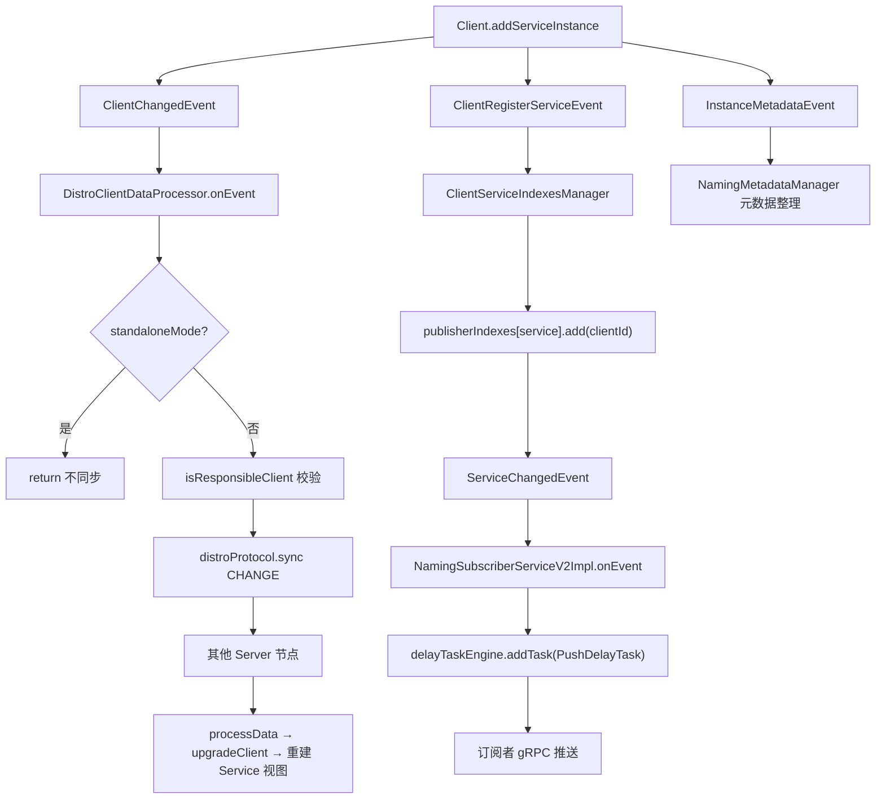
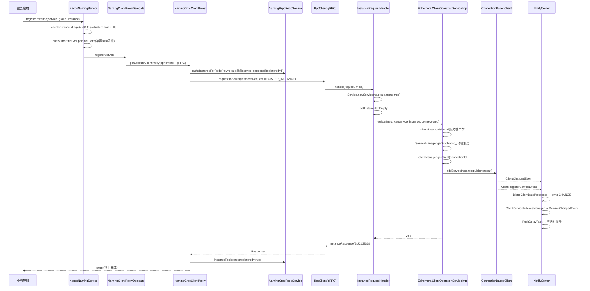

我先读取客户端命名服务的入口类，再追踪它调用的代理层。

入口层已明确，接下来读取代理层与 RPC 层的实现。

代理层的分流逻辑已找到，继续深入 gRPC 代理与参数校验、重做机制。

客户端 RPC 层已清楚，现在看断线重注册（redo）机制与服务端接收端。

客户端侧已完整，接着看服务端如何接收并落地这条注册请求。

服务端 handler 定位到了，读取处理链路与 redo 状态机。

服务端落地点已定位，继续读取实例操作服务与 HTTP 兜底通道。

补充客户端对象模型与服务端连接建立时机这两处关键点。

最后确认实例转换与自动建服务的细节。

## `NacosNamingService#registerInstance(serviceName, groupName, instance)` 服务注册流程源码解析

### 〇、一句话链路

```
NacosNamingService(3参校验) → NamingClientProxyDelegate(通道选择) → NamingGrpcClientProxy(redo缓存+请求构造)
→ RpcClient.request(同步gRPC) → [服务端] InstanceRequestHandler → EphemeralClientOperationServiceImpl
→ Client.addServiceInstance(内存 publishers) → 事件扇出(Distro复制 / 索引更新 / 订阅推送)
```

---

### 一、第 1 层：入口——三行代码做了三件事

`NacosNamingService.java` 第 157-162 行：

```java
@Override
public void registerInstance(String serviceName, String groupName, Instance instance) throws NacosException {
    NamingUtils.checkInstanceIsLegal(instance);      // ① 客户端参数校验
    checkAndStripGroupNamePrefix(instance, groupName); // ② group 前缀兼容处理
    clientProxy.registerService(serviceName, groupName, instance); // ③ 委托给代理
}
```

其余 5 个重载（`registerInstance(serviceName, ip, port)` 等）最终都收敛到这里，构造默认 `Instance`（weight=1.0、clusterName 默认 `DEFAULT`）。

#### ① `checkInstanceIsLegal`——两条硬规则

```java
public static void checkInstanceIsLegal(Instance instance) throws NacosException {
    if (null == instance) { throw ... INSTANCE_ERROR; }
    // 规则1：心跳超时/摘除时间必须 >= 心跳间隔
    if (instance.getInstanceHeartBeatTimeOut() < instance.getInstanceHeartBeatInterval()
            || instance.getIpDeleteTimeout() < instance.getInstanceHeartBeatInterval()) {
        throw new NacosApiException(INVALID_PARAM, INSTANCE_ERROR,
            "Instance 'heart beat interval' must less than 'heart beat timeout' and 'ip delete timeout'.");
    }
    // 规则2：clusterName 只允许 0-9a-zA-Z-.
    if (!StringUtils.isEmpty(instance.getClusterName())
            && !CLUSTER_NAME_PATTERN.matcher(instance.getClusterName()).matches()) {
        throw ...;
    }
}
```

**关键点**：这三个时间值**不是 `Instance` 字段，而是从 `metadata` 的 preserved key 里取**（`Instance` 第 216-229 行）：

| 语义 | metadata key | 默认值 |
|------|-------------|-------|
| 心跳间隔 | `preserved.heart.beat.interval` | 5s |
| 心跳超时 | `preserved.heart.beat.timeout` | 15s |
| IP 摘除 | `preserved.ip.delete.timeout` | 30s |

所以业务方如果在 metadata 里手写了 `heart.beat.timeout=3000`（< interval 5000），**在客户端本地就会被拒**，请求根本发不出去。

#### ② `checkAndStripGroupNamePrefix`——历史兼容包袱的收口

```java
private void checkAndStripGroupNamePrefix(Instance instance, String groupName) throws NacosException {
    String serviceName = instance.getServiceName();
    if (NamingUtils.isServiceNameCompatibilityMode(serviceName)) {   // 含 "@@"
        String groupNameOfInstance = NamingUtils.getGroupName(serviceName);
        if (!groupName.equals(groupNameOfInstance)) {
            throw new NacosException(CLIENT_INVALID_PARAM,
                "wrong group name prefix of instance service name! ...");
        }
        instance.setServiceName(NamingUtils.getServiceName(serviceName)); // 剥离前缀
    }
}
```

老用户习惯 `instance.setServiceName("myGroup@@myService")`，而新版本 `Service` 模型 group/name 分离。这里做**一致性校验 + 归一化剥离**，防止出现 `myGroup@@myGroup@@myService` 的双重前缀。

---

### 二、第 2 层：`NamingClientProxyDelegate`——通道路由（本流程第一个岔口）

```java
@Override
public void registerService(String serviceName, String groupName, Instance instance) throws NacosException {
    getExecuteClientProxy(instance).registerService(serviceName, groupName, instance);
}

private NamingClientProxy getExecuteClientProxy(Instance instance) {
    if (instance.isEphemeral()
            || grpcClientProxy.isAbilitySupportedByServer(AbilityKey.SERVER_SUPPORT_PERSISTENT_INSTANCE_BY_GRPC)) {
        return grpcClientProxy;
    }
    return httpClientProxy;
}
```

**路由真值表**：

| instance.ephemeral | 服务端能力位 | 走哪条通道 | 请求类型 |
|---|---|---|---|
| `true`（默认） | 任意 | **gRPC** | `InstanceRequest` |
| `false` | 支持持久实例 gRPC | **gRPC** | `PersistentInstanceRequest` |
| `false` | 不支持（老服务端） | **HTTP** | `POST /nacos/v1/ns/instance` |

**两个值得注意的设计**：

1. **能力协商而非版本判断**：`isAbilitySupportedByServer` 查的是 gRPC 建连时握手返回的 `ServerAbilities`（与之前分析的 `ServerMemberManager.SUPPORT_GRAY_MODEL` 属同一套能力矩阵机制），滚动升级时天然兼容。
2. **HTTP 通道是纯兜底**：`NamingHttpClientProxy.registerService` 里明确拒绝临时实例——

```java
if (instance.isEphemeral()) {
    throw new UnsupportedOperationException(
            "Do not support register ephemeral instances by HTTP, please use gRPC replaced.");
}
```

即两条通道的职责是互斥闭合的：**临时实例只能 gRPC，持久实例两条都行**。

---

### 三、第 3 层：`NamingGrpcClientProxy`——redo 前置缓存 + 请求发送

```java
@Override
public void registerService(String serviceName, String groupName, Instance instance) throws NacosException {
    NAMING_LOGGER.info("[REGISTER-SERVICE] {} registering service {} with instance {}", ...);
    if (instance.isEphemeral()) {
        registerServiceForEphemeral(serviceName, groupName, instance);  // ← 关键：先缓存再发送
    } else {
        doRegisterServiceForPersistent(serviceName, groupName, instance);
    }
}

private void registerServiceForEphemeral(String serviceName, String groupName, Instance instance) throws NacosException {
    redoService.cacheInstanceForRedo(serviceName, groupName, instance);  // ①
    doRegisterService(serviceName, groupName, instance);                 // ②
}

public void doRegisterService(String serviceName, String groupName, Instance instance) throws NacosException {
    InstanceRequest request = new InstanceRequest(namespaceId, serviceName, groupName,
            NamingRemoteConstants.REGISTER_INSTANCE, instance);
    requestToServer(request, Response.class);        // ③ 同步阻塞
    redoService.instanceRegistered(serviceName, groupName);  // ④ 成功才标记
}
```

**执行顺序 ①→②→④ 是这套机制的精髓**（下面第四节详解 redo 状态机）：

- ① 先把"我期望注册这个实例"写进内存 redo 表（`expectedRegistered=true, registered=false`）
- ② 发网络请求
- ④ **只有请求成功**才把 `registered` 置 true

任何一步抛异常，`registered` 都停留在 `false` → redo 状态机判定 `RedoType.REGISTER` → 定时任务自动补偿。**注册操作因此具备了"至少一次投递 + 最终一致"的语义**。

而持久实例 `doRegisterServiceForPersistent` **完全不进 redo 表**——因为持久实例是服务端落盘存储的，不存在"连接断了实例就没了"的问题，也不需要自愈。

---

### 四、第 4 层：`requestToServer`——统一 RPC 出口

```java
private <T extends Response> T requestToServer(AbstractNamingRequest request, Class<T> responseClass)
        throws NacosException {
    Response response = null;
    try {
        request.putAllHeader(
                getSecurityHeaders(request.getNamespace(), request.getGroupName(), request.getServiceName()));
        response = requestTimeout < 0 ? rpcClient.request(request) : rpcClient.request(request, requestTimeout);
        if (ResponseCode.SUCCESS.getCode() != response.getResultCode()) {
            if (NacosException.NO_RIGHT == response.getErrorCode()) {
                reLogin();   // 403 → 刷新 accessToken
            }
            throw new NacosException(response.getErrorCode(), response.getMessage());
        }
        if (responseClass.isAssignableFrom(response.getClass())) {
            return (T) response;
        }
        throw new NacosException(NacosException.SERVER_ERROR, "Server return invalid response");
    } catch (NacosException e) {
        recordRequestFailedMetrics(request, e, response);
        throw e;
    } catch (Exception e) {
        recordRequestFailedMetrics(request, e, response);
        throw new NacosException(NacosException.SERVER_ERROR, "Request nacos server failed: ", e);
    }
}
```

四个要点：

| 要点 | 说明 |
|------|------|
| **鉴权头注入** | `getSecurityHeaders` 带上 `accessToken`，并把 namespace/group/service 作为资源标识供服务端 `@Secured(action=WRITE)` 做资源级 ACL |
| **同步阻塞语义** | `rpcClient.request()` 内部 `future.get()`，注册成功才返回——这是**注册与配置推送在一致性语义上的关键差别**（配置发布也是同步，但服务发现读是本地缓存） |
| **超时可调** | `naming.request.timeout`（`CommonParams.NAMING_REQUEST_TIMEOUT`），默认 `-1` 走 RpcClient 全局超时 |
| **403 自愈** | token 过期触发 `reLogin()`，下一次 redo 重试即用新 token，无需业务方感知 |

---

### 五、第 5 层：`NamingGrpcRedoService`——断线自愈状态机

`NamingGrpcRedoService` 实现了 `ConnectionEventListener`，被注册进 `RpcClient`：

```java
rpcClient.registerConnectionListener(redoService);   // NamingGrpcClientProxy#start
```

#### 断线时：全量标记"未注册"

```java
@Override
public void onDisConnect(Connection connection) {
    connected = false;
    LogUtils.NAMING_LOGGER.warn("Grpc connection disconnect, mark to redo");
    synchronized (registeredInstances) {
        registeredInstances.values().forEach(instanceRedoData -> instanceRedoData.setRegistered(false));
    }
    synchronized (subscribes) {
        subscribes.values().forEach(subscriberRedoData -> subscriberRedoData.setRegistered(false));
    }
}
```

#### 为什么必须重注册？（服务端侧的原因）

服务端 `ConnectionBasedClientManager` 在**连接断开瞬间**就删了整个 client 及其所有实例：

```java
@Override
public boolean clientDisconnected(String clientId) {
    Loggers.SRV_LOG.info("Client connection {} disconnect, remove instances and subscribers", clientId);
    ConnectionBasedClient client = clients.remove(clientId);
    if (null == client) { return true; }
    client.release();
    boolean isResponsible = isResponsibleClient(client);
    NotifyCenter.publishEvent(new ClientOperationEvent.ClientReleaseEvent(client, isResponsible));
    NotifyCenter.publishEvent(new ClientEvent.ClientDisconnectEvent(client, isResponsible));
    return true;
}
```

**这就是 Nacos 2.x 用"长连接代替心跳"的代价**：1.x 时代实例靠 HTTP beat 存活 15s，短断不影响；2.x 里 TCP/gRPC 连接即实例生命周期，一断即删。redo 机制正是为填补这个语义缺口而存在的。

#### 三维状态机 → `RedoType`

`RedoData` 维护三个 `volatile boolean`：

```java
public RedoType getRedoType() {
    if (isRegistered() && !isUnregistering()) {
        return expectedRegistered ? RedoType.NONE : RedoType.UNREGISTER;
    } else if (isRegistered() && isUnregistering()) {
        return RedoType.UNREGISTER;
    } else if (!isRegistered() && !isUnregistering()) {
        return RedoType.REGISTER;
    } else {
        return expectedRegistered ? RedoType.REGISTER : RedoType.REMOVE;
    }
}
```

| registered | unregistering | expectedRegistered | 动作 | 典型场景 |
|---|---|---|---|---|
| T | F | T | `NONE` | 正常稳态 |
| F | F | T | **`REGISTER`** | **初次注册失败** / **断线重连后** |
| T | T | * | `UNREGISTER` | 注册成功后又来了反注册 |
| F | T | T | `REGISTER` | 断线时正好在 deregister → 先补注册再反注册（保序） |
| F | T | F | `REMOVE` | 彻底反注册完成 → 清理 redo 表 |

第四行很精妙：**断线时若用户正在 deregister，直接重发 deregister 会导致"服务端根本没这个实例"的空洞**，所以状态机要求先把 register 补回去再走 unregister，保证服务端状态轨迹连续。

#### 定时补偿任务

```java
public NamingGrpcRedoService(NamingGrpcClientProxy clientProxy, NacosClientProperties properties) {
    setProperties(properties);   // redoDelayTime 默认 3000ms, redoThreadCount 默认 1
    this.redoExecutor = new ScheduledThreadPoolExecutor(redoThreadCount, new NameThreadFactory(REDO_THREAD_NAME));
    this.redoExecutor.scheduleWithFixedDelay(new RedoScheduledTask(clientProxy, this),
            redoDelayTime, redoDelayTime, TimeUnit.MILLISECONDS);
}
```

```java
@Override
public void run() {
    if (!redoService.isConnected()) {
        LogUtils.NAMING_LOGGER.warn("Grpc Connection is disconnect, skip current redo task");
        return;    // 未连接不做无用请求
    }
    redoForInstances();
    redoForSubscribes();
}
```

`processRegisterRedoType` 中区分单实例与批量：

```java
private void processRegisterRedoType(InstanceRedoData redoData, String serviceName, String groupName) throws NacosException {
    if (redoData instanceof BatchInstanceRedoData) {
        clientProxy.doBatchRegisterService(serviceName, groupName, batchInstanceRedoData.getInstances());
        return;
    }
    clientProxy.doRegisterService(serviceName, groupName, redoData.get());
}
```

---

### 六、第 6 层：服务端入口 `InstanceRequestHandler`

```java
@Component
public class InstanceRequestHandler extends RequestHandler<InstanceRequest, InstanceResponse> {

    private final EphemeralClientOperationServiceImpl clientOperationService;

    @Override
    @TpsControl(pointName = "RemoteNamingInstanceRegisterDeregister", name = "RemoteNamingInstanceRegisterDeregister")
    @Secured(action = ActionTypes.WRITE)
    @ExtractorManager.Extractor(rpcExtractor = InstanceRequestParamExtractor.class)
    public InstanceResponse handle(InstanceRequest request, RequestMeta meta) throws NacosException {
        Service service = Service.newService(request.getNamespace(), request.getGroupName(), request.getServiceName(),
                true);   // ← 第4参 ephemeral 硬编码 true
        InstanceUtil.setInstanceIdIfEmpty(request.getInstance(), service.getGroupedServiceName());
        switch (request.getType()) {
            case NamingRemoteConstants.REGISTER_INSTANCE:    return registerInstance(service, request, meta);
            case NamingRemoteConstants.DE_REGISTER_INSTANCE: return deregisterInstance(service, request, meta);
            default: throw new NacosException(INVALID_PARAM, "Unsupported request type " + request.getType());
        }
    }

    private InstanceResponse registerInstance(Service service, InstanceRequest request, RequestMeta meta)
            throws NacosException {
        clientOperationService.registerInstance(service, request.getInstance(), meta.getConnectionId());
        NotifyCenter.publishEvent(new RegisterInstanceTraceEvent(System.currentTimeMillis(),
                NamingRequestUtil.getSourceIpForGrpcRequest(meta), true, service.getNamespace(),
                service.getGroup(), service.getName(),
                request.getInstance().getIp(), request.getInstance().getPort()));
        return new InstanceResponse(NamingRemoteConstants.REGISTER_INSTANCE);
    }
}
```

三个注解正是之前分析过的 `RequestHandlerRegistry#onApplicationEvent` 注册期扫描的产物：

| 注解 | 作用 | 时机 |
|------|------|------|
| `@TpsControl` | 注册限流点 `RemoteNamingInstanceRegisterDeregister`，超限返回 `OVER_THRESHOLD` | 注册时 scan + 运行时拦截 |
| `@Secured(WRITE)` | 资源级写权限校验（namespace/group/service 三元组） | 请求前过滤器链 |
| `@Extractor` | `InstanceRequestParamExtractor` 提取参数供 `RpcParamCheckerManager` 做服务端二次校验 | `handleRequest` 内 |

- `ephemeral=true` **硬编码**：`InstanceRequest` 天生只服务临时实例，持久实例走 `PersistentInstanceRequestHandler`（不同 Request 类型 → 泛型反射路由到不同 handler）。
- `meta.getConnectionId()` 作为 **clientId**：这是 2.x 最重要的模型转变——**注册主体是"连接"，不是"IP"**。
- `RegisterInstanceTraceEvent` 是链路追踪埋点，供控制台"服务→实例详情"展示注册来源 IP 与时间。

---

### 七、第 7 层：`EphemeralClientOperationServiceImpl`——真正落地

```java
@Override
public void registerInstance(Service service, Instance instance, String clientId) throws NacosException {
    NamingUtils.checkInstanceIsLegal(instance);   // ① 服务端二次校验（防绕过 SDK 直连）

    Service singleton = ServiceManager.getInstance().getSingleton(service);   // ② 服务自动创建
    if (!singleton.isEphemeral()) {
        throw new NacosRuntimeException(INVALID_PARAM,
            String.format("Current service %s is persistent service, can't register ephemeral instance.", ...));
    }
    Client client = clientManager.getClient(clientId);   // ③ 连接必须还活着
    checkClientIsLegal(client, clientId);

    InstancePublishInfo instanceInfo = getPublishInfo(instance);   // ④ 模型转换
    client.addServiceInstance(singleton, instanceInfo);            // ⑤ 写入内存
    client.setLastUpdatedTime();
    client.recalculateRevision();                                  // ⑥ Distro 校验用哈希

    NotifyCenter.publishEvent(new ClientOperationEvent.ClientRegisterServiceEvent(singleton, clientId)); // ⑦-a
    NotifyCenter.publishEvent(new MetadataEvent.InstanceMetadataEvent(singleton, instanceInfo.getMetadataId(), false)); // ⑦-b
}

private void checkClientIsLegal(Client client, String clientId) {
    if (client == null) {
        throw new NacosRuntimeException(CLIENT_DISCONNECT,
            String.format("Client [%s] connection already disconnect, can't register ephemeral instance.", clientId));
    }
    if (!client.isEphemeral()) { throw new NacosRuntimeException(INVALID_PARAM, ...); }
}
```

#### ② `ServiceManager.getSingleton`——服务无需预先创建

```java
public Service getSingleton(Service service) {
    Service result = singletonRepository.computeIfAbsent(service, key -> {
        NotifyCenter.publishEvent(new MetadataEvent.ServiceMetadataEvent(service, false));
        return service;
    });
    namespaceSingletonMaps.computeIfAbsent(result.getNamespace(), n -> new ConcurrentHashSet<>()).add(result);
    return result;
}
```

**注册即建服务**：第一次注册某服务时自动创建 singleton 并同步发出 `ServiceMetadataEvent` 初始化元数据。所以 Nacos 中"创建服务"不是注册的前置步骤（v1 的 `createService` API 在 2.x SDK 里已是空实现）。同时 `Service` 作为 ConcurrentHashMap key 复用了**同一对象引用**，后续所有索引都以该引用为键。

#### ③ 竞态防御

若客户端发来 register 请求的瞬间连接恰好断了，`clientManager.getClient(clientId)` 返回 null → 抛 `CLIENT_DISCONNECT`。**这个失败对客户端是"良性"的**：`requestToServer` 抛异常 → `instanceRegistered` 不执行 → redo 状态保持 `REGISTER` → 重连后自动补注册。

#### ④ `getPublishInfo`——精简存储的写时压缩

```java
default InstancePublishInfo getPublishInfo(Instance instance) {
    InstancePublishInfo result = new InstancePublishInfo(instance.getIp(), instance.getPort());
    Map<String, Object> extendDatum = result.getExtendDatum();
    if (null != instance.getMetadata() && !instance.getMetadata().isEmpty()) {
        extendDatum.putAll(instance.getMetadata());
    }
    if (StringUtils.isNotEmpty(instance.getInstanceId())) {
        extendDatum.put(Constants.CUSTOM_INSTANCE_ID, instance.getInstanceId());
    }
    if (Constants.DEFAULT_INSTANCE_WEIGHT != instance.getWeight()) {   // 只在 ≠1.0 时存
        extendDatum.put(Constants.PUBLISH_INSTANCE_WEIGHT, instance.getWeight());
    }
    if (!instance.isEnabled()) { extendDatum.put(Constants.PUBLISH_INSTANCE_ENABLE, instance.isEnabled()); }
    String clusterName = StringUtils.isBlank(instance.getClusterName())
            ? UtilsAndCommons.DEFAULT_CLUSTER_NAME : instance.getClusterName();
    result.setHealthy(instance.isHealthy());
    result.setCluster(clusterName);
    return result;
}
```

**这是内存优化的关键设计**：服务端不持有 `Instance` 完整对象，只保留 `ip+port+cluster+healthy` 加一个 `extendDatum` Map，**weight=1.0、enabled=true 这类默认值一律不存**。读时再由 `InstanceUtil.parseToApiInstance` 反向补齐默认值。百万级实例场景下这一条能省下相当可观的堆内存。

#### ⑤ `AbstractClient.addServiceInstance`——写入 + 触发变更事件

```java
@Override
public boolean addServiceInstance(Service service, InstancePublishInfo instancePublishInfo) {
    if (instancePublishInfo instanceof BatchInstancePublishInfo) {
        InstancePublishInfo old = publishers.put(service, instancePublishInfo);
        MetricsMonitor.incrementIpCountWithBatchRegister(old, (BatchInstancePublishInfo) instancePublishInfo);
    } else {
        if (null == publishers.put(service, instancePublishInfo)) {   // ← 以 Service 为 key
            MetricsMonitor.incrementInstanceCount();
        }
    }
    NotifyCenter.publishEvent(new ClientEvent.ClientChangedEvent(this));  // 触发 Distro 同步
    Loggers.SRV_LOG.info("Client change for service {}, {}", service, getClientId());
    return true;
}
```

> ⚠️ **`publishers` 是 `ConcurrentHashMap<Service, InstancePublishInfo>`**——**一个连接在一个服务上只能挂一个实例**，重复注册是 `put` 覆盖语义而非追加。

---

### 八、第 8 层：事件扇出——三条并发链路



#### 链路 A：Distro 集群复制（AP 一致性）

```java
@Override
public void onEvent(Event event) {
    if (EnvUtil.getStandaloneMode()) { return; }
    if (event instanceof ClientEvent.ClientVerifyFailedEvent) {
        syncToVerifyFailedServer((ClientEvent.ClientVerifyFailedEvent) event);
    } else {
        syncToAllServer((ClientEvent) event);
    }
}

private void syncToAllServer(ClientEvent event) {
    Client client = event.getClient();
    if (isInvalidClient(client)) { return; }
    if (event instanceof ClientEvent.ClientDisconnectEvent) {
        distroProtocol.sync(distroKey, DataOperation.DELETE);
    } else if (event instanceof ClientEvent.ClientChangedEvent) {
        distroProtocol.sync(distroKey, DataOperation.CHANGE);
    }
}

private boolean isInvalidClient(Client client) {
    // Only ephemeral data sync by Distro, persist client should sync by raft.
    return null == client || !client.isEphemeral() || !clientManager.isResponsibleClient(client);
}
```

**要点**：
- 同步单位是 **Client（整条连接的所有 publisher）而非单个实例**——一次 `generateSyncData()` 打包全部（`AbstractClient#generateSyncData`），减少 RPC 次数
- `isResponsibleClient` = `client.isNative()`，只有**连接归属节点**才有权发起复制，避免多节点重复广播造成环路
- 临时实例走 **Distro（AP）**，持久实例走 **Raft（CP）**，与之前分析的 `EmbeddedDumpService` 选主逻辑属同一套双协议体系
- `recalculateRevision()` 的 `DistroUtils.hash(this)` 是后续集群间 `verifyClient` 的比对基准

#### 链路 B：索引 → 推送

```java
// ClientServiceIndexesManager
private void addPublisherIndexes(Service service, String clientId) {
    publisherIndexes.computeIfAbsent(service, key -> new ConcurrentHashSet<>()).add(clientId);
    NotifyCenter.publishEvent(new ServiceEvent.ServiceChangedEvent(service, true));
}
```

```java
// NamingSubscriberServiceV2Impl
public void onEvent(Event event) {
    if (event instanceof ServiceEvent.ServiceChangedEvent) {
        Service service = serviceChangedEvent.getService();
        delayTaskEngine.addTask(service, new PushDelayTask(service, PushConfig.getInstance().getPushTaskDelay()));
        MetricsMonitor.incrementServiceChangeCount(service);
    }
}
```

`PushDelayTask` 是**带合并窗口的延迟任务**（同 Service 的多次变更在 delay 期内被合并成一个），防止批量注册时推送风暴。

#### 读侧：视图懒计算（重要架构差异）

`ServiceStorage` **不在写时更新 ServiceInfo**，而是读时反查索引：

```java
public ServiceInfo getData(Service service) {
    return serviceDataIndexes.containsKey(service) ? serviceDataIndexes.get(service) : getPushData(service);
}

private List<Instance> getAllInstancesFromIndex(Service service) {
    Set<Instance> result = new HashSet<>();
    Set<String> clusters = new HashSet<>();
    for (String each : serviceIndexesManager.getAllClientsRegisteredService(service)) {
        Optional<InstancePublishInfo> instancePublishInfo = getInstanceInfo(each, service);
        ...
        result.add(parseInstance(service, instancePublishInfo.get()));
        clusters.add(instance.getClusterName());
    }
    serviceClusterIndex.put(service, clusters);
    return new LinkedList<>(result);
}
```

**设计意图**：写路径只维护 `client → service` 的正排/倒排索引（O(1)），把昂贵的"聚合实例列表"推迟到真正需要推送/查询时做，并缓存到 `serviceDataIndexes`。这是 Nacos 2.x 相比 1.x `ServiceManager` 写时更新 `Cluster` 对象的核心性能改进，避免了注册风暴下的写放大。

---

### 九、完整时序图



**注意最后的返回点**：`registerInstance` 返回时，Distro 复制与订阅推送**仍在异步进行中**。

---

### 十、关键点清单

| # | 关键点 | 源码依据 | 影响 |
|---|--------|---------|------|
| 1 | **本地先行校验** | `checkInstanceIsLegal` | 参数错误不消耗网络，客户端就抛 `INVALID_PARAM` |
| 2 | **通道由实例类型 + 服务端能力位共同决定** | `getExecuteClientProxy` | 混合版本集群可平滑共存 |
| 3 | **临时实例不支持 HTTP 注册** | `NamingHttpClientProxy#registerService` | 1.x OpenAPI 迁移到 SDK 时易踩 |
| 4 | **先缓存 redo 再发请求，成功才标记** | `registerServiceForEphemeral` | 天然获得"至少一次"投递语义 |
| 5 | **redo key = `group@@serviceName`** | `cacheInstanceForRedo` | 同服务重复注册后者覆盖前者 |
| 6 | **定时 3s 单线程补偿** | `DEFAULT_REDO_DELAY_TIME=3000L` | 注册失败最迟 3s 后被重试，无需业务侧重试 |
| 7 | **连接即 Client，Client 即实例容器** | `meta.getConnectionId()` 作 clientId | 无独立心跳包，长连接是存活唯一依据 |
| 8 | **断连即全删** | `ConnectionBasedClientManager#clientDisconnected` | 短网抖会引发批量重注册，靠 redo 兜住 |
| 9 | **服务端二次校验 + 服务自动创建** | `getSingleton` / `checkInstanceIsLegal` | 防绕过 SDK 的直连调用；无需预建服务 |
| 10 | **写时压缩存储** | `getPublishInfo` 默认值不落 field | 大幅降低单实例内存足迹 |
| 11 | **`publishers` 以 Service 为 key** | `AbstractClient#addServiceInstance` | **同一连接同服务只能有一个实例** |
| 12 | **读写分离：写索引、读聚合** | `ClientServiceIndexesManager` + `ServiceStorage` | 避免注册风暴下的写放大 |
| 13 | **AP/CP 双轨** | `isInvalidClient` 中 `isEphemeral` 判断 | 临时走 Distro，持久走 Raft |
| 14 | **推送带合并窗口** | `PushDelayTask` + `pushTaskDelay` | 抑制抖动期的重复推送 |
| 15 | **接口返回 ≠ 全集群可见** | 扇出链全异步 | 最终一致，秒级窗口 |

---

### 十一、常见坑与规避

**坑 1：一个 JVM 注册同服务的两个端口实例被覆盖**

```java
// ❌ 错误：两次调用共用同一 clientProxy → 同一 gRPC 连接 → 同一 clientId
nacosNamingService.registerInstance("svc", instanceA); // ip=10.0.0.1:8081
nacosNamingService.registerInstance("svc", instanceB); // 覆盖 A！publishers key 都是 Service{svc}
```
原因在第 11 点。需要多实例时应创建**多个 `NacosNamingService` 实例**（每个持有独立 `RpcClient` 连接），或改用 `batchRegisterInstance`（走 `BatchInstancePublishInfo`，一个 key 挂多个实例）。

**坑 2：把注册当纯同步操作、失败即认为无副作用**

`registerInstance` 抛异常只代表"本次 RPC 失败"，redo 已在跑，实例仍可能在 3s 后被自动注册成功。业务侧若靠异常做回滚（如释放端口）会与自动补偿冲突。

**坑 3：`batchRegisterInstance` 不允许持久实例**

```java
public static void batchCheckInstanceIsLegal(List<Instance> instances) throws NacosException {
    for (Instance instance : newInstanceSet) {
        checkInstanceIsEphemeral(instance);   // 非 ephemeral 直接拒
        checkInstanceIsLegal(instance);
    }
}
```
且批量注册走的是**硬编码 gRPC**（Delegate 里 `batchRegisterService` 直接调 `grpcClientProxy`，无通道判断）。

**坑 4：metadata 里配了不合法的 beat 时间**——如前文所述，客户端本地即拒。

---

### 十二、总结

`registerInstance(String, String, Instance)` 方法体只有 3 行，但它是一条精心设计的五段式流水线的起点：

1. **校验段（客户端）**：参数合法性 + group 前缀归一化，把错误挡在网络之前。
2. **路由段**：以 `instance.ephemeral` 为一级分支、服务端 `AbilityKey` 为二级分支，选出 gRPC / HTTP 通道，解决混合版本集群的兼容问题。
3. **可靠性段**：`cacheInstanceForRedo → 发请求 → instanceRegistered` 的三段式顺序，配合 `expectedRegistered/registered/unregistering` 三维状态机和 3s 定时任务，把"网络请求"升级为**最终一致的声明式状态同步**——这是 Nacos 2.x 用长连接替代心跳后必须补上的能力。
4. **落地段（服务端）**：以 `connectionId` 为身份，把实例以压缩后的 `InstancePublishInfo` 写进 `Client.publishers`，**不做任何数据库操作，全程内存**（临时实例天然如此）。
5. **扩散段**：三个事件各自驱动一条独立链路——`ClientChangedEvent` 走 Distro 复制到集群其他节点（AP）、`ClientRegisterServiceEvent` 更新 `publisherIndexes` 并触发延迟推送、`InstanceMetadataEvent` 维护元数据。读侧采用**懒聚合**（`ServiceStorage` 从索引反算 ServiceInfo），写侧只维护索引。

**一句话概括**：Nacos 2.x 的服务注册，本质是**把"实例"降维成"gRPC 长连接（Client）的一个内存属性"**，用**连接生命周期取代心跳协议**、用**客户端 redo 状态机取代服务端超时判定**、用**Distro 异步复制 + 索引懒聚合**取代 1.x 的写时全量更新，从而在声明式 API 的背后拿到了"低延迟、高吞吐、可自愈、最终一致"的组合解；代价则是**注册返回不代表全局可见**，以及**同连接同服务的实例唯一性约束**——这是使用 SDK 时最需要牢记的两点。