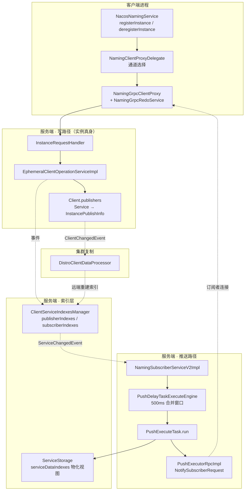
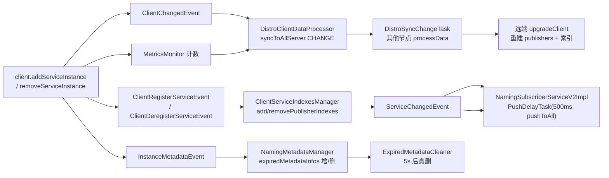
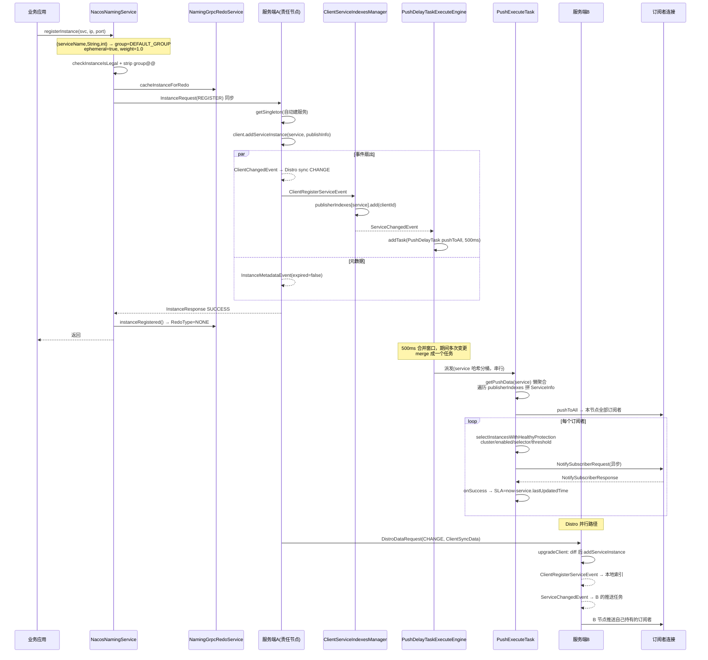

我先补齐推送侧的源码取证。

继续取证推送执行链与订阅侧闭环。

## 〇、一句话结论

**Nacos 服务端并不维护"服务 → 实例列表"这张正表，而是把实例挂在"连接 → 实例列表"上（`Client.publishers`），再用"服务 → 连接集合"两张反向索引（`publisherIndexes` / `subscriberIndexes`）把两者缝合起来。真正的"服务视图"（`ServiceInfo`）是推送任务在触发那一刻懒计算出来的物化缓存。注册/注销只是改动 `publishers` 与索引，推送任务负责把索引变化翻译成给订阅者的 `NotifySubscriberRequest`。**



---

## 一、客户端：注册与注销的入口

### 1.1 先澄清一个签名歧义

你给的入口 `registerInstance(java.lang.String, java.lang.String, int)` **不是** `(serviceName, groupName, port)`，而是：

```java
// NacosNamingService L127
@Override
public void registerInstance(String serviceName, String ip, int port) throws NacosException {
    registerInstance(serviceName, ip, port, Constants.DEFAULT_CLUSTER_NAME);
}
```

三个重载层层归一化，最终都落到 `(serviceName, groupName, Instance)`：

```java
// L127 → L137 → L142 → L158
public void registerInstance(String serviceName, String ip, int port, String clusterName) {
    registerInstance(serviceName, Constants.DEFAULT_GROUP, ip, port, clusterName);   // group 兜底
}

public void registerInstance(String serviceName, String groupName, String ip, int port, String clusterName)
        throws NacosException {
    Instance instance = new Instance();
    instance.setIp(ip);
    instance.setPort(port);
    instance.setWeight(1.0);                    // ← 唯一显式设置权重的入口
    instance.setClusterName(clusterName);
    registerInstance(serviceName, groupName, instance);
}
```

**关键推论**：`Instance` 的字段默认值决定了行为——`ephemeral = true`、`healthy = true`、`enabled = true`、`weight = 1.0`、`clusterName = "DEFAULT"`、`metadata` 为空 map。所以走这个三参重载注册出来的实例：

- 是**临时实例**（走 Distro + 连接生命周期管理，不落库、不进 Raft）；
- **心跳参数走全局默认**：`Instance` 的 `getHeartBeatInterval()/getHeartBeatTimeOut()/getIpDeleteTimeout()` 是从 `metadata` 的 `preserved.heart.beat.*` 键读出的，metadata 为空时返回 `Constants` 里的 5s / 15s / 30s；
- 没有 `instanceId`，由服务端 `InstanceUtil.setInstanceIdIfEmpty` 补成 `ip#port#clusterName#groupName`。

### 1.2 真正的收口点：两行完全对称

```java
// L158 注册
public void registerInstance(String serviceName, String groupName, Instance instance) throws NacosException {
    NamingUtils.checkInstanceIsLegal(instance);
    checkAndStripGroupNamePrefix(instance, groupName);
    clientProxy.registerService(serviceName, groupName, instance);
}

// L211 注销
public void deregisterInstance(String serviceName, String groupName, Instance instance) throws NacosException {
    NamingUtils.checkInstanceIsLegal(instance);
    checkAndStripGroupNamePrefix(instance, groupName);
    clientProxy.deregisterService(serviceName, groupName, instance);
}
```

`checkInstanceIsLegal` 校验两件事：心跳三件套的大小关系（`interval > timeout > ipDeleteTimeout` 这种非法组合直接拒），以及 clusterName 必须匹配 `[0-9a-zA-Z-.]+`。**注意注销也做这个校验**——这是防御性的（避免脏参数打到服务端），但代价是"传入一个 clusterName 非法的 Instance 想删实例"会在客户端就被拦掉。

`checkAndStripGroupNamePrefix` 是 1.x/2.x 兼容钩子：若 `instance.getServiceName()` 形如 `group@@service`，校验 group 一致后剥离，只留裸 service name。

### 1.3 通道路由：一个能力协商决定走 gRPC 还是 HTTP

```java
// NamingClientProxyDelegate
public void registerService(String serviceName, String groupName, Instance instance) throws NacosException {
    getExecuteClientProxy(instance).registerService(serviceName, groupName, instance);
}

private NamingClientProxy getExecuteClientProxy(Instance instance) {
    if (instance.isEphemeral() || isAbilitySupportedByServer(AbilityKey.SERVER_SUPPORT_PERSISTENT_INSTANCE_BY_GRPC)) {
        return grpcClientProxy;
    }
    return httpClientProxy;
}
```

| 实例类型 | 服务端支持持久实例 gRPC | 走哪个代理 |
|---|---|---|
| 临时（`ephemeral=true`） | 任意 | **gRPC** |
| 持久（`ephemeral=false`） | 是 | gRPC（`PersistentInstanceRequest`） |
| 持久 | 否（老服务端） | HTTP（`/api/naming` v1） |

两个代理对"临时实例 + HTTP"这种非法组合的处理**故意不对称**：

```java
// NamingHttpClientProxy —— 注册：抛异常，强失败
if (instance.isEphemeral()) {
    throw new UnsupportedOperationException("Do not support register ephemeral instances by HTTP, ...");
}

// NamingHttpClientProxy —— 注销：静默 return，尽力而为
if (instance.isEphemeral()) {
    return;
}
```

设计理由：注册失败必须让调用方知道（否则业务以为自己在集群里）；而"清理动作"在 HTTP 通道对临时实例本来就是 no-op，静默返回更符合"关闭流程不该被清理卡住"的语义。

### 1.4 注册：先缓存 → 再发送 → 成功才标记

```java
// NamingGrpcClientProxy
private void registerServiceForEphemeral(String serviceName, String groupName, Instance instance) throws NacosException {
    redoService.cacheInstanceForRedo(serviceName, groupName, instance);   // ① 先写 redo 表
    doRegisterService(serviceName, groupName, instance);                   // ② 同步 RPC
}

public void doRegisterService(String serviceName, String groupName, Instance instance) throws NacosException {
    InstanceRequest request = new InstanceRequest(namespaceId, serviceName, groupName,
            NamingRemoteConstants.REGISTER_INSTANCE, instance);
    requestToServer(request, Response.class);                              // ③ 失败直接抛
    redoService.instanceRegistered(serviceName, groupName);                 // ④ 成功才置 registered
}
```

这个顺序是**整个 2.x 客户端可靠性的基石**：redo 条目在请求发出前就存在，请求失败时抛异常且不置 `registered=true`，于是 `RedoScheduledTask` 每 3 秒扫到它时会重发。**"至少一次投递 + 最终一致"**，代价是网络分区期间客户端会无限重试。

### 1.5 注销：一个类型判断岔出两条完全不同的路

```java
public void deregisterService(String serviceName, String groupName, Instance instance) throws NacosException {
    if (instance.isEphemeral()) {
        deregisterServiceForEphemeral(serviceName, groupName, instance);
    } else {
        doDeregisterServiceForPersistent(serviceName, groupName, instance);   // 无 redo，无标记
    }
}

private void deregisterServiceForEphemeral(String serviceName, String groupName, Instance instance)
        throws NacosException {
    String key = NamingUtils.getGroupedName(serviceName, groupName);
    InstanceRedoData instanceRedoData = redoService.getRegisteredInstancesByKey(key);
    if (instanceRedoData instanceof BatchInstanceRedoData) {
        // 该服务当初是批量注册的 → 注销必须走批量语义，否则会把整批删掉
        List<Instance> instances = new ArrayList<>();
        if (null != instance) { instances.add(instance); }
        batchDeregisterService(serviceName, groupName, instances);
    } else {
        redoService.instanceDeregister(serviceName, groupName);   // 记"我想注销"
        doDeregisterService(serviceName, groupName, instance);    // 发请求 + instanceDeregistered
    }
}
```

**批量注销 = 求补集后重新注册剩余**，这是最反直觉的一处：

```java
@Override
public void batchDeregisterService(String serviceName, String groupName, List<Instance> instances)
        throws NacosException {
    synchronized (redoService.getRegisteredInstances()) {
        List<Instance> retainInstance = getRetainInstance(serviceName, groupName, instances);
        batchRegisterService(serviceName, groupName, retainInstance);   // ← 用 REGISTER 实现 DEREGISTER
    }
}
```

因为服务端 `BatchInstancePublishInfo` 是**整批一个条目**（`publishers` 里 key=Service，value=整批实例），没有"从批里摘掉一个"的接口，只能整批覆盖重写。补集算法里只比较 ip & port：

```java
// only compare Ip & Port because redoInstance's instanceId or serviceName might be null
private boolean compareIpAndPort(Instance deRegisterInstance, Instance redoInstance) {
    return deRegisterInstance.getIp().equals(redoInstance.getIp())
            && deRegisterInstance.getPort() == redoInstance.getPort();
}
```

### 1.6 `RedoData` 三维状态机

`expectedRegistered`（用户意图）× `registered`（已确认送达）× `unregistering`（正在注销）三个布尔推出 `RedoType`：

```java
public RedoType getRedoType() {
    if (isRegistered() && !isUnregistering()) {
        return expectedRegistered ? RedoType.NONE : RedoType.UNREGISTER;
    } else if (isRegistered() && isUnregistering()) {
        return RedoType.UNREGISTER;
    } else if (!isRegistered() && !isUnregistering()) {
        return RedoType.REGISTER;
    } else {
        return expectedRegistered ? RedoType.REGISTER : RedoType.REMOVE;
    }
}
```

| 阶段 | expected | registered | unregistering | RedoType | 动作 |
|---|---|---|---|---|---|
| 刚注册成功 | T | T | F | `NONE` | 无 |
| `instanceDeregister()` 后、请求前 | **F** | T | **T** | `UNREGISTER` | 若此时崩溃 → 重发注销 |
| `instanceDeregistered()` 后 | F | **F** | T | **`REMOVE`** | 下一轮 `removeInstanceForRedo()` 删条目 |
| 注销请求失败 | F | T | T | `UNREGISTER` | 继续重试 |
| **注销成功后断线** | F | F | T | `REMOVE` | 意图安全丢弃（服务端已因断连清空） |

> **重要推论**：一条 redo 记录在实例注销后**还会存活约 3 秒**（等下一轮扫描才 `REMOVE`）。如果你在 `deregisterInstance` 后立刻 `close()`，可能观察到条目未清。

### 1.7 断线自愈

```java
// NamingGrpcRedoService implements ConnectionEventListener
@Override
public void onDisConnect(Connection connection) {
    connected = false;
    synchronized (registeredInstances) {
        registeredInstances.values().forEach(InstanceRedoData::setRegistered);   // 全量置 false
    }
    // subscribes 同理
}
```

连接一断，所有实例/订阅的 `registered` 归 false → `RedoType` 变 `REGISTER` 或 `SUBSCRIBE` → 重连成功后定时任务全量重放。**这就是 2.x "长连接取代心跳"的补偿机制**：服务端断连即删全部实例，客户端靠 redo 表在重连后重建。

---

## 二、服务端如何维护服务实例（核心）

### 2.1 四个容器与"倒置存储"

| 容器 | 数据结构 | 语义 | 谁写 |
|---|---|---|---|
| `ServiceManager` | `Map<Service, Service>` 单例池 | **服务清单**（存在性 + revision + lastUpdatedTime） | getSingleton 自动建 / Cleaner 删 |
| `Client.publishers` | `ConcurrentHashMap<Service, InstancePublishInfo>` | **实例真身**，按连接分片 | add/removeServiceInstance |
| `ClientServiceIndexesManager` | `Map<Service, Set<String>>` × 2 | **反向索引**：谁发布/谁订阅了这个服务 | Client*ServiceEvent |
| `ServiceStorage` | `Map<Service, ServiceInfo>` + `Map<Service, Set<String>>` | **物化视图**：推送与查询的读缓存 | getPushData 懒算 |

```java
// AbstractClient
protected final ConcurrentHashMap<Service, InstancePublishInfo> publishers = new ConcurrentHashMap<>(16, 0.75f, 1);
protected final ConcurrentHashMap<Service, Subscriber> subscribers = new ConcurrentHashMap<>(16, 0.75f, 1);
```

注意 `new ConcurrentHashMap<>(16, 0.75f, 1)` —— **concurrencyLevel=1**。因为一个 Client 只被其连接所属的那个 Netty worker 线程写，没必要开 16 个 segment 白白浪费内存和寻址开销。这是典型的"按实际并发模型调容器参数"。

**为什么要倒置？** 如果按正表 `Map<Service, List<Instance>>` 存：

1. 一个客户端注册 N 个服务，实例散落在 N 个 List 里，**连接断开时要遍历全部服务才能清理**（O(全集群服务数)）；
2. 分布式同步粒度变成"整个服务的实例列表"，冲突多、传输大；
3. 无法表达"批量注册"这种"一批实例作为一个整体生命周期"的语义。

倒置后：断连清理 = 拿这个 `Client` 对象 `client.release()` + 遍历它的 `publishers.keySet()`（O(该连接的实例数)）；Distro 同步单位 = 一个 Client（`generateSyncData`），天然幂等且可 diff。

### 2.2 身份模型：连接即身份

| 实例类型 | clientId 生成 | Client 实现 | 一致性协议 | 生命周期 |
|---|---|---|---|---|
| 临时 | `meta.getConnectionId()`（gRPC 连接 ID） | `ConnectionBasedClient` | **Distro (AP)** | 连接断开即消亡 |
| 持久（gRPC） | `IpPortBasedClient.getClientId(instance.toInetAddr(), false)` → `ip:port#false` | `IpPortBasedClient` | **Raft (CP)** | 显式注销才消亡 |
| 持久（HTTP 1.x） | 同上 | `IpPortBasedClient` | Raft | 同上 |

```java
// ConnectionBasedClientManager
@Override
public boolean clientConnected(String clientId, String type) {
    if (!StringUtils.equals(type, ConnectionType.GRPC.getType().name())) { return false; }
    clients.computeIfAbsent(clientId, s -> {
        Loggers.SRV_LOG.info("Client connection {} connect to server", clientId);
        return new ConnectionBasedClient(clientId, isResponsibleClient(clientId), revision);
    });
    return true;
}

@Override
public boolean clientDisconnected(String clientId) {
    ConnectionBasedClient client = clients.remove(clientId);
    if (null == client) { return true; }
    client.release();                                                    // metrics 回退
    boolean isResponsible = isResponsibleClient(client);
    NotifyCenter.publishEvent(new ClientOperationEvent.ClientReleaseEvent(client, isResponsible));
    NotifyCenter.publishEvent(new ClientEvent.ClientDisconnectEvent(client, isResponsible));
    return true;
}
```

**两个事件对应两条清理线**：`ClientReleaseEvent` → 索引层删掉这个连接发布/订阅的所有索引（触发本节点推送）；`ClientDisconnectEvent` → Distro 层向其他节点广播 DELETE + 元数据层清理。

### 2.3 写时压缩：`InstancePublishInfo` 只存差异

```java
// ClientOperationService#getPublishInfo（default 方法）
default InstancePublishInfo getPublishInfo(Instance instance) {
    InstancePublishInfo result = new InstancePublishInfo(instance.getIp(), instance.getPort());
    Map<String, Object> extendDatum = new HashMap<>(1);
    putInstanceWeight(instance, extendDatum);     // 只有 weight != 1.0 才写
    putInstanceEnable(instance, extendDatum);     // 只有 enabled == false 才写
    putInstanceMetadata(instance, extendDatum);   // metadata 非空才写，并生成 metadataId
    result.setExtendDatum(extendDatum);
    return result;
}
```

只保留 `ip + port` 作为"定位必需"，其余全部走 `extendDatum` 稀疏 map。**效果**：一个 10 万实例的服务，绝大部分实例的 `InstancePublishInfo` 就是两个字段，Distro 序列化体积、内存占用、GC 压力都大幅下降。`metadataId` 把重量级的 metadata 剥离到 `NamingMetadataManager` 单独存，实例真身与元数据分家。

### 2.4 注册与注销在服务端的三处不对称

```java
// EphemeralClientOperationServiceImpl
@Override
public void registerInstance(Service service, Instance instance, String clientId) throws NacosException {
    NamingUtils.checkInstanceIsLegal(instance);                                  // ① 服务端二次校验
    Service singleton = ServiceManager.getInstance().getSingleton(service);      // ② 不存在则【自动建服务】
    if (!singleton.isEphemeral()) { throw new NacosRuntimeException(INVALID_PARAM, ...); }
    Client client = clientManager.getClient(clientId);
    checkClientIsLegal(client, clientId);
    InstancePublishInfo instanceInfo = getPublishInfo(instance);
    client.addServiceInstance(singleton, instanceInfo);   // ← 只认 Service 作 key
    client.setLastUpdatedTime();
    client.recalculateRevision();
    NotifyCenter.publishEvent(new ClientOperationEvent.ClientRegisterServiceEvent(singleton, clientId));
    NotifyCenter.publishEvent(new MetadataEvent.InstanceMetadataEvent(singleton, instanceInfo.getMetadataId(), false));
}

@Override
public void deregisterInstance(Service service, Instance instance, String clientId) {
    if (!ServiceManager.getInstance().containSingleton(service)) {      // ①′ 先查存在性，【绝不自动建服务】
        Loggers.SRV_LOG.warn("remove instance from non-exist service: {}", service);
        return;                                                          // ②′ 静默成功
    }
    Service singleton = ServiceManager.getInstance().getSingleton(service);
    Client client = clientManager.getClient(clientId);
    checkClientIsLegal(client, clientId);
    InstancePublishInfo removedInstance = client.removeServiceInstance(singleton);   // ③′ instance 参数【未被使用】
    client.setLastUpdatedTime();
    client.recalculateRevision();
    if (null != removedInstance) {                                        // ④′ 真删掉了才发事件 → 幂等
        NotifyCenter.publishEvent(new ClientOperationEvent.ClientDeregisterServiceEvent(singleton, clientId));
        NotifyCenter.publishEvent(new MetadataEvent.InstanceMetadataEvent(singleton, removedInstance.getMetadataId(), true));
    }
}
```

| 不对称点 | 注册 | 注销 | 设计理由 |
|---|---|---|---|
| 参数校验 | 客户端 + 服务端双重 | 仅客户端 | 反注册是删除操作，参数宽松无安全风险；且严格校验会导致"改了字段定义就删不掉老实例" |
| 服务不存在 | `getSingleton` 自动创建 | 先 `containSingleton`，不存在就 return | 注销不该产生垃圾服务对象（否则攻击者可用大量注销请求撑爆 ServiceManager） |
| 定位粒度 | `(clientId, Service)` | **同样** `(clientId, Service)`，`instance` 参数**完全没用** | 一个连接的一个服务只能有一个条目 |
| 是否发事件 | 必发 | 仅 `removedInstance != null` 才发 | 天然幂等：重复注销不产生重复推送风暴 |

> **③′ 是本节最重要的洞察**：`client.removeServiceInstance(singleton)` 只看 `Service`，`instance.getIp()/getPort()` 在临时实例路径上**根本不参与定位**。所以：**同一个 `NacosNamingService` 实例（同一条 gRPC 连接）对同一个服务先后注册两个不同 ip 的实例，第二次会覆盖第一次；对同一个服务注销时，即使传的 ip/port 是错的，也会把该连接该服务下那个唯一实例删掉。**

`InstanceRequestHandler` 层还有一处：无论服务端是否真的删掉了实例，都返回成功：

```java
private InstanceResponse deregisterInstance(Service service, InstanceRequest request, RequestMeta meta) {
    clientOperationService.deregisterInstance(service, request.getInstance(), meta.getConnectionId());
    NotifyCenter.publishEvent(new DeregisterInstanceTraceEvent(System.currentTimeMillis(),
            NamingRequestUtil.getSourceIpForGrpcRequest(meta), true, DeregisterInstanceReason.REQUEST,
            service.getNamespace(), service.getGroup(), service.getName(),
            request.getInstance().getIp(), request.getInstance().getPort()));
    return new InstanceResponse(NamingRemoteConstants.DE_REGISTER_INSTANCE);
}
```

**注销 API 的返回语义是"目标状态已达成"而非"我删了一行"**，所以客户端拿到成功不代表真的存在过那个实例。

### 2.5 事件扇出全景

一次 `addServiceInstance` / `removeServiceInstance` 会同时点亮四条独立链路：



### 2.6 索引维护：`ServiceChangedEvent` 的唯一产地

```java
// ClientServiceIndexesManager
private void addPublisherIndexes(Service service, String clientId) {
    publisherIndexes.computeIfAbsent(service, key -> new ConcurrentHashSet<>()).add(clientId);
    NotifyCenter.publishEvent(new ServiceEvent.ServiceChangedEvent(service, true));
}

private void removePublisherIndexes(Service service, String clientId) {
    publisherIndexes.computeIfPresent(service, (s, ids) -> {
        ids.remove(clientId);
        NotifyCenter.publishEvent(new ServiceEvent.ServiceChangedEvent(service, true));
        return ids.isEmpty() ? null : ids;    // ← 空集合直接摘掉 key，为 Cleaner 铺路
    });
}

private void addSubscriberIndexes(Service service, String clientId) {
    Set<String> clientIds = subscriberIndexes.computeIfAbsent(service, key -> new ConcurrentHashSet<>());
    // Fix #5404, Only first time add need notify event.
    if (clientIds.add(clientId)) {
        NotifyCenter.publishEvent(new ServiceEvent.ServiceSubscribedEvent(service, clientId));
    }
}
```

三个细节：

1. **`removePublisherIndexes` 无条件发 `ServiceChangedEvent`**——即使 `ids.remove(clientId)` 返回 false（没删到东西）。这是"宁可多推一次也不能漏推"的选择，靠推送侧的合并窗口吸收。
2. **`ids.isEmpty() → return null`**：索引 key 被回收，`EmptyServiceAutoCleanerV2` 才能识别出"空服务"。
3. **`addSubscriberIndexes` 只在首次 add 成功时发事件**：订阅是幂等的，同一连接重复订阅不该引发一次定向推送（这是 #5404 的修复）。

### 2.7 集群维度：为什么订阅者在 B 节点能收到 A 节点的注册

这是"服务端如何维护实例"在集群场景下最关键的一环。**实例数据按 clientId 哈希分片，只有责任节点持有权威副本；但索引和推送在每个节点都要能工作。**

```java
// DistroClientDataProcessor
private void syncToAllServer(ClientEvent event) {
    Client client = event.getClient();
    if (null == client || !client.isEphemeral() || !clientManager.isResponsibleClient(client)) {
        return;   // ← 非责任节点不广播，避免风暴
    }
    DistroKey distroKey = new DistroKey(client.getClientId(), TYPE);
    if (event instanceof ClientEvent.ClientDisconnectEvent) {
        distroProtocol.sync(distroKey, DataOperation.DELETE);
    } else if (event instanceof ClientEvent.ClientChangedEvent) {
        distroProtocol.sync(distroKey, DataOperation.CHANGE);
    }
}

// 其他节点收到后
private void upgradeClient(Client client, ClientSyncData clientSyncData) {
    Set<Service> syncedService = new HashSet<>();
    processBatchInstanceDistroData(syncedService, client, clientSyncData);
    for (int i = 0; i < namespaces.size(); i++) {
        Service service = Service.newService(namespaces.get(i), groupNames.get(i), serviceNames.get(i));
        Service singleton = ServiceManager.getInstance().getSingleton(service);
        syncedService.add(singleton);
        InstancePublishInfo instancePublishInfo = instances.get(i);
        if (!instancePublishInfo.equals(client.getInstancePublishInfo(singleton))) {   // ← diff 才写
            client.addServiceInstance(singleton, instancePublishInfo);
            NotifyCenter.publishEvent(new ClientOperationEvent.ClientRegisterServiceEvent(singleton, client.getClientId()));
            NotifyCenter.publishEvent(new MetadataEvent.InstanceMetadataEvent(singleton, instancePublishInfo.getMetadataId(), false));
        }
    }
    for (Service each : client.getAllPublishedService()) {
        if (!syncedService.contains(each)) {      // ← 同步数据里没有的，本地删掉（全量覆盖语义）
            client.removeServiceInstance(each);
            NotifyCenter.publishEvent(new ClientOperationEvent.ClientDeregisterServiceEvent(each, client.getClientId()));
        }
    }
    client.setRevision(clientSyncData.getAttributes().<Integer>getClientAttribute(ClientConstants.REVISION, 0));
}
```

**关键设计**：`upgradeClient` 是**"以同步数据为准的全量 reconcile"**，而不是增量 apply。它发的仍是 `ClientRegisterServiceEvent` / `ClientDeregisterServiceEvent`，于是**远端节点的 `ClientServiceIndexesManager` 也会被更新，进而发出本节点的 `ServiceChangedEvent`，触发 B 节点向自己连接着的订阅者推送**。

这就闭环了：A 节点注册 → Distro 复制到 B → B 重建索引 → B 主动推送给自己这边的订阅者。**每个节点的推送只覆盖自己持有连接的订阅者，靠 Distro 保证每个节点都有全量视图。**

`diff 才写` + `setRevision` 让重复同步和校验天然幂等，配合 `getVerifyData()`（责任节点定期广播 `(clientId, revision)` 供其他节点自检）构成最终一致的三重保障：全量快照、增量变更、周期校验。

### 2.8 延迟回收：两级 Cleaner

注销不是立刻释放所有结构的，因为"索引空了"和"确实永久空了"之间需要时间窗，避免客户端短暂断连导致服务被删。

```java
// ExpiredMetadataCleaner —— 元数据延迟删除
private static final int INITIAL_DELAY = 5000;
GlobalExecutor.scheduleExpiredClientCleaner(this, INITIAL_DELAY,
        GlobalConfig.getExpiredMetadataCleanInterval(), TimeUnit.MILLISECONDS);

public void doClean() {
    for (ExpiredMetadataInfo each : metadataManager.getExpiredMetadataInfos()) {
        if (System.currentTimeMillis() - each.getCreateTime() > GlobalConfig.getExpiredMetadataExpiredTime()) {
            removeExpiredMetadata(each);
        }
    }
}

// EmptyServiceAutoCleanerV2 —— 空服务回收
GlobalExecutor.scheduleExpiredClientCleaner(this, TimeUnit.SECONDS.toMillis(30),
        GlobalConfig.getEmptyServiceCleanInterval(), TimeUnit.MILLISECONDS);

private void cleanEmptyService(Service service) {
    Collection<String> registeredService = clientServiceIndexesManager.getAllClientsRegisteredService(service);
    if (registeredService.isEmpty() && isTimeExpired(service)) {
        Loggers.CLEAN.info("deleteService : {}, namespace: {}", service.getName(), service.getNamespace());
        clientServiceIndexesManager.removePublisherIndexesByEmptyService(service);
        ServiceManager.getInstance().removeSingleton(service);
        serviceStorage.removeData(service);
        NotifyCenter.publishEvent(new MetadataEvent.ServiceMetadataEvent(service, true));
    }
}
```

`InstanceMetadataEvent(service, metadataId, true)` 里的 `true` 只是"加入过期队列"，`ExpiredMetadataCleaner` 判定超过 `expiredMetadataExpiredTime` 才真删。**注销后的元数据仍会存活一段时间**，这是给"实例快速重启同一 metadataId"留的复用窗口。

### 2.9 被动注销 vs 主动注销：`DeregisterInstanceReason` 四值

| reason | 触发点 | 场景 |
|---|---|---|
| `REQUEST` | `InstanceRequestHandler.deregisterInstance` / `BatchInstanceRequestHandler` | 客户端显式调用 `deregisterInstance` |
| `NATIVE_DISCONNECTED` | `ClientServiceIndexesManager.handleClientDisconnect`，`event.isNative()==true` | 连接断在**本节点**（真实 TCP 断开） |
| `SYNCED_DISCONNECTED` | 同上，`isNative()==false` | 责任节点在别处，本节点收到 Distro DELETE 后清理同步来的 Client |
| `HEARTBEAT_EXPIRE` | 1.x `BeatReactor` / 心跳健康检查路径 | HTTP 心跳超时被摘 |

```java
private void handleClientDisconnect(ClientOperationEvent.ClientReleaseEvent event) {
    Client client = event.getClient();
    for (Service each : client.getAllSubscribeService()) {
        removeSubscriberIndexes(each, client.getClientId());   // 订阅索引随连接一起消失
    }
    DeregisterInstanceReason reason = event.isNative()
            ? DeregisterInstanceReason.NATIVE_DISCONNECTED : DeregisterInstanceReason.SYNCED_DISCONNECTED;
    long currentTimeMillis = System.currentTimeMillis();
    for (Service each : client.getAllPublishedService()) {
        removePublisherIndexes(each, client.getClientId());
        InstancePublishInfo instance = client.getInstancePublishInfo(each);
        NotifyCenter.publishEvent(new DeregisterInstanceTraceEvent(currentTimeMillis, "", false, reason,
                each.getNamespace(), each.getGroup(), each.getName(), instance.getIp(), instance.getPort()));
    }
}
```

**运维诊断价值**：在 `naming-trace.log` 里区分这四种 reason，就能一眼判定"实例消失是我自己调了注销，还是连接抖动，还是被别节点摘除"——这是排查"服务时好时坏"最有效的切入口。

---

## 三、订阅推送任务：`PushExecuteTask.run`

### 3.1 订阅的登记：一次性返回全量 + 挂上推送钩子

```java
// SubscribeServiceRequestHandler
Service service = Service.newService(namespaceId, groupName, serviceName, true);
Subscriber subscriber = new Subscriber(meta.getClientIp(), meta.getClientVersion(), app, meta.getClientIp(),
        namespaceId, groupedServiceName, 0, request.getClusters());
ServiceInfo serviceInfo = ServiceUtil.selectInstancesWithHealthyProtection(serviceStorage.getData(service),
        metadataManager.getServiceMetadata(service).orElse(null), subscriber.getCluster(), false, true,
        subscriber.getIp());
if (request.isSubscribe()) {
    clientOperationService.subscribeService(service, subscriber, meta.getConnectionId());
    NotifyCenter.publishEvent(new SubscribeServiceTraceEvent(...));
} else {
    clientOperationService.unsubscribeService(service, subscriber, meta.getConnectionId());
}
return new SubscribeServiceResponse(ResponseCode.SUCCESS.getCode(), "success", serviceInfo);
```

**订阅请求本身就是第一次数据拉取**——客户端调 `subscribe` 会同步拿到裁剪后的 `ServiceInfo`，之后靠推送增量更新。这消除了"注册后首次推送前无数据"的空窗。

注意 `Subscriber` 的 `port` 恒为 0（长连接不需要 UDP 回调端口），`cluster` 直接取 `request.getClusters()`——这个字段会在后续每次推送时被用作过滤条件。

```java
// EphemeralClientOperationServiceImpl.subscribeService
Service singleton = ServiceManager.getInstance().getSingletonIfExist(service).orElse(service);   // 不自动建！
Client client = clientManager.getClient(clientId);
client.addServiceSubscriber(singleton, subscriber);
client.setLastUpdatedTime();
NotifyCenter.publishEvent(new ClientOperationEvent.ClientSubscribeServiceEvent(singleton, clientId));
```

`subscribeService` 用 `getSingletonIfExist(...).orElse(service)`——**订阅不该创建服务**（订阅一个不存在的服务是合法的等待行为），但也不去 `ServiceManager` 里塞垃圾。这是继 2.4 之后又一处"读操作不产生写副作用"的克制设计。

### 3.2 触发源：两种事件，两种范围

```java
// NamingSubscriberServiceV2Impl
@Override
public void onEvent(Event event) {
    if (event instanceof ServiceEvent.ServiceChangedEvent) {
        // 服务实例变化 → 推给全部订阅者
        Service service = serviceChangedEvent.getService();
        delayTaskEngine.addTask(service, new PushDelayTask(service, PushConfig.getInstance().getPushTaskDelay()));
        MetricsMonitor.incrementServiceChangeCount(service);
    } else if (event instanceof ServiceEvent.ServiceSubscribedEvent) {
        // 新订阅者上线 → 只推它一个
        Service service = subscribedEvent.getService();
        delayTaskEngine.addTask(service, new PushDelayTask(service,
                PushConfig.getInstance().getPushTaskDelay(), subscribedEvent.getClientId()));
    }
}
```

```java
// PushDelayTask
public PushDelayTask(Service service, long delay) {                        // pushToAll = true
    this.service = service; pushToAll = true; targetClients = null;
    setTaskInterval(delay); setLastProcessTime(System.currentTimeMillis());
}
public PushDelayTask(Service service, long delay, String targetClient) {   // pushToAll = false
    this.service = service; this.pushToAll = false;
    this.targetClients = new HashSet<>(1); this.targetClients.add(targetClient);
    ...
}

@Override
public void merge(AbstractDelayTask task) {
    PushDelayTask oldTask = (PushDelayTask) task;
    if (isPushToAll() || oldTask.isPushToAll()) {
        pushToAll = true;              // ← 全量意图吞并定向意图
        targetClients = null;
    } else {
        targetClients.addAll(oldTask.getTargetClients());   // ← 定向目标求并集
    }
    setLastProcessTime(Math.min(getLastProcessTime(), task.getLastProcessTime()));
    Loggers.PUSH.info("[PUSH] Task merge for {}", service);
}
```

`merge` 的三点设计极精妙：

1. **布尔 OR 语义**：只要有一个任务要推全部，合并后就是推全部——正确性优先。
2. **`targetClients` 求并集**：N 个新订阅者在窗口内同时上线，只推一轮而不是 N 轮。
3. **`lastProcessTime` 取 min（而非平均）**：让合并后的任务**尽快到期**，因为 `Math.min` 保留了最早的那个"应该被处理的时间锚点"，配合 `NacosDelayTaskExecuteEngine` 的 `currentTime - lastProcessTime >= taskInterval` 判定，等价于"以最早的意图为准，别让它等太久"。

### 3.3 双层引擎：延迟层 + 串行执行层

```java
// PushDelayTaskExecuteEngine
@Override
protected void processTasks() {
    if (!switchDomain.isPushEnabled()) { return; }     // ← 全局推送开关（故障隔离阀门）
    super.processTasks();
}

private static class PushDelayTaskProcessor implements NacosTaskProcessor {
    @Override
    public boolean process(NacosTask task) {
        PushDelayTask pushDelayTask = (PushDelayTask) task;
        Service service = pushDelayTask.getService();
        NamingExecuteTaskDispatcher.getInstance()
                .dispatchAndExecuteTask(service, new PushExecuteTask(service, executeEngine, pushDelayTask));
        return true;
    }
}
```

```java
// NamingExecuteTaskDispatcher —— 单例
private NamingExecuteTaskDispatcher() {
    executeEngine = new NacosExecuteTaskExecuteEngine(EnvUtil.FUNCTION_MODE_NAMING, Loggers.SRV_LOG);
}
public void dispatchAndExecuteTask(Object dispatchTag, AbstractExecuteTask task) {
    executeEngine.addTask(dispatchTag, task);      // dispatchTag = Service
}
```

**两层解耦的职责**：
- **延迟层**（`PushDelayTaskExecuteEngine`，单线程扫描）负责"攒够 500ms 再走"和"任务合并"；
- **执行层**（`NacosExecuteTaskExecuteEngine`，按 `service.hashCode() % workerCount` 分桶）负责"同一个服务的推送任务串行执行"。

`Service` 的 `equals/hashCode` 只用 `(namespace, group, name)`（**故意排除 ephemeral 和 revision**，见下面），所以同一服务的任务永远落在同一个 worker：

```java
// Service
@Override
public boolean equals(Object o) {
    ...
    return namespace.equals(service.namespace) && group.equals(service.group) && name.equals(service.name);
}
@Override
public int hashCode() { return Objects.hash(namespace, group, name); }
```

这就是为什么 `Service` 能安全地当 `ConcurrentHashMap` 的 key、`ServiceManager` 的单例池能工作、以及**推送不需要任何锁**——同一服务的推送天然串行，`serviceDataIndexes` 的写入不存在并发交叠。

### 3.4 `PushExecuteTask.run` 逐行拆解

```java
@Override
public void run() {
    try {
        PushDataWrapper wrapper = generatePushData();                      // ① 懒聚合出全量视图
        ClientManager clientManager = delayTaskEngine.getClientManager();
        for (String each : getTargetClientIds()) {                         // ② 决定推给谁
            Client client = clientManager.getClient(each);
            if (null == client) { continue; }                              //    连接已断 → 跳过
            Subscriber subscriber = client.getSubscriber(service);
            if (subscriber == null) { continue; }                          //    该连接没订这个服务 → 跳过
            delayTaskEngine.getPushExecutor().doPushWithCallback(each, subscriber, wrapper,
                    new ServicePushCallback(each, subscriber, wrapper.getOriginalData(), delayTask.isPushToAll()));
        }
    } catch (Exception e) {
        Loggers.PUSH.error("Push task for service" + service.getGroupedServiceName() + " execute failed ", e);
        delayTaskEngine.addTask(service, new PushDelayTask(service, 1000L));   // ③ 整体失败 → 1s 后重推全量
    }
}

private PushDataWrapper generatePushData() {                                // 只算一次，供所有订阅者共享
    ServiceInfo serviceInfo = delayTaskEngine.getServiceStorage().getPushData(service);
    ServiceMetadata serviceMetadata = delayTaskEngine.getMetadataManager().getServiceMetadata(service).orElse(null);
    return new PushDataWrapper(serviceMetadata, serviceInfo);
}

private Collection<String> getTargetClientIds() {
    return delayTask.isPushToAll()
            ? delayTaskEngine.getIndexesManager().getAllClientsSubscribeService(service)
            : delayTask.getTargetClients();
}
```

四个值得注意的点：

1. **`generatePushData` 在循环外**——全量视图只聚合一次，之后每个订阅者只做轻量裁剪。这是"计算下推到读侧、但共享中间结果"的平衡。
2. **两处 `continue` 而非抛异常**：`client == null` 说明索引和真身出现了短暂不一致（索引里有、Client 已被摘），静默跳过即可——下次索引清理会修正。这是**索引层与数据层异步性带来的必然窗口**，代码选择容忍而不是修复。
3. **整体 catch 用 `1000L` 硬编码**（不是 retryDelay 配置项），且新建的是 `pushToAll` 任务。语义是"出大问题了，退避 1 秒后重新推所有订阅者"。
4. **循环内串行发送**：`doPushWithCallback` 内部是 `connection.asyncRequest(...)`，不阻塞——所以循环只是"提交异步任务"，真正发送在 Netty/回调线程池。

### 3.5 数据生成：`ServiceStorage.getPushData` 的懒聚合

```java
public ServiceInfo getData(Service service) {
    return serviceDataIndexes.containsKey(service) ? serviceDataIndexes.get(service) : getPushData(service);
}

public ServiceInfo getPushData(Service service) {
    ServiceInfo result = emptyServiceInfo(service);
    if (!ServiceManager.getInstance().containSingleton(service)) {
        return result;                          // 服务不存在 → 空列表（幂等）
    }
    Service singleton = ServiceManager.getInstance().getSingleton(service);
    result.setHosts(getAllInstancesFromIndex(singleton));
    serviceDataIndexes.put(singleton, result);  // 回填物化缓存
    return result;
}

private List<Instance> getAllInstancesFromIndex(Service service) {
    Set<Instance> result = new HashSet<>();
    Set<String> clusters = new HashSet<>();
    for (String each : serviceIndexesManager.getAllClientsRegisteredService(service)) {
        Optional<InstancePublishInfo> instancePublishInfo = getInstanceInfo(each, service);
        if (instancePublishInfo.isPresent()) {
            InstancePublishInfo publishInfo = instancePublishInfo.get();
            if (publishInfo instanceof BatchInstancePublishInfo) {
                result.addAll(parseBatchInstance(service, (BatchInstancePublishInfo) publishInfo, clusters));
            } else {
                Instance instance = parseInstance(service, instancePublishInfo.get());
                result.add(instance);                     // ← HashSet：无序！
                clusters.add(instance.getClusterName());
            }
        }
    }
    serviceClusterIndex.put(service, clusters);
    return new LinkedList<>(result);
}

private Instance parseInstance(Service service, InstancePublishInfo instanceInfo) {
    Instance result = InstanceUtil.parseToApiInstance(service, instanceInfo);   // ip/port/weight/enabled
    Optional<InstanceMetadata> metadata = metadataManager
            .getInstanceMetadata(service, instanceInfo.getMetadataId());        // 按 metadataId 拼回元数据
    metadata.ifPresent(instanceMetadata -> InstanceUtil.updateInstanceMetadata(result, instanceMetadata));
    return result;
}
```

**这就是倒置存储的还债时刻**：读一次要遍历 `publisherIndexes` 里所有 clientId，逐个 `clientManager.getClient(id).getInstancePublishInfo(service)`，再把压缩存储的 `extendDatum` + 分离存放的 `InstanceMetadata` 拼回完整 `Instance`。**写 1 次、读 N 次**的负载下这笔账很划算（N = 订阅者数量，通常远大于 1），并且它只在"服务变更"时算，而不是每次查询都算（`serviceDataIndexes` 兜住了读）。

用 `HashSet<Instance>` 聚合的副作用：**推送给客户端的实例列表顺序不保证稳定**。负载均衡若依赖列表下标取模，可能因为一次无关变更导致全量重排。

### 3.6 订阅者视角裁剪：三次过滤 + 保护阈值

```java
// PushExecutorRpcImpl
@Override
public void doPushWithCallback(String clientId, Subscriber subscriber, PushDataWrapper data,
        NamingPushCallback callBack) {
    ServiceInfo actualServiceInfo = getServiceInfo(data, subscriber);
    callBack.setActualServiceInfo(actualServiceInfo);
    pushService.pushWithCallback(clientId, NotifySubscriberRequest.buildNotifySubscriberRequest(actualServiceInfo),
            callBack, GlobalExecutor.getCallbackExecutor());
}

private ServiceInfo getServiceInfo(PushDataWrapper data, Subscriber subscriber) {
    return ServiceUtil.selectInstancesWithHealthyProtection(data.getOriginalData(), data.getServiceMetadata(),
            false, true, subscriber);    // healthyOnly=false, enableOnly=true
}
```

`doSelectInstances` 的三段过滤：

```java
for (Instance ip : serviceInfo.getHosts()) {
    if (checkCluster(clusterSets, ip) && checkEnabled(enableOnly, ip)) {   // ① cluster + enabled
        if (!healthyOnly || ip.isHealthy()) { filteredInstances.add(ip); }
        if (ip.isHealthy()) { healthyCount += 1; }
        allInstances.add(ip);
    }
}
```

然后 `InstancesFilter`（保护阈值 lambda）做两件事：

```java
// ② selector：服务级路由/灰度（label 等）
SelectorManager selectorManager = ApplicationUtils.getBean(SelectorManager.class);
allInstances = selectorManager.select(serviceMetadata.getSelector(), subscriberIp, allInstances);
filteredResult.setHosts(allInstances);

// 重算 healthyCount（因为 selector 可能已经过滤掉一批）
long newHealthyCount = healthyCount;
if (originalTotal != allInstances.size()) { ...重新统计... }

// ③ protectThreshold：健康比例过低时，把不健康实例伪造成健康返回
float threshold = serviceMetadata.getProtectThreshold();
if ((float) newHealthyCount / allInstances.size() <= threshold) {
    Loggers.SRV_LOG.warn("protect threshold reached, return all ips, service: {}", filteredResult.getName());
    filteredResult.setReachProtectionThreshold(true);
    List<Instance> filteredInstances = allInstances.stream()
            .map(i -> {
                if (!i.isHealthy()) {
                    i = InstanceUtil.deepCopy(i);
                    i.setHealthy(true);      // set all to `healthy` state to protect
                }
                return i;
            })
            .collect(Collectors.toCollection(LinkedList::new));
    filteredResult.setHosts(filteredInstances);
}
```

**保护阈值是"两害相权取其轻"**：健康实例少于阈值比例时，宁可把不健康实例也标记为健康给你（可能 5xx），也不给你空列表（必然全挂）。配合客户端侧的 `NAMING_PUSH_EMPTY_PROTECTION` 构成双层雪崩防护。

同时注意**每次推送都为每个订阅者重跑 selector**，这是有 CPU 成本的（`PushDataWrapper.processedDatum` 是为此预留的缓存槽位，当前 naming 模块内没有任何地方调用 `addProcessedPushData`/`getProcessedPushData`，只可能被推送 Hook/SPI 使用）。

`result.setLastRefTime(System.currentTimeMillis())` 值得留意——**每次推送的 `lastRefTime` 都是新生成的**，所以客户端不能用它做数据版本判断，必须用 `InstancesDiff`。

### 3.7 投递通道路由

```java
// PushExecutorDelegate
private PushExecutor getPushExecuteService(String clientId, Subscriber subscriber) {
    Optional<SpiPushExecutor> result = SpiImplPushExecutorHolder.getInstance()
            .findPushExecutorSpiImpl(clientId, subscriber);
    if (result.isPresent()) { return result.get(); }        // SPI 优先
    // use nacos default push executor
    return clientId.contains(IpPortBasedClient.ID_DELIMITER) ? udpPushExecuteService : rpcPushExecuteService;
}
```

**判据是 clientId 里有没有 `#` 分隔符**：`ip:port#false` 形式的（1.x 老客户端 / 持久实例）走 UDP 广播，gRPC 的 connectionId 走 RPC。一个字符串包含判断完成了 1.x/2.x 双栈兼容。

### 3.8 投递语义：`pushWithCallback` 不要求 ack

```java
// RpcPushService
public void pushWithCallback(String connectionId, ServerRequest request, PushCallBack requestCallBack, Executor executor) {
    Connection connection = connectionManager.getConnection(connectionId);
    if (connection != null) {
        try {
            connection.asyncRequest(request, new AbstractRequestCallBack(requestCallBack.getTimeout()) {
                @Override public void onResponse(Response response) {
                    if (response.isSuccess()) { requestCallBack.onSuccess(); }
                    else { requestCallBack.onFail(new NacosException(response.getErrorCode(), response.getMessage())); }
                }
                @Override public void onException(Throwable e) { requestCallBack.onFail(e); }
            });
        } catch (ConnectionAlreadyClosedException e) {
            connectionManager.unregister(connectionId);
            requestCallBack.onSuccess();      // ← 连接已关，视为"推送成功"
        } catch (Exception e) {
            requestCallBack.onFail(e);
        }
    } else {
        requestCallBack.onSuccess();           // ← 连接不存在，也视为"成功"
    }
}
```

**"连接不在了 = 成功"这个语义很重要**：订阅者已断开，索引清理会另行处理，推送没必要失败重试。否则下线一个订阅者会导致推送任务无限重试。

### 3.9 回调：三个时延指标 + 分级重试

```java
@Override
public void onSuccess() {
    long pushFinishTime = System.currentTimeMillis();
    long pushCostTimeForNetWork = pushFinishTime - executeStartTime;      // 纯网络+客户端处理
    long pushCostTimeForAll = pushFinishTime - delayTask.getLastProcessTime();   // 含 500ms 合并窗口
    long serviceLevelAgreementTime = pushFinishTime - service.getLastUpdatedTime();  // ★ SLA
    ...
    NotifyCenter.publishEvent(getPushServiceTraceEvent(pushFinishTime, result));
    PushResultHookHolder.getInstance().pushSuccess(result);
}

@Override
public void onFail(Throwable e) {
    long pushCostTime = System.currentTimeMillis() - executeStartTime;
    Loggers.PUSH.error("[PUSH-FAIL] {}ms, {}, reason={}, target={}", pushCostTime, service, e.getMessage(), subscriber.getIp());
    if (!(e instanceof NoRequiredRetryException)) {
        Loggers.PUSH.error("Reason detail: ", e);
        delayTaskEngine.addTask(service,
                new PushDelayTask(service, PushConfig.getInstance().getPushTaskRetryDelay(), clientId));   // 定向重试
    }
    PushResultHookHolder.getInstance().pushFailed(result);
}
```

**三个指标构成完整的时延归因链**：

| 指标 | 起点 | 含义 | 恶化时说明 |
|---|---|---|---|
| `pushCostTimeForNetWork` | 本次 push 发出 | 网络 RTT + 客户端回调处理 | 网络或客户端 GC |
| `pushCostTimeForAll` | `delayTask.lastProcessTime` | **含合并等待** | 任务积压 / 合并窗口过大 |
| `serviceLevelAgreementTime` | `service.lastUpdatedTime` | **端到端：服务端实例变更 → 订阅者确认收到** | 真正的用户感知 SLA |

**SLA 起点的选择非常关键**：它锚在 `Service.lastUpdatedTime`，也就是**服务端认定变更发生的那一刻**，而不是"推送任务创建时"。所以它把 500ms 合并窗口 + 索引传播 + Distro 复制 + 队列等待全算进去了。生产上排查"服务下线后调用方还在报错"，看这个数就够。

**分级重试**：单个订阅者失败 → 定向重试（`pushTaskRetryDelay=1000ms`，`pushToAll=false`，只重发那一个 clientId）；整个任务抛异常 → 全量重试（`1000L`，`pushToAll=true`）。`NoRequiredRetryException` 是唯一不重试的（语义：客户端明确回了"不需要重试"）。

默认参数汇总：

| 配置项 | 默认 | 作用 |
|---|---|---|
| `nacos.naming.push.pushTaskDelay` | **500ms** | 合并窗口 |
| `nacos.naming.push.pushTaskTimeout` | **5000ms** | 单次 push 的 ack 超时 |
| `nacos.naming.push.pushTaskRetryDelay` | **1000ms** | 定向重试延迟 |
| 客户端 `DEFAULT_REDO_DELAY_TIME` | 3000ms | redo 补偿扫描周期 |

### 3.10 客户端接收落地

```java
// NamingPushRequestHandler（注册为 ServerRequestHandler）
@Override
public Response requestReply(Request request, Connection connection) {
    if (request instanceof NotifySubscriberRequest) {
        NotifySubscriberRequest notifyRequest = (NotifySubscriberRequest) request;
        serviceInfoHolder.processServiceInfo(notifyRequest.getServiceInfo());
        return new NotifySubscriberResponse();     // ← 这个回包驱动服务端的 onSuccess
    }
    return null;
}

// ServiceInfoHolder.processServiceInfo
public ServiceInfo processServiceInfo(ServiceInfo serviceInfo) {
    String serviceKey = serviceInfo.getKeyWithoutClusters();
    if (serviceKey == null) { return null; }
    ServiceInfo oldService = serviceInfoMap.get(serviceKey);
    if (isEmptyOrErrorPush(serviceInfo)) {         // ← 空/异常推送保护
        NAMING_LOGGER.warn("process service info but found empty or error push, ...");
        return oldService;                          // 拒绝更新，保留旧数据
    }
    serviceInfoMap.put(serviceKey, serviceInfo);
    InstancesDiff diff = getServiceInfoDiff(oldService, serviceInfo);
    ...
    if (diff.hasDifferent()) {                      // ← 无差异不通知，防惊群
        NAMING_LOGGER.info("current ips:({}) service: {} -> {}", serviceInfo.ipCount(), serviceKey, ...);
        if (!failoverReactor.isFailoverSwitch(serviceKey)) {     // ← 故障演练模式屏蔽
            NotifyCenter.publishEvent(new InstancesChangeEvent(notifierEventScope,
                    serviceInfo.getName(), serviceInfo.getGroupName(), serviceInfo.getClusters(),
                    serviceInfo.getHosts(), diff));
        }
        DiskCache.write(serviceInfo, cacheDir);     // ← 落本地磁盘供冷启动
    }
    return serviceInfo;
}

private boolean isEmptyOrErrorPush(ServiceInfo serviceInfo) {
    return null == serviceInfo.getHosts() || (pushEmptyProtection && !serviceInfo.validate());
}
```

**四道闸门**：key 校验 → 空/畸形推送保护（`NAMING_PUSH_EMPTY_PROTECTION`，默认 false，开了之后服务端误推空列表客户端会拒绝）→ diff 无变化不通知 → failover 开关优先。

最后 `InstancesChangeEvent` 由 `InstancesChangeNotifier` 分发：

```java
@Override
public void onEvent(InstancesChangeEvent event) {
    String subId = NamingUtils.getGroupedName(event.getServiceName(), event.getGroupName());
    Collection<NamingSelectorWrapper> selectorWrappers = selectorManager.getSelectorWrappers(subId);
    for (NamingSelectorWrapper selectorWrapper : selectorWrappers) {
        selectorWrapper.notifyListener(event);      // 走到用户的 EventListener
    }
}
@Override
public boolean scopeMatches(InstancesChangeEvent event) {
    return this.eventScope.equals(event.scope());   // 按 NacosNamingService 实例隔离
}
```

`eventScope`（一个 uuid）保证**多个 `NacosNamingService` 实例之间的监听回调不会串台**——这是 `InstancesChangeEvent` 继承 `ScopedEvent` 的意义。

---

## 四、端到端时序：一次注册如何变成 N 次推送



---

## 五、设计关键点清单

| # | 关键点 | 源码位置 | 解决的问题 |
|---|---|---|---|
| 1 | **倒置存储**：实例挂连接，服务靠索引 | `AbstractClient.publishers` + `ClientServiceIndexesManager` | 断连清理 O(本连接实例数)；Distro 同步单位天然合理 |
| 2 | **连接即身份**（临时）vs **ip:port 即身份**（持久） | `meta.getConnectionId()` vs `IpPortBasedClient.getClientId()` | 长连接取代心跳；持久实例独立于连接生命周期 |
| 3 | **同连接同服务唯一实例** | `publishers.put(service, info)`，`removeServiceInstance(service)` 不用 instance 参数 | 简化模型，代价是同连接不能挂同服务多实例 |
| 4 | **写时压缩** | `getPublishInfo` 只在 weight≠1 / !enabled 时写 extendDatum | 10 万实例级别的内存与序列化体积 |
| 5 | **元数据分离** | `metadataId` + `NamingMetadataManager` | 实例真身轻量，元数据独立生命周期与过期 |
| 6 | **读写分离 + 懒聚合** | `ServiceStorage.getPushData` 在推送时算，缓存到 `serviceDataIndexes` | 避免写放大（1 写 N 读） |
| 7 | **索引空即摘 key** | `removePublisherIndexes` 返回 null | 为 `EmptyServiceAutoCleanerV2` 提供判据 |
| 8 | **读操作无写副作用** | `subscribeService` 用 `getSingletonIfExist(...).orElse(service)` | 订阅不存在的服务不该造服务对象 |
| 9 | **注销幂等** | `removedInstance != null` 才发事件；不存在的服务静默 return | 重复注销不引发推送风暴 |
| 10 | **事件驱动全链路解耦** | 4 个事件 × 3 个 SmartSubscriber | 写路径只做一次内存改动，扇出由事件承担 |
| 11 | **每节点全量视图 + 本地推送** | `upgradeClient` 发同样的 Register/Deregister 事件 | 订阅者只连一个节点，但能看到全集群实例 |
| 12 | **reconcile 而非增量** | `upgradeClient` 遍历 `syncedService` 反向删除 | 丢包/乱序也能收敛到一致 |
| 13 | **revision + 三重同步** | 快照 / CHANGE / VERIFY(`getVerifyData`) | AP 系统的最终一致兜底 |
| 14 | **责任节点才广播** | `!clientManager.isResponsibleClient(client) → return` | 防 O(N²) 转发风暴 |
| 15 | **延迟 + 合并窗口** | `PushDelayTask.merge` 500ms | 抗推送风暴（滚动发布 1000 实例） |
| 16 | **pushToAll 吞并 target** | `if (isPushToAll() \|\| oldTask.isPushToAll())` | 合并永不丢"更宽的范围" |
| 17 | **同 service 串行执行** | `NamingExecuteTaskDispatcher` 按 service 分桶 + `Service` equals 排除 ephemeral/revision | 推送无需加锁 |
| 18 | **三层过滤 + 保护阈值** | `doSelectInstances` + `InstancesFilter` | 每个订阅者看到自己该看的视图，且防雪崩 |
| 19 | **SLA 锚在服务端变更时刻** | `pushFinishTime - service.getLastUpdatedTime()` | 端到端可归因（网络/队列/合并各占多少） |
| 20 | **连接不在视为推送成功** | `RpcPushService` 两处 `onSuccess()` | 避免下线订阅者导致无限重试 |
| 21 | **分级重试** | 定向 retryDelay 1s vs 全量 1s | 单点失败不放大成全局重推 |
| 22 | **客户端四道闸门** | `processServiceInfo`：key/empty-protect/diff/failover | 防误推空列表打挂调用方 |
| 23 | **本地磁盘缓存** | `DiskCache.write` + `NAMING_LOAD_CACHE_AT_START` | 服务端全挂时冷启动仍可用 |
| 24 | **三级回收** | `ExpiredMetadataCleaner` 5s / `EmptyServiceAutoCleanerV2` 30s / 连接断开 | 抗抖动，避免频繁建删 |
| 25 | **redo 三段式 + 状态机** | `cacheInstanceForRedo → doRegisterService → instanceRegistered` | 至少一次投递 + 断线自愈 |
| 26 | **1.x/2.x 双栈** | `PushExecutorDelegate` 用 `#` 判通道 | 平滑升级 |

---

## 六、六个实战坑

### 坑 1：同一个 `NacosNamingService` 实例注册同服务多实例会互相覆盖

因为服务端 `publishers` 的 key 只有 `Service`。正确做法：**一个进程一个服务多端口/多 IP 时，用 `NamingFactory.createNamingService()` 创建多个实例**（每个实例一条 gRPC 连接，clientId 不同），或走 `batchRegisterInstance`（`BatchInstancePublishInfo` 支持一批）。

### 坑 2：`deregisterInstance` 传错 ip/port 也会删成功

临时实例路径上 `instance` 参数不参与定位。危险场景：一个连接误订了多个服务后想用 `deregisterInstance(A)` 删 B，会静默"成功"，B 却没被删（因为按 Service 找 A 找不到、返回 null → 不报错）。**注销后务必验证目标服务确实摘掉了**（看 `naming-trace.log` 的 `DeregisterInstanceTraceEvent` 或 `getAllInstances`）。

### 坑 3：`shutDown()` 不会主动注销实例

```java
@Override
public void shutDown() throws NacosException {
    serviceInfoHolder.shutdown();
    clientProxy.shutdown();
    NotifyCenter.deregisterSubscriber(changeNotifier);
}   // 没有任何 deregisterInstance 调用
```

它依赖服务端 `clientDisconnected` 清理。虽然连接断开本身很快，但**集群内 Distro 传播 + 500ms 合并窗口 + 推送重试**加起来，订阅者侧可能还有秒级感知延迟。**优雅下线必须自己显式 `deregisterInstance`**，标准姿势：

```java
// 1. 先摘流量（开关/注册中心下线标记）
namingService.deregisterInstance(serviceName, groupName, instance);
// 2. 等待 > 500ms 合并窗口 + 网络传播，建议 1~3s
Thread.sleep(3000);
// 3. 再关连接池 / shutting down
namingService.shutDown();
```

### 坑 4：500ms 合并窗口不是可调小就更好的参数

`nacos.naming.push.pushTaskDelay` 调小会降低合并率，滚动发布时 1000 个实例变更会产生 1000 次独立推送风暴（每次都要 `getPushData` 重算全量 + 遍历全部订阅者 + 跑一遍 selector）。**它的本质是"用延迟换吞吐"**，默认 500ms 是权衡后的结果。要降低感知延迟应该优先优化 selector 复杂度和订阅者数量，而不是调这个参数。

### 坑 5：`Service.lastUpdatedTime` 不是你以为的那个语义

```javavvv
public void renewUpdateTime() { lastUpdatedTime = System.currentTimeMillis(); }
```

它只在 `Service` 创建时初始化，`renewUpdateTime()` 的调用点很少（大部分变更走的是 `client.setLastUpdatedTime()`）。所以 SLA 指标 `pushFinishTime - service.getLastUpdatedTime()` 在"服务已存在很久后注册第一个实例"的场景下**会偏大**（起点是服务对象创建时刻，不是实例变更时刻）。看 SLA 日志异常大时先排这一点。

### 坑 6：持久实例走完全不同的生命周期，别混用

- 持久实例**不进 redo 表**（`doRegisterServiceForPersistent` 里没有 `instanceRegistered` 调用）→ 断线不会自愈重放；
- clientId 是 `ip:port#false`，与 `ConnectionBasedClient` 无关；
- 一致性走 Raft(CP)，`isInvalidClient` 用 `!client.isEphemeral()` 直接过滤掉不走 Distro；
- 注销必须显式调用且 **ip/port 精确匹配**（Raft 侧按 ip:port 定位）。

如果你给一个持久实例配了"重启后自动恢复"的期望，那需要靠 `PersistentClientAutoRefreshTask` 类机制或显式重注册，不能指望 redo。

---

## 总结

**Nacos naming 的服务实例维护是一个"写侧极简、读侧懒算、扇出全走事件"的三层架构。**

1. **客户端负责"意图持久化"**。注册/注销收口到 `(serviceName, groupName, Instance)` 一个方法，之后的一切可靠性都建立在 `RedoData` 这个三维状态机上——`expectedRegistered` 存的是"用户想怎样"，`registered` 存的是"服务端确认了吗"，两者分离让定时任务能无歧义地推导出该重发注册还是重发注销还是清除条目。配合 `onDisConnect` 的全量 `setRegistered(false)`，2.x 用**一条长连接 + 一张本地状态表**完全替代了 1.x 的心跳线程，代价转移给了 redo 补偿（3 秒收敛）。

2. **服务端负责"倒置存储 + 索引缝合"**。`Client.publishers` 是唯一真身（写时压缩，元数据分家），`ServiceManager` 只存服务清单，`ClientServiceIndexesManager` 用两张 `Map<Service, Set<clientId>>` 把它们连起来，`ServiceStorage` 则是读侧的物化视图。这个设计的收益是断连清理 O(本连接实例数)、Distro 同步以 Client 为幂等单位；成本是每一次读都要遍历索引反查拼装。写路径只改内存 + 发 4 个事件就返回，索引维护、集群复制、元数据过期、推送触发全部由事件解耦。**跨节点的推送能力来自一个巧妙设计：远端节点 `upgradeClient` 收到 Distro 数据后，会重新发出和本地节点一模一样的 `ClientRegisterServiceEvent`，从而让每个节点的索引层与推送层都能独立工作。**

3. **推送任务负责"把状态变化翻译成网络动作"**。`ServiceChangedEvent → PushDelayTask(500ms) → merge → 按 service 串行派发 → PushExecuteTask.run → getPushData 懒聚合 → 逐订阅者裁剪 → pushWithCallback → 三指标日志`。`merge` 的布尔 OR、目标集并、`lastProcessTime` 取 min 三行代码，是抗住滚动发布风暴的全部秘密；`selectInstancesWithHealthyProtection` 的 cluster/enabled/selector/protectThreshold 四段，让同一份服务端数据对每个订阅者呈现不同视图，并在健康实例不足时"宁 5xx 不给空"；SLA 指标锚在 `service.lastUpdatedTime` 上，把端到端时延拆成网络 / 队列 / 合并三段可归因。

4. **一致性的最终兜底是时间**。索引空了不立刻删服务（30s），元数据过期了不立刻删（5s），实例注销后 redo 条目不立刻清（3s），推送失败先定向重试 1s 再全量重试。这些"不立刻"共同构成了一套**抗抖动的延迟垃圾回收体系**——因为分布式环境下"看起来空了"绝大多数时候只是某条链路的消息还没到。

一句话：**注册/注销改的是 `Client` 的 map，索引把它翻译成 `Service` 的变化，事件把它扩散到本节点所有关注者和所有集群节点，推送任务把最终一致的状态压缩成一次 `NotifySubscriberRequest`。** 而整条链路的关键指标只有一个：`serviceLevelAgreementTime`——从服务端 `lastUpdatedTime` 到订阅者 ack 的全程耗时。