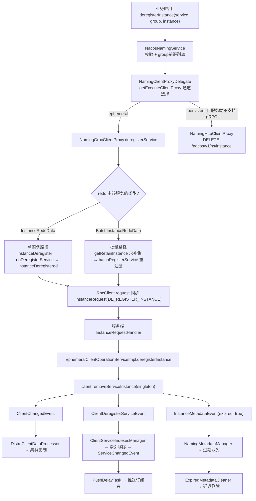

我先补齐注销链路特有的几处细节：批量反注册的"剩余重注册"、追踪事件枚举、以及服务清空后的索引回收。

## `NacosNamingService#deregisterInstance(serviceName, groupName, instance)` 服务实例注销全流程解析

### 〇、全流程鸟瞰



与注册流程相比，注销多了两条**分岔（批量补集）**、一条**反向状态机（预期态翻转）**、以及一套**延迟垃圾回收**。

---

## 第一部分：客户端处理逻辑

### 一、入口层：三行对称代码

`NacosNamingService.java` 第 210-215 行：

```java
@Override
public void deregisterInstance(String serviceName, String groupName, Instance instance) throws NacosException {
    NamingUtils.checkInstanceIsLegal(instance);
    checkAndStripGroupNamePrefix(instance, groupName);
    clientProxy.deregisterService(serviceName, groupName, instance);
}
```

与 `registerInstance` **完全对称**（同样校验心跳三件套关系、clusterName 正则、同样剥离 `group@@service` 前缀）。四个便捷重载（`deregisterInstance(serviceName, ip, port)` 等）在此收敛，注意构造默认 `Instance` 时**不设置 weight**（注册版会 `setWeight(1.0)`），因为反注册不需要 weight。

---

### 二、代理层：与注册共用同一套路由

```java
@Override
public void deregisterService(String serviceName, String groupName, Instance instance) throws NacosException {
    getExecuteClientProxy(instance).deregisterService(serviceName, groupName, instance);
}

private NamingClientProxy getExecuteClientProxy(Instance instance) {
    if (instance.isEphemeral()
            || grpcClientProxy.isAbilitySupportedByServer(AbilityKey.SERVER_SUPPORT_PERSISTENT_INSTANCE_BY_GRPC)) {
        return grpcClientProxy;
    }
    return httpClientProxy;
}
```

**一个值得注意的不对称**：`NamingHttpClientProxy.deregisterService` 的临时实例分支是**静默返回**而非抛异常：

```java
@Override
public void deregisterService(String serviceName, String groupName, Instance instance) throws NacosException {
    NAMING_LOGGER.info("[DEREGISTER-SERVICE] {} deregistering service {} with instance: {}", ...);
    if (instance.isEphemeral()) {
        return;                      // ← 注册时抛 UnsupportedOperationException，注销时直接 return
    }
    final Map<String, String> params = new HashMap<>(16);
    params.put(CommonParams.NAMESPACE_ID, namespaceId);
    params.put(CommonParams.SERVICE_NAME, NamingUtils.getGroupedName(serviceName, groupName));
    params.put(CommonParams.CLUSTER_NAME, instance.getClusterName());
    params.put(IP_PARAM, instance.getIp());
    params.put(PORT_PARAM, String.valueOf(instance.getPort()));
    params.put(EPHEMERAL_PARAM, String.valueOf(instance.isEphemeral()));
    reqApi(UtilAndComs.nacosUrlInstance, params, HttpMethod.DELETE);
}
```

**设计理由**：注册失败必须让调用方知道（否则实例根本不在集群里，业务会误判）；而"反注册"在 HTTP 通道对临时实例本来就是 no-op（临时实例由连接管理，不存在 HTTP 反注册语义），**静默返回更符合"尽力而为的清理动作"这一语义**——清理失败不值得阻塞关