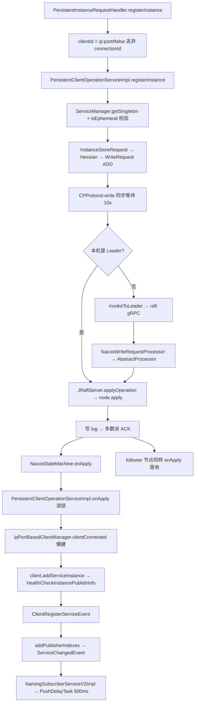

分析 JRaft 持久实例链路需要先摸清 proxy 转发与状态机执行两层。我从入口开始取证。

`PersistentClientOperationServiceImpl` 直接继承了 `RequestProcessor4CP` —— 业务与 Raft 处理器合一。深入这条线。

持久健康状态也走 Raft 写 —— 这条支线很关键。

单机模式下 CP 协议是什么实现？这决定持久注册能否工作。

推送触发点需要精确核实，避免臆断。

证据链完整。以下是 JRaft 持久实例注册的服务端全链路分析。

---

# 〇、一句话结论

持久实例注册的本质是：**把一个 `(Service, Instance, clientId)` 三元组 Hessian 序列化后写成一条 JRaft log，然后由状态机在每一个节点上各自回放一遍，落地成各节点内存里的 `IpPortBasedClient.publishers`**。它和临时实例最大的分野不是"用了 Raft"，而是**三件事同时发生**：① 身份从 `connectionId` 换成 `ip:port#false`（连接被彻底抛弃）；② 写入从「本地改 + Distro 广播」换成「log 复制 + 全节点 apply」；③ 一致性等级从最终一致换成了**线性一致的读就绪 + 强一致的写**。

而且有一个容易被忽略的架构事实：**`PersistentClientOperationServiceImpl` 一个类同时扮演两个角色** —— 对上它是 `ClientOperationService`（业务接口），对下它是 `RequestProcessor4CP`（Raft 状态机的回调实现）。写路径和 apply 路径在同一个 bean 里闭环。



---

# 一、入口层：`PersistentInstanceRequestHandler` 的三个决断

`/System/Volumes/Data/resource/github/nacos/naming/src/main/java/com/alibaba/nacos/naming/remote/rpc/handler/PersistentInstanceRequestHandler.java` L60-L83：

```java
@Override
@TpsControl(pointName = "RemoteNamingInstanceRegisterDeregister", name = "RemoteNamingInstanceRegisterDeregister")
@Secured(action = ActionTypes.WRITE)
@ExtractorManager.Extractor(rpcExtractor = PersistentInstanceRequestParamExtractor.class)
public InstanceResponse handle(PersistentInstanceRequest request, RequestMeta meta) throws NacosException {
    Service service = Service.newService(request.getNamespace(), request.getGroupName(), request.getServiceName(),
            false);                                              // ① ephemeral = false
    InstanceUtil.setInstanceIdIfEmpty(request.getInstance(), service.getGroupedServiceName());
    switch (request.getType()) {
        case NamingRemoteConstants.REGISTER_INSTANCE:  return registerInstance(service, request, meta);
        ...
    }
}

private InstanceResponse registerInstance(Service service, PersistentInstanceRequest request, RequestMeta meta) {
    Instance instance = request.getInstance();
    String clientId = IpPortBasedClient.getClientId(instance.toInetAddr(), false);   // ② ip:port#false
    clientOperationService.registerInstance(service, instance, clientId);
    NotifyCenter.publishEvent(new RegisterInstanceTraceEvent(..., true, ...));       // ③ 第三参 isPersistent=true
    return new InstanceResponse(NamingRemoteConstants.REGISTER_INSTANCE);
}
```

## 1.1 关键点 ②：`meta` 在写路径上被彻底丢弃

对比 `InstanceRequestHandler.registerInstance`（L75）：

```java
clientOperationService.registerInstance(service, request.getInstance(), meta.getConnectionId());
```

临时实例用 `meta.getConnectionId()`，持久实例用 `instance.toInetAddr()` 拼出来的 `ip:port#false`。**`meta` 参数在持久注册路径里只用于 trace event 的 sourceIp**，对数据落库毫无影响。

这一句就换掉了整个生命周期模型：

| 维度 | 临时实例（connectionId） | 持久实例（ip:port#false） |
|---|---|---|
| 身份绑定 | 一条 gRPC 长连接 | 一个逻辑 ip:port 会话 |
| 断连后果 | `ClientDisconnectEvent` → 实例消失 | 无任何影响 |
| 一进程多实例 | 同连接同服务只能存 1 个（已知陷阱） | 每个 ip:port 一个独立 client，互不干扰 |
| 心跳 | 需要（`ClientBeatCheckTaskV2`） | 不需要 |
| 过期回收 | `isExpire` 按时间 | **永不超时**，见下 |
| 反向代理/NAT | 客户端 IP 即连接 IP | 客户端 IP 是业务声明的 |

`IpPortBasedClient.isExpire` L93-L96 明确了这一点：

```java
@Override
public boolean isExpire(long currentTime) {
    return isEphemeral() && getAllPublishedService().isEmpty() && currentTime - getLastUpdatedTime() > ...;
}
```

**持久 client 恒不超时**，只能靠显式 `DELETE` 或快照 reconcile 移除。

## 1.2 关键点：`instanceId` 在进入 Raft 之前生成

`InstanceUtil.setInstanceIdIfEmpty` L114-L121：

```java
public static void setInstanceIdIfEmpty(Instance instance, String groupedServiceName) {
    if (null != instance && StringUtils.isEmpty(instance.getInstanceId())) {
        if (StringUtils.isBlank(instance.getServiceName())) {
            instance.setServiceName(groupedServiceName);
        }
        instance.setInstanceId(InstanceIdGeneratorManager.generateInstanceId(instance));
    }
}
```

这一步发生在 `WriteRequest` 构造之前，所以 **instanceId 会进入 raft log 并被全集群复制**。设计含义：instanceId 一旦由某个节点生成，其他节点 apply 时用的是同一条 log 里的同一个值 —— 不会出现「各节点各生成一个 ID」。这是"写路径前置生成"而非"apply 时生成"的典型正确选择。

代价是：如果 instanceId 由客户端提供且不同实例传了同一个值，raft log 会忠实地复制这个冲突值，服务端不做去重校验。

## 1.3 关键点对比：两个 handler 结构完全同构，仅差两个常量

`InstanceRequestHandler` 与 `PersistentInstanceRequestHandler` 的 `handle` 是逐行镜像 —— 差异只有 `Service.newService(..., true/false)` 和 clientId 来源。**共用同一个 TPS 桶名 `RemoteNamingInstanceRegisterDeregister`**。也就是说持久实例的注册流量和临时实例的注册流量在限流上是**混在一起的**，一个打满会连带另一个。

## 1.4 注入方式：跳过路由代理

```java
private final PersistentClientOperationServiceImpl clientOperationService;   // 具体类，非接口
```

而 `ClientOperationServiceProxy`（L88-L90）才是那个"按 `instance.isEphemeral()` 分流"的路由器：

```java
private ClientOperationService chooseClientOperationService(final Instance instance) {
    return instance.isEphemeral() ? ephemeralClientOperationService : persistentClientOperationService;
}
```

持久 RPC handler **不走这个 proxy，而是直接依赖具体实现类**。原因是请求类型本身已经表达了"我是持久实例"（`PersistentInstanceRequest`），不需要再看 `instance.isEphemeral()`。副作用是：如果客户端用 `InstanceRequest`（ephemeral 请求体）但 `instance.setEphemeral(false)`，就会经 HTTP controller 的 proxy 走到持久实现 —— 于是同一个业务动作有两条进入持久实现的路径，一条走 proxy 一条不走。

---

# 二、业务层：`registerInstance` 如何把调用变成一条日志

`/System/Volumes/Data/resource/github/nacos/naming/src/main/java/com/alibaba/nacos/naming/core/v2/service/impl/PersistentClientOperationServiceImpl.java` L85-L127：

```java
@Component("persistentClientOperationServiceImpl")
public class PersistentClientOperationServiceImpl extends RequestProcessor4CP implements ClientOperationService {

    private final PersistentIpPortClientManager clientManager;
    private final Serializer serializer = SerializeFactory.getDefault();
    private final CPProtocol protocol;
    private final ReentrantReadWriteLock lock = new ReentrantReadWriteLock();
    private final ReentrantReadWriteLock.ReadLock readLock = lock.readLock();

    public PersistentClientOperationServiceImpl(final PersistentIpPortClientManager clientManager) {
        this.clientManager = clientManager;
        this.protocol = ApplicationUtils.getBean(ProtocolManager.class).getCpProtocol();
        this.protocol.addRequestProcessors(Collections.singletonList(this));   // ★ 构造期建 raft group
    }

    @Override
    public void registerInstance(Service service, Instance instance, String clientId) {
        Service singleton = ServiceManager.getInstance().getSingleton(service);
        if (singleton.isEphemeral()) {
            throw new NacosRuntimeException(NacosException.INVALID_PARAM, "... is ephemeral service, can't register persistent instance.");
        }
        final InstanceStoreRequest request = new InstanceStoreRequest();
        request.setService(service);
        request.setInstance(instance);
        request.setClientId(clientId);
        final WriteRequest writeRequest = WriteRequest.newBuilder().setGroup(group())
                .setData(ByteString.copyFrom(serializer.serialize(request))).setOperation(DataOperation.ADD.name())
                .build();
        try {
            protocol.write(writeRequest);                       // ★ 同步阻塞，最长 10s
            Loggers.RAFT.info("Client registered. service={}, clientId={}, instance={}", service, clientId, instance);
        } catch (Exception e) {
            throw new NacosRuntimeException(NacosException.SERVER_ERROR, e);
        }
    }
```

## 2.1 双重身份：一个 bean 同时是写方与 apply 方

- 对 naming 业务：它是 `ClientOperationService`，被 handler 调用 `registerInstance/deregisterInstance`
- 对 JRaft：它是 `RequestProcessor4CP`，被状态机回调 `onApply(WriteRequest)`

这是 v2 相对 1.x 的重要简化。1.x 里持久数据走 `DatumProcessor` + `NamingMRData` + `naming_persistent_service` group，数据模型是「KV Datum」；v2 直接把 `Client/InstancePublishInfo` 这套 v2 内存模型当成 raft 的状态，**日志内容 = 业务命令**，不再有独立的存储抽象层。

## 2.2 构造期注册 raft group：懒启动 + 时序耦合

`addRequestProcessors` → `JRaftProtocol.addRequestProcessors` L162-L164 → `raftServer.createMultiRaftGroup(processors)`。

`JRaftServer.createMultiRaftGroup` L221-L272 里第一件事就是：

```java
if (!this.isStarted) {
    this.processors.addAll(processors);      // 攒着，等 start() 时统一建
    return;
}
```

所以**协议未启动时 processor 只是被收集**，`protocol` 字段此时已被 `ProtocolManager.getCpProtocol()` 触发 `initCPProtocol()`（双检锁，L86-L96），init 里 `raftServer.start()` → `createMultiRaftGroup(this.processors)`。这套"攒批 + 惰性"让 bean 创建顺序不再致命，但也意味着 **raft group 是在第一次有业务 bean 索取 CPProtocol 时才真正建立的**，而不是启动早期。

每个 `RequestProcessor4CP` 独占一个 raft group，group 名来自 `group()`：

```java
@Override
public String group() {
    return Constants.NAMING_PERSISTENT_SERVICE_GROUP_V2;    // "naming_persistent_service_v2"
}
```

独立 group 意味着**独立的 log / snapshot / meta 目录与独立的 leader 选举**（L237-L239、L88-L104 的 `initDirectory`）：

```
${nacos.home}/data/protocol/raft/naming_persistent_service_v2/{log, snapshot, meta-data}
```

`conf` 用 `Configuration`（成员地址 = `ip:raftPort`，由 `ProtocolManager.toCPMembersInfo` L76-L84 通过 `MemberUtil.calculateRaftPort` 算出），raft RPC 复用 gRPC 通道（`JRaftUtils.initRpcServer` L62-L84 用 `GrpcRaftRpcFactory` 注册 `Log/WriteRequest/ReadRequest/Response` 的 protobuf marshaller，并挂上 `NacosWriteRequestProcessor`/`NacosReadRequestProcessor`）。

## 2.3 命令载荷：`InstanceStoreRequest` + Hessian

```java
protected static class InstanceStoreRequest implements Serializable {
    private Service service;
    private Instance instance;
    private String clientId;
}
```

`SerializeFactory.getDefault()` 的默认实现是 **Hessian**（`consistency/src/main/java/com/alibaba/nacos/consistency/SerializeFactory.java` L32-L47）：

```java
public static final String HESSIAN_INDEX = "Hessian".toLowerCase();
public static String defaultSerializer = HESSIAN_INDEX;
public static Serializer getDefault() { return SERIALIZER_MAP.get(defaultSerializer); }
```

这解释了 `InstanceStoreRequest` 为什么要 `implements Serializable` 并声明 `serialVersionUID = -9077205657156890549L` —— Hessian 走的是 JavaBean/Serializable 语义。同时也解释了一个隐性约束：**raft log 里的 payload 是 Java 序列化图，改 `Service`/`Instance`/`InstancePublishInfo` 的字段是跨版本兼容风险**，滚动升级期间旧节点反序列化新 log（或反之）都可能失败。这是持久实例升级要格外小心的根本原因，也是 `serialVersionUID` 被显式钉死的原因。

## 2.4 `operation` 字段：把 CRUD 语义外置到 log header

```java
WriteRequest.newBuilder().setGroup(group())
    .setData(...).setOperation(DataOperation.ADD.name()).build()
```

`DataOperation` 放在 `WriteRequest.operation`（protobuf 字段）而不是 payload 内部。好处是**状态机分派不需要反序列化业务对象**（`onApply` L197 先 `DataOperation.valueOf(request.getOperation())` 再按分支决定是否 deserialize），也让运维读 raft log 时能直接看到 ADD/DELETE/CHANGE。

## 2.5 同步阻塞写：10 秒预算占用 gRPC 工作线程

`JRaftProtocol.write` L177-L187：

```java
@Override
public Response write(WriteRequest request) throws Exception {
    CompletableFuture<Response> future = writeAsync(request);
    // Here you wait for 10 seconds, as long as possible, for the request to complete
    return future.get(10_000L, TimeUnit.MILLISECONDS);
}

@Override
public CompletableFuture<Response> writeAsync(WriteRequest request) {
    return raftServer.commit(request.getGroup(), request, new CompletableFuture<>());
}
```

这条 `future.get(10s)` 跑在 **gRPC 请求处理线程**上（`GrpcRequestAcceptor` 的 worker 池）。对比临时实例路径（本地 map put + 异步 Distro 广播，毫秒级返回），持久注册的 P99 直接受 raft 多数派 RTT 支配。集群跨机房、leader 选举中、磁盘 fsync 慢时，最坏情况一条注册请求吃掉一个工作线程 10 秒 —— 持久实例注册量大时会打满 remote 线程池。

---

# 三、协议层：Leader 与 Follower 的两条岔路

`JRaftServer.commit` L320-L340：

```java
public CompletableFuture<Response> commit(final String group, final Message data, final CompletableFuture<Response> future) {
    final RaftGroupTuple tuple = findTupleByGroup(group);
    if (tuple == null) {
        future.completeExceptionally(new IllegalArgumentException("No corresponding Raft Group found : " + group));
        return future;
    }
    FailoverClosureImpl closure = new FailoverClosureImpl(future);
    final Node node = tuple.node;
    if (node.isLeader()) {
        applyOperation(node, data, closure);          // 路径 A：本地直接 apply
    } else {
        invokeToLeader(group, data, rpcRequestTimeoutMs, closure);   // 路径 B：转发 leader
    }
    return future;
}
```

## 3.1 路径 A（本机是 leader）

`applyOperation` L397-L419：

```java
public void applyOperation(Node node, Message data, FailoverClosure closure) {
    final Task task = new Task();
    task.setDone(new NacosClosure(data, status -> {
        NacosClosure.NacosStatus nacosStatus = (NacosClosure.NacosStatus) status;
        closure.setThrowable(nacosStatus.getThrowable());
        closure.setResponse(nacosStatus.getResponse());
        closure.run(nacosStatus);
    }));
    // add request type field at the head of task data.
    byte[] requestTypeFieldBytes = new byte[2];
    requestTypeFieldBytes[0] = ProtoMessageUtil.REQUEST_TYPE_FIELD_TAG;
    requestTypeFieldBytes[1] = (data instanceof ReadRequest)
            ? ProtoMessageUtil.REQUEST_TYPE_READ : ProtoMessageUtil.REQUEST_TYPE_WRITE;
    byte[] dataBytes = data.toByteArray();
    task.setData((ByteBuffer) ByteBuffer.allocate(requestTypeFieldBytes.length + dataBytes.length)
            .put(requestTypeFieldBytes).put(dataBytes).position(0));
    node.apply(task);
}
```

设计细节：**leader 写日志时无法把 read/write 类型放进 protobuf（因为 `ReadRequest` 和 `WriteRequest` 是不同 message，回放时只有裸 `ByteBuffer`），于是手工前置 2 个字节做类型标签**，回放侧用 `ProtoMessageUtil.parse(data.array())` 还原（见 4.1）。这是"状态机 log 是自描述的二进制流"这一约束下的典型补丁。

`node.apply(task)` → JRaft 内部：写本地 log → 复制到 follower → 多数派提交 → `StateMachine.onApply`。

## 3.2 路径 B（本机是 follower）

`invokeToLeader` L421-L452：

```java
private void invokeToLeader(final String group, final Message request, final int timeoutMillis, FailoverClosure closure) {
    try {
        final Endpoint leaderIp = Optional.ofNullable(getLeader(group))
                .orElseThrow(() -> new NoLeaderException(group)).getEndpoint();
        cliClientService.getRpcClient().invokeAsync(leaderIp, request, new InvokeCallback() {
            @Override
            public void complete(Object o, Throwable ex) {
                if (Objects.nonNull(ex)) { closure.setThrowable(ex); closure.run(new Status(RaftError.UNKNOWN, ex.getMessage())); return; }
                if (!((Response)o).getSuccess()) {                    // ★ 检查业务 success
                    closure.setThrowable(new IllegalStateException(((Response) o).getErrMsg()));
                    closure.run(new Status(RaftError.UNKNOWN, ((Response) o).getErrMsg()));
                    return;
                }
                closure.setResponse((Response) o);
                closure.run(Status.OK());
            }
            @Override
            public Executor executor() { return RaftExecutor.getRaftCliServiceExecutor(); }
        }, timeoutMillis);
    } catch (Exception e) { closure.setThrowable(e); closure.run(new Status(RaftError.UNKNOWN, e.toString())); }
}
```

leader 侧接收方是 `NacosWriteRequestProcessor`（`JRaftUtils.initRpcServer` L81 注册），继承 `AbstractProcessor`，L43-L61：

```java
protected void handleRequest(final JRaftServer server, final String group, final RpcContext rpcCtx, Message message) {
    final JRaftServer.RaftGroupTuple tuple = server.findTupleByGroup(group);
    if (Objects.isNull(tuple)) { rpcCtx.sendResponse(Response.newBuilder().setSuccess(false)
            .setErrMsg("Could not find the corresponding Raft Group : " + group).build()); return; }
    if (tuple.getNode().isLeader()) {
        execute(server, rpcCtx, message, tuple);
    } else {
        rpcCtx.sendResponse(Response.newBuilder().setSuccess(false).setErrMsg("Could not find leader : " + group).build());
    }
}
```

**注意 `isLeader` 被检查了两次**（follower 本地一次、leader 接收时再一次）。这不是冗余：两次检查之间存在 term 变更窗口（转发的请求可能在新 leader 上任后到达），第二次检查能避免旧 leader 把 log 写进已下线的 term。返回的是 `Response.success=false` 而非异常 —— 让 follower 侧能拿到明确的 `Could not find leader` 而不是超时。

这条路径多一次 **节点间 RPC**（raft 端口），因此持久实例注册的延迟构成是：`客户端→服务端 gRPC` + `follower→leader raft RPC` + `raft 多数派复制` + `leader apply`。打到 follower 的注册天然比打到 leader 多一跳。

## 3.3 单机模式：依然跑 JRaft

这一点值得专门澄清。`ConsistencyConfiguration` L38-L55：

```java
@Bean(value = "strongAgreementProtocol")
public CPProtocol strongAgreementProtocol(ServerMemberManager memberManager) throws Exception {
    const protocl = getProtocol(CPProtocol.class, () -> new JRaftProtocol(memberManager));
    return protocl;
}

private <T> T getProtocol(Class<T> cls, Callable<T> builder) throws Exception {
    Collection<T> protocols = NacosServiceLoader.load(cls);   // SPI 优先
    Iterator<T> iterator = protocols.iterator();
    return iterator.hasNext() ? iterator.next() : builder.call();
}
```

**本代码库中已不存在 `NullConsistencyProtocol`**（全库 grep 无匹配），CP 实现恒为 `JRaftProtocol`（除外部 SPI 覆盖）。所以 `-m standalone` 下持久实例注册照样走完整 raft 流程，只是 `Configuration` 里只有一个 peer —— 自己既是 leader 又是唯一法定人数，commit 只需本地 fsync，不必等待网络复制。这也说明**单机持久实例的写延迟 = 一次磁盘 fsync**，而不是零成本。

---

# 四、状态机层：`onApply` 的分派规则

`/System/Volumes/Data/resource/github/nacos/core/src/main/java/com/alibaba/nacos/core/distributed/raft/NacosStateMachine.java` L95-L149（核心骨架）：

```java
public void onApply(Iterator iter) {
    while (iter.hasNext()) {
        Status status = Status.OK();
        try {
            if (iter.done() != null) {
                closure = (NacosClosure) iter.done();        // leader 本地提交，带 closure
                message = closure.getMessage();
            } else {
                final ByteBuffer data = iter.getData();
                message = ProtoMessageUtil.parse(data.array());    // ★ 靠 2 字节标签还原类型
                if (message instanceof ReadRequest) {
                    //'iter.done() == null' means current node is follower, ignore read operation
                    applied++; index++; iter.next(); continue;      // follower 回放跳过读
                }
            }
            if (message instanceof WriteRequest) {
                Response response = processor.onApply((WriteRequest) message);    // ★ 回调业务
                postProcessor(response, closure);
            }
            if (message instanceof ReadRequest) {
                Response response = processor.onRequest((ReadRequest) message);
                postProcessor(response, closure);
            }
        } catch (Throwable e) {
            index++; status.setError(RaftError.UNKNOWN, e.toString());
            Optional.ofNullable(closure).ifPresent(c1 -> c1.setThrowable(e));
            throw e;
        } finally {
            Optional.ofNullable(closure).ifPresent(c1 -> c1.run(status));
        }
        applied++; index++; iter.next();
    }
    // 外层 catch：iter.setErrorAndRollback(index - applied, ESTATEMACHINE...)
}
```

四个要点：

1. **`iter.done() != null` 是「本地提交」的判据**，而非「是否 leader」。leader 自己 apply 的请求带 closure，可以立刻把 `Response` 回给调用方；follower 从 log 迭代到的条目 `done() == null`，只能回放状态变更、无法回响应。
2. **follower 跳过 `ReadRequest`** 是正确性设计：读请求（`readFromLeader` → `commit` 会把 ReadRequest 也塞进 raft 路径）不需要在 follower 上产生状态变更，回放它没有意义且会重复执行 `onRequest`。
3. **一条 log 应用失败会 rollback 整批**（`iter.setErrorAndRollback(index - applied, ...)`），JRaft 会停止该状态机推进 —— 也就是说 `onApply` 里的**未捕获异常是集群级事故**（log 卡死、apply 停滞）。这直接解释了业务层为什么要在 `onApply` 里把异常 catch 干净（见 5.1）。
4. `postProcessor(response, closure)` 只在 `closure != null` 时 set response，follower 回放时 response 无人接收 —— 这是"leader 返回成功、follower 静默 apply"的实现点。

## 4.1 业务侧的 `onApply`：把异常吞成 success=false

L191-L224：

```java
@Override
public Response onApply(WriteRequest request) {
    final Lock lock = readLock;                      // ★ 读锁
    lock.lock();
    try {
        final InstanceStoreRequest instanceRequest = serializer.deserialize(request.getData().toByteArray());
        final DataOperation operation = DataOperation.valueOf(request.getOperation());
        switch (operation) {
            case ADD:     onInstanceRegister(instanceRequest.service, instanceRequest.instance, instanceRequest.getClientId()); break;
            case DELETE:  onInstanceDeregister(instanceRequest.service, instanceRequest.getClientId()); break;
            case CHANGE:
                if (instanceAndServiceExist(instanceRequest)) {
                    onInstanceRegister(instanceRequest.service, instanceRequest.instance, instanceRequest.getClientId());
                }
                break;
            default:
                return Response.newBuilder().setSuccess(false).setErrMsg("unsupport operation : " + operation).build();
        }
        return Response.newBuilder().setSuccess(true).build();
    } catch (Exception e) {
        Loggers.RAFT.warn("Persistent client operation failed. ", e);
        return Response.newBuilder().setSuccess(false)
                .setErrMsg("Persistent client operation failed. " + e.getMessage()).build();
    } finally {
        lock.unlock();
    }
}
```

三个精妙之处：

**（a）读锁做写保护，方向反直觉但正确。** 同一个 `ReentrantReadWriteLock`：`onApply` 拿 `readLock`（L193），`AbstractSnapshotOperation` 的 save/load 拿 `writeLock`：

```java
// AbstractSnapshotOperation L46-L62
public void onSnapshotSave(Writer writer, BiConsumer<Boolean, Throwable> callFinally) {
    RaftExecutor.doSnapshot(() -> {
        final Lock lock = writeLock;
        lock.lock();
        try { callFinally.accept(writeSnapshot(writer), null); }
        ...
    });
}
```

含义是：**apply 之间允许并发**（其实 JRaft 单个 group 的 onApply 本身就是串行线程，读锁只是不额外制造瓶颈），**但快照期间必须独占** —— 快照要对 `clientManager.showClients()` 做全量一致性遍历，若与 apply 交错就会写出一个 log 上任何时刻都不存在的视图。锁方向的选择精确对应"快照是全局原子的读，apply 是增量写"。

**（b）CHANGE 的 `instanceAndServiceExist` 防「更新退化为创建」：**

```java
private boolean instanceAndServiceExist(InstanceStoreRequest instanceRequest) {
    return clientManager.contains(instanceRequest.getClientId())
        && clientManager.getClient(instanceRequest.getClientId()).getAllPublishedService().contains(instanceRequest.service);
}
```

`updateInstance`（走 CHANGE）的唯一调用方是健康状态同步器，语义是"改已存在实例的 healthy"。如果这个实例已被 DELETE（或从未 ADD），CHANGE 会绕过 `onInstanceRegister` 的懒建 client 逻辑（`clientManager.clientConnected`）从而在集群里凭空造出一个实例。这里用一次存在性校验拦住 —— 而且**校验后直接 fall through 到 `onInstanceRegister`**（复用 ADD 逻辑），不另写一套 update 分支，保证 ADD 与 CHANGE 的落地代码绝对一致。

**（c）`catch (Exception)` 而非 `Throwable`。** 状态机外层 `catch (Throwable)` 会 rollback；业务层只挡 `Exception`，`Error`（如 OOM/StackOverflow）会穿透到状态机 → 停 apply。这个分工是合理的：可恢复的业务错误不能让集群停摆，不可恢复的 JVM 错误必须停。

---

# 五、落地层：apply 之后数据到底怎么存

L231-L243：

```java
private void onInstanceRegister(Service service, Instance instance, String clientId) {
    Service singleton = ServiceManager.getInstance().getSingleton(service);
    if (!clientManager.contains(clientId)) {
        clientManager.clientConnected(clientId, new ClientAttributes());
    }
    Client client = clientManager.getClient(clientId);
    InstancePublishInfo instancePublishInfo = getPublishInfo(instance);
    client.addServiceInstance(singleton, instancePublishInfo);
    client.setLastUpdatedTime();
    NotifyCenter.publishEvent(new ClientOperationEvent.ClientRegisterServiceEvent(singleton, clientId));
    NotifyCenter.publishEvent(new MetadataEvent.InstanceMetadataEvent(singleton, instancePublishInfo.getMetadataId(), false));
}
```

## 5.1 `ClientAttributes` 是空的 —— 一个确定的可观测性缺口

`clientConnected(clientId, new ClientAttributes())` 传的是**空 attributes**。而临时实例的 attributes 来自连接 labels（app/version/标签），HTTP 路径则由 `ClientAttributesFilter` 填充。持久实例走 raft 后 `RequestMeta` 已经丢失（raft log 里只有 service/instance/clientId 三样），所以：

```java
// PersistentIpPortClientFactory L37-L41
public IpPortBasedClient newClient(String clientId, ClientAttributes attributes) {
    IpPortBasedClient ipPortBasedClient = new IpPortBasedClient(clientId, false);   // ephemeral 硬编码 false
    ipPortBasedClient.setAttributes(attributes);
    return ipPortBasedClient;
}
```

**结论：`IpPortBasedClient` 的 `ephemeral=false` 不来自解析 clientId 的 `#false` 后缀，而是工厂硬编码** —— `clientId` 里的 `#false` 只是给 `getResponsibleTagFromId()`（`substring(0, indexOf("#"))`）和 `PushExecutorDelegate` 的路由判断用的标记位。运维接口查这个 client 看不到 app / 版本 / 标签。

## 5.2 实例类型升级：`InstancePublishInfo` → `HealthCheckInstancePublishInfo`

`IpPortBasedClient.addServiceInstance` L88-L90 做了一层转换：

```java
@Override
public boolean addServiceInstance(Service service, InstancePublishInfo instancePublishInfo) {
    return super.addServiceInstance(service, parseToHealthCheckInstance(instancePublishInfo));
}

private HealthCheckInstancePublishInfo parseToHealthCheckInstance(InstancePublishInfo instancePublishInfo) {
    HealthCheckInstancePublishInfo result = (instancePublishInfo instanceof HealthCheckInstancePublishInfo)
        ? (HealthCheckInstancePublishInfo) instancePublishInfo : new HealthCheckInstancePublishInfo();
    ... // 逐字段复制 ip/port/healthy/cluster/extendDatum
    if (!ephemeral) { result.initHealthCheck(); }     // ★ 持久实例：立刻建 HealthCheckStatus
    return result;
}
```

`initHealthCheck()` → `healthCheckStatus = new HealthCheckStatus()`（含 `isBeingChecked`/`checkOkCount`/`checkFailCount`）。含义是**持久实例从注册那一刻起就进入服务端主动探测状态机**，且 `tryStartCheck()` 用 CAS 保证同一实例不被并发探测。

对比临时实例：`InstancePublishInfo` 原样存，健康与否由客户端心跳/连接决定，不需要 `HealthCheckStatus`。

## 5.3 压缩存储与 `getPublishInfo` 复用

`getPublishInfo` 来自 `ClientOperationService` 接口的 default 方法（L94-L114），**与临时实例共用同一份实现**：

```java
default InstancePublishInfo getPublishInfo(Instance instance) {
    InstancePublishInfo result = new InstancePublishInfo(instance.getIp(), instance.getPort());
    Map<String, Object> extendDatum = result.getExtendDatum();
    if (null != instance.getMetadata() && !instance.getMetadata().isEmpty()) { extendDatum.putAll(instance.getMetadata()); }
    if (StringUtils.isNotEmpty(instance.getInstanceId())) { extendDatum.put(Constants.CUSTOM_INSTANCE_ID, instance.getInstanceId()); }
    if (Constants.DEFAULT_INSTANCE_WEIGHT != instance.getWeight()) { extendDatum.put(Constants.PUBLISH_INSTANCE_WEIGHT, instance.getWeight()); }
    if (!instance.isEnabled()) { extendDatum.put(Constants.PUBLISH_INSTANCE_ENABLE, instance.isEnabled()); }
    String clusterName = StringUtils.isBlank(instance.getClusterName()) ? UtilsAndCommons.DEFAULT_CLUSTER_NAME : instance.getClusterName();
    result.setHealthy(instance.isHealthy());
    result.setCluster(clusterName);
    return result;
}
```

只在非默认值时写 `extendDatum`（稀疏编码）。有个值得注意的点：**持久路径这里没有写 `ephemeral=false` 标记进 extendDatum**（临时路径也没有写 true），持久性完全由 `Service.ephemeral` 和 client 类型承载。

## 5.4 事件扇出：与临时实例共用后半程

`ClientRegisterServiceEvent` 由 `ClientServiceIndexesManager` 消费（L119-L133）：

```java
private void handleClientOperation(ClientOperationEvent event) {
    ...
    if (event instanceof ClientOperationEvent.ClientRegisterServiceEvent) { addPublisherIndexes(service, clientId); }
    ...
}

private void addPublisherIndexes(Service service, String clientId) {
    publisherIndexes.computeIfAbsent(service, key -> new ConcurrentHashSet<>()).add(clientId);
    NotifyCenter.publishEvent(new ServiceEvent.ServiceChangedEvent(service, true));   // ★ 无条件
}
```

然后 `NamingSubscriberServiceV2Impl`（L109/L116-L118）把 `ServiceChangedEvent` 变成 `PushDelayTask(service, pushTaskDelay=500ms)`。**从 `ClientRegisterServiceEvent` 往后的所有链路，持久实例与临时实例一字不差**：同一份索引、同一个 `ServiceStorage` 懒聚合、同一个推送引擎、同一个 500ms 合并窗口。

`incrementRevision=true` 会调 `service.incrementRevision()`。但持久侧**没有 `client.recalculateRevision()`**（对比 `EphemeralClientOperationServiceImpl` L70/L95/L112 都有）。这是**正确的不对称**：`Client.revision` 是 Distro VERIFY 的指纹（`getVerifyData(clientId, revision)`），持久实例不参与 Distro，算 revision 纯属浪费；而 `Service.revision` 属于本地视图，仍需要推进。

## 5.5 持久侧完全拒绝 Distro 与订阅

`PersistentIpPortClientManager` 的三处 `UnsupportedOperationException` 与恒 true 的责任判定：

```java
@Override public boolean syncClientConnected(String clientId, ClientAttributes attributes) { throw new UnsupportedOperationException(""); }
@Override public boolean verifyClient(DistroClientVerifyInfo verifyData) { throw new UnsupportedOperationException(""); }
@Override public boolean isResponsibleClient(Client client) { return true; }   // 注释：Raft 算法，任意节点都能处理
@Override public boolean clientConnected(final Client client) {
    clients.computeIfAbsent(client.getClientId(), s -> { ...; ipPortBasedClient.init(); return ipPortBasedClient; });
    return true;
}
```

`isResponsibleClient` 恒 true 的含义：临时实例只有责任节点才广播 Distro，持久实例**每个节点都是责任节点**（因为数据来自 raft log 而非某个节点的所有权）。

`init()`（`IpPortBasedClient` L133-L141）里 `ephemeral=false` → `healthCheckTaskV2 = new HealthCheckTaskV2(this); HealthCheckReactor.scheduleCheck(healthCheckTaskV2)` —— **client 一建立就开始探测**。

而订阅被彻底禁止（L176-L184）：

```java
@Override public void subscribeService(Service service, Subscriber subscriber, String clientId) {
    throw new UnsupportedOperationException("No persistent subscribers");
}
```

配合 `ClientOperationServiceProxy.subscribeService` L77-L79 的注释「Subscriber is an ephemeral type only, so call ephemeral client directly」，形成完整规则：**订阅者永远是临时性质的**，持久服务上的订阅仍然登记在某个 `ConnectionBasedClient` 上，只是持久实例本身的 `IpPortBasedClient` 不持有 subscriber。

## 5.6 `DELETE` 的两个细节

```java
private void onInstanceDeregister(Service service, String clientId) {
    Service singleton = ServiceManager.getInstance().getSingleton(service);
    Client client = clientManager.getClient(clientId);
    if (client == null) { Loggers.RAFT.warn("client not exist onInstanceDeregister, clientId : {}", clientId); return; }   // 幂等
    final InstancePublishInfo removedInstance = client.removeServiceInstance(singleton);
    client.setLastUpdatedTime();
    if (client.getAllPublishedService().isEmpty()) {
        clientManager.clientDisconnected(clientId);      // 空了就删 client
    }
    NotifyCenter.publishEvent(new ClientOperationEvent.ClientDeregisterServiceEvent(singleton, clientId));
    if (null != removedInstance) {
        NotifyCenter.publishEvent(new MetadataEvent.InstanceMetadataEvent(singleton, removedInstance.getMetadataId(), true));
    }
}
```

1. `onApply` 的 DELETE 分支只传 `service` + `clientId`，**instance 参数不参与定位**（L204），与临时实例一样印证"实例由 (clientId, Service) 唯一确定，不由 ip/port 内容确定"。
2. `client == null` 时 warn + return，实现幂等 —— 重放同一条 DELETE 日志不会炸。但**注意 `getSingleton(service)` 在 client 检查之前**，若 service 从未存在，`getSingleton` 会顺手创建一个空服务单例（持久路径用的是 `getSingleton` 而非 `getSingletonIfExist`）。这是持久 DELETE 相对临时 DELETE（L103-L106 有 `containSingleton` 前置短路）的一处不对称。
3. 业务层 `deregisterInstance`（L158-L174）**不做 `singleton.isEphemeral()` 校验**，而 `registerInstance`（L108）做了。也就是说对临时服务发持久注销请求，命令会进 raft log 并在 apply 时按 clientId 找不到 client 而 warn 返回 —— 不报错，静默无效。

---

# 六、一致性闭环：快照与全量 reconcile

`loadSnapshotOperate()` L265-L267 返回非空，所以 `createMultiRaftGroup` L253 保留了默认 1800 秒快照间隔（若业务未实现快照则被置 0 关闭）。

## 6.1 快照写：以 client 为单位全量 dump

```java
protected InputStream dumpSnapshot() {
    Map<String, IpPortBasedClient> clientMap = clientManager.showClients();     // unmodifiableView
    ConcurrentHashMap<String, ClientSyncData> clone = new ConcurrentHashMap<>(INITIAL_CAPACITY);
    clientMap.forEach((clientId, client) -> clone.put(clientId, client.generateSyncData()));
    return new ByteArrayInputStream(serializer.serialize(clone));
}
```

`showClients()` 返回 `Collections.unmodifiableMap(clients)`，是**活视图**而非拷贝 —— 安全性完全依赖外层 `writeLock` 排他住所有 `onApply`。`generateSyncData()` 复用 Distro 的那份 `ClientSyncData` 结构（namespace/group/service 三个平行 list + instancePublishInfos），**一份数据模型同时服务 AP 同步、CP 快照和运维导出**。

打包成 `persistent_instance.zip` 并带 CRC64 校验：

```java
final Checksum checksum = new CRC64();
DiskUtils.compressIntoZipFile("instance", inputStream, outputFile, checksum);
meta.append(CHECK_SUM_KEY, Long.toHexString(checksum.getValue()));
```

读侧对校验和不匹配直接 `throw new IllegalArgumentException("Snapshot checksum failed")` → `onSnapshotLoad` 返回 false → JRaft 认定快照损坏，回退到 log 回放。**这是对抗磁盘静默腐坏（bit rot）的必要防线**，因为持久实例的全部真相就是这台机器的 raft 数据。

## 6.2 快照读：三段式 reconcile

`loadSnapshot` L359-L377 是全量对账：

```java
ConcurrentHashMap<String, ClientSyncData> newData = serializer.deserialize(snapshotBytes);
Collection<String> oldClientIds = clientManager.allClientId();
for (Map.Entry<String, ClientSyncData> entry : newData.entrySet()) {
    if (oldClientIds.contains(entry.getKey())) { updateSyncDataToClient(entry, (IpPortBasedClient) clientManager.getClient(entry.getKey())); }   // 活 client：diff 更新
    else {
        IpPortBasedClient snapshotClient = new IpPortBasedClient(entry.getKey(), false);
        snapshotClient.setAttributes(entry.getValue().getAttributes());
        snapshotClient.init();
        addSyncDataToClient(entry, snapshotClient);                                            // 新 client
    }
}
removeDeadClient(newData.keySet(), oldClientIds);                                              // 死 client
```

与 Distro 的 `upgradeClient` 是同一种"全量 reconcile + diff 发事件"思路（前序已论证），但有三处不同：

| 方面 | Distro upgradeClient（AP） | 持久快照 loadSnapshot（CP） |
|---|---|---|
| 触发时机 | 每次收到远端 ClientSyncData | 仅启动/追赶时装快照 |
| 事件发送 | 逐条 `putServiceInstance` 后发 | `addSyncDataToClient` **先攒 List 再加 client 后统一发** |
| attributes | 来自连接/label | 快照里直接带回（`entry.getValue().getAttributes()`） |

`addSyncDataToClient` L471-L490 这个"攒事件"设计值得单独指出：

```java
List<ClientOperationEvent.ClientRegisterServiceEvent> waitPublishEvents = new ArrayList<>();
for (int i = 0; i < namespaces.size(); i++) {
    ...
    client.putServiceInstance(singleton, instances.get(i));      // 只塞数据，不发事件
    waitPublishEvents.add(new ClientOperationEvent.ClientRegisterServiceEvent(singleton, client.getClientId()));
}
clientManager.addSyncClient(client);                             // ★ 先让 client 可见
for (ClientOperationEvent.ClientRegisterServiceEvent waitPublishEvent : waitPublishEvents) {
    NotifyCenter.publishEvent(waitPublishEvent);                  // ★ 再统一发事件
}
```

顺序很重要：**先把 client 放进 manager，再发事件**。因为 `ClientServiceIndexesManager` 收到 `ClientRegisterServiceEvent` 后（以及别的订阅者可能）需要能 `clientManager.getClient(clientId)` 拿到这个 client。若先发事件再放 client，索引会指向一个不存在的 clientId，形成脏索引。这是 reconcile 类逻辑里最经典的一种时序坑，代码用"延迟发事件"精确规避。

另外用 `putServiceInstance`（L146-L150，纯 put 不发 `ClientChangedEvent`）而不是 `addServiceInstance` —— 快照加载期间不该产生 Distro 广播（持久 client 本来也不广播），也避免逐个发事件。

`removeDeadClient` L440-L469 独立处理"快照里没有但本地有"的 client，先逐个移除 publishers（发 `ClientDeregisterServiceEvent`）再 `removeAndRelease`。注意 `clientDisconnected` 会遍历 publishers 移除索引，而这里手动展开循环，是因为 `removeAndRelease` 只做 `remove + release()`、不发 per-service 事件。

---

# 七、下半场：健康状态也是 Raft 日志

这条支线最能体现 CP 的代价与收益。

`/System/Volumes/Data/resource/github/nacos/naming/src/main/java/com/alibaba/nacos/naming/healthcheck/v2/PersistentHealthStatusSynchronizer.java` L41-L47：

```java
@Override
public void instanceHealthStatusChange(boolean isHealthy, Client client, Service service, InstancePublishInfo instance) {
    Instance updateInstance = InstanceUtil.parseToApiInstance(service, instance);
    updateInstance.setHealthy(isHealthy);
    persistentClientOperationService.updateInstance(service, updateInstance, client.getClientId());
}
```

`updateInstance`（L132-L151）走的是完全相同的管道，只是 `operation = DataOperation.CHANGE`。

于是形成一条闭环链路：

```
探测失败 → HealthCheckInstancePublishInfo.getFailCount()++ → 超阈值置 unhealthy
   → PersistentHealthStatusSynchronizer.instanceHealthStatusChange
   → updateInstance → WriteRequest(CHANGE) → protocol.write → raft log
   → 全节点 onApply → onInstanceRegister（ADD 同一段代码）
   → ClientRegisterServiceEvent → ServiceChangedEvent → PushDelayTask(500ms) → 推送
```

两个推论：

**推论一：持久实例的 healthy 位是强一致的全集群事实。** 临时实例的 healthy 由各节点 `ClientBeatCheckTaskV2`/连接状态本地判定，不同节点可能短暂不一致（靠 Distro verify 收敛）；持久实例的 healthy 是 raft log 里的一个字段，任何节点读到的都是已提交值 —— 这就是"持久实例健康状态不会因节点而异"的实现根据。

**推论二：一次健康翻转 = 一条 raft log + 一次同步 10s 预算的写。** 每个节点都持有该 `IpPortBasedClient`、都 `init()` 起探测任务（`HealthCheckTaskV2.taskId = client.getResponsibleId()` = `ip:port`），因此 N 节点集群对同一实例有 N 份独立探测。任一节点判定翻转就提交一次 CHANGE。这既是**冗余探测带来的写放大**（最坏 N 次），也在客观上构成了"多节点投票"式的抖动抑制 —— 只要判定阈值让多数节点不轻易翻转，实际写入就集中在真故障时。这是本设计中一处未在注释里明说、但需要运维理解的权衡。

---

# 八、设计关键点清单

| # | 关键点 | 位置 |
|---|---|---|
| 1 | 身份换成 `ip:port#false`，`meta.connectionId` 在写路径被丢弃 | handler L77 |
| 2 | instanceId 在进 raft 前生成，保证全集群同一值 | `setInstanceIdIfEmpty` L114 |
| 3 | 一个类同时是 `ClientOperationService` 与 `RequestProcessor4CP` | impl L85 |
| 4 | 每个 `RequestProcessor4CP` 独占一个 raft group + 独立磁盘目录 | `createMultiRaftGroup` L230-L272 |
| 5 | group 名 `naming_persistent_service_v2`，与 1.x 的 `naming_persistent_service` 并存隔离 | `group()` L270 |
| 6 | 构造期 `addRequestProcessors` + 未启动时攒批，解耦 bean 顺序 | impl L102 / JRaftServer L223 |
| 7 | payload 用 Hessian 序列化 `InstanceStoreRequest`（Serializable + 钉死 serialVersionUID） | `SerializeFactory` L36 |
| 8 | CRUD 语义外置到 `WriteRequest.operation`，分派无需 deserialize | impl L118 / onApply L197 |
| 9 | `protocol.write` 同步等 10s，占用 gRPC 工作线程 | `JRaftProtocol` L178-L182 |
| 10 | leader 本地走 `applyOperation`，follower 走 `invokeToLeader` RPC（多一跳） | `commit` L332-L338 |
| 11 | leader 二次 `isLeader` 校验，防 term 变更窗口下的旧 leader 写入 | `AbstractProcessor` L51 |
| 12 | 写 log 时前置 2 字节 request-type 标签，回放侧自描述还原 | `applyOperation` L406-L417 |
| 13 | `iter.done()!=null` 区分「本地提交」与「log 回放」；follower 跳过 ReadRequest | `onApply` L104-L116 |
| 14 | 状态机异常 → `setErrorAndRollback` 停 apply，故业务层必须 catch 干净 | `onApply` L143-L148 |
| 15 | `onApply` 拿 readLock、快照拿 writeLock（方向反直觉但正确） | impl L193 / `AbstractSnapshotOperation` L49 |
| 16 | CHANGE 前置 `instanceAndServiceExist`，防更新退化为创建，并复用 ADD 落地代码 | impl L207/L226 |
| 17 | 持久 client 懒建、attributes 恒空（app/version 丢失） | impl L233 / Factory L38 |
| 18 | `ephemeral=false` 由工厂硬编码，`#false` 只是标记位（供 responsibleId 与推送路由） | `IpPortBasedClient` L64-L71 |
| 19 | `addServiceInstance` 把 `InstancePublishInfo` 升级为 `HealthCheckInstancePublishInfo` 并 `initHealthCheck` | `IpPortBasedClient` L88/L124 |
| 20 | 后半程（索引→视图→推送）与临时实例完全复用，`addPublisherIndexes` 无条件发 `ServiceChangedEvent` | indexes L130 |
| 21 | 持久侧不算 `client.revision`（不参与 Distro VERIFY），是正确的不对称 | impl L239 对比 Ephemeral L70 |
| 22 | `isResponsibleClient` 恒 true、`verifyClient`/`syncClientConnected` 抛 Unsupported | manager L118-L126 |
| 23 | 订阅被禁止："No persistent subscribers"；订阅者永远挂在临时 client 上 | impl L177 / proxy L78 |
| 24 | 持久 client 永不超时（`isExpire` 含 `isEphemeral()` 前置） | L93 |
| 25 | 快照 zip + CRC64 校验，校验失败即拒绝加载（防磁盘静默腐坏） | L326/L343 |
| 26 | 快照 load 三段 reconcile，且**先 addSyncClient 再批量发事件** | L471-L490 |
| 27 | 健康状态变更也写成 raft log（CHANGE）→ 全集群强一致的 healthy | `PersistentHealthStatusSynchronizer` L46 |
| 28 | 单机也跑 JRaft（无 Null 实现），单 peer 自任 leader，写成本 = 一次 fsync | `ConsistencyConfiguration` L40 |

---

# 九、七个坑

### 坑 1（最重要）：Leader 上写失败被静默吞掉，Follower 上写失败会报错

三段代码合起来看：

```java
// ① 业务层 onApply 吞异常，返回 success=false
} catch (Exception e) { return Response.newBuilder().setSuccess(false).setErrMsg(...).build(); }

// ② FailoverClosureImpl：status 是 OK 就正常 complete，不看 success 字段
public void run(Status status) {
    if (status.isOk()) { future.complete(data); return; }        // data.success=false 也走完
    future.completeExceptionally(...);
}

// ③ 业务调用侧忽略 write() 返回值
protocol.write(writeRequest);          // Response 被丢弃
```

于是**请求打到 leader**：`onApply` 里 `deserialize` 失败、`getClient` NPE 等任何 `Exception` → `success=false` → status 仍 OK → future 正常 complete → `registerInstance` 不看返回值 → handler 返回 `InstanceResponse(SUCCESS)` → **客户端以为注册成功，实际什么都没写**。

而**请求打到 follower**：`invokeToLeader` 的回调明确检查 `!((Response)o).getSuccess()` → `setThrowable` + `Status(RaftError.UNKNOWN)` → `completeExceptionally` → `write()` 抛 → 包成 `NacosRuntimeException(SERVER_ERROR)` → 客户端收到错误。

同一个错误，成败取决于请求落到哪个节点。正确写法应是 `registerInstance` 检查 `write()` 返回的 `Response.getSuccess()`。排查特征：客户端报成功但服务列表没有该实例，且 raft 日志里有 `Persistent client operation failed.` warn。

### 坑 2：同名服务不能混用类型，且报错发生在 raft 之前

`Service.equals/hashCode` 只用 `(namespace, group, name)`，**ephemeral 不在 key 里**。所以临时服务和持久服务在 `ServiceManager` 里是同一个 slot。`registerInstance` 的 `getSingleton(service).isEphemeral()` 检查（L107-L112）正是为了拦住"在已存在的临时服务上注册持久实例"，抛 `INVALID_PARAM`。

但注意方向不对称：`deregisterInstance` **没有这个检查**（L158-L174 直接构造 WriteRequest），所以对错误类型的服务注销会白白写一条 raft log，apply 时才因 clientId 不存在而 warn 丢弃。高频重试会污染 raft log。

### 坑 3：持久实例批量注册是空实现，调用后静默"成功"

```java
@Override
public void batchRegisterInstance(Service service, List<Instance> instances, String clientId) {
    //TODO PersistentClientOperationServiceImpl Nacos batchRegister
}
```

空方法体。HTTP/内部经 `ClientOperationServiceProxy.batchRegisterInstance`（L61-L63）用 `instances.get(0)` 选实现，若首个实例 `isEphemeral()=false` 就落到这个 no-op —— **调用方拿到 200，什么都没注册**。`BatchInstanceRequestHandler`（gRPC）目前只对接临时路径，但任何走 proxy 的批量持久注册都会静默丢失。

### 坑 4：raft 抖动直接转化为 remote 线程池耗尽

`protocol.write` 里 `future.get(10_000L)` 阻塞 gRPC 工作线程，最长 10 秒。leader 选举期间（`electionTimeout` 默认 5s，`commit` 走 `invokeToLeader` 可能 `NoLeaderException`）、跨 AZ 复制慢、leader 磁盘 fsync 抖动，都会让每个持久注册请求占用线程秒级。持久实例注册/健康翻转写 QPS 高时，**naming 的 RPC 工作线程会被 raft 拖死，连带影响同进程里的临时实例注册与查询**。这不是超时配置问题，是"同步等强一致"模型的固有耦合。

### 坑 5：改 `Service`/`Instance`/`InstancePublishInfo` 的字段 = 跨版本兼容风险

raft log 里躺的是 Hessian 序列化的 Java 对象图（`InstanceStoreRequest`），快照里是 `ConcurrentHashMap<String, ClientSyncData>`。滚动升级时新节点要能 deserialize 旧 log/旧快照，反之亦然。`serialVersionUID` 被显式钉死就是为这个。加/改字段务必确认 Hessian 的容忍度，并优先只加可选字段。

### 坑 6：持久实例的运维元信息基本为空

`clientConnected(clientId, new ClientAttributes())` 传空 attributes，`RequestMeta`（app、version、clientIp、labels）在 raft 边界全部丢失。用 `/v2/ns/client/list` 查一个持久 clientId，看不到它是谁、哪个版本、从哪来 —— 只能从 clientId 本身反解出 `ip:port`。诊断持久实例问题时必须知道这一点，别把"attributes 为空"当 bug 报。

### 坑 7：空服务可能因持久 DELETE 被凭空创建

`onInstanceDeregister` 第一行是 `ServiceManager.getInstance().getSingleton(service)`（会创建），而 client 存在性检查在后面。对不存在的 (service, clientId) 组合重放 DELETE，会在 `ServiceManager` 里留下一个没有任何实例的空持久服务，随后由 `EmptyServiceAutoCleanerV2` 周期性回收 —— 中间窗口内运维查询会看到这个幽灵服务。临时路径靠 `containSingleton` 前置短路避开了这个问题。

---

# 十、与临时实例（AP）注册的完整对照

| 维度 | 临时实例（AP / Distro） | 持久实例（CP / JRaft） |
|---|---|---|
| Handler | `InstanceRequestHandler` | `PersistentInstanceRequestHandler` |
| Service.ephemeral | `true` | `false` |
| clientId | `meta.getConnectionId()`（uuid） | `ip:port#false` |
| Client 类型 | `ConnectionBasedClient` | `IpPortBasedClient` |
| ClientManager | `ConnectionBasedClientManager`（经 `ClientManagerDelegate`） | `PersistentIpPortClientManager`（独立 bean） |
| 变更如何生效本机 | 本地直接改 map | **raft log → apply 才改 map** |
| 变更如何生效他机 | 责任节点广播 `DistroData` + `upgradeClient` reconcile | **每个节点各自 apply 同一条 log** |
| 写入同步性 | 全异步（handler 立即返回） | **同步，最多等 10s** |
| 一致性 | 最终一致（VERIFY + 快照 + CHANGE 三重保障） | 线性一致（多数派提交才返回） |
| `Client.revision` | `recalculateRevision()` 用于 Distro 校验 | 不计算 |
| `Service.revision` | 递增（共用 `addPublisherIndexes`） | 递增（同一段代码） |
| 健康判定 | 客户端心跳 / 连接存活 | **服务端主动探测，结果写回 raft log** |
| 实例信息类 | `InstancePublishInfo` | `HealthCheckInstancePublishInfo` |
| 断连/过期清理 | 断连即清理；client 有 `isExpire` | 只能显式 DELETE；client 永不超时 |
| 订阅支持 | 支持 | 抛 `UnsupportedOperationException` |
| 批量注册 | 支持（`BatchInstancePublishInfo`） | TODO 空实现 |
| Distro 参与 | 是 | 否（`verifyClient` 抛 Unsupported） |
| 快照 | Distro 快照（key→value） | JRaft 快照（`persistent_instance.zip` + CRC64） |
| 可用性 | leader 挂仍可本地写 | **无 leader 期间完全不可写**（读仍可用） |
| 失败语义 | 明确异常 | leader 静默 / follower 报错（坑 1） |

---

# 总结

**第一，这条链路的骨架是「命令 → 日志 → 状态机 → 视图」，而不是「改内存 → 同步内存」。** 一个 `PersistentInstanceRequest` 走完的七层是：handler 决定身份 → 业务层打包 `InstanceStoreRequest` 成 `WriteRequest` → 协议层判 leader 决定本地 apply 还是转发 → JRaft 写 log 并等多数派 → 状态机 `onApply` 按 operation 分派 → 业务侧第二个入口（`onInstanceRegister`）把数据塞进 `IpPortBasedClient.publishers` → 事件驱动更新索引与视图，最后进推送。前四层是"让所有人看到同一条日志"，后三层才是"让这台机器拥有正确数据"。**理解顺序对了，才知道为什么持久实例注册慢、为什么它对集群规模敏感、为什么它的故障表现如此古怪。**

**第二，`PersistentClientOperationServiceImpl` 的双重身份是全链路的核心枢纽。** 它既是 `ClientOperationService`（写命令的发起者）又是 `RequestProcessor4CP`（日志的落地者），两者用同一个 `InstanceStoreRequest` 结构对接，用同一个 `ReentrantReadWriteLock` 与快照互斥。这个设计的收益是"命令即数据、apply 即实现"的极简闭环，也带来了它最大的风险：**发起方不看 apply 的结果**（返回值被丢弃），于是命令与状态之间的确认回路被人为切断，只在下一次读取数据时才暴露。

**第三，持久侧几乎放弃了与 AP 侧的一切共享，唯独保留了后半程。** 存储模型分家（两个 `ClientManager` bean）、身份模型分家（ip:port vs connectionId）、一致性机制分家（Raft vs Distro）、生命周期分家（永不超时 vs 心跳过期）、订阅能力砍掉、批量注册未实现。但 `ClientRegisterServiceEvent → addPublisherIndexes → ServiceChangedEvent → PushDelayTask` 这一整条**索引/视图/推送链路是完全共用的**，`getPublishInfo` 的压缩编码也是共用的。这正是 v2 架构的价值所在：一致性协议可插拔（AP/CP 二选一），而读写分离的视图层（`Client.publishers` + `ClientServiceIndexesManager` + `ServiceStorage`）对两者透明。所以排查持久实例问题时，**"数据没进 map"要查 raft/apply，"进了 map 但查不到/没推送"要查与临时实例共用的那半程**。

**第四，三个值得单独记住的权衡。** ① **单机也跑 JRaft**（本库已无 Null 实现），standalone 下持久写 = 一次 fsync，不是零成本；② **健康状态写回 raft log** 换来了"全集群 healthy 绝对一致"，代价是探测写放大和写路径二次占用 raft；③ **attributes 在 raft 边界丢失**，是"把身份定义为 ip:port"必然的可观测性代价。

用一句话收束：**临时实例注册是"我这个连接声明了一个 ip:port"，持久实例注册是"集群共同承认了一条 `ADD(ip:port#false → service)` 的日志"；前者的一致性来自最终对齐，后者的一致性来自每一次都先把日志写进多数派的磁盘。**