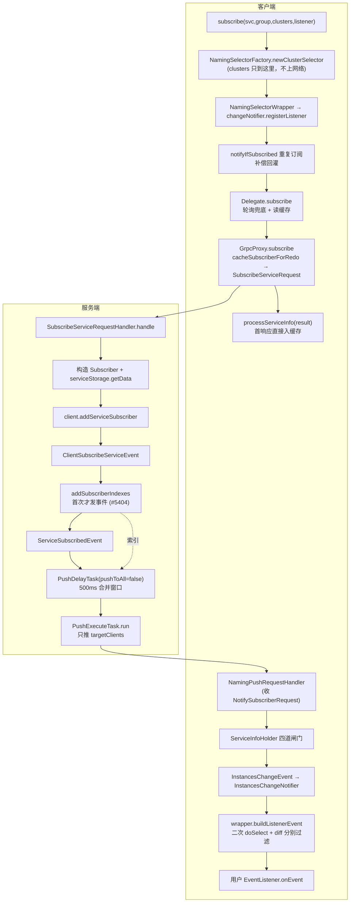
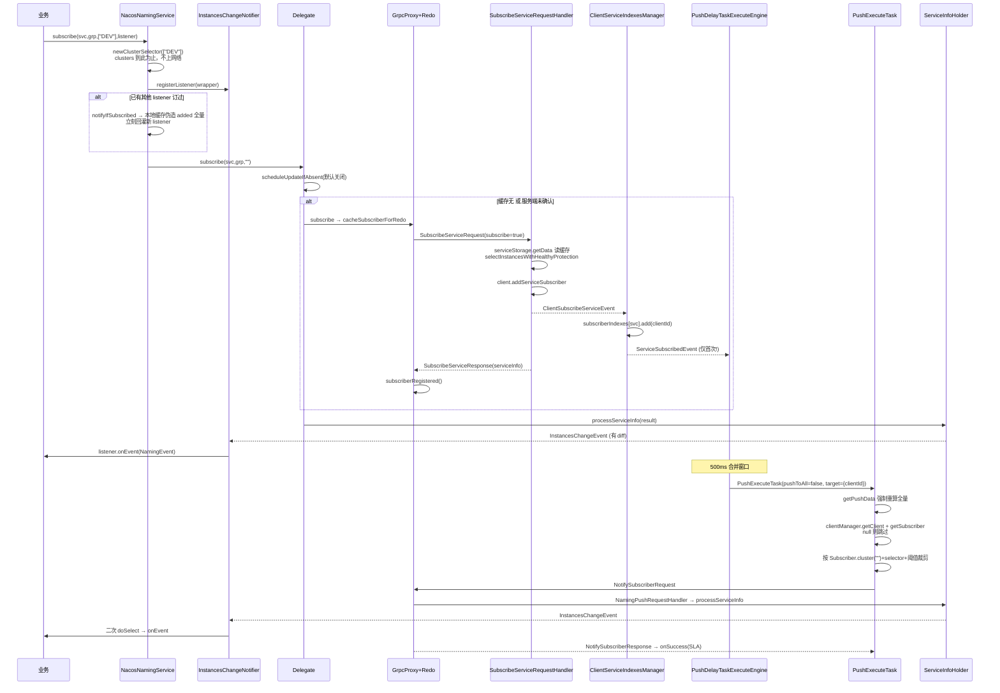

我来补齐订阅侧的源码取证。

## 〇、一句话结论

**Nacos 的订阅是"客户端本地过滤 + 服务端定向推送 + 轮询兜底"的三层结构：客户端把 `clusters` 完全留在本地做 selector 过滤，发给服务端的订阅请求永远是全集群；服务端只把订阅关系记在"当前这条 gRPC 连接的 `Client.subscribers`"和 `subscriberIndexes` 反向索引里，且这份关系不参与 Distro 集群同步；真正让订阅生效的，是它把 `ServiceSubscribedEvent` 变成一次"只推给它自己"的定向推送任务。**



---

## 一、客户端订阅链路

### 1.1 入口：一个最容易被误读的设计

你给的入口是 L456：

```java
@Override
public void subscribe(String serviceName, String groupName, List<String> clusters, EventListener listener)
        throws NacosException {
    NamingSelector clusterSelector = NamingSelectorFactory.newClusterSelector(clusters);
    doSubscribe(serviceName, groupName, getUniqueClusterString(clusters), clusterSelector, listener);
}
```

而 `doSubscribe` 里：

```java
private void doSubscribe(String serviceName, String groupName, String clusters, NamingSelector selector,
        EventListener listener) throws NacosException {
    if (selector == null || listener == null) {
        return;
    }
    NamingSelectorWrapper wrapper = new NamingSelectorWrapper(serviceName, groupName, clusters, selector, listener);
    changeNotifier.registerListener(groupName, serviceName, wrapper);   // ① 本地登记
    notifyIfSubscribed(serviceName, groupName, wrapper);                // ② 重复订阅补偿
    clientProxy.subscribe(serviceName, groupName, Constants.NULL);      // ③ 发给服务端
}
```

**第 ③ 步的 `Constants.NULL` 是整条链路最关键的一行**。查 `com.alibaba.nacos.api.common.Constants`：

```java
public static final String NULL = "";     // 不是 "null"，就是空串
```

也就是说：**`clusters` 参数从头到尾没有出过网络**。它只被用来：
- 构造 `ClusterSelector`（本地 `Predicate<Instance>`：`set.contains(instance.getClusterName())`）；
- 拼成 `getUniqueClusterString(clusters)`（`TreeSet` 排序后逗号连接，保证 `["b","a"]` 和 `["a","b"]` 得到同一个字符串 `"a,b"`）塞进 `NamingSelectorWrapper` 作为回调事件的元信息。

发给服务端的一律是空串。这与 `NamingGrpcClientProxy` 里那句注释吻合：

```java
* @param clusters    clusters, current only support subscribe all clusters, maybe deprecated
```

**为什么这么设计？** 因为服务端如果按 cluster 建订阅索引，`subscriberIndexes` 的 key 就要变成 `(Service, clusters)` 组合，而一个 cluster 的增删会引发索引重组；更重要的是服务端每次推送本来就要跑一遍 `doSelectInstances` 做 cluster 过滤，客户端本地再过滤一次的成本几乎为零。**把 cluster 维度收敛到客户端，服务端订阅索引退化为纯 `Service → Set<clientId>`，复杂度大幅降低。**

副作用：服务端会把这个服务**所有 cluster 的实例**都推给客户端，跨集群订阅场景下有多余流量。

### 1.2 顺序的秘密：先登记监听，再发请求

`registerListener` → `notifyIfSubscribed` → `clientProxy.subscribe` 这个顺序是刻意的：

```java
// InstancesChangeNotifier extends Subscriber<InstancesChangeEvent>
public void registerListener(String groupName, String serviceName, NamingSelectorWrapper wrapper) {
    String subId = NamingUtils.getGroupedName(serviceName, groupName);
    selectorManager.addSelectorWrapper(subId, wrapper);
}
```

如果先发网络请求再登记监听，那么请求返回后服务端立刻推一次变更，就会**丢失第一次通知**（回调找不到 wrapper）。反过来先登记，则推送到达时一定有地方接。

而 `notifyIfSubscribed` 解决的是**同一服务多 listener 的重复订阅**问题：

```java
private void notifyIfSubscribed(String serviceName, String groupName, NamingSelectorWrapper wrapper)
        throws NacosException {
    if (clientProxy.isSubscribed(serviceName, groupName, StringUtils.EMPTY)) {
        NAMING_LOGGER.warn("Duplicate subscribe for groupName: {}, serviceName: {}; "
                + "directly use current cached to notify.", groupName, serviceName);
        ServiceInfo serviceInfo = serviceInfoHolder.getServiceInfo(serviceName, groupName);
        InstancesChangeEvent event = transferToEvent(serviceInfo);
        wrapper.notifyListener(event);                     // ← 用本地缓存立刻回灌新 listener
    }
}

private InstancesChangeEvent transferToEvent(ServiceInfo serviceInfo) {
    if (serviceInfo == null) {
        return null;
    }
    InstancesDiff diff = new InstancesDiff();
    diff.setAddedInstances(serviceInfo.getHosts());        // 把全部现有实例伪装成 "added"
    return new InstancesChangeEvent(notifierEventScope, serviceInfo.getName(), serviceInfo.getGroupName(),
            serviceInfo.getClusters(), serviceInfo.getHosts(), diff);
}
```

**语义**：第二个 listener 订阅同一服务时，服务端早就在推了，不会为它专门补一次。于是客户端伪造一个 `added = 全部现有实例` 的 diff 事件，让新 listener 立刻拿到当前视图。配合后面 1.6 的 `isCallable` 检查（`added || removed || modified` 才真回调），这套机制保证"**订阅即收到一次回调**"的契约。

### 1.3 Delegate 层：轮询兜底 + 缓存复用 + 幂等

```java
// NamingClientProxyDelegate
@Override
public ServiceInfo subscribe(String serviceName, String groupName, String clusters) throws NacosException {
    NAMING_LOGGER.info("[SUBSCRIBE-SERVICE] service:{}, group:{}, clusters:{} ", serviceName, groupName, clusters);
    String serviceNameWithGroup = NamingUtils.getGroupedName(serviceName, groupName);
    String serviceKey = ServiceInfo.getKey(serviceNameWithGroup, clusters);
    serviceInfoUpdateService.scheduleUpdateIfAbsent(serviceName, groupName, clusters);   // ① 轮询兜底
    ServiceInfo result = serviceInfoHolder.getServiceInfoMap().get(serviceKey);
    if (null == result || !isSubscribed(serviceName, groupName, clusters)) {             // ② 幂等判定
        result = grpcClientProxy.subscribe(serviceName, groupName, clusters);
    }
    serviceInfoHolder.processServiceInfo(result);                                        // ③ 入缓存并触发回调
    return result;
}
```

三处值得停下来看：

**① `scheduleUpdateIfAbsent` 默认是关的**：

```java
public void scheduleUpdateIfAbsent(String serviceName, String groupName, String clusters) {
    if (!asyncQuerySubscribeService) {
        return;      // NAMING_ASYNC_QUERY_SUBSCRIBE_SERVICE 默认 false
    }
    ...
    ScheduledFuture<?> future = addTask(new UpdateTask(serviceName, groupName, clusters));
    futureMap.put(serviceKey, future);
}
```

`UpdateTask` 是一条"推拉结合的推模式失效兜底"：

```java
@Override
public void run() {
    long delayTime = DEFAULT_DELAY;                                   // 1000ms
    try {
        if (!changeNotifier.isSubscribed(groupName, serviceName) && !futureMap.containsKey(serviceKey)) {
            isCancel = true; return;                                   // 已退订 → 自然终止
        }
        ServiceInfo serviceObj = serviceInfoHolder.getServiceInfoMap().get(serviceKey);
        if (serviceObj == null) {
            serviceObj = namingClientProxy.queryInstancesOfService(serviceName, groupName, clusters, false);
            serviceInfoHolder.processServiceInfo(serviceObj);
            delayTime = serviceObj.getCacheMillis() * DEFAULT_UPDATE_CACHE_TIME_MULTIPLE;   // ×6
            lastRefTime = serviceObj.getLastRefTime();
            return;
        }
        if (serviceObj.getLastRefTime() <= lastRefTime) {              // ★ 缓存没被推送刷新过 → 主动拉
            serviceObj = namingClientProxy.queryInstancesOfService(serviceName, groupName, clusters, false);
            serviceInfoHolder.processServiceInfo(serviceObj);
        }
        lastRefTime = serviceObj.getLastRefTime();
        if (CollectionUtils.isEmpty(serviceObj.getHosts())) {
            incFailCount();                                            // 空列表 → 指数退避
            return;
        }
        delayTime = serviceObj.getCacheMillis() * DEFAULT_UPDATE_CACHE_TIME_MULTIPLE;
        resetFailCount();
    } catch (NacosException e) { handleNacosException(e); }
      catch (Throwable e) { handleUnknownException(e); }
    finally {
        if (!isCancel) {
            executor.schedule(this, Math.min(delayTime << failCount, DEFAULT_DELAY * 60), TimeUnit.MILLISECONDS);
        }
    }
}
```

**`serviceObj.getLastRefTime() <= lastRefTime` 是这套兜底的判据核心**：因为服务端每次推送都会在 `doSelectInstances` 里 `result.setLastRefTime(System.currentTimeMillis())`，只要推送正常到达，缓存的 `lastRefTime` 必然前进，轮询任务就"什么都不做、只重新排期"。**一旦某次推送丢了（连接假死、服务端 push 开关关了、任务队列堵了），`lastRefTime` 停滞，下一次轮询就会主动 `queryInstancesOfService` 拉全量。**

同时 `delayTime << failCount`（上限 `DEFAULT_DELAY * 60 = 60s`）构成**指数退避**，且"空实例列表"也计入 fail —— 这是防止服务端误推空导致客户端疯狂拉取的又一层保护。

默认 `asyncQuerySubscribeService = false`，说明官方对 gRPC 推送的信任度是高的，轮询只作为极端场景（或跨版本兼容）的开关。

**② 幂等判定 `null == result || !isSubscribed(...)`**：`isSubscribed` 直接查 redo 表：

```java
// NamingGrpcClientProxy
@Override
public boolean isSubscribed(String serviceName, String groupName, String clusters) throws NacosException {
    return redoService.isSubscriberRegistered(serviceName, groupName, clusters);
}

// NamingGrpcRedoService
public boolean isSubscriberRegistered(String serviceName, String groupName, String cluster) {
    String key = ServiceInfo.getKey(NamingUtils.getGroupedName(serviceName, groupName), cluster);
    synchronized (subscribes) {
        SubscriberRedoData redoData = subscribes.get(key);
        return null != redoData && redoData.isRegistered();
    }
}
```

**"本地缓存有数据" 且 "服务端确认已订阅" 两个条件同时满足才跳过网络请求**。为什么不能只看缓存？因为缓存可能来自 `DiskCache.read`（冷启动加载本地文件），此时服务端根本不知道你在订阅。这个坑正是 `tryToSubscribe` 里注释所说的第三种状态。

**③ `processServiceInfo(result)` 无条件调用**：即使 ② 跳过了网络请求，也会把拿到的 `result`（可能是缓存对象）再过一遍 diff 逻辑。**这是 1.2 中 `notifyIfSubscribed` 之外的第二条"订阅即回调"保证路径。**

### 1.4 gRPC 层：与注册同构的"先写 redo 再发送"

```java
@Override
public ServiceInfo subscribe(String serviceName, String groupName, String clusters) throws NacosException {
    NAMING_LOGGER.info("[GRPC-SUBSCRIBE] service:{}, group:{}, cluster:{} ", serviceName, groupName, clusters);
    redoService.cacheSubscriberForRedo(serviceName, groupName, clusters);   // ① 先落意图
    return doSubscribe(serviceName, groupName, clusters);                   // ② 再发请求
}

public ServiceInfo doSubscribe(String serviceName, String groupName, String clusters) throws NacosException {
    SubscribeServiceRequest request = new SubscribeServiceRequest(namespaceId, groupName, serviceName, clusters, true);
    SubscribeServiceResponse response = requestToServer(request, SubscribeServiceResponse.class);
    redoService.subscriberRegistered(serviceName, groupName, clusters);      // ③ 成功才标记
    return response.getServiceInfo();
}
```

`cacheSubscriberForRedo` 的 key 构造与实例不同：

```java
public void cacheSubscriberForRedo(String serviceName, String groupName, String cluster) {
    String key = ServiceInfo.getKey(NamingUtils.getGroupedName(serviceName, groupName), cluster);
    SubscriberRedoData redoData = SubscriberRedoData.build(serviceName, groupName, cluster);
    synchronized (subscribes) {
        subscribes.put(key, redoData);
    }
}
```

而 `ServiceInfo.getKey` 对空 clusters 有特殊处理：

```java
public static String getKey(String name, String clusters) {
    if (!isEmpty(clusters)) {
        return name + Constants.SERVICE_INFO_SPLITER + clusters;
    }
    return name;                     // ← clusters="" 时不加后缀
}
```

**所以订阅 redo 表的 key 实际就是 `group@@service`**，和实例 redo 表 (`registeredInstances`) 的 key 完全一致 —— 两个 `ConcurrentMap` 用同样的键空间，逻辑上互不干扰。这也解释了 `RedoScheduledTask` 日志里 `{}@@{}#{}` 的格式为何对订阅多带一个 `#cluster`（当 cluster 非空时才存在）。

订阅与注册**共用同一个 3 秒 redo 定时任务**，`SubscriberRedoData` 也复用同一套 `RedoData<String>` 三维状态机（`泛型参数 T = String` 存的是 clusters）。

### 1.5 断线重连：订阅自愈

```java
@Override
public void onDisConnect(Connection connection) {
    connected = false;
    synchronized (registeredInstances) {
        registeredInstances.values().forEach(d -> d.setRegistered(false));
    }
    synchronized (subscribes) {                                   // ← 订阅一起标记
        subscribes.values().forEach(d -> d.setRegistered(false));
    }
}
```

`expectedRegistered=true, registered=false, unregistering=false` → `RedoType.REGISTER` → 走 `doSubscribe` 重放：

```java
private void redoForSubscribe(SubscriberRedoData redoData) throws NacosException {
    switch (redoData.getRedoType()) {
        case REGISTER:   clientProxy.doSubscribe(serviceName, groupName, cluster); break;
        case UNREGISTER: clientProxy.doUnsubscribe(serviceName, groupName, cluster); break;
        case REMOVE:     redoService.removeSubscriberForRedo(serviceName, groupName, cluster); break;
        default:
    }
}
```

**这里有个和实例 redo 不同的关键点**：`doSubscribe` 里 `requestToServer` 成功后调的是 `subscriberRegistered`，而它**不会把 `unregistering` 置回 false**（只 `setRegistered(true)`）：

```java
public void subscriberRegistered(String serviceName, String groupName, String cluster) {
    ...
    if (null != redoData) { redoData.setRegistered(true); }   // 注意：只设 registered
}
```

而实例侧调的是 `redoData.registered()`：

```java
public void registered() { this.registered = true; this.unregistering = false; }
```

对订阅来说这没影响，因为 `subscriberDeregister` 之后紧接着就是 `doUnsubscribe` → `removeSubscriberForRedo`，条目会被直接摘掉，不走 `subscriberRegistered`。但这是一个**容易埋雷的 API 不对称**。

### 1.6 退订：引用计数式的"最后一个才真退"

```java
private void doUnsubscribe(String serviceName, String groupName, NamingSelector selector, EventListener listener)
        throws NacosException {
    if (selector == null || listener == null) { return; }
    NamingSelectorWrapper wrapper = new NamingSelectorWrapper(selector, listener);   // ← 只传 selector+listener
    changeNotifier.deregisterListener(groupName, serviceName, wrapper);
    if (!changeNotifier.isSubscribed(groupName, serviceName)) {                      // 本地还有人订？
        clientProxy.unsubscribe(serviceName, groupName, Constants.NULL);
    }
}
```

这里藏着一套精确的**值语义对象比较**。`NamingSelectorWrapper` 继承了 `AbstractSelectorWrapper` 的 equals：

```java
// AbstractSelectorWrapper
return Objects.equals(selector, that.selector) && Objects.equals(listener, that.listener);

// NamingListenerInvoker
return Objects.equals(listener, that.listener);   // 内层再包一层
```

所以退订时用一个**只装了 `(selector, listener)` 两件套的空壳 wrapper** 就能在 `ConcurrentHashSet` 里精确命中当初注册的那个五参 wrapper —— 因为 `ClusterSelector` 重写了 equals 只比 `clusterString`：

```java
// NamingSelectorFactory.ClusterSelector
@Override
public boolean equals(Object o) {
    ...
    return Objects.equals(this.clusterString, that.clusterString);
}
```

整个"listener 引用 + clusters 字符串"就是订阅的身份指纹，`serviceName/groupName` 反而由 map 的 `subId` key 承载了。

而**只有 `selectorMap` 里该 subId 的 wrapper 集合彻底空了，才向服务端发 `unsubscribe`**。这是典型的引用计数：

```java
public void removeSelectorWrapper(String subId, S wrapper) {
    selectorMap.computeIfPresent(subId, (k, v) -> {
        v.remove(wrapper);
        return v.isEmpty() ? null : v;      // 空集直接摘 key
    });
}
public boolean isSubscribed(String subId) {
    return CollectionUtils.isNotEmpty(this.getSelectorWrappers(subId));
}
```

`Delegate.unsubscribe` 顺带关掉轮询任务：

```java
@Override
public void unsubscribe(String serviceName, String groupName, String clusters) throws NacosException {
    serviceInfoUpdateService.stopUpdateIfContain(serviceName, groupName, clusters);
    grpcClientProxy.unsubscribe(serviceName, groupName, clusters);
}
```

注意 `stopUpdateIfContain` 只是从 `futureMap` 移除条目，**任务对象本身靠 `UpdateTask.run` 开头的 `isCancel` 自检自然终止**（`!changeNotifier.isSubscribed(...) && !futureMap.containsKey(...)`）—— 这是一种避免 `Future.cancel` 竞态的软取消写法。

### 1.7 一个隐性副作用：查询 API 会自动订阅

```java
private ServiceInfo getServiceInfoBySubscribe(String serviceName, String groupName, List<String> clusters,
        NamingSelector selector, boolean subscribe) throws NacosException {
    ServiceInfo serviceInfo;
    if (subscribe) {
        serviceInfo = serviceInfoHolder.getServiceInfo(serviceName, groupName);
        serviceInfo = tryToSubscribe(serviceName, groupName, serviceInfo);       // ★ 也会发起订阅
        serviceInfo = doSelectInstance(serviceInfo, selector);
    } else {
        String clusterString = NamingSelectorFactory.getUniqueClusterString(clusters);
        serviceInfo = clientProxy.queryInstancesOfService(serviceName, groupName, clusterString, false);
    }
    return serviceInfo;
}

private ServiceInfo tryToSubscribe(String serviceName, String groupName, ServiceInfo cachedServiceInfo)
        throws NacosException {
    if (null == cachedServiceInfo) {                              // 没缓存 → 从没订过
        return clientProxy.subscribe(serviceName, groupName, StringUtils.EMPTY);
    }
    if (clientProxy.isSubscribed(serviceName, groupName, StringUtils.EMPTY)) {   // 有缓存且已订 → 直接用
        return cachedServiceInfo;
    }
    ServiceInfo result = cachedServiceInfo;                        // 有缓存但没订（来自本地磁盘）→ 补订，失败容忍
    try {
        result = clientProxy.subscribe(serviceName, groupName, StringUtils.EMPTY);
    } catch (NacosException e) {
        NAMING_LOGGER.warn("Subscribe from Server failed, will use local cache. fail message: ", e);
    }
    return result;
}
```

三种状态穷举得非常干净：**无缓存 → 订阅；有缓存已订 → 直接返回；有缓存未订（`NAMING_LOAD_CACHE_AT_START` 冷启动来的）→ 尝试订阅，失败降级用本地缓存**。最后一句 `catch` 后不抛，是典型的"可用性优先于一致性"。

而 `getAllInstances(serviceName)` 的 `subscribe` 参数默认 `true`：

```java
@Override
public List<Instance> getAllInstances(String serviceName, List<String> clusters) throws NacosException {
    return getAllInstances(serviceName, clusters, true);      // 默认订阅
}
```

**坑点**：只是想在业务代码里"查一次实例列表"，实际会在服务端注册一个 subscriber、占用一条 `subscriberIndexes`、并且此后每次该服务变更都会给你推一条消息。纯查询必须显式传 `subscribe=false`。

注意 `tryToSubscribe` 用 `StringUtils.EMPTY`，`doSubscribe` 用 `Constants.NULL`，**两者都等于 `""`**（`Constants.NULL = ""`），所以 key 空间一致、能互相识别。这是读代码时容易误判为 bug 的地方。

### 1.8 推送回流的完整落地

服务端推送到达后：

```java
// NamingGrpcClientProxy.start
rpcClient.registerConnectionListener(redoService);
rpcClient.registerServerRequestHandler(new NamingPushRequestHandler(serviceInfoHolder));

// NamingPushRequestHandler
@Override
public Response requestReply(Request request, Connection connection) {
    if (request instanceof NotifySubscriberRequest) {
        serviceInfoHolder.processServiceInfo(((NotifySubscriberRequest) request).getServiceInfo());
        return new NotifySubscriberResponse();       // 这个回包驱动服务端 onSuccess → SLA 统计
    }
    return null;
}
```

`processServiceInfo` 的四道闸门（详见上一轮，这里聚焦与订阅的关系）：

```java
public ServiceInfo processServiceInfo(ServiceInfo serviceInfo) {
    String serviceKey = serviceInfo.getKeyWithoutClusters();     // ← 注意：去掉 clusters 的 key
    if (serviceKey == null) { return null; }
    ServiceInfo oldService = serviceInfoMap.get(serviceKey);
    if (isEmptyOrErrorPush(serviceInfo)) { return oldService; }   // 闸门①：空/畸形推送保护
    serviceInfoMap.put(serviceKey, serviceInfo);
    ...
    InstancesDiff diff = getServiceInfoDiff(oldService, serviceInfo);
    if (diff.hasDifferent()) {                                    // 闸门②：无差异不打扰
        if (!failoverReactor.isFailoverSwitch(serviceKey)) {      // 闸门③：故障演练屏蔽
            NotifyCenter.publishEvent(new InstancesChangeEvent(notifierEventScope, ...));
        }
        DiskCache.write(serviceInfo, cacheDir);                   // 闸门④：落盘
    }
    return serviceInfo;
}

private boolean isEmptyOrErrorPush(ServiceInfo serviceInfo) {
    return null == serviceInfo.getHosts() || (pushEmptyProtection && !serviceInfo.validate());
}
```

这里有一个**关键的 key 语义差异**：`serviceInfoMap` 用 `getKeyWithoutClusters()`（= `group@@service`），而 `Delegate.subscribe` 用 `ServiceInfo.getKey(groupedName, clusters)`。**因为客户端订阅 clusters 恒为 `""`，`getKey` 对空串正好退化成同一个值**，两套 key 才神奇地重合。如果你把 clusters 传进 `clientProxy.subscribe`（比如手工调 SPI），缓存 key 会变成 `group@@service@@DEV`，而推送回来的 `ServiceInfo.clusters` 是服务端 `result.setClusters(cluster)` 设的值，`getKeyWithoutClusters` 又不带它 —— 缓存就会分裂成两份。**这是"订阅 clusters 恒空"这个隐式约定的脆弱之处。**

`ServiceInfo.validate()` 值得单独看：

```java
public boolean validate() {
    if (isAllIPs()) { return true; }
    if (hosts == null) { return false; }
    boolean existValidHosts = false;
    for (Instance host : hosts) {
        if (host.isHealthy() && host.getWeight > 0) { existValidHosts = true; break; }
    }
    return existValidHosts;      // 只要没有一个"健康且权重>0"的实例就判为 invalid
}
```

开了 `NAMING_PUSH_EMPTY_PROTECTION` 之后，**服务端把实例全部下线（或全权重置 0）推来的空视图会被客户端拒绝**，本地保留最后一次有效数据。这是"宁可用过期数据也不可用空数据"的极端保守选择，代价是真的全下线时无法感知。

### 1.9 从事件到用户 Listener：第二次过滤

```java
// InstancesChangeNotifier
@Override
public void onEvent(InstancesChangeEvent event) {
    String subId = NamingUtils.getGroupedName(event.getServiceName(), event.getGroupName());
    Collection<NamingSelectorWrapper> selectorWrappers = selectorManager.getSelectorWrappers(subId);
    for (NamingSelectorWrapper selectorWrapper : selectorWrappers) {
        selectorWrapper.notifyListener(event);
    }
}

@Override
public boolean scopeMatches(InstancesChangeEvent event) {
    return this.eventScope.equals(event.scope());   // 按 NacosNamingService 实例隔离，防串台
}
```

注意 `subId` 只由 `(groupName, serviceName)` 构成 —— **同一服务的多个不同 clusters 的 listener 会共享一次 `onEvent`**，各自靠自己的 selector 过滤：

```java
// NamingSelectorWrapper
@Override
protected NamingEvent buildListenerEvent(InstancesChangeEvent event) {
    List<Instance> currentIns = CollectionUtils.isNotEmpty(event.getHosts())
            ? doSelect(event.getHosts()) : Collections.emptyList();
    InstancesDiff diff = event.getInstancesDiff();
    InstancesDiff newDiff = new InstancesDiff();
    if (diff.isAdded())   { newDiff.setAddedInstances(doSelect(diff.getAddedInstances())); }
    if (diff.isRemoved()) { newDiff.setRemovedInstances(doSelect(diff.getRemovedInstances())); }
    if (diff.isModified()) { newDiff.setModifiedInstances(doSelect(diff.getModifiedInstances())); }
    return new NamingChangeEvent(serviceName, groupName, clusters, currentIns, newDiff);
}

@Override
public boolean isCallable(NamingEvent event) {
    NamingChangeEvent changeEvent = (NamingChangeEvent) event;
    return changeEvent.isAdded() || changeEvent.isRemoved() || changeEvent.isModified();
}
```

**对 `hosts`、`added`、`removed`、`modified` 四个列表分别跑一遍 selector** —— 因为 selector 是任意谓词，不能只过滤 hosts 再重算 diff（"新增的实例被 selector 滤掉了"这种情况必须单独判定）。过滤完如果三个 diff 标志全 false，`isCallable` 返回 false，**这个 listener 就不会被调用**。

这就是为什么"订阅 DEV 集群的 listener"在"只改了 PROD 集群实例"时不会收到打扰 —— 尽管服务端把全量都推过来了。

最后是执行线程：

```java
// NamingListenerInvoker
@Override
public void invoke(NamingEvent event) {
    invoked.set(true);
    logInvoke(event);
    if (listener instanceof AbstractEventListener && ((AbstractEventListener) listener).getExecutor() != null) {
        ((AbstractEventListener) listener).getExecutor().execute(() -> listener.onEvent(event));
    } else {
        listener.onEvent(event);
    }
}

// AbstractSelectorWrapper
public void notifyListener(T event) {
    if (!isSelectable(event)) { return; }
    E newEvent = buildListenerEvent(event);
    if (isCallable(newEvent)) {
        synchronized (listener) {      // lock listener to make sure isInvoked is thread safe
            listener.invoke(newEvent);
        }
    }
}
```

**默认在 `NotifyCenter` 的分发线程上同步执行 `listener.onEvent`**。用户 listener 里做 RPC / 慢初始化会**阻塞整个客户端的事件总线**。想要异步必须继承 `AbstractEventListener` 并传自己的 executor。`synchronized (listener)` 锁的是 `NamingListenerInvoker` 对象，粒度是单个 listener —— 不会互相阻塞，只是为了 `invoked` 标志的可见性。

---

## 二、服务端处理订阅请求

### 2.1 三层切面

```java
@Component
public class SubscribeServiceRequestHandler extends RequestHandler<SubscribeServiceRequest, SubscribeServiceResponse> {

    @Override
    @TpsControl(pointName = "RemoteNamingServiceSubscribeUnSubscribe", name = "RemoteNamingServiceSubscribeUnsubscribe")
    @Secured(action = ActionTypes.READ)
    @ExtractorManager.Extractor(rpcExtractor = SubscribeServiceRequestParamExtractor.class)
    public SubscribeServiceResponse handle(SubscribeServiceRequest request, RequestMeta meta) throws NacosException {
```

| 切面 | 配置 | 与注册侧的差异 |
|---|---|---|
| `@TpsControl` | `pointName = "RemoteNamingServiceSubscribeUnSubscribe"` | **注册/注销是 `RemoteNamingInstanceRegisterDeregister`**，订阅独立一个 TPS 桶，可单独限流 |
| `@Secured` | **`ActionTypes.READ`** | 注册/注销是 `WRITE`。语义正确：订阅是"读取服务列表"的一种形式，只读权限即可 |
| `@ExtractorManager.Extractor` | `SubscribeServiceRequestParamExtractor` | 参数抽取器，供通用校验和埋点使用 |

`@Secured(READ)` 这个选择有实践意义：**很多只读型消费者（网关、运维工具）只有读权限，但需要订阅能力**。若订阅按 WRITE 鉴权，这类场景就得分发写凭证。

### 2.2 handle 主体：一次请求顺手做了"查询 + 登记"两件事

```java
public SubscribeServiceResponse handle(SubscribeServiceRequest request, RequestMeta meta) throws NacosException {
    String namespaceId = request.getNamespace();
    String serviceName = request.getServiceName();
    String groupName = request.getGroupName();
    String app = RequestContextHolder.getContext().getBasicContext().getApp();
    String groupedServiceName = NamingUtils.getGroupedName(serviceName, groupName);
    Service service = Service.newService(namespaceId, groupName, serviceName, true);   // ① ephemeral=true 硬编码
    Subscriber subscriber = new Subscriber(meta.getClientIp(), meta.getClientVersion(), app,
            meta.getClientIp(), namespaceId, groupedServiceName, 0, request.getClusters());  // ② 构造订阅者
    ServiceInfo serviceInfo = ServiceUtil.selectInstancesWithHealthyProtection(serviceStorage.getData(service),
            metadataManager.getServiceMetadata(service).orElse(null), subscriber.getCluster(), false, true,
            subscriber.getIp());                                                        // ③ 先算数据
    if (request.isSubscribe()) {
        clientOperationService.subscribeService(service, subscriber, meta.getConnectionId());
        NotifyCenter.publishEvent(new SubscribeServiceTraceEvent(System.currentTimeMillis(),
                NamingRequestUtil.getSourceIpForGrpcRequest(meta),
                service.getNamespace(), service.getGroup(), service.getName()));
    } else {
        clientOperationService.unsubscribeService(service, subscriber, meta.getConnectionId());
        NotifyCenter.publishEvent(new UnsubscribeServiceTraceEvent(System.currentTimeMillis(),
                NamingRequestUtil.getSourceIpForGrpcRequest(meta),
                service.getNamespace(), service.getGroup(), service.getName()));
    }
    return new SubscribeServiceResponse(ResponseCode.SUCCESS.getCode(), "success", serviceInfo);
}
```

四个细节逐个看：

**① `Service.newService(..., true)` 的 `true` 是 ephemeral**。订阅 API 没有 ephemeral 参数 —— 2.x 的持久实例订阅走的是另一套（`IpPortBasedClient` + UDP）。**这里硬编码意味着 gRPC 订阅只服务临时实例生态。**

**② `Subscriber` 的八参构造**：

```java
new Subscriber(addrStr = meta.getClientIp(), agent = meta.getClientVersion(), app = app, ip = meta.getClientIp(),
               namespaceId, serviceName = groupedServiceName, port = 0, clusters = request.getClusters());
```

- **`port` 恒为 0**：UDP 推送时代订阅者要提供回调端口，gRPC 长连接不需要（推送直接走这条双向流），字段仅为兼容 1.x 而保留。这个 0 也保证了 `PushExecutorDelegate` 不会误把 gRPC 订阅者送去 UDP 通道（判据在 clientId 而非 subscriber.port）；
- **`addrStr` 与 `ip` 都是 `meta.getClientIp()`**：1.x 时代 `addrStr` 是 `ip:port` 组合，2.x 无 port 所以两者相同，运维查询接口能看到重复信息但无害；
- **`app` 来自 `RequestContextHolder`**：这是 2.x 的上下文注入机制（`ParamExtractor` 阶段填充），而不是 1.x 的 request param 直取 —— **便于统一从 header/连接元数据里拿应用名**；
- **`serviceName` 存的是 `groupedServiceName`（`group@@service`）**，而 `Service` 对象里 group 和 name 是分开的两个字段。两套表示并存，运维接口查询订阅者时看到的是拼接串。

**③ 数据计算发生在 `if` 分支之前**——**无论订阅还是退订，服务端都会算一遍完整数据**（退订时也算了但客户端会丢掉）。这个顺序不是疏漏，它保证了"订阅请求本身即一次查询"，客户端不需要先 subscribe 再 getAllInstances 两次往返。

但更要紧的是它用的是 `serviceStorage.getData(service)` 而**不是** `getPushData(service)`：

```java
public ServiceInfo getData(Service service) {
    return serviceDataIndexes.containsKey(service) ? serviceDataIndexes.get(service) : getPushData(service);
}
public ServiceInfo getPushData(Service service) {          // 总是重算并回填
    ...
    serviceDataIndexes.put(singleton, result);
    return result;
}
```

**订阅响应读缓存、推送路径必重算**。差别在于：`serviceDataIndexes` 是在每次 `ServiceChangedEvent` 驱动的推送中被刷新的，所以刚变更过的服务，订阅响应拿到的是最近一次推送计算的结果（可能滞后 ≤ 500ms 合并窗口）。而推送必须用最新数据。**这是一个"订阅首次响应允许轻微滞后、推送绝不允许"的取舍**，靠后续的定向推送（下面 `ServiceSubscribedEvent`）在 500ms 内自动纠偏。

**④ `selectInstancesWithHealthyProtection(..., healthyOnly=false, enableOnly=true, subscriberIp)`**：订阅响应会做 **cluster 过滤（用 `subscriber.getCluster()`，实际是客户端传的 `""` → `clusterSets` 为空 → 不过滤）+ enabled 过滤 + selector 过滤 + 保护阈值**，但**不过滤不健康实例**（`healthyOnly=false`），把 healthy 标志原样带给客户端由它自己决定。

### 2.3 订阅关系的存储：两级、节点本地

```java
// EphemeralClientOperationServiceImpl
@Override
public void subscribeService(Service service, Subscriber subscriber, String clientId) {
    Service singleton = ServiceManager.getInstance().getSingletonIfExist(service).orElse(service);   // ★
    Client client = clientManager.getClient(clientId);
    checkClientIsLegal(client, clientId);
    client.addServiceSubscriber(singleton, subscriber);
    client.setLastUpdatedTime();
    NotifyCenter.publishEvent(new ClientOperationEvent.ClientSubscribeServiceEvent(singleton, clientId));
}

@Override
public void unsubscribeService(Service service, Subscriber subscriber, String clientId) {
    Service singleton = ServiceManager.getInstance().getSingletonIfExist(service).orElse(service);
    Client client = clientManager.getClient(clientId);
    checkClientIsLegal(client, clientId);
    client.removeServiceSubscriber(singleton);
    client.setLastUpdatedTime();
    NotifyCenter.publishEvent(new ClientOperationEvent.ClientUnsubscribeServiceEvent(singleton, clientId));
}
```

**`getSingletonIfExist(service).orElse(service)` 是继"注销不建服务"之后第二处"读操作不产生写副作用"**。订阅一个还不存在的服务是完全合法的（服务可能几秒后才被注册），但**绝不该因此往 `ServiceManager` 塞一个空壳**，否则大量"订阅了拼错名字的服务"的客户端能把服务清单撑爆。

存储落点：

```java
// AbstractClient
@Override
public boolean addServiceSubscriber(Service service, Subscriber subscriber) {
    if (null == subscribers.put(service, subscriber)) {
        MetricsMonitor.incrementSubscribeCount();
    }
    return true;
}
@Override
public boolean removeServiceSubscriber(Service service) {
    if (null != subscribers.remove(service)) { MetricsMonitor.decrementSubscribeCount(); }
    return true;
}
```

和 `publishers` 一样是 `ConcurrentHashMap<Service, Subscriber>` —— **一条连接对一个服务只能有一个 Subscriber 记录**，重复订阅只覆盖（`Subscriber.equals` 比 `addrStr/agent/app/ip/namespaceId/serviceName`，同连接重复订阅基本相等，覆盖无副作用）。

索引侧：

```java
// ClientServiceIndexesManager
private void addSubscriberIndexes(Service service, String clientId) {
    Set<String> clientIds = subscriberIndexes.computeIfAbsent(service, key -> new ConcurrentHashSet<>());
    // Fix #5404, Only first time add need notify event.
    if (clientIds.add(clientId)) {
        NotifyCenter.publishEvent(new ServiceEvent.ServiceSubscribedEvent(service, clientId));
    }
}

private void removeSubscriberIndexes(Service service, String clientId) {
    Set<String> clientIds = subscriberIndexes.get(service);
    if (clientIds == null) { return; }
    clientIds.remove(clientId);
    if (clientIds.isEmpty()) { subscriberIndexes.remove(service); }
}
```

`#5404` 这个注释值一千字：**`Set.add` 返回 false 说明这个 clientId 已经在了，即"重复订阅"，此时不该再触发一次定向推送**。修之前每次 gRPC 重连、客户端 redo 重放订阅、或一个进程里多 listener 订同一服务（虽然 redo 表幂等，但服务端可能因为不同 clientId 视角收到多次）都会多推一轮。

**注意退订的两个不对称**：
- `removeSubscriberIndexes` **不发任何 `ServiceEvent`** —— 退订不需要推送给任何人；
- 但 `removeSubscriberIndexes` 的 `subscriberIndexes.remove(service)` 判空写法**不是原子的**（先 get 再 remove，中间可能有别的线程 add），而 `removePublisherIndexes` 用的是 `computeIfPresent` 返回 null。这是理论上的竞态，实际后果是"空集合的 key 短暂残留"，下一次推送会遍历到空集合直接结束，无正确性问题。

### 2.4 订阅关系绝不同步到集群

这是本轮最重要的架构判定。看 Distro 同步的数据结构：

```java
// ClientSyncData —— 通篇只有 publishers
private String clientId;
private ClientAttributes attributes;
private List<String> namespaces;
private List<String> groupNames;
private List<String> serviceNames;
private List<InstancePublishInfo> instancePublishInfos;
private BatchInstanceData batchInstanceData;
```

```java
// AbstractClient.generateSyncData —— 只遍历 publishers，压根不看 subscribers
for (Map.Entry<Service, InstancePublishInfo> entry : publishers.entrySet()) { ... }
```

**`Client.subscribers` 不进 `generateSyncData`、不进 Distro、不进 Raft。**

推论链：

1. 订阅关系只存在于**持有这条 TCP/gRPC 连接的那个节点**内存里；
2. 每个节点的 `PushExecuteTask` 只能看到自己的订阅者，因此**只能推送给自己持有连接的客户端**；
3. 客户端要收全量变更，就必须**保证连的节点上有全量的实例数据** —— 这正是 Distro 把 publishers 复制到每个节点的目的；
4. 客户端连哪个节点，就只被那个节点推送。**做 LB 时不能"每个请求换一个服务端地址"**（这也是 gRPC 长连接天然黏性的原因）；
5. 运维接口 `ServiceController.subscribers` 查到的**只是本节点的订阅者**，看全集群要轮询各节点。

```java
// NamingSubscriberServiceV2Impl
@Override
public Collection<Subscriber> getSubscribers(Service service) {
    Collection<Subscriber> result = new HashSet<>();
    for (String each : indexesManager.getAllClientsSubscribeService(service)) {
        result.add(clientManager.getClient(each).getSubscriber(service));
    }
    return result;
}
```

**"实例要复制、订阅不复制"是一个成本极优的分工**：订阅者数量通常和实例数量同量级，若两者都全集群复制，Distro 流量直接翻倍。而订阅本质上是"连接级状态"，天然应该只属于连接所在节点。

### 2.5 定向推送：`ServiceSubscribedEvent` 的全部意义

```java
// NamingSubscriberServiceV2Impl
@Override
public void onEvent(Event event) {
    if (event instanceof ServiceEvent.ServiceChangedEvent) {
        delayTaskEngine.addTask(service, new PushDelayTask(service, PushConfig.getInstance().getPushTaskDelay()));
        MetricsMonitor.incrementServiceChangeCount(service);           // pushToAll = true
    } else if (event instanceof ServiceEvent.ServiceSubscribedEvent) {
        delayTaskEngine.addTask(service, new PushDelayTask(service,
                PushConfig.getInstance().getPushTaskDelay(), subscribedEvent.getClientId()));   // pushToAll = false
    }
}
```

```java
// PushExecuteTask
private Collection<String> getTargetClientIds() {
    return delayTask.isPushToAll()
            ? delayTaskEngine.getIndexesManager().getAllClientsSubscribeService(service)
            : delayTask.getTargetClients();
}
```

**为什么新订阅要单独设计一条定向通道？** 因为客户端在 `Delegate.subscribe` 里已经同步拿到过一次 `serviceInfo`（2.2 的 ③），500ms 后如果数据没变，全量推一次是给这个客户端的一个"确认 + 刷新 lastRefTime"（配合 1.3 的轮询兜底判据）；而如果此时用 `pushToAll`，就会为了一个新来的订阅者**把整个服务的实例列表重推给所有已有订阅者**，N 个订阅者 + N 次新订阅 = N² 条消息。定向推送把它降为 O(N)。

同时定向推送还有一个隐性作用：**它是新订阅者首次拿到 `reachProtectionThreshold=true` 之类服务端计算结果的时机**（1.3 的轮询 `lastRefTime` 判据也依赖推送来刷新）。

`merge` 时两类任务的合成规则：

```java
if (isPushToAll() || oldTask.isPushToAll()) {
    pushToAll = true; targetClients = null;      // 全量吞并定向
} else {
    targetClients.addAll(oldTask.getTargetClients());   // 多个定向求并集
}
```

**10 个客户端在同一个 500ms 窗口内订阅同一个服务 → 合并成 1 个 `pushToAll=true` 的任务（因为其间若有任何实例变更）或 1 个含 10 个 target 的任务。绝不会是 10 个任务。**

### 2.6 生命周期终点：连接断开

```java
// ClientServiceIndexesManager.handleClientDisconnect
private void handleClientDisconnect(ClientOperationEvent.ClientReleaseEvent event) {
    Client client = event.getClient();
    for (Service each : client.getAllSubscribeService()) {
        removeSubscriberIndexes(each, client.getClientId());     // 订阅索引一次性全清
    }
    DeregisterInstanceReason reason = event.isNative()
            ? DeregisterInstanceReason.NATIVE_DISCONNECTED : DeregisterInstanceReason.SYNCED_DISCONNECTED;
    ... // publishers 清理 + trace 事件
}

// AbstractClient.release
@Override
public void release() {
    ... // publishers 的 metrics 回退
    MetricsMonitor.getSubscriberCount().addAndGet(-1 * subscribers.size());   // 订阅计数一次性扣
}
```

**订阅关系的清理完全挂在连接生命周期上，没有任何超时/心跳机制**。这与 1.x 时代"订阅者要发 beat 保活"是完全不同的模型。

由此可推出一个重要事实：**`isNative()` 的区分对订阅无意义但代码统一处理**（因为 `ClientReleaseEvent` 是 publisher 和 subscriber 共用的），远端同步来的 client 断开时，其 `subscribers` 恒为空（2.4 说了订阅不同步），所以 `getAllSubscribeService()` 返回空集，for 循环不执行。**这条清理线对 `SYNCED_DISCONNECTED` 是天然 no-op。**

---

## 三、订阅 → 推送的完整协作



---

## 四、关键点清单

| # | 关键点 | 位置 | 价值 |
|---|---|---|---|
| 1 | **clusters 不下网络，纯本地过滤** | `doSubscribe` 传 `Constants.NULL` | 服务端订阅索引退化为 `Service→Set<clientId>`，复杂度骤降 |
| 2 | **先 registerListener 再发请求** | `doSubscribe` 三步顺序 | 消除"请求返回与监听登记之间"的丢通知窗口 |
| 3 | **重复订阅的补偿回灌** | `notifyIfSubscribed` + `transferToEvent` | 兑现"订阅必收到一次回调"契约 |
| 4 | **订阅幂等双条件** | `null==result \|\| !isSubscribed(...)` | 区分"磁盘缓存来的"和"服务端确认过的"两种缓存状态 |
| 5 | **推拉结合的轮询兜底** | `UpdateTask` + `lastRefTime` 判据 + `delayTime<<failCount` 退避 | 推送丢失时自动降级为拉，默认关闭 |
| 6 | **redo 三段式对订阅同样成立** | `cacheSubscriberForRedo → doSubscribe → subscriberRegistered` | 与注册共构"至少一次投递" |
| 7 | **断连全量 `setRegistered(false)`** | `onDisConnect` | 长连接断开后订阅关系靠重放恢复 |
| 8 | **退订的引用计数语义** | `!changeNotifier.isSubscribed(...)` 才发请求 | 同服务多 listener 只保留一份服务端订阅 |
| 9 | **值语义的 wrapper equals** | `AbstractSelectorWrapper` + `ClusterSelector.equals` 只比 clusterString | 用两参空壳精确命中五参原对象 |
| 10 | **订阅是 READ 权限** | `@Secured(ActionTypes.READ)` | 只读消费者（网关/运维）无需写凭证 |
| 11 | **订阅请求即一次查询** | 数据计算在 if 之前 | 省掉 subscribe + getAllInstances 两次往返 |
| 12 | **订阅响应读缓存、推送重算** | `getData` vs `getPushData` | 首响应允许 ≤500ms 滞后，靠定向推送纠偏 |
| 13 | **订阅不自动建服务** | `getSingletonIfExist(...).orElse(service)` | 防拼错服务名污染 ServiceManager |
| 14 | **#5404 首次才推** | `if (clientIds.add(clientId))` | 重复订阅不引发定向推送风暴 |
| 15 | **定向推送通道** | `ServiceSubscribedEvent → PushDelayTask(targetClient)` | 新订阅成本 O(1) 而非 O(N) |
| 16 | **merge 布尔 OR + 集合并** | `PushDelayTask.merge` | 窗口内 N 次订阅合并为 1 个任务 |
| 17 | **订阅关系不参与 Distro/Raft** | `ClientSyncData` 无 subscribers 字段 | Distro 流量减半；订阅是连接级本地状态 |
| 18 | **退订不发 ServiceEvent** | `removeSubscriberIndexes` | 无人需要被告知某人不订了 |
| 19 | **订阅清理挂在连接生命周期** | `handleClientDisconnect` + `release()` | 2.x 无订阅心跳，模型大幅简化 |
| 20 | **推送路径双 null 跳过** | `client==null \|\| subscriber==null → continue` | 容忍索引层与数据层的异步窗口 |
| 21 | **事件二次过滤** | `buildListenerEvent` 对 hosts/added/removed/modified 各跑一次 doSelect | 全集群推送 + 本地按 cluster 精确投递，不打扰无关 listener |
| 22 | **事件 scope 隔离** | `scopeMatches(eventScope)` | 多个 `NacosNamingService` 实例的回调互不串台 |
| 23 | **默认同步执行用户 listener** | `NamingListenerInvoker.invoke` | 慢 listener 会阻塞事件总线，需继承 `AbstractEventListener` 提供 executor |

---

## 五、六个坑

### 坑 1：`getAllInstances` / `selectInstances` 默认会订阅

```java
public List<Instance> getAllInstances(String serviceName, List<String> clusters) {
    return getAllInstances(serviceName, clusters, true);   // subscribe=true
}
```

高频轮询调用（比如每 100ms 取一次实例做路由）会在服务端**注册一个 subscriber**，此后每次变更都会推给你，同时进入 `subscriberIndexes` 影响推送扇出规模。纯查询请显式：

```java
namingService.getAllInstances(serviceName, groupName, clusters, /*subscribe*/ false);
```

### 坑 2：cluster 订阅在服务端不省流量

`subscribe(svc, grp, Arrays.asList("DEV"), listener)` 服务端订的是**全集群**，PROD 的变更也会推过来再被本地 `ClusterSelector` 丢掉。跨集群多且变更频繁时，这是明显的多余带宽与 CPU（`buildListenerEvent` 要对四个列表各跑一遍 selector）。真正在服务端过滤 cluster 只能靠 `@Secured` 之外的另一条路：`ServiceQueryRequest`（`queryInstancesOfService` 支持 clusters 参数）。

### 坑 3：订阅者只连一个节点，运维查订阅列表看不全

`GET /nacos/v1/ns/service/subscribers` 只返回**当前被查询节点**的订阅者（2.4 推论 5）。排查"为什么某个消费者没收到推送"必须逐节点查，或看 `naming-push.log` 的 `[PUSH-SUCC]/[PUSH-FAIL]` 与 `target={subscriber.ip}`。

### 坑 4：`processServiceInfo` 与 `subscribe` 的 key 语义不同，别自己传 clusters

- `Delegate.subscribe` → `ServiceInfo.getKey(groupedName, clusters)`（clusters 非空时带 `@@clusters` 后缀）
- `ServiceInfoHolder.processServiceInfo` → `getKeyWithoutClusters()`（永远只到 `group@@service`）

正常流程两者相等（因为 clusters 恒 `""`）。若你绕过 `NacosNamingService` 直接调 `NamingClientProxy.subscribe(svc, grp, "DEV")`，缓存会裂成两份、轮询任务对不上、`isSubscribed` 永远返回 false 导致每次查询都重发订阅请求。**这个隐式约定目前没有断言保护。**

### 坑 5：开了 `NAMING_PUSH_EMPTY_PROTECTION` 后，真的全下线你收不到

`ServiceInfo.validate()` 在"没有任何健康且权重>0 的实例"时返回 false，`processServiceInfo` 直接 `return oldService` 拒绝更新。**服务确实缩容到 0 时，客户端会永久停留在旧实例列表**（直到出现一个健康实例）。这个开关是防"服务端异常误推空"的，不适合需要感知"完全无提供者"的场景（如做空列表告警的业务）。

### 坑 6：`subscriberRegistered` 不复位 `unregistering`

```java
public void subscriberRegistered(...) { ... redoData.setRegistered(true); }        // 订阅
public void instanceRegistered(...)   { ... redoData.registered(); }               // 实例：registered=true, unregistering=false
```

正常流程碰不到，但如果你在极短时间内先 `unsubscribe` 再 `subscribe` 同一服务（且 `unsubscribe` 请求失败、`subscribe` 成功），`unregistering=true + registered=true + expectedRegistered=false` 会推导出 `RedoType.UNREGISTER`，redo 任务会去执行一次 `doUnsubscribe` 把订阅摘掉。**要避免就串行化订阅变更操作。**

---

## 六、与注册链路的对称与不对称

| 维度 | 注册/注销实例 | 订阅/退订 |
|---|---|---|
| 权限 | `WRITE` | **`READ`** |
| TPS 桶 | `RemoteNamingInstanceRegisterDeregister` | `RemoteNamingServiceSubscribeUnSubscribe` |
| 请求是否返回数据 | 只回 `InstanceResponse(type)` | **回完整 `ServiceInfo`（顺带完成一次查询）** |
| 服务端存储 | `Client.publishers` | `Client.subscribers` |
| 是否集群同步 | **是（Distro CHANGE/DELETE）** | **否** |
| 触发推送范围 | `pushToAll=true`（全部订阅者） | `pushToAll=false`（只推自己） |
| 参数校验 | 客户端 `checkInstanceIsLegal` + 服务端二次 | 无（只有 `@ExtractorManager` 通用抽取） |
| 自动建服务 | 注册会（`getSingleton`） | **不会**（`getSingletonIfExist`） |
| 幂等实现 | `removedInstance != null` 才发事件 | `clientIds.add(clientId)` 才发事件 |
| redo 状态机 | `RedoData<Instance>` | `RedoData<String>`（存 clusters） |
| 断线恢复 | 重放注册 | 重放订阅（同一定时任务） |
| 延迟回收 | `EmptyServiceAutoCleanerV2` / `ExpiredMetadataCleaner` | **无（直接随连接释放）** |

---

## 总结

**订阅在 Nacos 2.x 里被设计成"一个极轻的注册动作 + 一次同步查询 + 一条只属于自己的推送线"。**

1. **客户端把复杂度全部内收**。`clusters` 不上网络、过滤在本地 selector 做四遍；`registerListener` 严格早于网络请求，配合 `notifyIfSubscribed` 的补偿回灌与 `Delegate.subscribe` 末尾无条件的 `processServiceInfo`，三条路共同兑现"订阅即收到一次回调"；`isSubscribed` 用"本地缓存 + 服务端确认"双条件保证幂等又能识别磁盘缓存；`UpdateTask` 用 `lastRefTime` 是否前进作为推送健康度探针，不健康就自动降级为拉并指数退避。整套机制是"推拉结合、以推为主、拉为兜底"的教科书实现。

2. **服务端把订阅降维成"连接上的一个 map 条目"**。`getSingletonIfExist` 保证订阅不产生服务对象副作用，`Set.add` 返回值保证重复订阅不引发重复推送（#5404），退订只清索引不发事件，`ClientSyncData` 干脆没有 subscribers 字段——**订阅是连接级状态，天生不该跨节点复制**。省下的这一半 Distro 流量，换来的代价是每个节点只推自己持有连接的客户端，所以运维查订阅者必须逐节点。

3. **`ServiceSubscribedEvent` 是订阅链路存在的唯一理由**。它把"新订阅者上线"从一个 O(N) 的全量广播降为 O(1) 的定向推送，并在 `merge` 里靠"布尔 OR 吞并 + target 并集"保证多个同时上线的订阅者合并成一轮。加上 `getData`（读缓存，给首响应）与 `getPushData`（强制重算，给推送）的职责分离，订阅首屏的微小滞后会在 500ms 内被定向推送纠偏。

4. **真正贯穿始终的一条原则是"参数尽量不上网络，状态尽量挂在连接"**。cluster 过滤在本地、订阅索引在本节点、生命周期跟着 TCP 走 —— 这让 Nacos 2.x 相比 1.x（订阅者要发 beat 保活、MIGRATE 集群同步订阅关系）在集群流量和状态复杂度上都下降了一个数量级，而代价只是"gRPC 连接必须黏性"和"节点故障时订阅关系需客户端重建（靠 redo 自动完成）"。

用一句话收束：**注册让实例进入 `Client.publishers`，订阅让自己进入 `Client.subscribers` 与 `subscriberIndexes`，两者在 `ClientServiceIndexesManager` 里通过 `Service` 这个 key 相遇；`ServiceChangedEvent` 惊动所有人，`ServiceSubscribedEvent` 只服务自己，500ms 的合并窗口把这场相遇压缩成一次 `NotifySubscriberRequest`。**