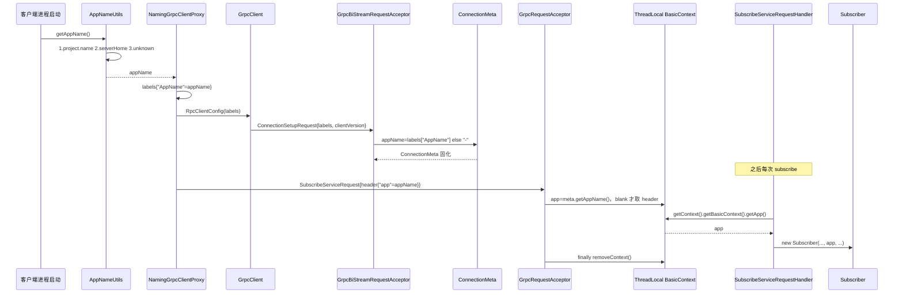

我来追这条 `app` 的来源链——先看服务端的 `RequestContextHolder` 与客户端 appName 的初始化。

`GrpcRequestAcceptor` 和 HTTP 过滤器各设一次。我读这两处与客户端 `AppNameUtils`。

链条已现。继续确认 labels 如何从客户端到服务端 `ConnectionMeta`，以及 HTTP 分支。

`ConnectionMeta` 有独立 `appName` 字段。追它是在哪里被填入的。

核心链路已通。再确认 `RequestContextHolder` 的生命周期与 `Subscriber.app` 的用途/是否参与 equals。

`Subscriber.equals` 包含 `app` —— 这点值得深挖。再确认 `project.name` 来源、header 备用路径与 `ClientAttributesFilter`。

最后确认 header 兜底的取值语义（空串时给不给 default）。

## 〇、一句话结论

`Subscriber.app` **不是订阅 API 的参数，也不在 `SubscribeServiceRequest` 的字段里**。它是客户端进程启动时由 `AppNameUtils` 静态推断出的一个名字，通过 **两条通道**（连接建立的 `labels`、每个请求的 `header`）之一送达服务端，被写进 `RequestContextHolder` 的**请求级 ThreadLocal**（`BasicContext.app`）；`SubscribeServiceRequestHandler.handle` 的第一行只是"从 ThreadLocal 里捞出来"而已。

```
project.name(系统属性/env/nacos-client.properties)
   │  或 /home/admin/${app}/ 目录约定
   ▼
AppNameUtils.getAppName()            ← 唯一真源，静态、进程级、全局共享
   ├─► labels{"AppName"=app} ─► ConnectionSetupRequest ─► ConnectionMeta.appName ─┐
   └─► header{"app"=app} ─────► 每个 AbstractNamingRequest ───────────────────────┤
                                                                                  ▼
                                            GrpcRequestAcceptor.prepareRequestContext()
                                                  requestContext.getBasicContext().setApp(app)
                                                                                  │
                             SubscribeServiceRequestHandler.handle() ◄── ThreadLocal ┘
                                                  new Subscriber(..., app, ...)
```

---

## 一、服务端取值点：为什么 handle 里那行代码看起来"凭空"冒出一个 app

### 1.1 `SubscribeServiceRequest` 里根本没有 app 字段

`api/.../request/SubscribeServiceRequest.java`（全文 56 行）只有两个自有字段：

```java
public class SubscribeServiceRequest extends AbstractNamingRequest {
    private boolean subscribe;
    private String clusters;
    public SubscribeServiceRequest(String namespace, String groupName, String serviceName, String clusters,
            boolean subscribe) { ... }
}
```

父类 `AbstractNamingRequest` 提供 `namespace / serviceName / groupName`。**整条订阅请求的业务负载里没有 app 的位置**——所以 `handle` 只能从别处拿。

### 1.2 `handle` 的取值方式（`SubscribeServiceRequestHandler.java` L71-80）

```java
public SubscribeServiceResponse handle(SubscribeServiceRequest request, RequestMeta meta) throws NacosException {
    String namespaceId = request.getNamespace();
    ...
    String app = RequestContextHolder.getContext().getBasicContext().getApp();   // ★ 上下文，不是 request，也不是 meta
    String groupedServiceName = NamingUtils.getGroupedName(serviceName, groupName);
    Service service = Service.newService(namespaceId, groupName, serviceName, true);
    Subscriber subscriber = new Subscriber(meta.getClientIp(), meta.getClientVersion(), app, meta.getClientIp(),
            namespaceId, groupedServiceName, 0, request.getClusters());
```

这里有三个层次的信息来源，值得对照记忆：

| Subscriber 字段 | 来源 | 层次 |
|---|---|---|
| `addrStr` / `ip` | `meta.getClientIp()` | 连接级（RequestMeta） |
| `agent` | `meta.getClientVersion()` | 连接级 |
| **`app`** | **`RequestContextHolder` ThreadLocal** | **请求级上下文** |
| `namespaceId` / `serviceName` | `request.getXxx()` | 请求级负载 |
| `cluster` | `request.getClusters()` | 请求级负载 |
| `port` | 硬编码 `0` | — |

**设计含义**：`RequestMeta` 是 handler 的入参、天然可得；app 却绕道 ThreadLocal，是因为 `RequestContextHolder` 是 2.2+ 为了给**横切关注点**（鉴权日志、trace、审计 `AccessLogger`）提供统一"谁在调我"的答案而设计的，`SubscribeServiceRequestHandler` 只是搭了这趟车。

### 1.3 `RequestContextHolder` 的三挡保险

`core/.../context/RequestContextHolder.java`（全文 43 行）：

```java
private static final Supplier<RequestContext> REQUEST_CONTEXT_FACTORY = () -> {
    long requestTimestamp = System.currentTimeMillis();
    return new RequestContext(requestTimestamp);
};
private static final ThreadLocal<RequestContext> CONTEXT_HOLDER = ThreadLocal.withInitial(REQUEST_CONTEXT_FACTORY);

public static RequestContext getContext() { return CONTEXT_HOLDER.get(); }
public static void removeContext() { CONTEXT_HOLDER.remove(); }
```

- **`withInitial`**：任何人任何时候调 `getContext()` 都不会 NPE，最差拿到一个全新 context；
- **`removeContext()` 在 `GrpcRequestAcceptor` 的 `finally` 里**（L221-223），保证 gRPC 工作线程复用时不串号——**这一点是 ThreadLocal 方案能否成立的前提**；
- `BasicContext` 构造时给了默认值：

```java
private static final String DEFAULT_APP = "unknown";
public BasicContext() {
    this.addressContext = new AddressContext();
    this.app = DEFAULT_APP;          // ★ 默认 unknown，不是 null
    this.encoding = Constants.ENCODE;
}
```

所以 `Subscriber.app` **理论最小值域是 `"unknown"`**，不会是 null——除非有人显式 set 了 null/空串（见后面坑 1）。

---

## 二、app 被写入 ThreadLocal 的两个入口

### 2.1 gRPC：连接级优先、请求级兜底（`GrpcRequestAcceptor.prepareRequestContext` L227-241）

```java
private void prepareRequestContext(Request request, RequestMeta requestMeta, Connection connection) {
    RequestContext requestContext = RequestContextHolder.getContext();
    requestContext.setRequestId(request.getRequestId());
    requestContext.getBasicContext().setUserAgent(requestMeta.getClientVersion());
    requestContext.getBasicContext().setRequestProtocol(BasicContext.GRPC_PROTOCOL);
    requestContext.getBasicContext().setRequestTarget(request.getClass().getSimpleName());
    String app = connection.getMetaInfo().getAppName();                    // ① 连接级
    if (StringUtils.isBlank(app)) {
        app = request.getHeader(HttpHeaderConsts.APP_FILED, "unknown");     // ② 请求级 header
    }
    requestContext.getBasicContext().setApp(app);
    ...
}
```

**判定顺序很关键**：`ConnectionMeta.appName`（建连时一次性确定，整条连接生命周期不变）优先；只有它空白才看单个请求的 header。这带来一个后果——**同一条连接上，header 里的 app 想"逐请求覆盖"连接级 app 是失败的**（除非连接级恰好为空）。

### 2.2 HTTP：只有 header 一条路（`HttpRequestContextFilter` L87-102）

```java
private void setOtherBasicContext(HttpServletRequest request, RequestContext requestContext) {
    String userAgent = WebUtils.getUserAgent(request);
    requestContext.getBasicContext().setUserAgent(userAgent);
    String app = getAppName(request);
    if (StringUtils.isNotBlank(app)) {            // ★ 空白不覆盖，保留默认 unknown
        requestContext.getBasicContext().setApp(app);
    }
}

private String getAppName(HttpServletRequest request) {
    String app = request.getHeader(HttpHeaderConsts.APP_FILED);       // "app"
    if (StringUtils.isBlank(app)) {
        app = request.getHeader(CLIENT_APPNAME_HEADER);               // "Client-AppName"
    }
    return app;
}
```

两个协议路径的差异一目了然：

| | gRPC | HTTP |
|---|---|---|
| 有无连接级 app | 有（`ConnectionMeta.appName`） | 无（无状态请求） |
| header 候选 key | `app`（1 个） | `app` → `Client-AppName`（2 个） |
| 空白处理 | `setApp(兜底值)`，兜底值必非空 | `isNotBlank` 才 set，否则留 `"unknown"` |
| `requestTarget` | `SubscribeServiceRequest` | `POST /v2/ns/instance` |

顺带一提，HTTP 的持久实例路径还有第三个消费口（`naming/web/ClientAttributesFilter.java` L132-147）：

```java
private ClientAttributes getClientAttributes() {
    String version = RequestContextHolder.getContext().getBasicContext().getUserAgent();
    String app = RequestContextHolder.getContext().getBasicContext().getApp();
    String clientIp = RequestContextHolder.getContext().getBasicContext().getAddressContext().getSourceIp();
    ClientAttributes clientAttributes = new ClientAttributes();
    ...
    if (app != null) {
        clientAttributes.addClientAttribute(HttpHeaderConsts.APP_FILED, app);
    }
```

即 HTTP 注册时 app 会**同时**进入 `IpPortBasedClient.clientAttributes`（这个字段会随 Raft 同步到集群）和 `Subscriber.app`（不会同步）——同一个值两条落地路径，一致性特征完全不同。

---

## 三、证据链已完整闭合。以下是分析。

---

# 〇、一句话结论

`Subscriber.app` **不是订阅 API 的参数，也不是 `SubscribeServiceRequest` 的字段**。它是客户端 JVM 在**进程启动时用 `AppNameUtils` 静态推断出的 appName**，通过「连接建立时的 labels」这一主通道（或「每个请求的 header」这一备通道）抵达服务端，被写进**请求级 ThreadLocal**（`RequestContextHolder` → `BasicContext.app`），`handle` 只是从这个 ThreadLocal 里把它取出来塞进 `Subscriber` 的第 3 个构造参数。

链路总长：

```
-Dproject.name / nacos-client.properties / catalina.base
   → AppNameUtils.getAppName()                       [客户端，静态一次]
   → labels{"AppName"=app} → ConnectionSetupRequest  [gRPC 连接建立]
   → ConnectionMeta.appName                          [服务端，连接级]
   → BasicContext.app                                [服务端，请求级 ThreadLocal]
   → Subscriber.app                                  [naming 存储，订阅级]
```

---

# 一、服务端最后三跳：从 ThreadLocal 取值

## 1.1 取值点

`/System/Volumes/Data/resource/github/nacos/naming/src/main/java/com/alibaba/nacos/naming/remote/rpc/handler/SubscribeServiceRequestHandler.java` L75：

```java
String app = RequestContextHolder.getContext().getBasicContext().getApp();
```

**注意这一行没有读 `request`** —— 我核对了 `SubscribeServiceRequest` 全文（56 行），它的业务字段只有两个：

```java
public class SubscribeServiceRequest extends AbstractNamingRequest {
    private boolean subscribe;
    private String clusters;      // 无 app 字段
}
```

也就是说 app 在协议层是「带外信息」（out-of-band），走的是上下文传递而非请求体传递。

## 1.2 装入 Subscriber 的位置

L78-L79：

```java
Subscriber subscriber = new Subscriber(meta.getClientIp(), meta.getClientVersion(), app, meta.getClientIp(),
        namespaceId, groupedServiceName, 0, request.getClusters());
```

把 `Subscriber` 的 8 个字段来源摊开看，**`app` 是三个「非请求体」字段之一**：

| Subscriber 字段 | 来源 | 类别 |
|---|---|---|
| `addrStr` | `meta.getClientIp()` | 连接元信息 |
| `agent` | `meta.getClientVersion()` ← setup 的 `getClientVersion()` | 连接元信息 |
| **`app`** | **`BasicContext.getApp()` ← 连接 labels / 请求 header** | **连接元信息（带外）** |
| `ip` | `meta.getClientIp()`（与 addrStr 同值） | 连接元信息 |
| `port` | 字面量 `0` | 恒为 0，无用 |
| `namespaceId` | 由 service 拆出 | 请求体 |
| `serviceName` | `NamingUtils.getGroupedName(serviceName, groupName)` | 请求体 |
| `cluster` | `request.getClusters()` | 请求体 |

## 1.3 ThreadLocal 的默认值与生命周期

`/System/Volumes/Data/resource/github/nacos/core/src/main/java/com/alibaba/nacos/core/context/addition/BasicContext.java` L28、L65-L69：

```java
private static final String DEFAULT_APP = "unknown";

public BasicContext() {
    this.addressContext = new AddressContext();
    this.app = DEFAULT_APP;          // ★ 构造即赋 unknown，不是 null
    this.encoding = Constants.ENCODE;
}
```

字段注释（L55-L58）本身就写明了语义：

> Optional, mark the app name of the request **from when client set app name**, default `unknown`.

`/System/Volumes/Data/resource/github/nacos/core/src/main/java/com/alibaba/nacos/core/context/RequestContextHolder.java` L33-L41：

```java
private static final ThreadLocal<RequestContext> CONTEXT_HOLDER = ThreadLocal.withInitial(REQUEST_CONTEXT_FACTORY);

public static RequestContext getContext() { return CONTEXT_HOLDER.get(); }
public static void removeContext() { CONTEXT_HOLDER.remove(); }
```

gRPC 工作线程是复用的，所以 `GrpcRequestAcceptor` 在 `finally` 里必须清（L221-L223）：

```java
} finally {
    RequestContextHolder.removeContext();
}
```

这保证了「A 请求的 app 不会串到 B 请求」。这是 app 虽然源自连接级、但仍按请求级隔离的原因。

---

# 二、写入 ThreadLocal 的两个入口

## 2.1 gRPC 主路径（订阅走这条）

`/System/Volumes/Data/resource/github/nacos/core/src/main/java/com/alibaba/nacos/core/remote/grpc/GrpcRequestAcceptor.java` L227-L241：

```java
private void prepareRequestContext(Request request, RequestMeta requestMeta, Connection connection) {
    RequestContext requestContext = RequestContextHolder.getContext();
    requestContext.setRequestId(request.getRequestId());
    requestContext.getBasicContext().setUserAgent(requestMeta.getClientVersion());
    requestContext.getBasicContext().setRequestProtocol(BasicContext.GRPC_PROTOCOL);
    requestContext.getBasicContext().setRequestTarget(request.getClass().getSimpleName());
    String app = connection.getMetaInfo().getAppName();                      // ① 连接级
    if (StringUtils.isBlank(app)) {
        app = request.getHeader(HttpHeaderConsts.APP_FILED, "unknown");       // ② 请求级 header
    }
    requestContext.getBasicContext().setApp(app);
    ...
}
```

**优先级明确：连接级 > 请求级 header。** 且 ① 只要非 blank 就直接采用，不再看 ②。

## 2.2 HTTP 路径（1.x SDK、curl 运维调用）

`/System/Volumes/Data/resource/github/nacos/core/src/main/java/com/alibaba/nacos/core/context/remote/HttpRequestContextFilter.java` L87-L102：

```java
private void setOtherBasicContext(HttpServletRequest request, RequestContext requestContext) {
    String userAgent = WebUtils.getUserAgent(request);
    requestContext.getBasicContext().setUserAgent(userAgent);
    String app = getAppName(request);
    if (StringUtils.isNotBlank(app)) {              // ★ 非空才覆盖，否则保留默认 unknown
        requestContext.getBasicContext().setApp(app);
    }
}

private String getAppName(HttpServletRequest request) {
    String app = request.getHeader(HttpHeaderConsts.APP_FILED);       // "app"
    if (StringUtils.isBlank(app)) {
        app = request.getHeader(CLIENT_APPNAME_HEADER);               // "Client-AppName"
    }
    return app;
}
```

HTTP 没有长连接概念，每个请求独立，所以**只能靠 header**，两级 header key 依次尝试。

## 2.3 naming 侧的第二处消费：ClientAttributes

`/System/Volumes/Data/resource/github/nacos/naming/src/main/java/com/alibaba/nacos/naming/web/ClientAttributesFilter.java` L132-L147：

```java
private ClientAttributes getClientAttributes() {
    String version = RequestContextHolder.getContext().getBasicContext().getUserAgent();
    String app = RequestContextHolder.getContext().getBasicContext().getApp();
    String clientIp = RequestContextHolder.getContext().getBasicContext().getAddressContext().getSourceIp();
    ClientAttributes clientAttributes = new ClientAttributes();
    if (version != null) { clientAttributes.addClientAttribute(HttpHeaderConsts.CLIENT_VERSION_HEADER, version); }
    if (app != null) { clientAttributes.addClientAttribute(HttpHeaderConsts.APP_FILED, app); }
    if (clientIp != null) { clientAttributes.addClientAttribute(HttpHeaderConsts.CLIENT_IP, clientIp); }
    return clientAttributes;
}
```

同一个 app 值在 HTTP 持久实例路径下会**再落到 `IpPortBasedClient.clientAttributes`**（这个字段是走 Raft 同步的），与 `Subscriber.app` 是两份独立副本。

---

# 三、连接级 appName 的诞生（gRPC 主路径的源头）

## 3.1 服务端：从 setup 请求的 labels 提取

`/System/Volumes/Data/resource/github/nacos/core/src/main/java/com/alibaba/nacos/core/remote/grpc/GrpcBiStreamRequestAcceptor.java` L107-L117：

```java
if (parseObj instanceof ConnectionSetupRequest) {
    ConnectionSetupRequest setUpRequest = (ConnectionSetupRequest) parseObj;
    Map<String, String> labels = setUpRequest.getLabels();
    String appName = "-";                                  // ★ 兜底是 "-"，不是 "unknown"
    if (labels != null && labels.containsKey(Constants.APPNAME)) {
        appName = labels.get(Constants.APPNAME);
    }
    ConnectionMeta metaInfo = new ConnectionMeta(connectionId, payload.getMetadata().getClientIp(),
            remoteIp, remotePort, localPort, ConnectionType.GRPC.getType(),
            setUpRequest.getClientVersion(), appName, setUpRequest.getLabels());
```

`ConnectionMeta` 有**独立的 `appName` 字段**（L328-L334 是纯字段 getter，不是从 labels 现取），构造时一次性固化。

⚠️ 这里的 key 是 `Constants.APPNAME = "AppName"`（`api/.../common/Constants.java` L34），而 header 用的是 `HttpHeaderConsts.APP_FILED = "app"`（L37）—— **两个不同的 key 名**。

## 3.2 客户端：发送 setup

`/System/Volumes/Data/resource/github/nacos/common/src/main/java/com/alibaba/nacos/common/remote/client/grpc/GrpcClient.java` L387-L395：

```java
//send a  setup request.
ConnectionSetupRequest conSetupRequest = new ConnectionSetupRequest();
conSetupRequest.setClientVersion(getClientVersion());
conSetupRequest.setLabels(super.getLabels());
conSetupRequest.setAbilityTable(...);
conSetupRequest.setTenant(super.getTenant());
grpcConn.sendRequest(conSetupRequest);
```

## 3.3 labels 的构造 —— app 真正的注入点

`/System/Volumes/Data/resource/github/nacos/client/src/main/java/com/alibaba/nacos/client/naming/remote/gprc/NamingGrpcClientProxy.java` L103-L109：

```java
Map<String, String> labels = new HashMap<>();
labels.put(RemoteConstants.LABEL_SOURCE, RemoteConstants.LABEL_SOURCE_SDK);
labels.put(RemoteConstants.LABEL_MODULE, RemoteConstants.LABEL_MODULE_NAMING);
labels.put(Constants.APPNAME, AppNameUtils.getAppName());        // ★★★ 唯一定义处
GrpcClientConfig grpcClientConfig = RpcClientConfigFactory.getInstance()
        .createGrpcClientConfig(properties.asProperties(), labels);
this.rpcClient = RpcClientFactory.createClient(uuid, ConnectionType.GRPC, grpcClientConfig);
```

关键点：这段在 **`NamingGrpcClientProxy` 的构造函数**里，一个 proxy 一个 `RpcClient` 一个 labels Map。它**不随 subscribe 调用变化**，也无法被 `subscribe()` 的参数覆盖。

---

# 四、请求级 header 的来源（兜底通道）

`NamingGrpcClientProxy.requestToServer` L443-L449：

```java
private <T extends Response> T requestToServer(AbstractNamingRequest request, Class<T> responseClass) throws NacosException {
    Response response = null;
    try {
        request.putAllHeader(
                getSecurityHeaders(request.getNamespace(), request.getGroupName(), request.getServiceName()));
        response = requestTimeout < 0 ? rpcClient.request(request) : rpcClient.request(request, requestTimeout);
```

`/System/Volumes/Data/resource/github/nacos/client/src/main/java/com/alibaba/nacos/client/naming/remote/AbstractNamingClientProxy.java` L36、L44-L56：

```java
private static final String APP_FILED = "app";

protected Map<String, String> getSecurityHeaders(String namespace, String group, String serviceName) {
    RequestResource resource = RequestResource.namingBuilder().setNamespace(namespace).setGroup(group)
            .setResource(serviceName).build();
    Map<String, String> result = this.securityProxy.getIdentityContext(resource);
    result.putAll(getAppHeaders());            // 身份 + app
    return result;
}

protected Map<String, String> getAppHeaders() {
    Map<String, String> result = new HashMap<>(1);
    result.put(APP_FILED, AppNameUtils.getAppName());     // 同一个函数
    return result;
}
```

**结论：labels 与 header 里的 app 是同一个 `AppNameUtils.getAppName()` 的两次调用，值必然相同。** 所以二级兜底在正常 SDK 场景下几乎不会生效，它真正的受众是：1.x 老客户端、非 SDK 自建的 gRPC 连接、代理/网关转发了请求但没有完整透传 setup labels 的情形。

header 容器大小写不敏感，`api/.../remote/request/Request.java` L31：

```java
private final Map<String, String> headers = new TreeMap<>(String.CASE_INSENSITIVE_ORDER);
```

而 default 只在 **null** 时生效，L74-L77：

```java
public String getHeader(String key, String defaultValue) {
    String value = headers.get(key);
    return (value == null) ? defaultValue : value;      // 空串 "" 原样返回！
}
```

---

# 五、最上游：`AppNameUtils` 的三级推断

`/System/Volumes/Data/resource/github/nacos/client/src/main/java/com/alibaba/nacos/client/utils/AppNameUtils.java` L50-L85：

```java
private static final String DEFAULT_APP_NAME = "unknown";

public static String getAppName() {
    String appName;
    appName = getAppNameByProjectName();
    if (appName != null) { return appName; }        // ① 显式配置
    appName = getAppNameByServerHome();
    if (appName != null) { return appName; }        // ② 容器目录推断
    return DEFAULT_APP_NAME;                        // ③ "unknown"
}

private static String getAppNameByProjectName() {
    return NacosClientProperties.PROTOTYPE.getProperty(Constants.SysEnv.PROJECT_NAME);   // "project.name"
}

private static String getAppNameByServerHome() {
    String serverHome = null;
    if (SERVER_JBOSS.equals(getServerType()))      { serverHome = ...getProperty(PARAM_MARKING_JBOSS); }      // jboss.server.home.dir
    else if (SERVER_JETTY.equals(getServerType()))  { serverHome = ...getProperty(PARAM_MARKING_JETTY); }       // jetty.home
    else if (SERVER_TOMCAT.equals(getServerType())) { serverHome = ...getProperty(PARAM_MARKING_TOMCAT); }      // catalina.base
    if (serverHome != null && serverHome.startsWith(LINUX_ADMIN_HOME)) {          // "/home/admin/"
        return StringUtils.substringBetween(serverHome, LINUX_ADMIN_HOME, File.separator);
    }
    return null;
}
```

## 5.1 三种设置方式与搜索顺序

`Constants.SysEnv.PROJECT_NAME = "project.name"`（client/constant/Constants.java L32），通过 `NacosClientProperties.PROTOTYPE` 读取。其搜索顺序见 `SearchableProperties.init()` L63-L68：

```java
List<SourceType> initOrder = Arrays.asList(SourceType.PROPERTIES, SourceType.JVM, SourceType.ENV);
String firstEnv = JVM_ARGS_PROPERTY_SOURCE.getProperty(Constants.SysEnv.NACOS_ENV_FIRST);
if (StringUtils.isBlank(firstEnv)) { firstEnv = SYSTEM_ENV_PROPERTY_SOURCE.getProperty(Constants.SysEnv.NACOS_ENV_FIRST); }
```

| 方式 | 写法 | 说明 |
|---|---|---|
| 配置文件 | `nacos-client.properties` 里 `project.name=order-app` | 默认最高优先级（PROPERTIES 首位） |
| JVM 参数 | `-Dproject.name=order-app` | 需 `-Dnacos.env.first=JVM` 才优先于配置文件 |
| 环境变量 | `nacos.env.first=ENV` + `PROJECT_NAME` | 同上 |

## 5.2 ②级推断的实际适用范围

`getAppNameByServerHome()` 要求容器 home 路径**以 `/home/admin/` 开头**，取中间的目录名。这是阿里系部署约定（`/home/admin/{appName}/...`）。外部用户用独立 Tomcat（`catalina.base=/usr/local/tomcat`）、Spring Boot fat jar、Docker 部署时**这一级永远返回 null**，直接落到 `"unknown"`。

## 5.3 静态 + 全局 = 进程级单值

`getAppName()` 是**无参静态方法**，读的是全局 `PROTOTYPE`。因此：

- 同一个 JVM 里所有 `NacosNamingService` 实例、所有连接、config 与 naming 模块，**共享同一个 appName**；
- 一旦 JVM 启动，`project.name` 改了也不会生效（`SEARCH_ORDER` 是 `static final`，但每次 `getProperty` 会实读，所以系统属性运行期改动理论上可见，但 labels 已固化在连接上，不会重发）。

---

# 六、app 落地之后：存在哪、谁消费、影响什么

## 6.1 存储位置

`Subscriber` 被放进 `AbstractClient.subscribers: ConcurrentHashMap<Service, Subscriber>`（容器参数 `(16, 0.75f, 1)`）。即 **每订阅一个 Service，就存一份完整 Subscriber 对象，app 冗余 N 份**。

## 6.2 不参与集群同步

前序已确认：`ClientSyncData` 只有 `clientId / attributes / namespaces / groupNames / serviceNames / instancePublishInfos / batchInstanceData`，**没有 subscribers**。因此：

- 订阅关系（连带 app）**只存在于连接所在节点**；
- 远端节点上那个 `ConnectionBasedClient` 的 `subscribers` 是空的 —— 这也正好解释了 `PushExecuteTask.run` 里的 `if (subscriber == null) { continue; }`；
- 运维 API 查订阅者 app 必须打到连接所在的那台节点。

## 6.3 唯一消费点：运维可观测

`/System/Volumes/Data/resource/github/nacos/naming/src/main/java/com/alibaba/nacos/naming/controllers/v2/ClientInfoControllerV2.java` L184-L196：

```java
for (Service service : allSubscribeService) {
    ObjectNode item = JacksonUtils.createEmptyJsonNode();
    item.put("namespace", service.getNamespace());
    ...
    Subscriber subscriber = client.getSubscriber(service);
    ObjectNode subscriberInfo = JacksonUtils.createEmptyJsonNode();
    subscriberInfo.put("app", subscriber.getApp());
    subscriberInfo.put("agent", subscriber.getAgent());
    subscriberInfo.put("addr", subscriber.getAddrStr());
    item.set("subscriberInfo", subscriberInfo);
```

对应 `GET /v2/ns/client/subscribe/list?clientId=xxx`，也就是控制台「订阅者」页签的数据来源。

**推送链路完全不读 app**：`PushExecuteTask` 只用 `client.getSubscriber(service)` 拿到对象后交给 `PushExecutorRpcImpl`，其中生效的字段是 `subscriber.getIp()`（用于 `ServiceUtil` 的自身摘除）和 `getCluster()`（用于集群过滤）。

## 6.4 app 参与 equals/hashCode

`/System/Volumes/Data/resource/github/nacos/naming/src/main/java/com/alibaba/nacos/naming/pojo/Subscriber.java` L133-L150：

```java
return Objects.equals(addrStr, that.addrStr) && Objects.equals(agent, that.agent) && Objects
        .equals(app, that.app) && Objects.equals(ip, that.ip) && Objects.equals(namespaceId, that.namespaceId)
        && Objects.equals(serviceName, that.serviceName);

@Override
public int hashCode() {
    return Objects.hash(addrStr, agent, app, ip, namespaceId, serviceName);
}
```

注意 `port` 和 `cluster` **不在 equals 中**，而 `app` 在。设计上这是把 Subscriber 当作「订阅者身份」而非「订阅配置」—— 但因为它存进的是 `Map<Service, Subscriber>`（key 是 Service），equals 实际不影响覆盖语义，只影响集合对比与测试断言。

---

# 七、全景时序图



---

# 八、关键点清单

| # | 关键点 | 证据位置 |
|---|---|---|
| 1 | app 是**带外信息**：不在 subscribe API、不在 `SubscribeServiceRequest` 字段 | `SubscribeServiceRequest.java` L26-L28；`NacosNamingService` 全文无 app |
| 2 | 服务端从 **ThreadLocal** 取，不从 request 取 | `SubscribeServiceRequestHandler.java` L75 |
| 3 | gRPC 优先级：**连接级 labels > 请求级 header** | `GrpcRequestAcceptor.java` L233-L236 |
| 4 | 连接级 appName 在 setup 时一次性固化进 `ConnectionMeta` | `GrpcBiStreamRequestAcceptor.java` L110-L117 |
| 5 | labels 的 key 是 `"AppName"`，header 的 key 是 `"app"`，HTTP 兜底 `"Client-AppName"` —— **三个不同名字** | `Constants.java` L34；`HttpHeaderConsts.java` L37；`Constants.java` L165 |
| 6 | labels 与 header 的值来自**同一函数两次调用**，正常场景必相同 → 兜底几乎不触发 | `NamingGrpcClientProxy.java` L106 与 `AbstractNamingClientProxy.java` L54 |
| 7 | 真源 `AppNameUtils` 三级：`project.name` → 容器 `/home/admin/{app}/` → `"unknown"` | `AppNameUtils.java` L50-L85 |
| 8 | 配置途径三种（properties / -D / env），默认顺序 `PROPERTIES→JVM→ENV`，由 `nacos.env.first` 调整 | `SearchableProperties.java` L63-L68 |
| 9 | 静态全局单值：同 JVM 内所有客户端实例共享一个 appName | `AppNameUtils.getAppName()` 无参静态 |
| 10 | `BasicContext` 默认 `"unknown"`（不是 null），且 gRPC finally 必清 ThreadLocal | `BasicContext.java` L28/L67；`GrpcRequestAcceptor.java` L222 |
| 11 | `Subscriber` 的 `app` **不参与 Distro/Raft 同步**（`ClientSyncData` 无 subscribers） | 前序结论 |
| 12 | `app` **不参与推送过滤**，仅可观测；唯一消费点是运维 API | `ClientInfoControllerV2.java` L191 |
| 13 | `app` 参与 `equals/hashCode`，而 `port`/`cluster` 不参与 | `Subscriber.java` L142-L149 |
| 14 | HTTP 路径下 app 还会二次落到 `ClientAttributes`（这份**会**同步） | `ClientAttributesFilter.java` L140-L141 |
| 15 | `header` map 大小写不敏感（`CASE_INSENSITIVE_ORDER`） | `Request.java` L31 |

---

# 九、五个坑

### 坑 1：`appName = "-"` 会短路 header 兜底

`GrpcBiStreamRequestAcceptor` L110 的兜底值是 `"-"`。若客户端 labels 为 null 或不含 `"AppName"`（非标准 SDK、集群间连接、自建 gRPC 客户端），则 `ConnectionMeta.appName = "-"`。而 `"-"` **不是 blank**，于是 `GrpcRequestAcceptor` L234 的 `isBlank` 判断为 false，**header 里真实的 app 被忽略**，`Subscriber.app` 永远显示 `-`。

排查特征：控制台订阅列表 app 列一片 `-`，但 header 明明带了正确值。

### 坑 2：`-Dproject.name=`（空值）一路穿透成 `""`

`getAppNameByProjectName()` 没有 `isBlank` 检查，只判 `!= null`：

```java
appName = getAppNameByProjectName();
if (appName != null) { return appName; }     // "" 也会 return！后两级不走
```

空串进入 labels（`containsKey` 为 true）→ `ConnectionMeta.appName = ""` → 这次 `isBlank` 为 true → 走 header，header 里也是 `""`；而 `getHeader(key, "unknown")` 只在 **null** 时兜底，空串原样返回 → **`Subscriber.app = ""`**。

同样地，`BasicContext.DEFAULT_APP = "unknown"` 也救不了你 —— 因为 gRPC 路径是**无条件 set**（L237），把 unknown 覆盖成了空串。

### 坑 3：容器/云原生部署下 app 恒为 `unknown`

第二级推断硬编码 `/home/admin/` 前缀。Docker/K8s 里 `catalina.base=/usr/local/tomcat`、Spring Boot fat jar 无 `catalina.base` → 全部落 `"unknown"`。**运维上依赖 app 维度定位订阅方时会失去区分度**，必须显式配 `project.name`。

### 坑 4：跨节点查不到 app

订阅关系（含 app）不同步。`GET /v2/ns/client/subscribe/list` 必须用 `clientId` 且打到**连接所在节点**；从别节点查同一 clientId 只会拿到空的 subscribers，甚至 client 都不存在。

### 坑 5：无法按订阅粒度指定 app

`subscribe(serviceName, groupName, clusters, listener)` 四个参数没有 app 的位置，`Instance` 类也没有 `appName` 字段（grep 无匹配）。想让不同订阅带不同 app，只能给每个订阅建独立 `NacosNamingService` + 独立 classloader/JVM。常规做法是**在 `Instance.metadata` 或 serviceName 命名上带业务标识**，而不是靠 app。

---

# 总结

`Subscriber.app` 的来源可以压缩成三句话：

**第一，它在协议层是「带外」的。** `subscribe()` API 不接收它，`SubscribeServiceRequest` 也不携带它。服务端 `SubscribeServiceRequestHandler` 第 75 行那一句 `RequestContextHolder.getContext().getBasicContext().getApp()`，取的是一个 **ThreadLocal**，而这个 ThreadLocal 是在更外层的 `GrpcRequestAcceptor.prepareRequestContext` 里被预填充的。这个设计让所有 `RequestHandler` 都能零成本拿到调用方应用名，而不需要每个请求类型都新增一个 `app` 字段。

**第二，它的真源在客户端进程启动时，且只有一个。** `AppNameUtils.getAppName()` 按 `project.name` 属性 → 容器 `/home/admin/{app}/` 目录约定 → 字面量 `"unknown"` 三级降级，结果被塞进 gRPC 连接的 `labels{"AppName"=...}`，在 `ConnectionSetupRequest` 中被送到服务端并固化进 `ConnectionMeta.appName`。请求 header 里的 `"app"` 是同一次推断的第二次调用，仅作兜底 —— 而由于兜底值 `"-"` 不是空白串，这条兜底路径在现实中经常被短路。

**第三，它纯粹服务于可观测性，不参与任何决策。** app 落到 `AbstractClient.subscribers` 里（每个 Service 一份冗余副本），唯一读取处是 `ClientInfoControllerV2` 的订阅列表接口，供控制台展示「谁订阅了这个服务」；它不进 Distro 同步（所以换节点就查不到）、不进推送过滤（推送只看 `cluster` 和 `ip`）、也不进 TPS 限流和鉴权维度。

因此，把 `Subscriber.app` 理解成 **"连接级身份的显示名标签"** 最贴切：`clientId` 决定服务端如何处理这个订阅（生命周期、索引、推送目标），而 `app` 只是给运维人员看的一行注释。也正因如此，它值得配、应该配（`-Dproject.name` 或 `nacos-client.properties`），但配错或配成 `unknown` 不会影响任何功能 —— 这是它与 config 模块 header 里 `Client-AppName` 用于灰度和审计的最大差异。